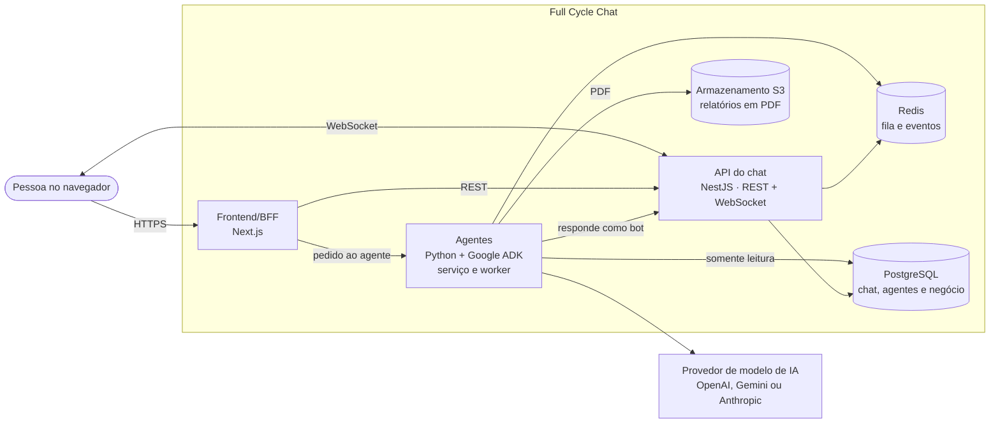

# 💬 Agentic Slack — Full Cycle Chat


> **Um chat de equipe no estilo Slack com suporte a agentes de IA integrados como plugins**, capazes de resumir conversas, delegar tarefas e consultar dados de negócio diretamente do banco de dados em tempo real.

---

## 📌 Sumário

- [Sobre o Projeto](#-sobre-o-projeto)
- [Arquitetura e Stack Tecnológica](#-arquitetura-stack-tecnológica)
- [Estrutura do Monorepo](#-estrutura-do-monorepo)
- [Como Executar](#-como-executar)
- [Como este projeto foi construído com ia](#-como-este-projeto-foi-construído-com-ia)
- [Onde ler o quê](#-onde-ler-o-quê)
- [UI/UX e Prototipagem](#-uiux--prototipagem)
- [Licença](#-licença)

---

## 🚀 Sobre o Projeto

O **Agentic Slack** é uma aplicação full-stack desenvolvida durante a Imersão IA da Full Cycle. O produto é especificado por inteiro em documentos antes da escrita do código (*Spec-Driven Development / Harness Engineering*).

### ✨ O que o produto promete

* 💬 **IA Integrada na Conversa**: Mencione o agente (`@assistente`) em qualquer canal ou conversa direta; o pedido e a resposta ficam ali mesmo, sem trocar de ferramenta.
* ✅ **Execução de Ações & Delegação**: A delegação vira uma tarefa de verdade, com responsável e notificação, e o relatório de dados chega como PDF para baixar.
* 🔐 **Dados de Negócio com Permissão**: O agente só consulta dados quando quem pediu tem acesso, e nunca altera os dados da empresa.
* 🎯 **Sem Inventar Fatos**: Todo número precisa estar no resultado de uma consulta. Quando não consegue responder, o agente informa que não foi possível.
* 🔌 **Arquitetura Plugin-first**: Um administrador conecta e desconecta cada agente do workspace.

**Os detalhes de escopo, público e métricas estão no [product brief](docs/product-brief.md).**

---

## 🏗️ Arquitetura & Stack Tecnológica

Um monorepo com três aplicações principais: o frontend/BFF em **Next.js**, a API do chat em **NestJS** (REST + WebSocket) e os agentes em **Python** com **Google ADK**. A ideia central é o chat não depender dos agentes.



O diagrama completo, os fluxos e as decisões estão no [HLD](docs/hld.md).

### 🛠️ Tecnologias Utilizadas (por camada)

| Camada                         | Tecnologias                                                      |
| :----------------------------- | :--------------------------------------------------------------- |
| **Front-end**            | Next.js, React, Tailwind CSS, Figma (Design)                     |
| **Back-end**             | NestJS, TypeScript, WebSocket, PostgreSQL, Redis, S3 / SeaweedFS |
| **Agentes de IA**        | Python 3.12, Google ADK (Agent Development Kit), Claude API      |
| **Ferramentas & DevOps** | Docker, Docker Compose, Playwright, Antigravity IDE, Claude Code |

---

## 📁 Estrutura do Monorepo

```text
.
├── .claude/              # Regras, context window e skills para assistentes de código
├── apps/
│   ├── web/              # Frontend & BFF em Next.js
│   └── chat-api/         # API principal de comunicação e WebSocket em NestJS
├── docs/
│   ├── product-brief.md  # Visão geral de escopo e produto
│   ├── hld.md            # High-Level Design (Arquitetura)
│   ├── lld.md            # Low-Level Design (Modelagem e Rotas)
│   ├── adr/              # Architecture Decision Records
│   └── class01.md        # Documentação detalhada da Aula 01
├── docker/               # Scripts de inicialização do banco de dados e serviços
├── compose.yaml          # Orquestração do ambiente completo via Docker Compose
└── AGENTS.md             # Guia de comandos e padrões para desenvolvedores e IAs
```

---

## ▶️ Como Executar

**Pré-requisito:** Docker com Docker Compose. Tudo roda dentro dos contêineres, então você não precisa de Node.js nem pnpm instalados na máquina host.

### 1. Clonar e Inicializar o Ambiente

```bash
git clone https://github.com/alexandrecpedro/agentic-slack-ai.git
cd agentic-slack-ai

# Sobe os contêineres e espera o Postgres e o S3 ficarem prontos
docker compose -f compose.yaml up -d --build --wait
```

### 2. Acompanhar e Rodar as Aplicações

Na primeira subida, a instalação das dependências continua dentro dos contêineres por alguns minutos. Acompanhe com:

```bash
docker compose -f compose.yaml logs -f web chat-api
```

Quando terminar, rode a web e a API (cada uma num terminal):

```bash
# Terminal 1 - Frontend Web (Next.js)
docker compose -f compose.yaml exec web pnpm dev --hostname 0.0.0.0

# Terminal 2 - API do Chat (NestJS)
docker compose -f compose.yaml exec chat-api pnpm start:dev
```

### 📌 Mapeamento de Serviços & Portas

| Serviço                       | Endereço                 |
| :----------------------------- | :------------------------ |
| **Web (Next.js)**        | `http://localhost:3000` |
| **API do Chat (NestJS)** | `http://localhost:3001` |
| **PostgreSQL**           | `localhost:5432`        |
| **S3 (SeaweedFS)**       | `http://localhost:8333` |

*Para derrubar os contêineres:* `docker compose -f compose.yaml down`.

---

## 🤖 Como este projeto foi construído com IA

Este repositório não começou pelo código. Antes de qualquer linha, o produto e a arquitetura foram escritos em documentos, com a IA conduzindo entrevistas e registrando as decisões. Depois, esses documentos viraram o contexto que guia os agentes de código.

1. **Product brief por entrevista**: A skill `product-brief` entrevista a pessoa, seção por seção, e grava o `docs/product-brief.md`: o quê, para quem, o que fica fora do MVP.
2. **HLD**: A skill `hld` transforma o brief na arquitetura de alto nível (`docs/hld.md`): contêineres, fluxos, requisitos de qualidade.
3. **LLD e ADRs**: A skill `lld` desce aos detalhes (`docs/lld.md`): rotas, tabelas, regras. Cada decisão importante vira um ADR em `docs/adr/`.
4. **`AGENTS.md` e rules**: Os comandos, a forma de rodar no Docker e as práticas de código de cada aplicação ficam em arquivos de memória que o agente lê antes de trabalhar.
5. **Código**: Só então o agente escreve código, com as skills de boas práticas da stack carregadas.

### 🛠️ Skills Utilizadas

Skills utilizadas no projeto (ficam em `.claude/skills/`):

| Skill                                           | Para quê                               | Origem                       |
| :---------------------------------------------- | :-------------------------------------- | :--------------------------- |
| `product-brief`                               | Entrevista e grava o product brief      | Própria do projeto          |
| `hld`                                         | Cria, revisa e atualiza o HLD           | Própria do projeto          |
| `lld`                                         | Cria, revisa e atualiza o LLD           | Própria do projeto          |
| `domain-modeling`                             | Glossário do domínio e ADRs           | mattpocock/skills            |
| `grill-me`, `grilling`, `grill-with-docs` | Entrevistas para testar ideias e planos | mattpocock/skills            |
| `nestjs-best-practices`                       | Boas práticas de NestJS                | kadajett/agent-nestjs-skills |
| `next-best-practices`                         | Boas práticas de Next.js               | vercel-labs/openreview       |
| `vercel-react-best-practices`                 | Performance em React e Next.js          | vercel-labs/agent-skills     |

---

## 📚 Onde ler o quê

| Documento                                         | O que tem                                                                 |
| ------------------------------------------------- | ------------------------------------------------------------------------- |
| [`docs/product-brief.md`](docs/product-brief.md) | O quê e para quem: escopo do MVP, o que fica fora, métricas             |
| [`docs/hld.md`](docs/hld.md)                     | Arquitetura de alto nível: contêineres, fluxos, requisitos              |
| [`docs/lld.md`](docs/lld.md)                     | Detalhes de implementação: rotas, tabelas, regras                       |
| [`docs/adr/`](docs/adr/)                         | As decisões de arquitetura, uma por arquivo                              |
| [`docs/roadmap.md`](docs/roadmap.md)             | As funcionalidades a desenvolver, as dependências e o status de cada uma |
| [`GLOSSARY.md`](GLOSSARY.md)                     | O vocabulário do domínio                                                |
| [`AGENTS.md`](AGENTS.md)                         | Como rodar o projeto e as convenções para agentes de código            |

---

## 🎨 UI/UX e Prototipagem

O design das telas e protótipos interativos do Slack estão disponíveis no [Figma](https://www.figma.com/design/plW17JDOoRHydUJIIi2u87/slack?node-id=0-1&p=f&t=4cpR434jZTW9jYQl-0).

---

## 📄 Licença

Este projeto é um software livre distribuído sob a licença **MIT**. Veja o arquivo [LICENSE](LICENSE)
