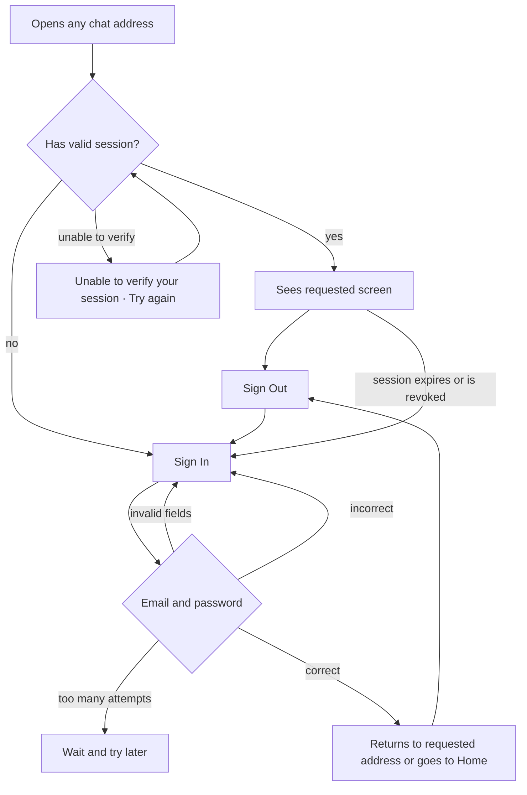

# PRD · F01 · Login and Session

2026-11-09 · Luiz Carlos · Status: approved

## 1. Executive Summary

* **Problem:** Without identifying who is using the system, the chat does not know whose message is whose, who can view a private channel, or who has data permissions. Currently, there is no way to log into the product.
* **Proposed Solution:** The user logs in using the email and password created for them by the company, remains logged in across all browser tabs for up to 30 days of inactivity, and logs out whenever they choose.
* **Success Criteria:** This feature does not independently move any metrics in the product brief (section "Objectives and Success Metrics"). It is a prerequisite for all of them, because every request to an agent and every task begins with a logged-in user. It fulfills the non-functional "Session" requirement from the brief: no credentials accessible to the browser, revocable session, and valid for the entire browser.

## 2. User Experience and Operation

### Personas

* **Workspace User:** Has an account created by the company via script outside of the product (brief, "Out of scope"). Uses the chat in the work computer browser almost every day.
* **Administrator:** Logs in the same way. F01 does not bring anything exclusive to administrators.

### Flow

### User Stories

1. As a workspace user, I want to sign in with my email and password so that I can use the chat with my identity.
2. As a workspace user, I want to know what I filled out incorrectly during sign-in so I can correct it and log in.
3. As a workspace user, I want to stay logged in across all tabs and after closing the browser so I don't have to sign in again with every use.
4. As a workspace user, I want to land on the conversation I opened via a link after signing in so I don't have to search for it again.
5. As a workspace user, I want to sign out of the chat so no one else uses my account in that browser.
6. As a workspace user, I want to be taken to the sign-in screen when my session ends so I understand why I can no longer use the chat.
7. As a workspace user, I want a connection failure not to disconnect me so I don't have to sign in again due to a network drop.

### Acceptance Criteria

**Story 1, Sign In**

* The "Sign In" screen has Email and Password fields and a "Sign In" button, as shown in the Figma Login section of the project, across default, validation error, submitting, and server error states.
* With the email and password of an existing account, the user signs into the chat.
* The email is accepted case-insensitively and with trailing/leading spaces stripped.
* While submission is in progress, the button indicates it is submitting and does not accept a second submission.
* The entire flow works by keyboard alone: Tab navigates through fields and the button, and Enter submits.
* The screen follows the project's design system and achieves a score of 100 on Lighthouse Accessibility.

**Story 2, Sign-In Errors**

* Empty or improperly formatted email displays "Enter a valid email, such as name@company.com" below the field. An empty password displays "Enter your password." Neither case triggers a submission.
* Non-existent email or incorrect password displays the same message: "Incorrect email or password. Check your details and try again," without revealing whether an account exists for that email.
* After 5 failed attempts within 15 minutes, subsequent attempts are blocked for 15 minutes, even with the correct password, and the screen warns that there were too many attempts and that the user can try again in a few minutes. The message does not reveal whether the email has an account.
* A server or network failure during submission displays an error asking to try again, distinct from the incorrect data message, and preserves the entered email.

**Story 3, Staying Logged In**

* After signing in on one tab, other tabs of the same browser, open or new, are already logged in without requiring a new sign-in.
* Closing and reopening the browser keeps the user logged in.
* The session expires after 30 days of inactivity. Each use renews the period, so anyone who uses the chat at least once every 30 days does not need to sign in again.
* No page script can read the session credential (brief, non-functional requirement "Session").
* Anyone already logged in who opens "Sign In" is redirected straight to Home.

**Story 4, Returning to Destination**

* Anyone opening a chat address without a session goes to "Sign In" and, after signing in, lands on that address.
* Without a requested address, or with an address outside the chat itself, the user lands on Home.

**Story 5, Sign Out**

* "Sign Out" is available on any chat screen when the user is logged in.
* Signing out terminates the session for that browser and takes the user to "Sign In."
* Other tabs of the same browser go to "Sign In" upon the next action or when the real-time connection is refused, without displaying or sending anything further on behalf of the user.
* Sessions for the same user in other browsers and computers remain valid.
* After signing out, navigating back via browser history does not show chat content.

**Story 6, Expired Session**

* When the session expires or is revoked, the next action or real-time connection in any tab takes the user to "Sign In." After logging in again, they return to where they were (Story 4).

**Story 7, Session Verification Failure**

* When the session cannot be verified due to a network or server failure, the user sees "Unable to verify your session," with a "Try again" button, matching the Figma screen "Doors / Session Error," and is not sent to "Sign In."
* "Try again" retries the verification and, if successful, displays the requested screen.

### Out of Scope

* Creating accounts, inviting people, or resetting passwords through the product: accounts and passwords are created via scripts outside the product until F15 (User Registration and Invitation).
* "Forgot my password" and self-service password changes.
* "Sign out from all devices," list of active sessions, and session revocation via a screen. In the MVP, revoking a session is an operation performed outside the product.
* "Remember me" option: sessions always last up to 30 days of inactivity.
* Enterprise SSO (Single Sign-On), two-factor authentication, and magic link login.
* Deactivating or blocking a user account.
* Home content: F01 only leads the user up to it. Channels, conversations, and the rest arrive from F02 onwards.
* Preserving text typed by the user when the session expired.

## 3. AI System Requirements

Not applicable: F01 does not involve agents.

## 4. Product Risks

| Risk | Mitigation |
| --- | --- |
| The user forgets their password and there is no way to recover it via the product | The installation operator resets the password via script. If this becomes a bottleneck, anticipate password recovery in Phase 2, alongside F15 |
| Shared computer: a 30-day session leaves the account open to the next user | The product is for work computers (brief, "Target Audience"); "Sign Out" is accessible on every screen and terminates the browser session |
| Someone tries to guess passwords | Limit of 5 incorrect attempts in 15 minutes and a message that does not reveal whether the email has an account |
| A third party purposely enters the wrong password with another person's email and locks them out | The lockout lasts only 15 minutes. What the limit is based on (email, network, or both) is left for the spec |
| A network drop looks like a session end and makes the user log in again for no reason | Session verification failure displays "Unable to verify your session" with "Try again," without redirecting to "Sign In" |
| The session ends in the middle of an action and the user loses what they were doing | With 30 days renewed on each use, this is rare. After logging in again, they return to the same screen |
