# Validação visual da F01-T03

Capturas da web em 1440 × 900, no Chromium do contêiner `e2e`, ao lado do `get_screenshot` dos
frames do Figma (arquivo `slack`, página Telas). O tema escuro da web é o `data-theme="dark"` na
raiz; o do Figma é o modo Dark da coleção Semantic, aplicado só para a captura e removido depois.

| Estado | Frame | Web, claro | Figma, claro | Web, escuro | Figma, escuro |
| --- | --- | --- | --- | --- | --- |
| Entrar · Padrão | 19:1306 | 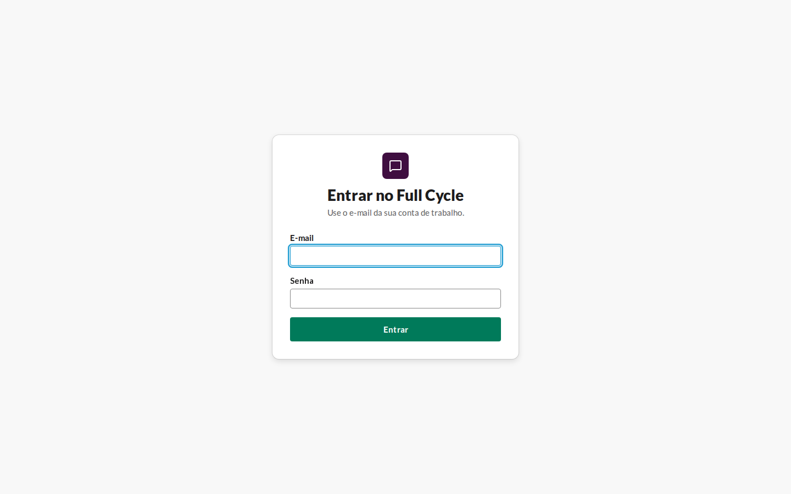 | 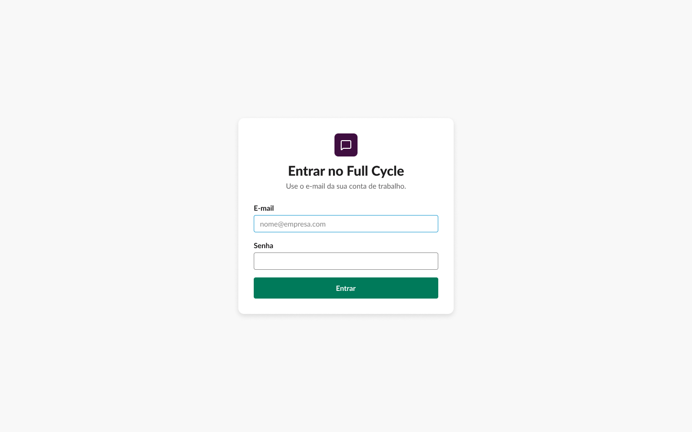 | 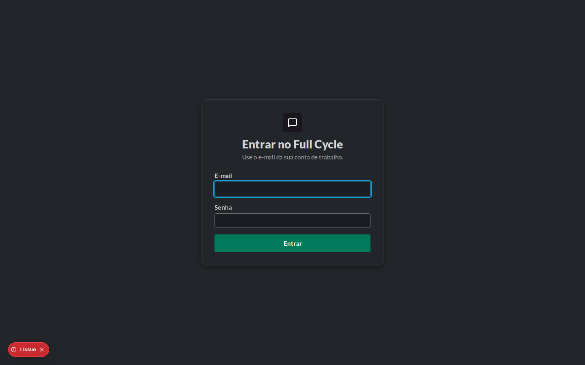 | 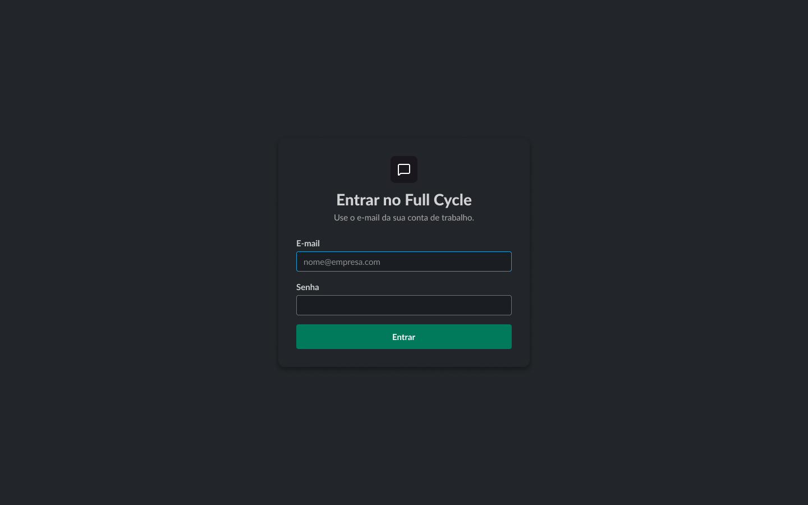 |
| Entrar · Enviando | 19:1369 |  | 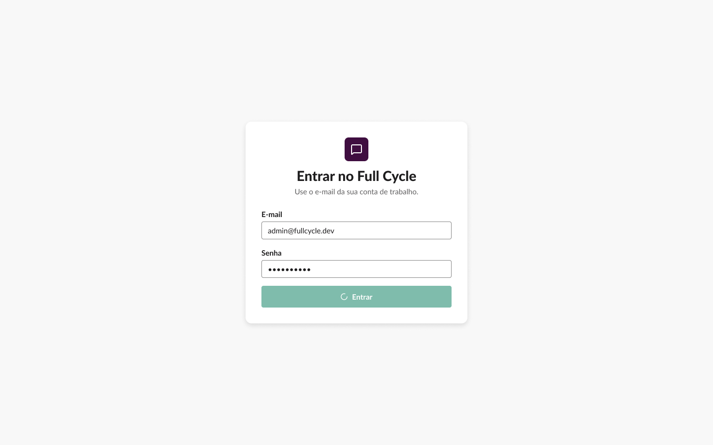 | 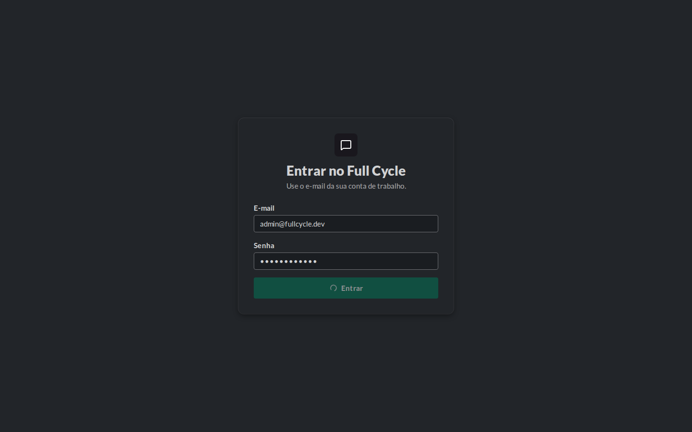 | 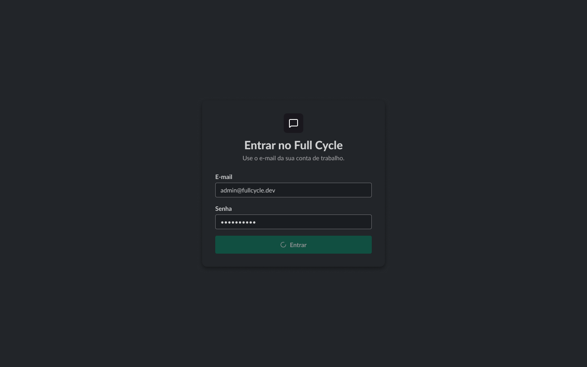 |
| Entrar · Credenciais incorretas | 19:1399 | 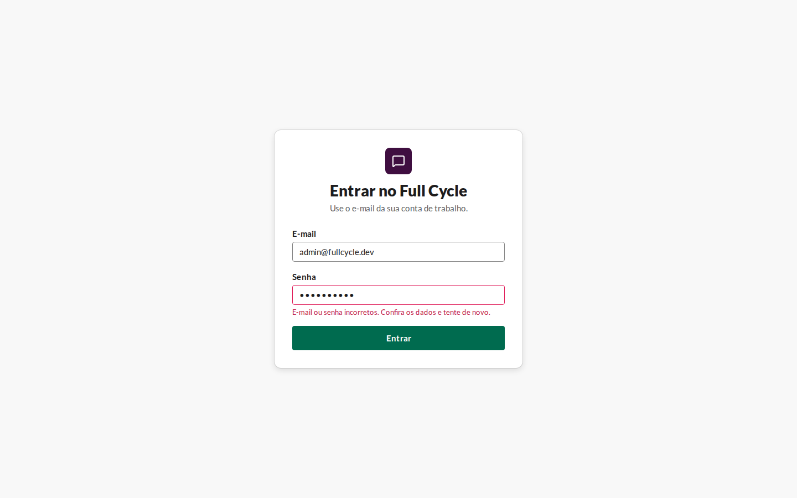 |  | 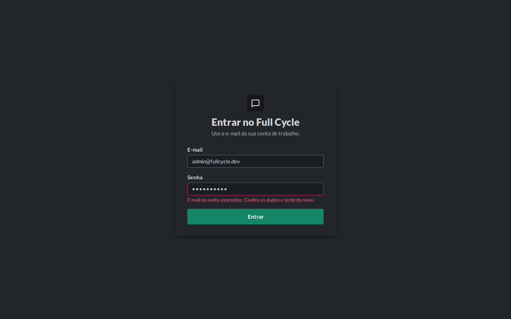 | 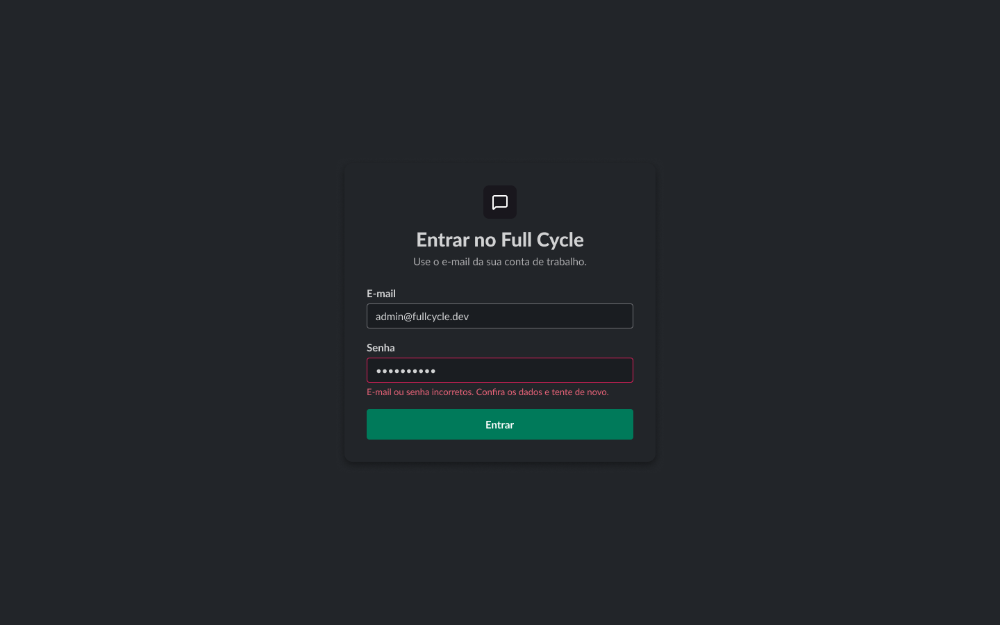 |
| Home · Vazio | 19:1645 | 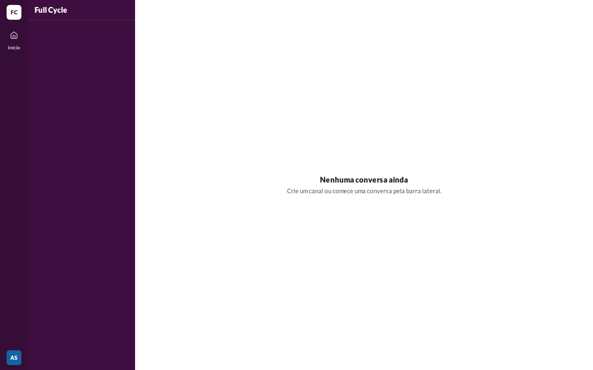 | 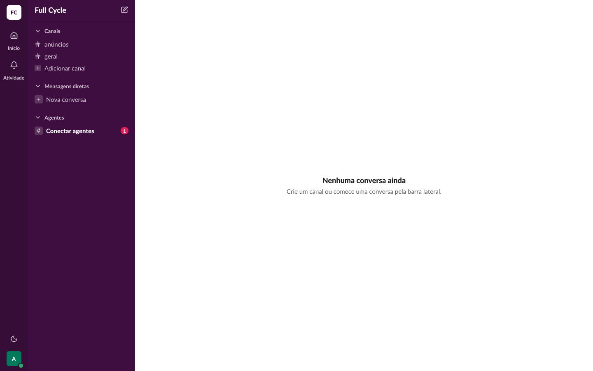 | 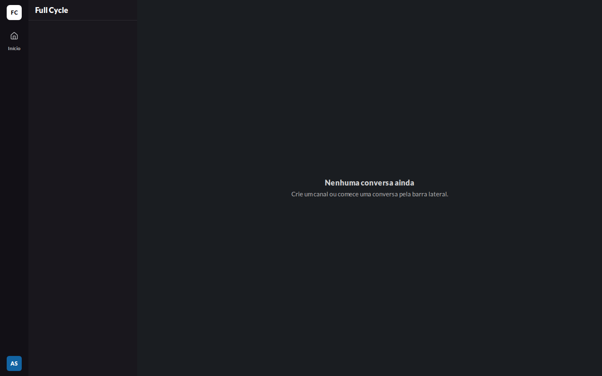 | 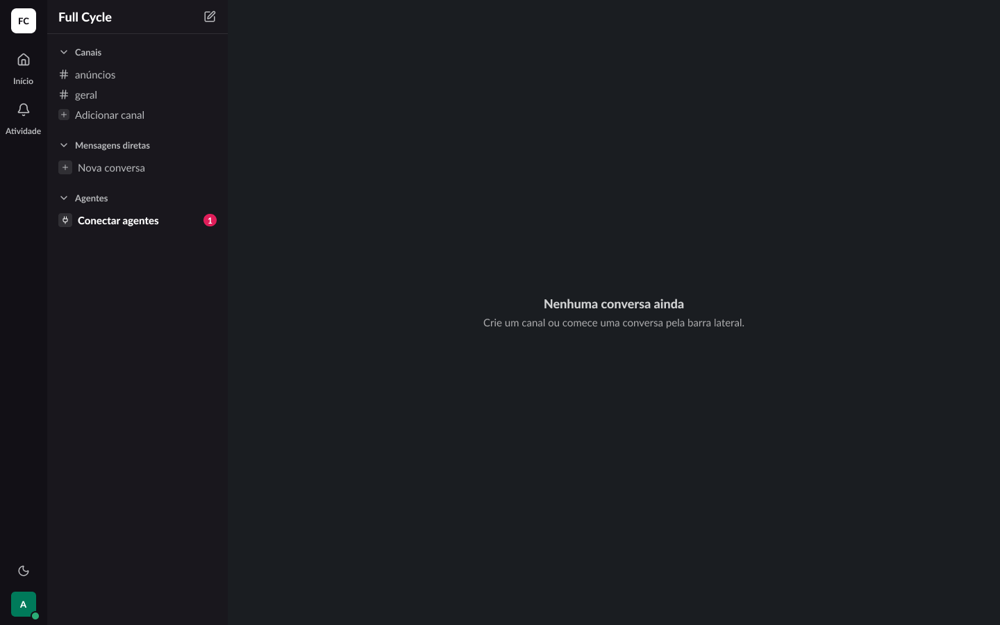 |

## Diferenças encontradas

- **Texto do botão escuro em vez de `on-primary`.** O `tailwind-merge` não conhecia a escala de
  texto do design system e descartava o `text-on-primary` ao lado do `text-body`. Corrigido em
  `src/app/utils/cn.ts`, com a escala registrada no `extendTailwindMerge`; capturas refeitas.
- **Indicador de desenvolvimento do Next sobre a tela.** Desligado no `next.config.ts`
  (`devIndicators: false`); capturas refeitas.
- **Home sem Atividade, controle de tema, ponto de presença e seções da Sidebar.** Intencional:
  a spec da F01 ("BFF e telas", "Home na F01") deixa esses itens para F02, F04, F05, F08, F09 e
  F10.
- **Avatar.** No Figma, a Pessoa de exemplo tem uma inicial ("A", em `avatar-3`); na web, "Ana
  Souza" tem duas ("AS"), e a cor sai do id da Pessoa entre `avatar-1` e `avatar-6`. Sem mudança:
  é dado, e não desenho.
- **Renderização da Lato.** O Chromium do contêiner desenha a Lato com espaçamento um pouco maior
  que o Figma nos títulos. Os tamanhos, pesos e alturas de linha são os da escala; sem mudança.
- **"Início" ativo.** O frame não distingue o item ativo na cor; a web marca com
  `aria-current="page"` e mantém o visual do Figma.
