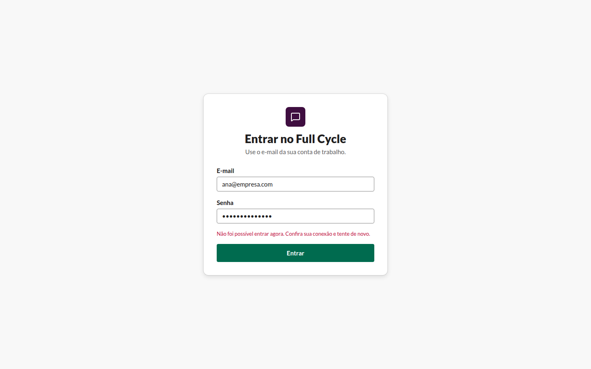

# Falha no envio ao entrar (CA3)

Verificação do agente com o `playwright-cli`, no contêiner `e2e`, em 2026-11-09.

## Passos

1. Parar o processo da API do chat (`pnpm start:dev` no contêiner `chat-api`); `GET
   http://localhost:3001/v1/sessions/current` passa a não responder.
2. `playwright-cli open --browser=chromium http://web:3000/entrar`, em 1440 × 900.
3. Preencher o E-mail com `ana@empresa.com` e a Senha com `senha-qualquer`, e clicar em "Entrar".
4. Guardar o snapshot e a captura, e ler o foco e os valores dos campos.
5. Subir a API do chat de novo.

## Resultado

- A mensagem "Não foi possível entrar agora. Confira sua conexão e tente de novo." aparece num
  `alert`, entre a Senha e o botão ([snapshot](falha-no-envio-snapshot.yml), linha do
  `alert [ref=e20]`).
- O E-mail continua `ana@empresa.com` e a Senha continua preenchida.
- O foco fica no botão "Entrar", onde estava ao enviar (`button "Entrar" [active]` no snapshot).

## Diferença encontrada e corrigida

Na primeira rodada, o foco caía no `body`: o botão fica desabilitado durante o envio e perde o
foco. O formulário passou a guardar o elemento focado no envio e a devolver o foco a ele quando o
resultado é a falha. A segunda rodada, acima, é a que vale.

## 5xx e tempo esgotado

Os dois caem no mesmo caminho da rede fora: o service HTTP (`src/app/services/chat-api.ts`)
devolve `failure` para qualquer status fora de 201 e do 401 `invalid_credentials`, e para o tempo
limite de 5 s (`AbortSignal.timeout`), e o Server Action devolve o estado `failure`.
