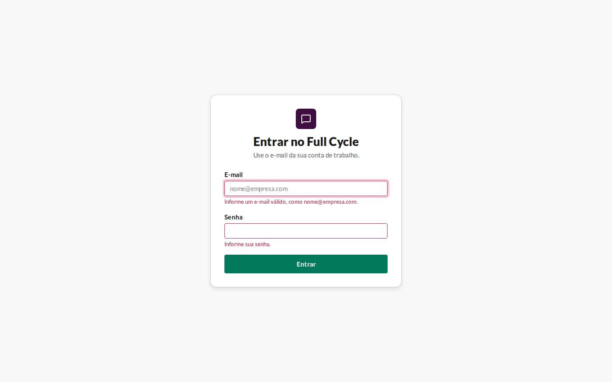
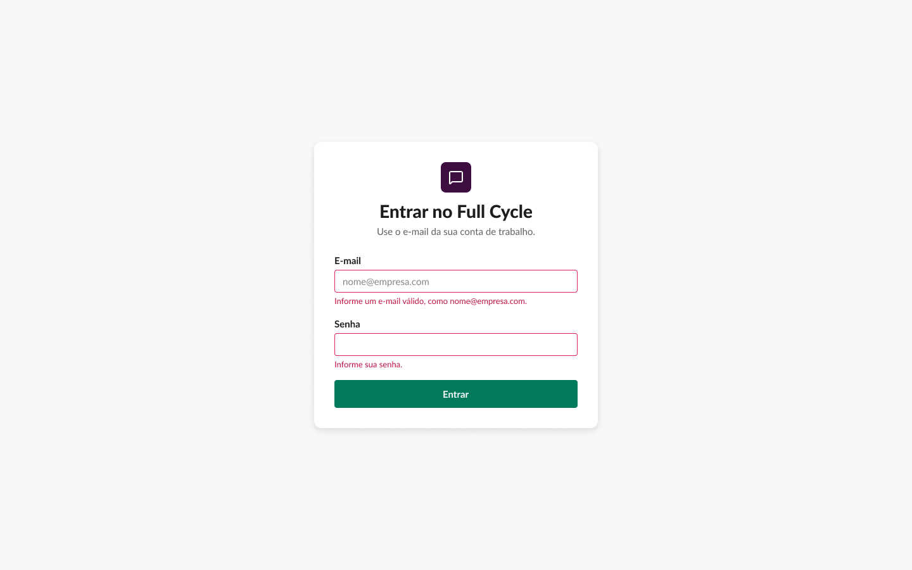
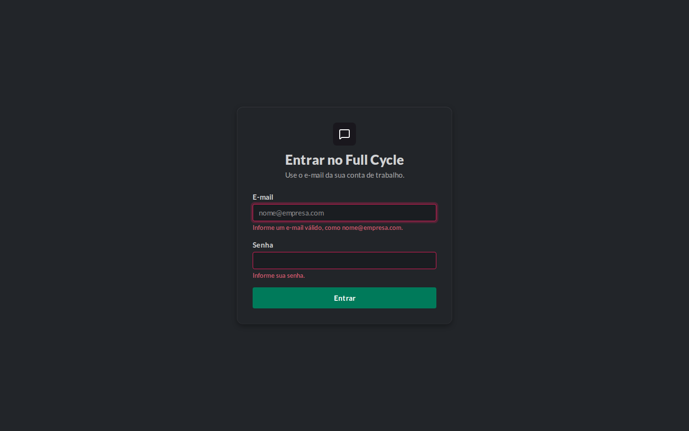
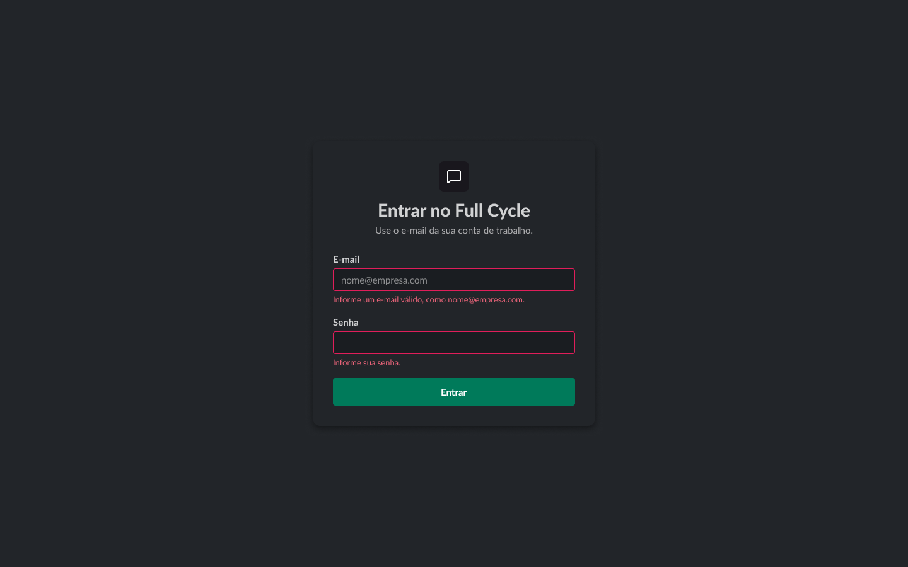
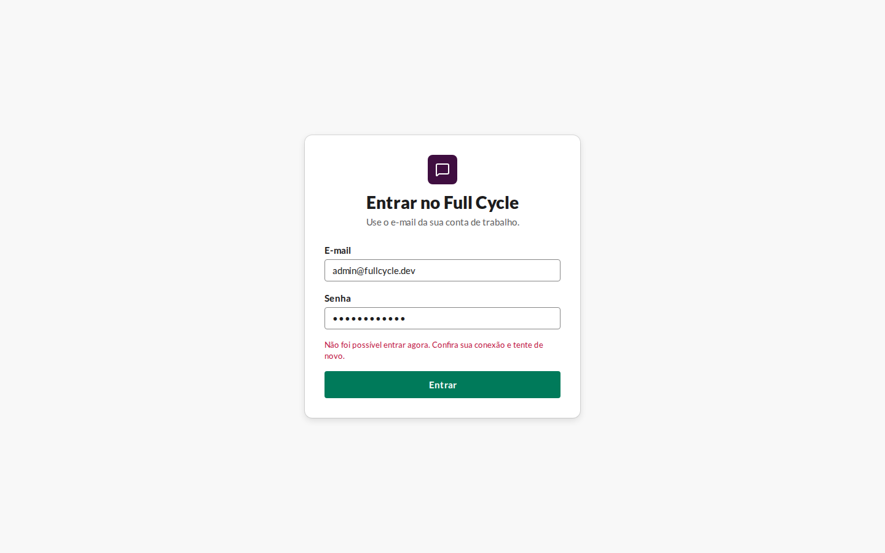
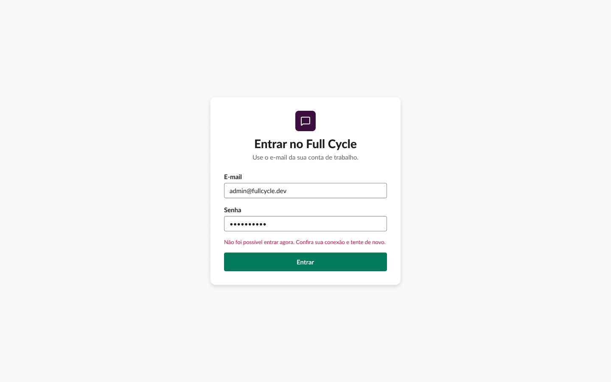
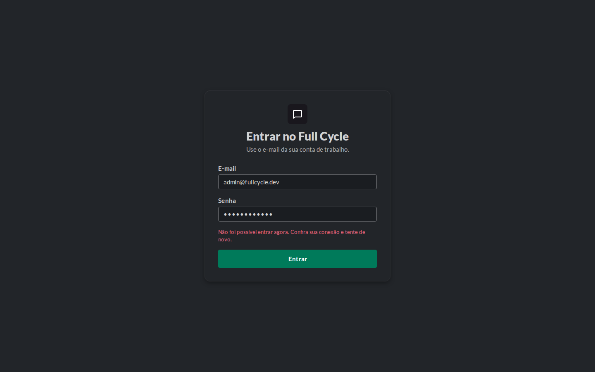
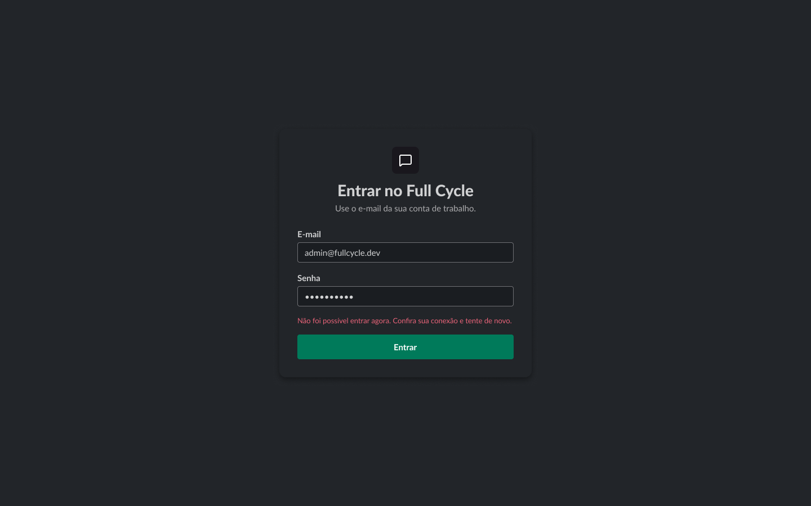

# Validação visual da F01-T04

Capturas da web em 1440 × 900, no Chromium do contêiner `e2e`, ao lado do `get_screenshot` dos
frames do Figma. A "Falha no envio" foi capturada com a API do chat parada.

| Estado | Frame | Web, claro | Figma, claro | Web, escuro | Figma, escuro |
| --- | --- | --- | --- | --- | --- |
| Entrar · Erro de validação | 19:1336 |  |  |  |  |
| Entrar · Falha no envio | 86:22 |  |  |  |  |

## Diferenças encontradas

- **Placeholder do E-mail.** O frame mostra "nome@empresa.com" no campo vazio; a web passou a
  ter o mesmo placeholder.
- **Contorno azul no campo com foco.** O `:focus-visible` global, fora das camadas do Tailwind,
  vencia o `focus-visible:outline-none` do campo, e o campo inválido em foco ganhava o contorno
  azul por cima do anel `danger/25`. A regra global foi para `@layer base`; capturas refeitas.
- **Mensagem da falha em duas linhas.** No Figma ela cabe numa linha de 384 px; o Chromium do
  contêiner desenha a Lato um pouco mais larga (a mesma diferença registrada na T03) e quebra a
  última palavra. Tamanho, peso e cor são os do frame; sem mudança.
