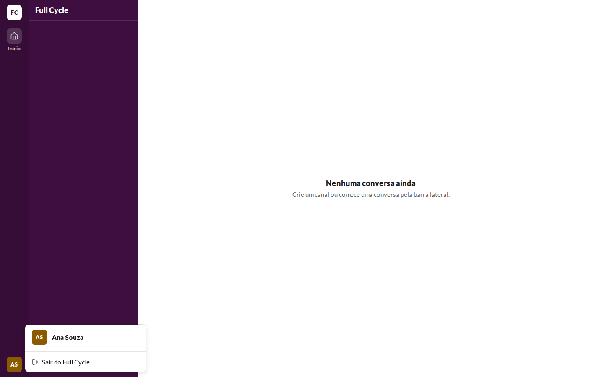
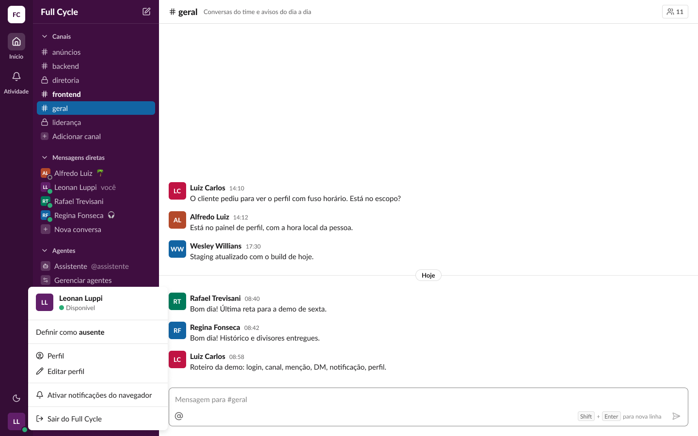
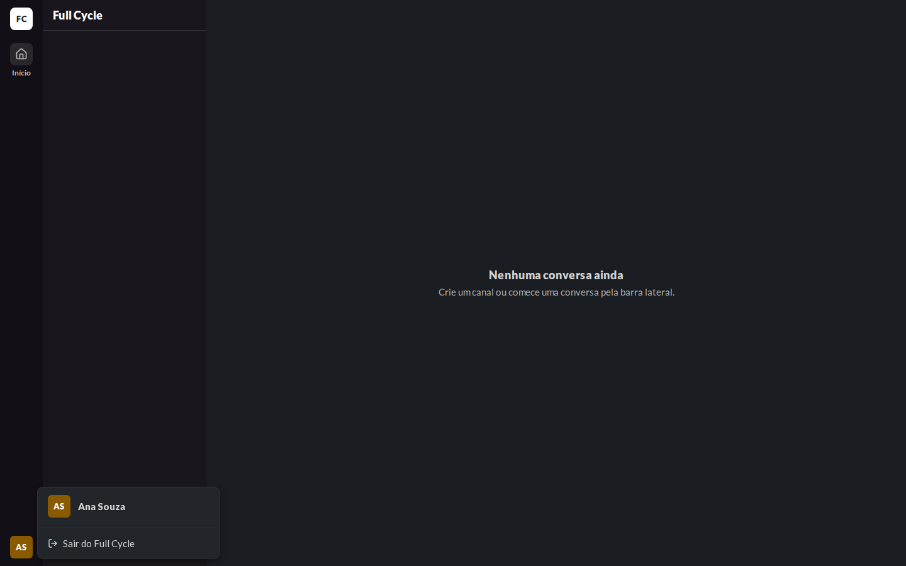
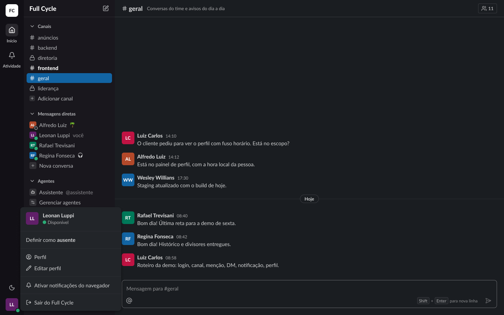

# Validação visual da F01-T07

O menu do avatar aberto, em 1440 × 900, no Chromium do contêiner `e2e`, ao lado do frame "Casca /
Menu do usuário / Disponível" (25:25749) do Figma.

| Estado | Web, claro | Figma, claro | Web, escuro | Figma, escuro |
| --- | --- | --- | --- | --- |
| Menu aberto |  |  |  |  |

## Diferenças encontradas

- **Itens do menu.** O frame tem a linha de presença, "Definir como ausente", "Perfil", "Editar
  perfil" e "Ativar notificações do navegador"; a F01 tem só o cabeçalho, sem presença, e "Sair do
  Full Cycle" (spec da F01, "Menu do avatar"). Intencional.
- **"Início" ativo.** Este frame mostra o tile do item ativo com `sidebar-field`, o que o frame
  "Home / Vazio" não mostrava; o Rail passou a usar o tile em `sidebar-field` no item ativo.
- **Captura no meio da animação.** A primeira captura pegou o `pop-in` do menu e saiu translúcida;
  refeita depois dos 200 ms da animação.
- **Posição.** O menu abre à direita do avatar, alinhado pela base, como no frame (Radix com
  `side="right"` e `align="end"`).
