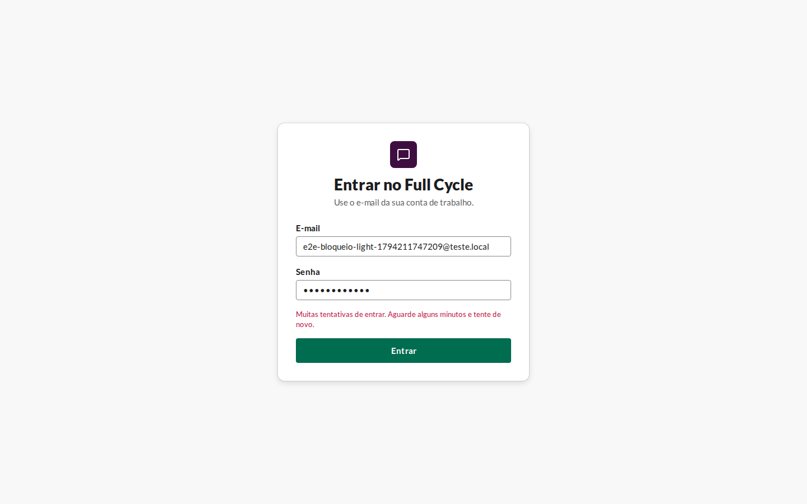
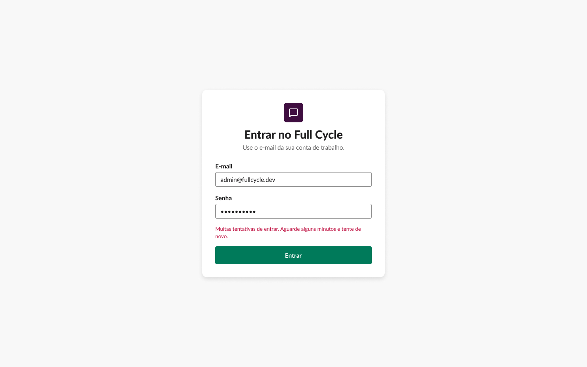
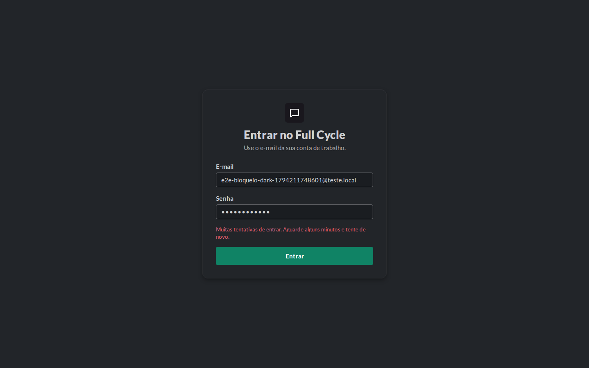
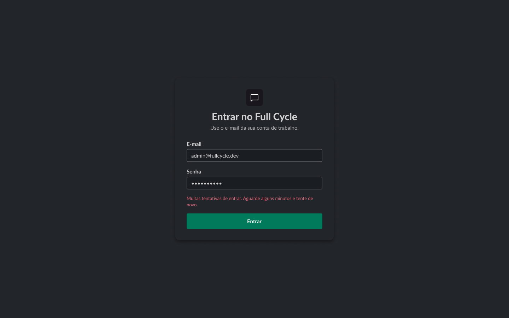

# Validação visual da F01-T08

"Tentativas demais" em 1440 × 900, no Chromium do contêiner `e2e`, depois de seis tentativas
erradas com um e-mail sem conta, ao lado do frame "Login / Tentativas demais" (86:54) do Figma,
criado antes do código (CA6).

| Estado | Web, claro | Figma, claro | Web, escuro | Figma, escuro |
| --- | --- | --- | --- | --- |
| Entrar · Tentativas demais |  |  |  |  |

## Diferenças encontradas

- **Botão em `primary-hover`.** A captura da web pega o botão com o foco devolvido depois do
  envio e o ponteiro recém-saído; é estado de interação, e não diferença de desenho.
- **Quebra da mensagem.** As duas versões quebram a mensagem em duas linhas; a última palavra muda
  pela largura da Lato no Chromium do contêiner (a mesma diferença registrada na T03 e na T04).
- **E-mail e senha.** Os valores dos campos são os da captura (um e-mail de teste e a senha
  errada), e não os do frame; o que importa é que continuam preenchidos.
