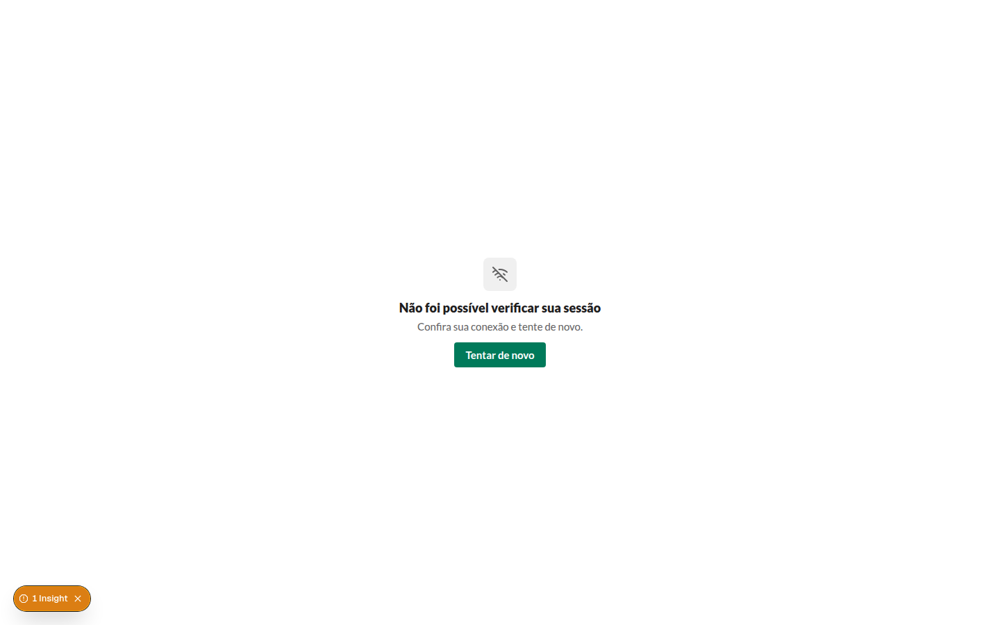
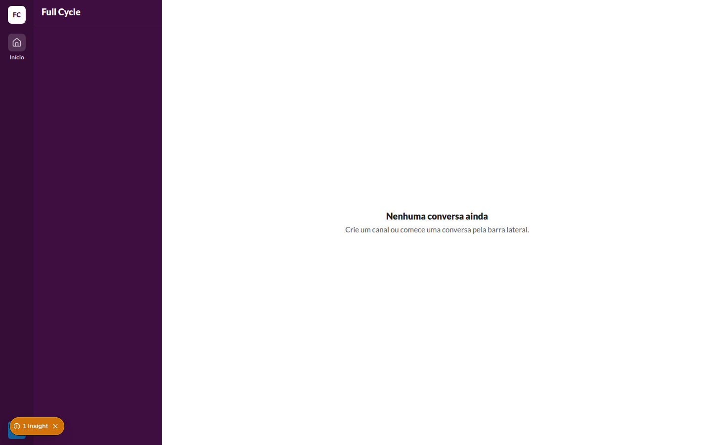
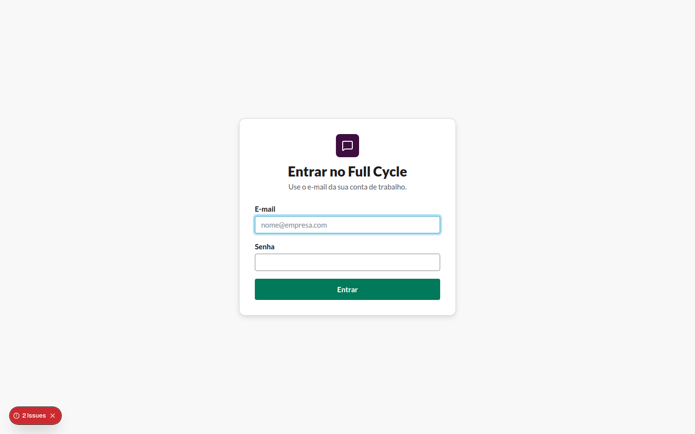

# Erro de sessão e "Tentar de novo" (CA2, CA3 e CA4)

Verificação do agente com o `playwright-cli`, no contêiner `e2e`, em 2026-11-09, com a Pessoa de
desenvolvimento `dev@teste.local`.

## 1. API parada numa tela logada

1. Entrar pelo formulário com a API de pé.
2. Parar o processo da API do chat (`pnpm start:dev` no contêiner `chat-api`).
3. Abrir `http://web:3000/?aba=teste`.

Resultado ([snapshot](erro-de-sessao-1-api-parada.yml)):

- "Não foi possível verificar sua sessão", com "Confira sua conexão e tente de novo." e o botão
  "Tentar de novo", em tela cheia, sem o Rail nem a Sidebar.
- A URL continua `/?aba=teste`, e o cookie `fc_session` continua no navegador.

## 2. API de volta e "Tentar de novo"

1. Subir a API do chat de novo e esperar ela responder.
2. Clicar em "Tentar de novo".

Resultado ([snapshot](erro-de-sessao-2-tentar-de-novo.yml)): o shell da Home aparece (Rail com
"Menu de Pessoa Dev", Sidebar e o Main), e a URL continua `/?aba=teste`.

## 3. Sessão revogada antes de "Tentar de novo"

1. Entrar, parar a API e abrir `/`: a tela de erro aparece.
2. Apagar as Sessões da Pessoa no banco e subir a API.
3. Clicar em "Tentar de novo".

Resultado ([snapshot](erro-de-sessao-3-sessao-revogada.yml)): a Pessoa vai para `/entrar`, pelo
caminho normal do 401.

## Observações

- Os badges "Insight" e "Issue" no canto das capturas são do servidor de desenvolvimento do Next:
  um aviso de navegação instantânea, e o stream de desenvolvimento interrompido quando a API foi
  parada no meio de uma renderização. Não aparecem no build de produção.
- Depois da revisão, a rota `/api/session/expired` deixou de voltar ao caminho pedido quando a
  reconferência falha (o layout tinha recebido 401): ela leva a "Entrar" sem apagar o cookie, e
  "Entrar" mostra o formulário. Assim a API instável não faz o navegador alternar sem fim entre
  o layout e a rota. A falha na verificação do layout, que é o caso desta tarefa, continua
  mostrando o erro na própria tela, como acima.
