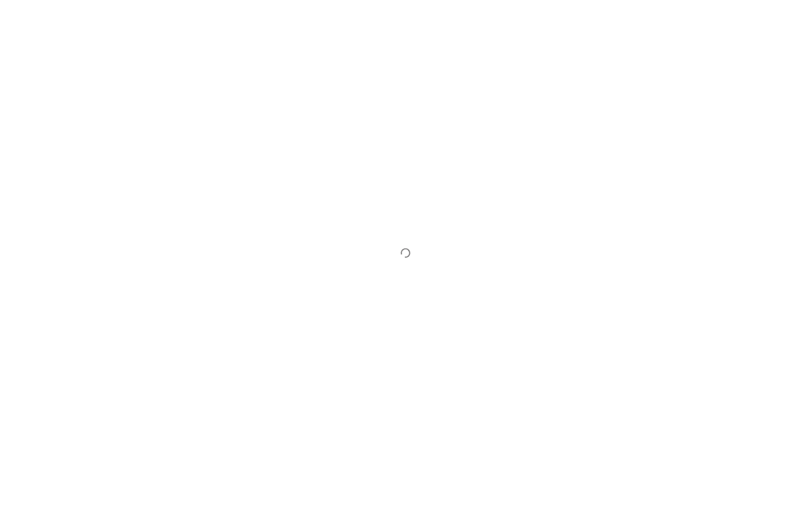
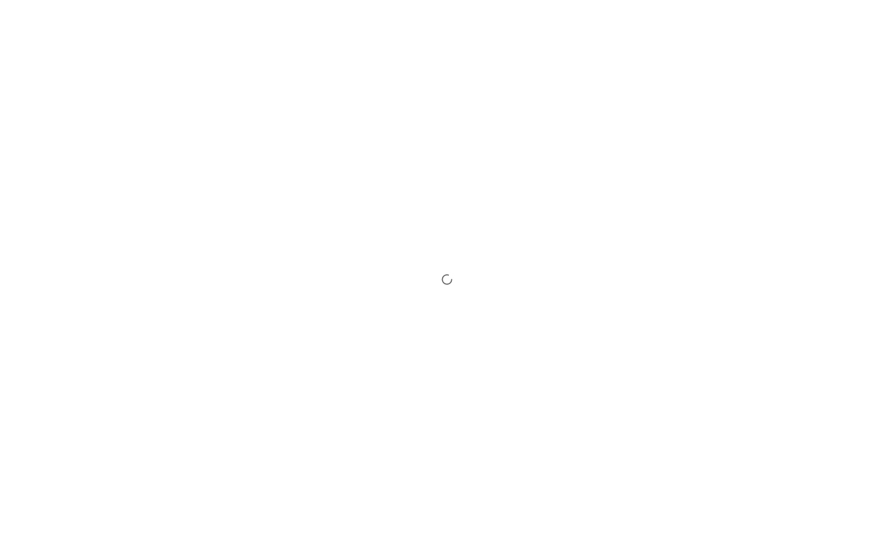
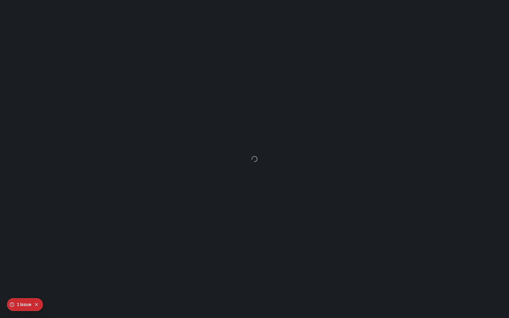
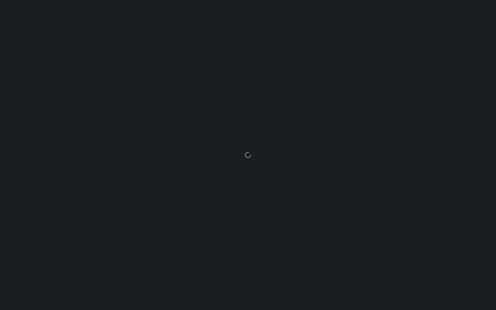
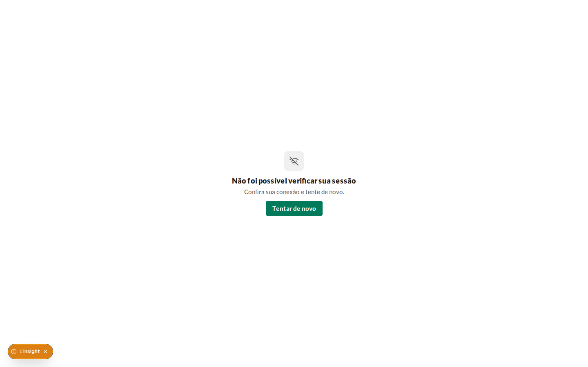
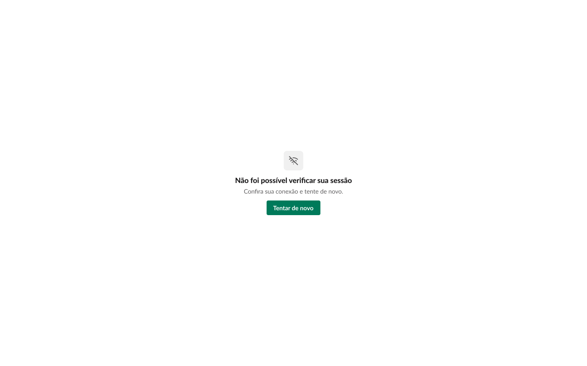
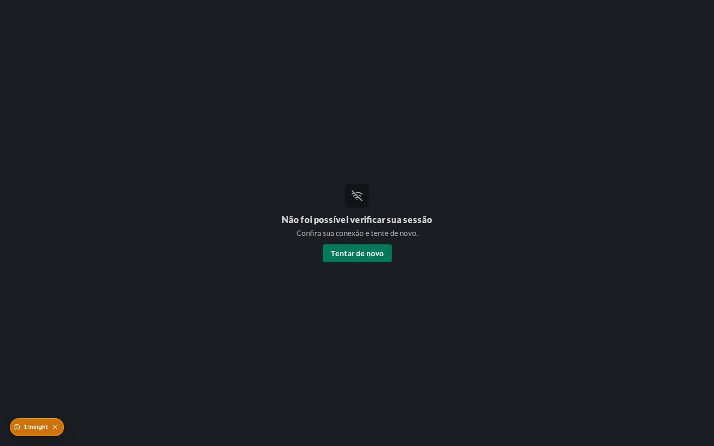
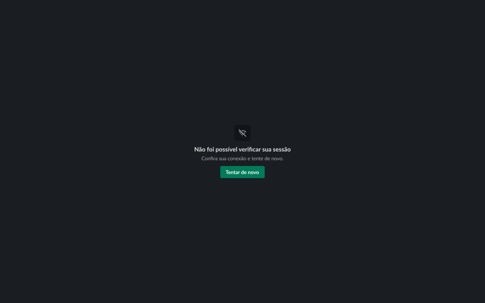

# Validação visual da F01-T09

Capturas em 1440 × 900, no Chromium do contêiner `e2e`, ao lado do `get_screenshot` dos frames do
Figma. "Carregando o app" foi capturada com a API do chat congelada (`kill -STOP`), o que deixa a
verificação esperando o tempo limite; "Erro de sessão", com a API parada.

| Estado | Frame | Web, claro | Figma, claro | Web, escuro | Figma, escuro |
| --- | --- | --- | --- | --- | --- |
| Portas · Carregando o app | 19:1770 |  |  |  |  |
| Portas · Erro de sessão | 19:1793 |  |  |  |  |

## Diferenças encontradas

- **Spinner de 20 px.** O frame usa 20 px; o `Spinner` ganhou o tamanho `md` (20) e o antigo de
  24 passou a `lg`.
- **Ícone e ação no EmptyState.** O frame tem o quadro de 48 com o ícone `wifi-off` e o botão; o
  `EmptyState` ganhou as props `icon` e `action`.
- **Badges do Next nas capturas.** "Insight" e "Issue" são do servidor de desenvolvimento (a troca
  de tema da captura antes da hidratação e o aviso de navegação instantânea); não fazem parte da
  tela.
- **Renderização da Lato.** O título sai um pouco mais largo no Chromium do contêiner, como nas
  outras tarefas da F01.
