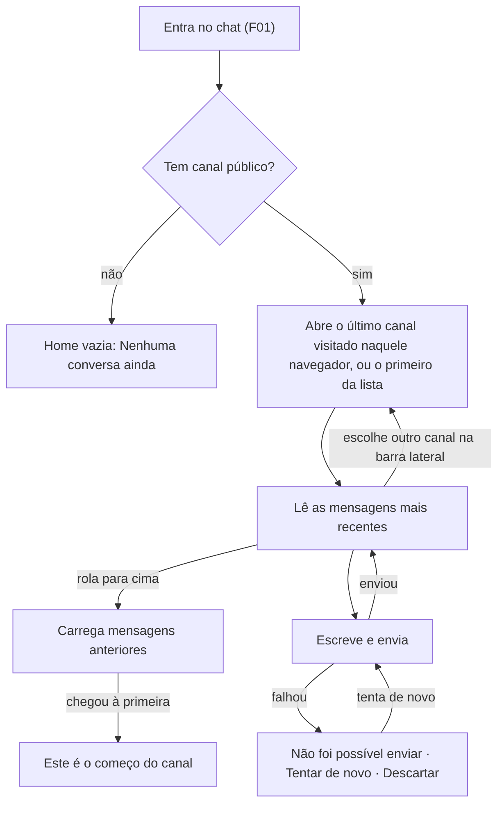

# PRD · F02 · Mensagens em canal público

2026-11-09 · Luiz Carlos · Status: aprovado

## 1. Resumo executivo

- **Problema:** depois da F01 a pessoa entra no chat, mas não tem onde conversar: a Home está
  vazia. Sem canais e mensagens, nenhuma outra funcionalidade (tempo real, menções, agentes) tem
  onde acontecer.
- **Solução proposta:** a pessoa vê os canais públicos do workspace na barra lateral, abre um
  deles, lê o histórico desde as mensagens mais recentes até a primeira, rolando para cima, e
  envia mensagens de texto.
- **Critérios de sucesso:** esta funcionalidade não move sozinha nenhuma métrica do product brief
  (seção "Objetivos e métricas de sucesso"). Ela é pré-requisito de "Uso do agente", porque todo
  pedido a um agente é uma mensagem numa conversa. Ela cumpre, do requisito não funcional
  "Desempenho" do brief, a parte do histórico paginado, e o requisito "Acessibilidade" nas telas
  que entrega.

## 2. Experiência do usuário e funcionamento

### Personas

- **Pessoa do workspace:** entra com a conta criada pela empresa (F01) e conversa nos canais
  públicos, no navegador do computador de trabalho.
- **Quem opera a instalação:** cria os canais públicos por script, fora do produto, como já faz
  com as contas, até a F04 (Criação de canais e convite para canal privado).

### Regras do canal público nesta funcionalidade

- Os canais públicos são criados por script, com nome e tópico. Não há canal criado pelo produto.
- Toda Pessoa é Membro de todos os canais públicos, inclusive quem ganhar conta depois que o
  canal foi criado. Não há como entrar nem sair de um canal (F18, Fase 2).

### Fluxo

### Histórias de usuário

1. Como pessoa do workspace, quero ver os canais públicos do workspace na barra lateral para
   escolher onde conversar.
2. Como pessoa do workspace, quero cair num canal ao entrar no chat para começar a conversar sem
   procurar por onde.
3. Como pessoa do workspace, quero ler as mensagens mais recentes de um canal, com quem escreveu
   e quando, para me atualizar da conversa.
4. Como pessoa do workspace, quero rolar o histórico até a primeira mensagem do canal para
   recuperar o contexto de conversas antigas.
5. Como pessoa do workspace, quero enviar uma mensagem de texto num canal para falar com o time.
6. Como pessoa do workspace, quero saber quando uma mensagem não foi enviada e tentar de novo
   para não perder o que escrevi nem duplicar a mensagem.
7. Como pessoa do workspace, quero abrir um canal pelo link dele para ir direto à conversa que
   alguém me indicou.

### Critérios de aceite

**Todas as histórias**

- As telas seguem o design system do projeto e as telas das seções Casca e Conversa do Figma do
  projeto, nos temas claro e escuro, e atingem 100 na nota de Acessibilidade do Lighthouse.
- Tudo funciona só pelo teclado: Tab chega aos canais da barra lateral, Enter abre o canal, e o
  histórico rola pelas setas e por Page Up e Page Down.
- Abaixo de 768 px de largura, o Rail e a barra lateral viram uma gaveta, que abre por um botão
  no cabeçalho da conversa.

**História 1, lista de canais**

- A barra lateral tem a seção "Canais", com os canais públicos em ordem alfabética, cada um com o
  ícone de `#` e o nome. O canal aberto fica destacado.
- A seção "Canais" recolhe e expande ao clicar no título.
- Enquanto a lista carrega, a barra lateral mostra o esqueleto ("Casca / Sidebar / Esqueleto").
- Se a lista não carregar, a barra lateral mostra "Não foi possível carregar suas conversas." com
  o botão "Tentar de novo", e a área da conversa mostra "Não foi possível carregar a conversa",
  como na tela "Conversa / Erro ao carregar a lista" do Figma.
- A barra lateral não mostra "Adicionar canal", Mensagens diretas nem Agentes: eles entram com a
  F04, a F05 e a F10.

**História 2, canal ao entrar**

- Ao chegar à Home, a pessoa vê aberto o último canal que visitou naquele navegador.
- Na primeira visita naquele navegador, ou se o último canal não existe mais, abre o primeiro
  canal da lista.
- Sem nenhum canal público no workspace, a Home mostra "Nenhuma conversa ainda", como em
  "Home / Vazio".

**História 3, ler as mensagens recentes**

- Abrir um canal mostra o cabeçalho com o nome e o tópico do canal e as mensagens mais recentes,
  com a última visível logo acima da caixa de mensagem.
- Cada mensagem mostra o avatar de iniciais, o nome do autor, a hora (horas e minutos, no fuso do
  navegador) e o texto.
- Mensagens seguidas do mesmo autor, com até 5 minutos entre uma e outra e no mesmo dia, aparecem
  na forma compacta, sem repetir avatar e nome ("Conversa / Mensagem / Compacta").
- Um divisor separa as mensagens de cada dia, com "Hoje", "Ontem" ou a data.
- O texto aparece como foi escrito, com as quebras de linha. Endereços que começam com `http://`
  ou `https://` viram links que abrem em outra aba. Nenhum outro texto vira formatação ou HTML.
- Enquanto o histórico carrega, a área mostra "Conversa / Estrutura / Histórico carregando". Se
  não carregar, mostra "Não foi possível carregar as mensagens desta conversa." com o botão
  "Tentar de novo".
- Ao abrir um canal, o foco vai para a caixa de mensagem.
- As mensagens que outras pessoas enviam depois que o canal foi aberto aparecem quando a pessoa
  abre o canal de novo ou recarrega a página. A chegada sem recarregar é da F03.

**História 4, histórico até a primeira mensagem**

- Ao rolar até perto do topo, as mensagens anteriores carregam sozinhas, com o indicador
  "Conversa / Lista / Carregando anteriores", e a mensagem que a pessoa estava lendo continua no
  mesmo lugar da tela.
- O link "Carregar mensagens anteriores", no topo da lista, faz o mesmo pelo teclado.
- Se as mensagens anteriores não carregarem, as já carregadas continuam na tela e o link
  "Carregar mensagens anteriores" permite tentar de novo.
- Ao chegar à primeira mensagem, o topo mostra "Este é o começo do canal #nome" com o tópico do
  canal, como em "Conversa / Lista / Início do canal". Um canal sem mensagens mostra só isso.
- Abrir um canal de até 100 mil mensagens mostra as mais recentes em até 1 s, no p95, e cada
  carga de mensagens anteriores leva até 1 s, no p95.

**História 5, enviar uma mensagem**

- A caixa de mensagem mostra "Mensagem para #nome". Enter envia e Shift+Enter quebra a linha.
- Os espaços e as quebras de linha das pontas são removidos no envio. Uma mensagem vazia, ou só
  com espaços, não é enviada, e o botão de enviar fica desabilitado.
- O limite é de 4000 caracteres. Acima dele, a caixa mostra "N caracteres acima do limite", como
  em "Conversa / Composer / Acima do limite", e a mensagem não é enviada.
- Ao enviar, a caixa fica vazia, a mensagem aparece no fim da lista no estado "enviando" e a lista
  rola até ela. Quando a gravação termina, ela passa ao estado normal, com a hora.
- Várias mensagens enviadas em sequência aparecem na ordem em que foram enviadas.
- Quem abre o canal depois vê a mensagem, com o nome da pessoa como autor.

**História 6, falha no envio**

- Uma mensagem que não foi gravada, por falha da rede ou do servidor, fica na lista com "Não foi
  possível enviar." e as ações "Tentar de novo" e "Descartar", como em "Conversa / Mensagem /
  Falha no envio".
- "Tentar de novo" reenvia a mesma mensagem. Ela nunca aparece duas vezes, nem quando o primeiro
  envio chegou a ser gravado e só a resposta se perdeu.
- "Descartar" tira a mensagem da lista.
- A mensagem com falha fica na lista enquanto a aba estiver aberta. Recarregar a página a
  descarta.
- Se a Sessão tiver acabado, o envio leva a pessoa para "Entrar", como na F01 (história 6).

**História 7, abrir um canal pelo link**

- Cada canal tem um endereço próprio, que muda ao trocar de canal na barra lateral e funciona no
  voltar e avançar do navegador.
- Abrir o endereço de um canal abre esse canal. Sem Sessão, a pessoa entra e cai nele, como na
  F01 (história 4).
- O endereço de um canal que não existe mostra "Conversa não encontrada", com o link "Voltar ao
  início", como em "Conversa / Estrutura / Conversa não encontrada".

### O que não é objetivo

- Ver as mensagens dos outros chegarem sem recarregar, o aviso de "digitando" e a recuperação
  depois de uma queda de conexão: F03.
- Criar canal, canal privado e convite: F04. Entrar e sair de canais: F18.
- Conversa direta, busca de pessoas e perfil: F05. Clicar no nome ou no avatar do autor não abre
  nada nesta funcionalidade.
- Lista de membros do canal e a contagem de membros no cabeçalho: o canal público inclui o
  workspace inteiro.
- Menções, citação, copiar, editar e apagar mensagens, e o menu da mensagem: F06.
- Não lidas, divisor de novas mensagens e "novas mensagens abaixo": F07.
- Formatação de texto (negrito, código, listas), prévia de links, emojis e anexos: anexos ficam
  para a F22.
- Editar o nome ou o tópico de um canal pelo produto.
- Guardar o texto não enviado ao trocar de canal ou quando a Sessão acaba.
- Mensagens de agentes: entram com a F11.

## 3. Requisitos do sistema de IA

Não se aplica: a F02 não envolve agentes.

## 4. Riscos de produto

| Risco | Mitigação |
| --- | --- |
| Sem tempo real, a pessoa acha que ninguém respondeu e a conversa parece parada | A F03 vem logo depois, e reabrir o canal ou recarregar a página mostra o que chegou. Até a F03, a funcionalidade serve para validar a conversa, não para o uso diário |
| Os canais só existem por script, e o time não consegue criar o canal de que precisa | Quem opera a instalação cria um conjunto inicial de canais. A F04 traz a criação pelo produto |
| A pessoa perde o que escreveu numa falha de rede, ou a mensagem aparece duplicada ao tentar de novo | A mensagem com falha fica na lista com "Tentar de novo", e o reenvio nunca duplica |
| O histórico de um canal antigo demora a abrir | As mensagens carregam por partes, das mais recentes para as mais antigas, com teto de 1 s no p95 |
| Alguém escreve na mensagem um conteúdo que vira código na tela de quem lê | O texto aparece como texto puro. Só endereços `http://` e `https://` viram links |
| Um link leva a um site malicioso | O link abre em outra aba, sem acesso à página do chat. O risco de a pessoa clicar num link enganoso é aceito, como em qualquer chat |
