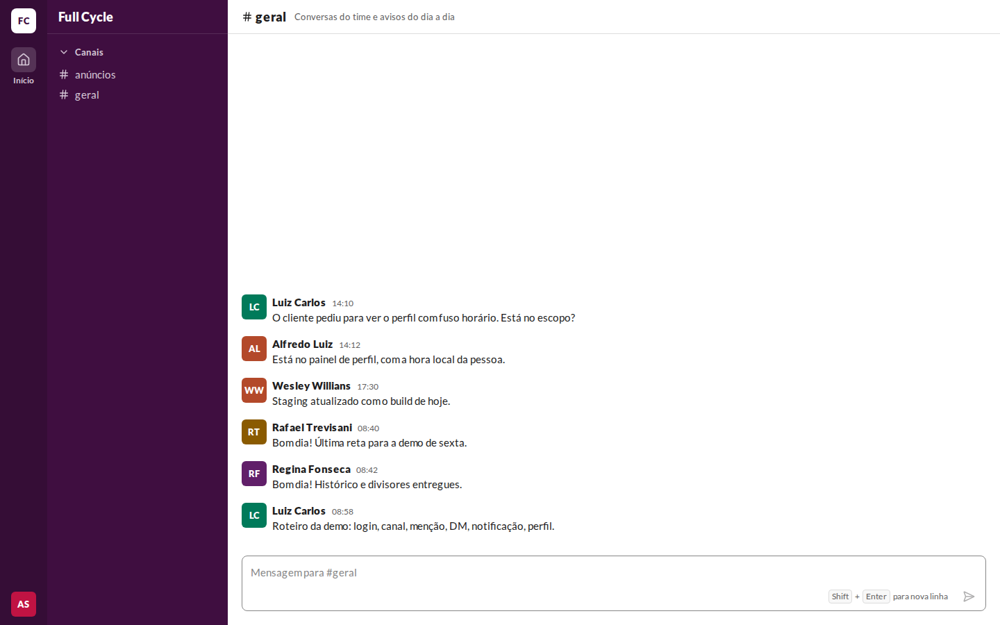
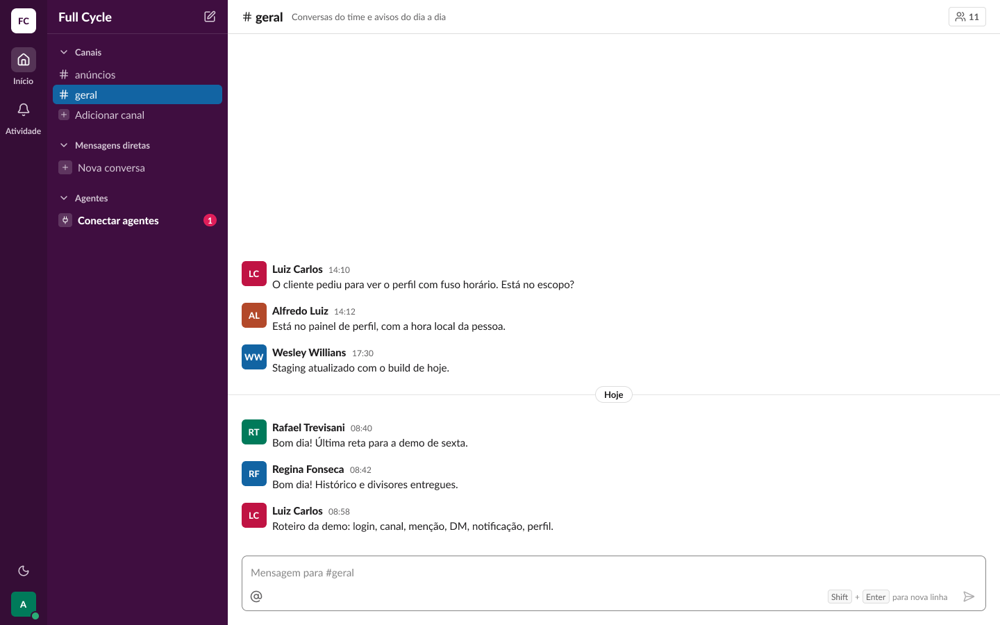
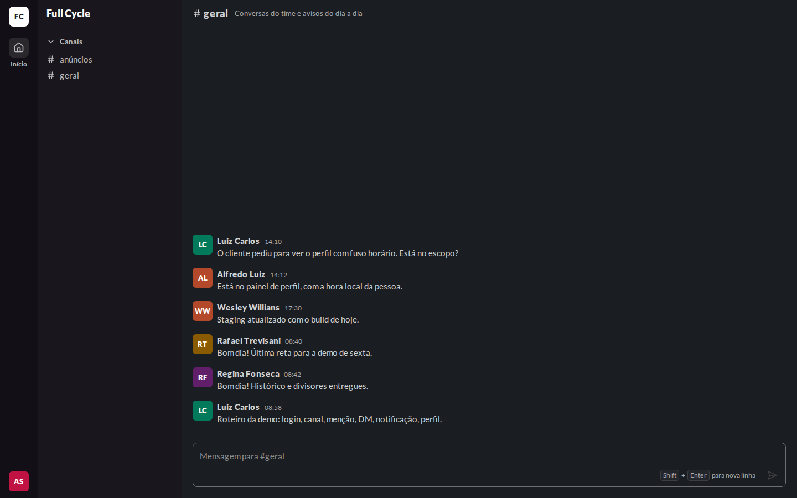
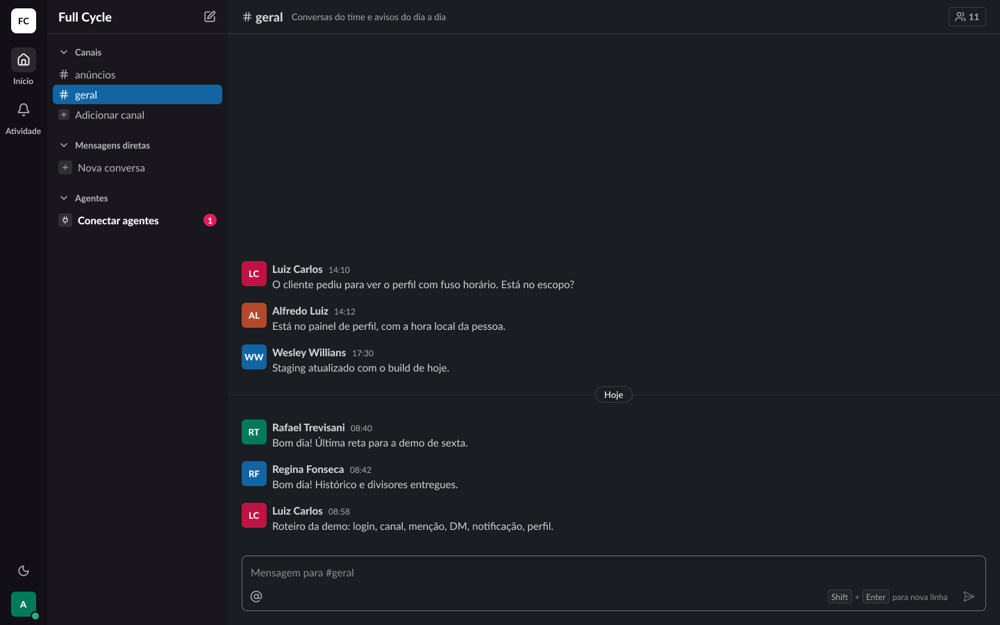

# Validação visual da F02-T02

Capturas da web em 1440 × 900, no Chromium do contêiner `e2e`, ao lado das capturas do frame
"Conversa / Estrutura / Canal público" (21:2843) do Figma (arquivo `slack`, página Telas). O tema
escuro da web é o `data-theme="dark"` na raiz. No Figma, a página Telas está no modo Dark da
coleção Semantic; a captura clara aplicou o modo Light só ao frame, removido depois.

Os dados da web imitam os do frame: os Canais `#anúncios` e `#geral` do banco de
desenvolvimento e seis Mensagens das mesmas Pessoas, nos mesmos horários, apagadas depois da
captura.

| Estado | Frame | Web, claro | Figma, claro | Web, escuro | Figma, escuro |
| --- | --- | --- | --- | --- | --- |
| Conversa · Canal público | 21:2843 |  |  |  |  |

## Diferenças encontradas

- **Dica "Shift + Enter para nova linha" em `fg-muted`, e não em `fg-subtle`.** O `fg-subtle`
  sobre o fundo do composer não passa no contraste da checagem do axe (4,5:1), que a tarefa exige
  sem violações. O texto continua igual; só a cor sobe um tom.
- **Sem a linha ativa da barra lateral e sem o divisor de dia.** Intencional: entram na F02-T07
  e na F02-T04.
- **Sem "Adicionar canal", Mensagens diretas, Agentes, o ícone de nova mensagem, Atividade, o
  controle de tema, o ponto de presença, o botão de Membros e o botão de menções.** Intencional:
  a spec da F02 ("BFF e telas") e o PRD ("O que não é objetivo") deixam esses itens para a F04,
  F05, F06, F08, F09 e F10.
- **Avatar.** As cores saem do id de cada Pessoa entre `avatar-1` e `avatar-6`, e a Pessoa logada
  tem duas iniciais ("AS"). Sem mudança: é dado, e não desenho.
- **Renderização da Lato.** Como na F01, o Chromium do contêiner desenha a Lato com espaçamento um
  pouco diferente do Figma. Os tamanhos, pesos e alturas de linha são os da escala.
