# Validação visual da F02-T03

Capturas da web em 1440 × 900, no Chromium do contêiner `e2e`, ao lado das capturas dos frames
do Figma (arquivo `slack`, página Telas). O tema escuro da web é o `data-theme="dark"` na raiz. No
Figma, a página Telas está no modo Dark da coleção Semantic; a captura clara aplicou o modo Light
só a cada frame, removido depois.

Os dados da web: `#geral` do banco de desenvolvimento com 60 Mensagens de "Luiz Carlos", com o
sentinela desligado para o link aparecer parado. O carregamento foi segurado na rota do BFF até a
captura. O começo do Canal usa `#anúncios`, sem Mensagens. As Mensagens foram apagadas depois.

| Estado | Frame | Web, claro | Figma, claro | Web, escuro | Figma, escuro |
| --- | --- | --- | --- | --- | --- |
| Lista · Carregar mensagens anteriores | 21:6069 | 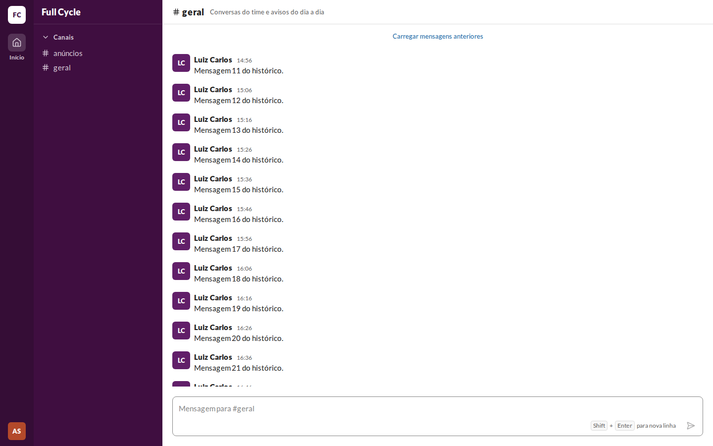 | 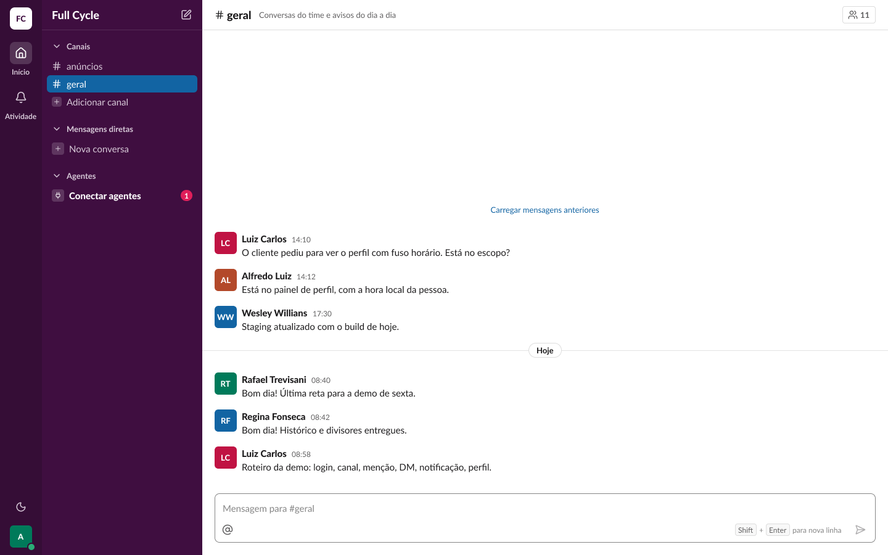 | 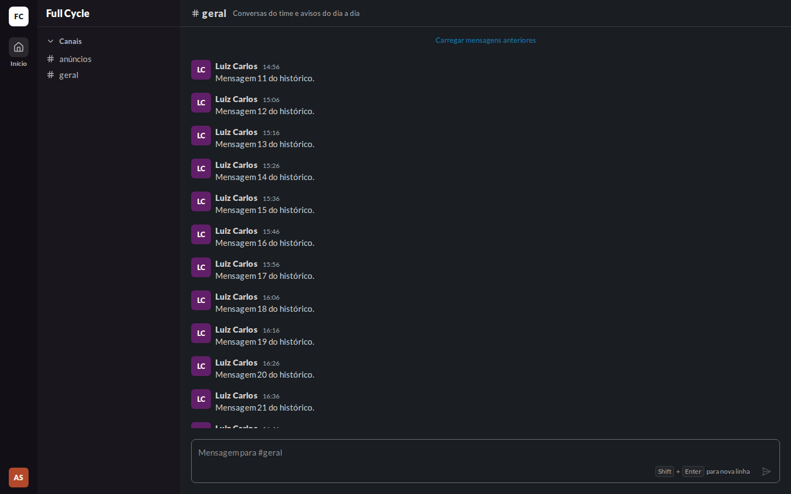 | 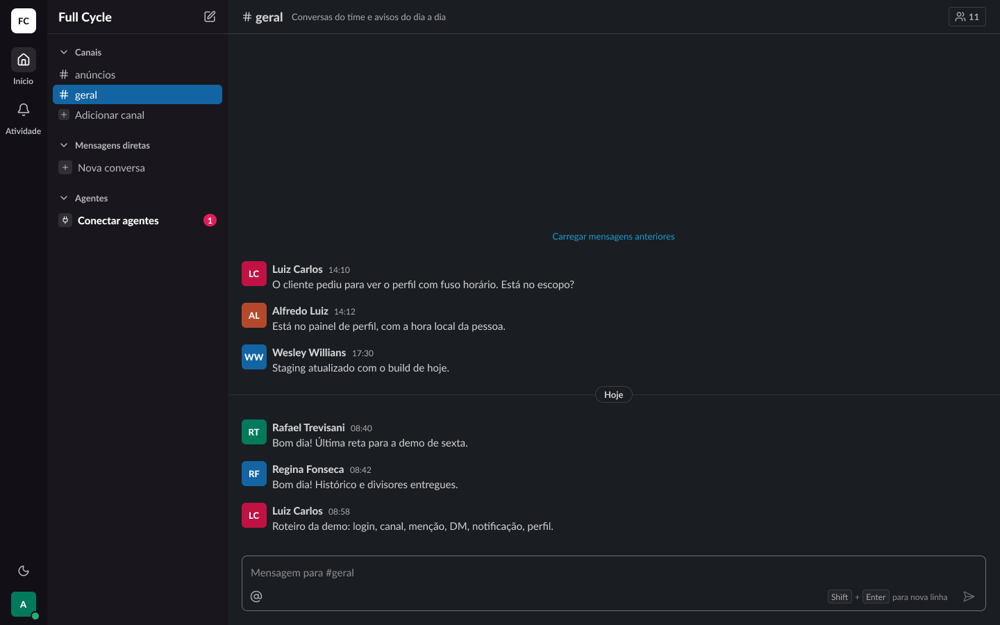 |
| Lista · Carregando anteriores | 21:6830 | 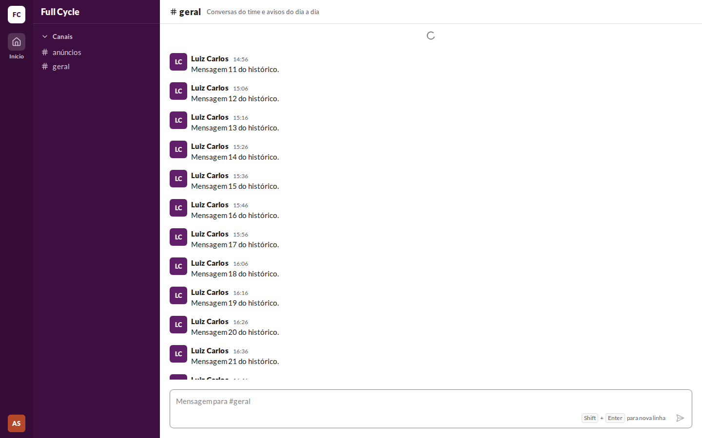 | 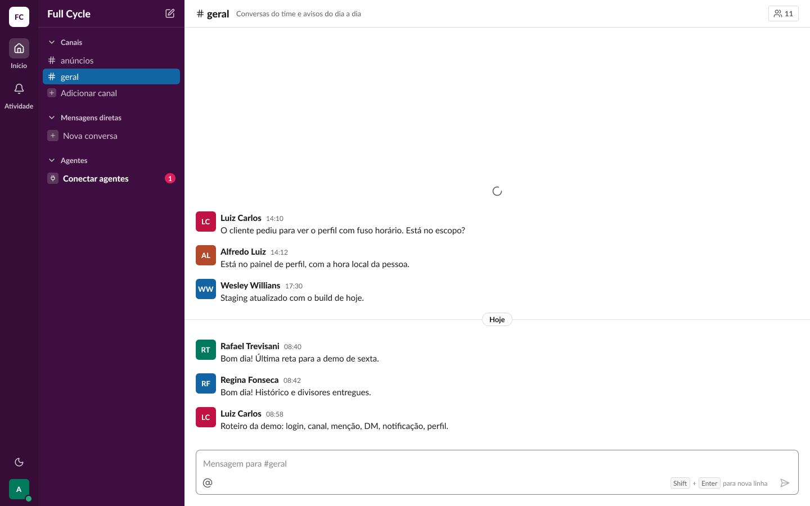 | 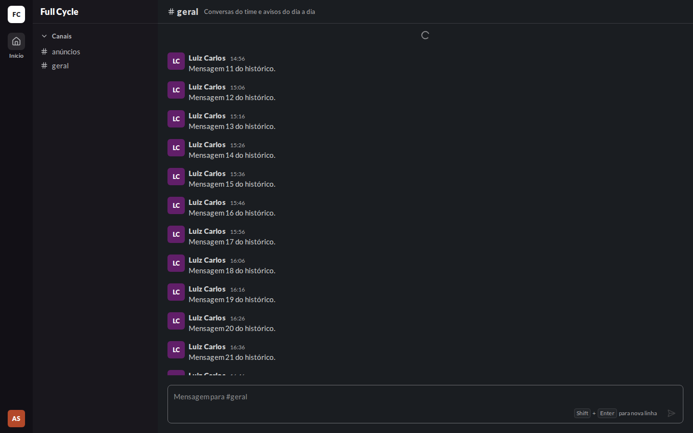 | 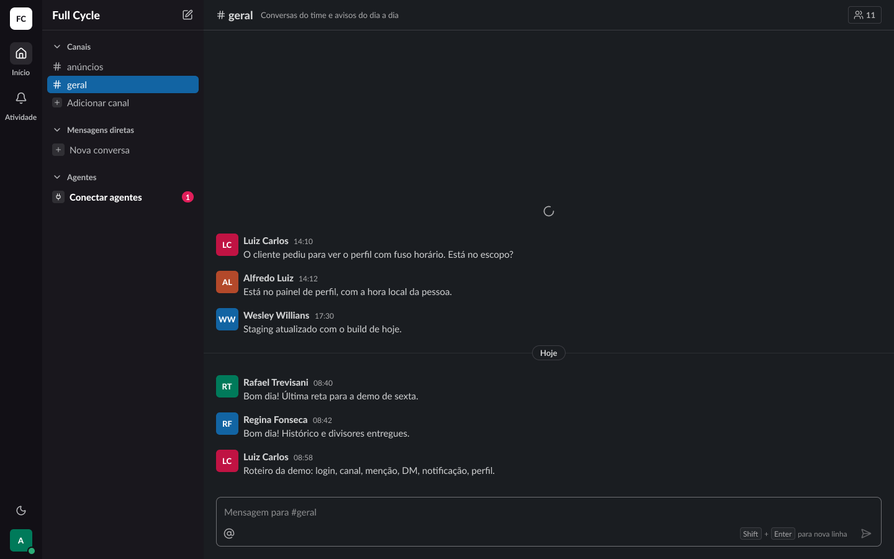 |
| Lista · Início do canal | 21:4808 | 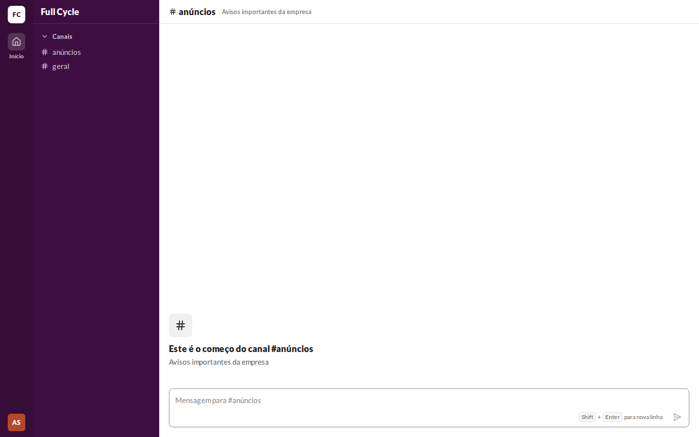 | 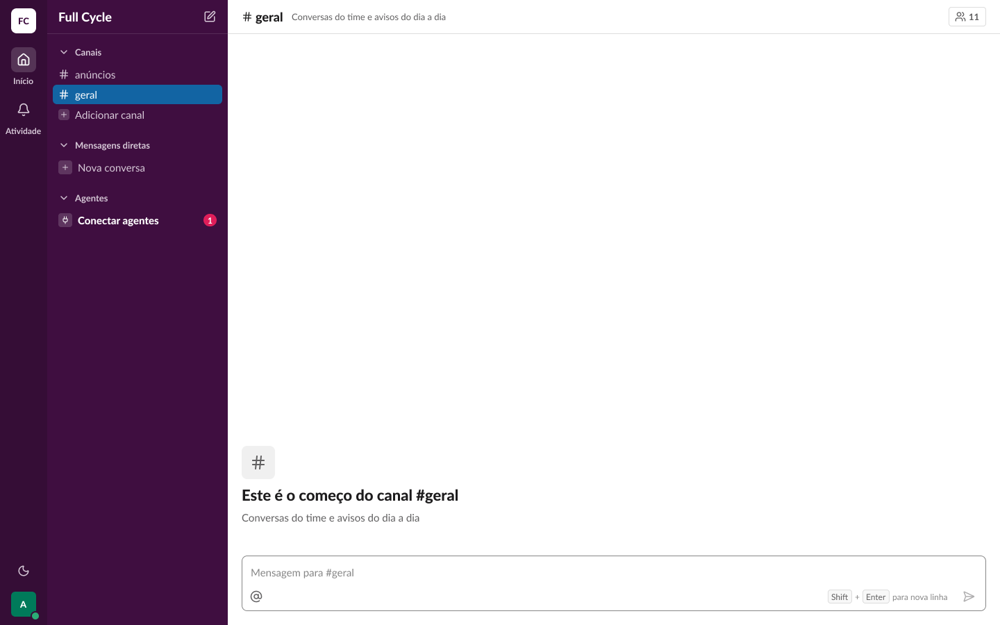 | 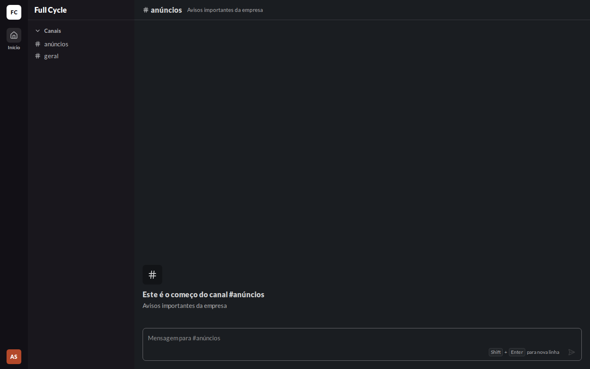 | 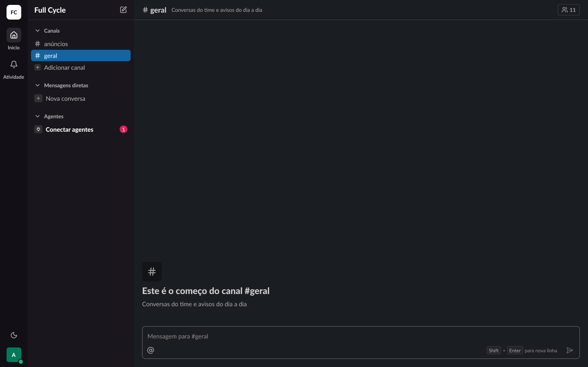 |

## Diferenças encontradas

- **Mais Mensagens na web.** O frame mostra seis Mensagens abaixo do link e do indicador; a web
  tem uma página inteira, então o link fica no topo e a lista enche a tela. É dado, e não desenho:
  a faixa de 48 px, o link em `text-small` na cor `link` e o Spinner de 20 no centro batem com o
  frame.
- **Indicador dentro do botão.** Na web, o Spinner fica dentro do próprio botão "Carregar mensagens
  anteriores" durante a carga, para quem chegou pelo teclado não perder o foco. Visualmente é igual
  ao frame.
- **Canal do começo.** O frame usa `#geral`; a captura usa `#anúncios`, porque `#geral` tem
  Mensagens no banco de desenvolvimento. O desenho (quadro de 48 com `#`, título e Tópico) é o
  mesmo.
- **Sem a linha ativa, o divisor de dia e os itens de outras funcionalidades:** os mesmos da
  validação da F02-T02 (`../02-abrir-um-canal-e-enviar-uma-mensagem/validacao-visual.md`).
