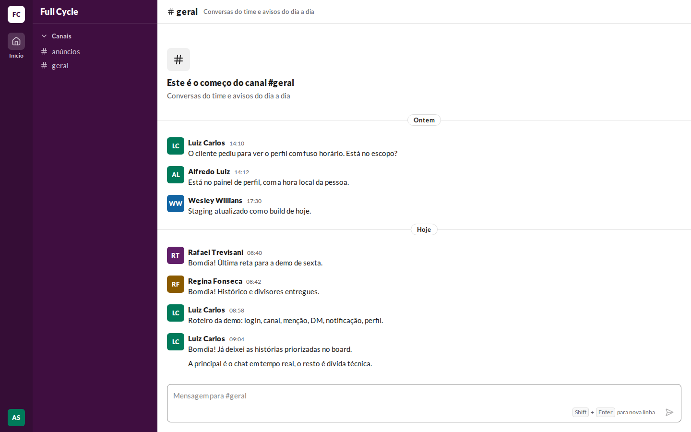
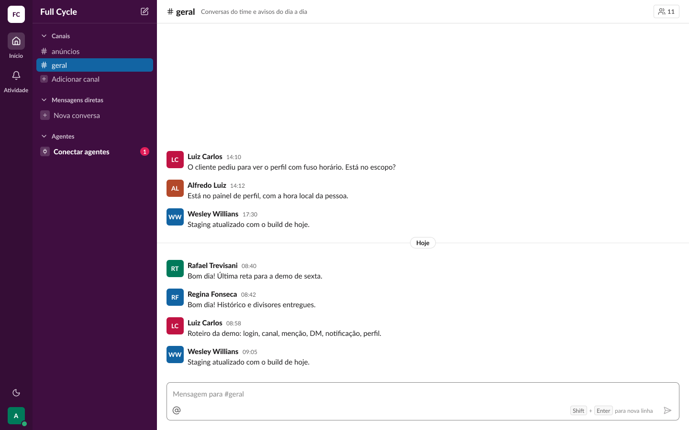
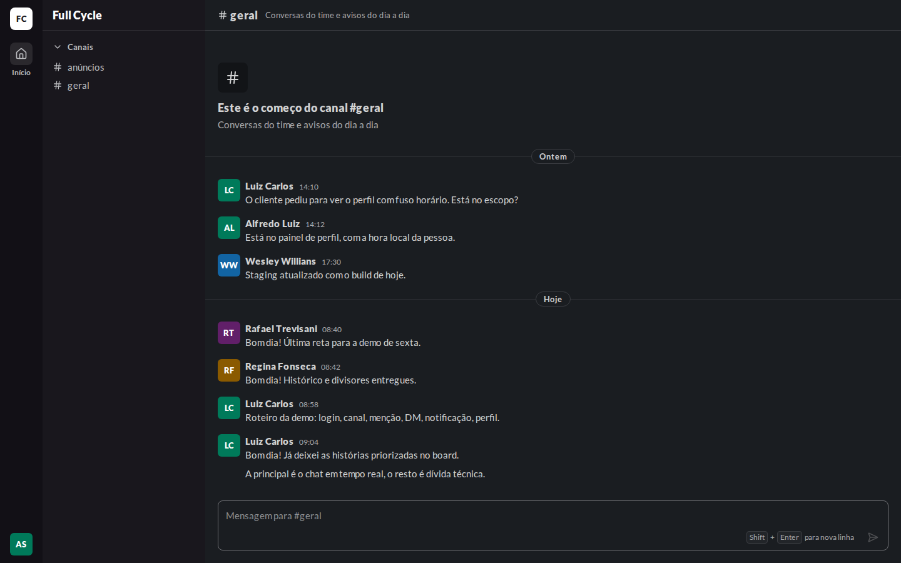
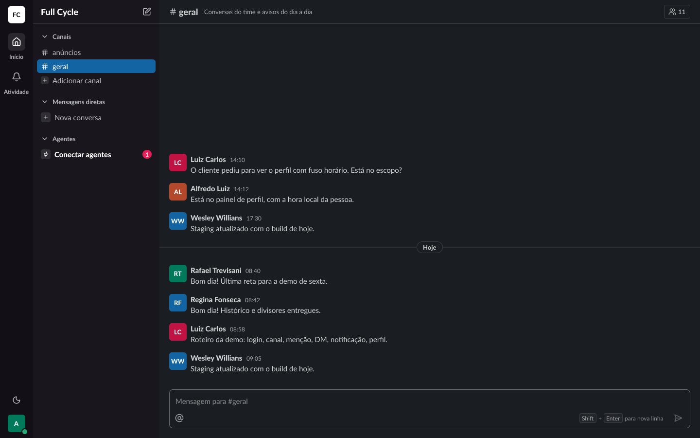
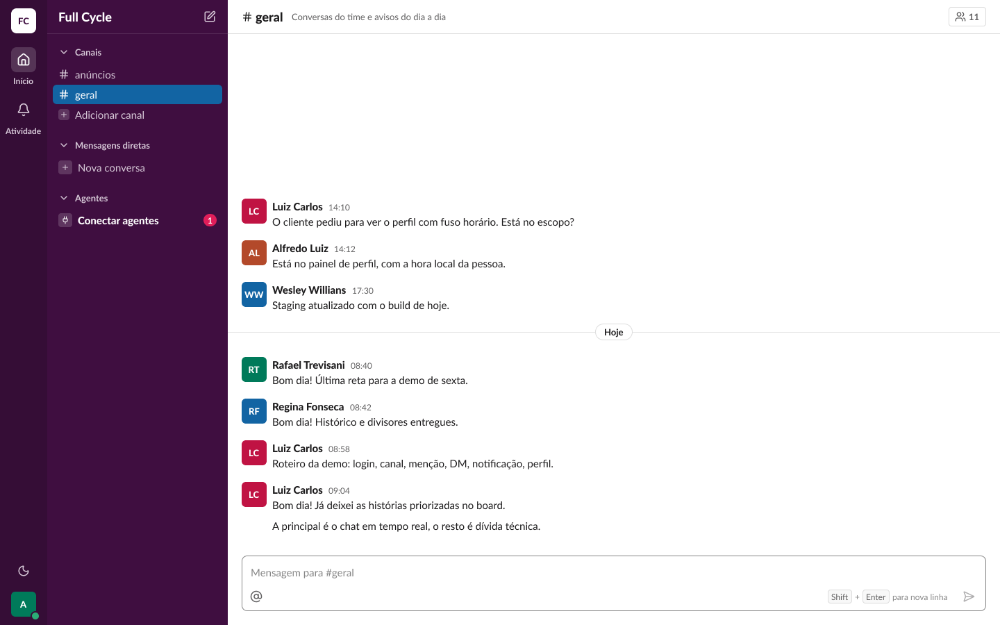
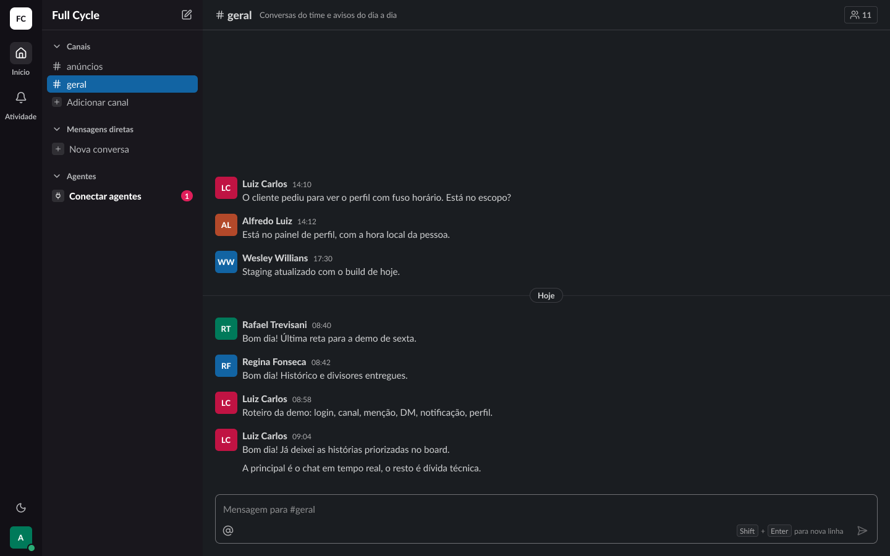

# Validação visual da F02-T04

Capturas da web em 1440 × 900, no Chromium do contêiner `e2e`, ao lado das capturas dos frames
do Figma (arquivo `slack`, página Telas). O tema escuro da web é o `data-theme="dark"` na raiz. No
Figma, a página Telas está no modo Dark da coleção Semantic; a captura clara aplicou o modo Light
só a cada frame, removido depois.

Os dados da web imitam os do frame "Mensagem / Compacta": `#geral` do banco de desenvolvimento,
com as Mensagens das mesmas Pessoas e nos mesmos horários. "Luiz Carlos" escreve às 09:04 e às
09:05, e a segunda vira compacta. As Mensagens foram apagadas depois da captura. A mesma captura
mostra a forma completa, a compacta e o divisor, e por isso aparece nas duas linhas.

| Estado | Frame | Web, claro | Figma, claro | Web, escuro | Figma, escuro |
| --- | --- | --- | --- | --- | --- |
| Mensagem · Completa (com divisor "Hoje") | 22:6386 |  |  |  |  |
| Mensagem · Compacta | 22:7404 |  |  |  |  |

## Diferenças encontradas

- **Divisor "Ontem" e começo do Canal no topo.** Na web, o histórico curto cabe na tela inteira,
  então aparecem o começo do Canal e o divisor do primeiro dia. O frame é um recorte de um
  histórico mais longo, sem esse começo. O divisor e a forma compacta batem com o frame: a calha de
  36 px, a hora escondida até o hover e nenhum espaço de 8 px antes da compacta.
- **A forma compacta guarda a hora na calha.** Ela aparece no hover e no foco, como no Figma, e
  fica sempre disponível ao leitor de tela.
- **Sem a linha ativa da barra lateral e sem os itens de outras funcionalidades:** os mesmos da
  validação da F02-T02 (`../02-abrir-um-canal-e-enviar-uma-mensagem/validacao-visual.md`).
