# Validação visual da F02-T05

Capturas da web em 1440 × 900, no Chromium do contêiner `e2e`, ao lado das capturas dos frames
do Figma (arquivo `slack`, página Telas). O tema escuro da web é o `data-theme="dark"` na raiz. No
Figma, a página Telas está no modo Dark da coleção Semantic; a captura clara aplicou o modo Light
só a cada frame, removido depois.

Os dados da web imitam os dos frames: `#geral` do banco de desenvolvimento com as Mensagens das
mesmas Pessoas, apagadas depois. A Mensagem "enviando" foi segurada na rota do Server Action, e a
falha veio da mesma rota abortada.

| Estado | Frame | Web, claro | Figma, claro | Web, escuro | Figma, escuro |
| --- | --- | --- | --- | --- | --- |
| Mensagem · Enviando | 22:11072 | 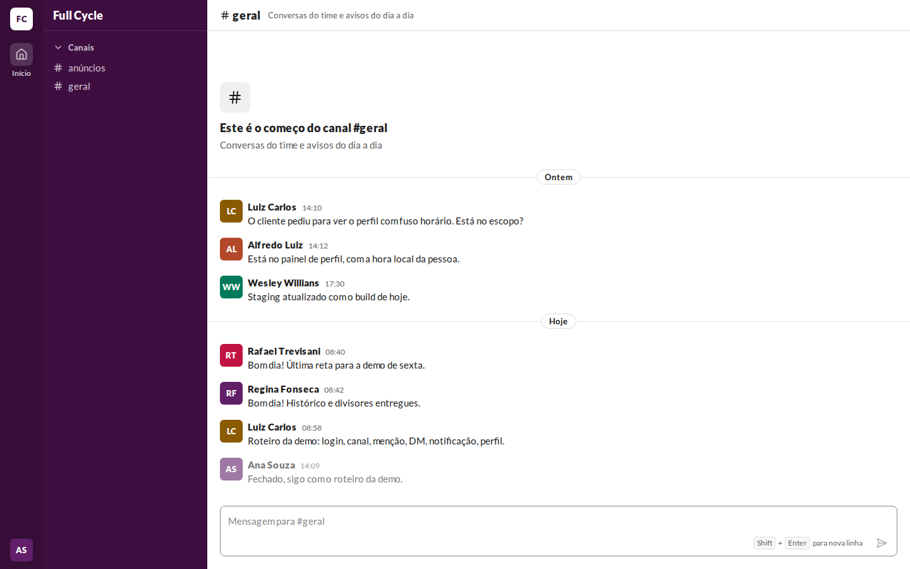 | 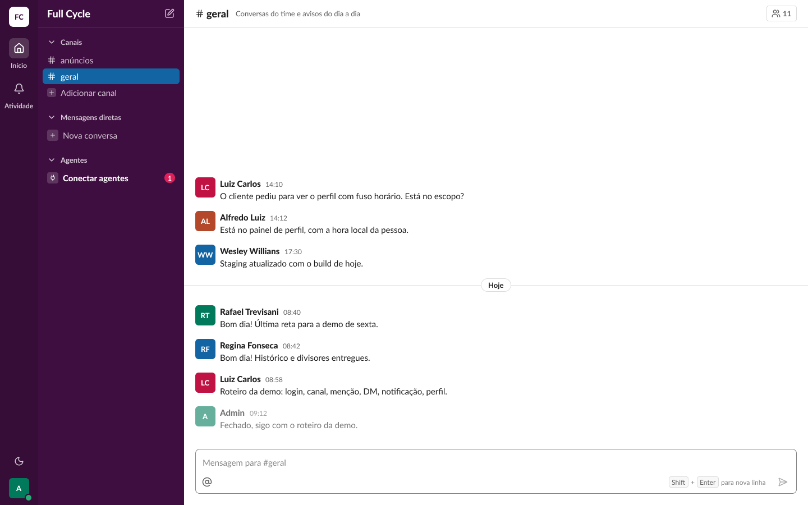 | 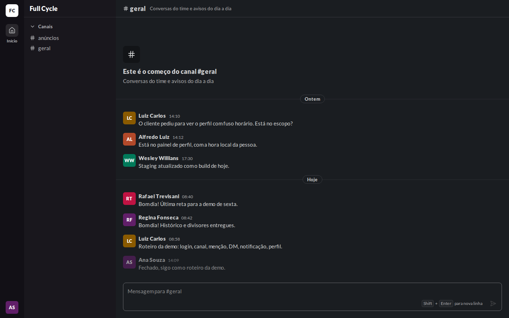 | 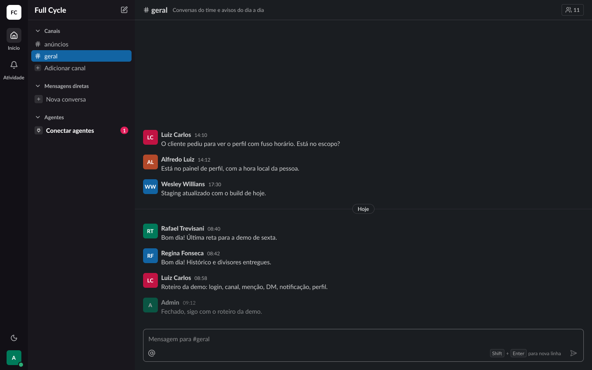 |
| Mensagem · Falha no envio | 22:12030 | 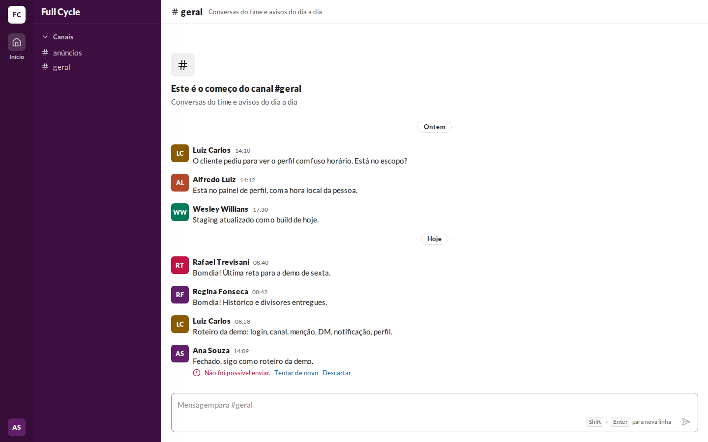 | 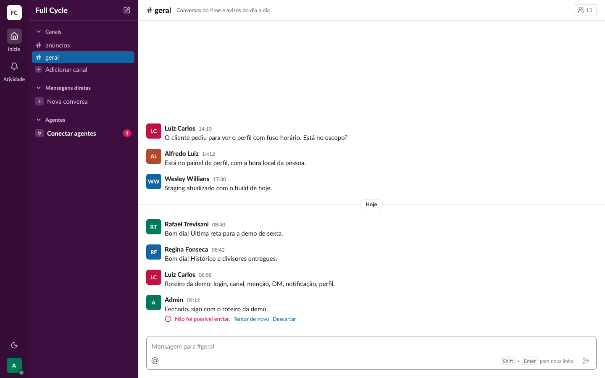 | 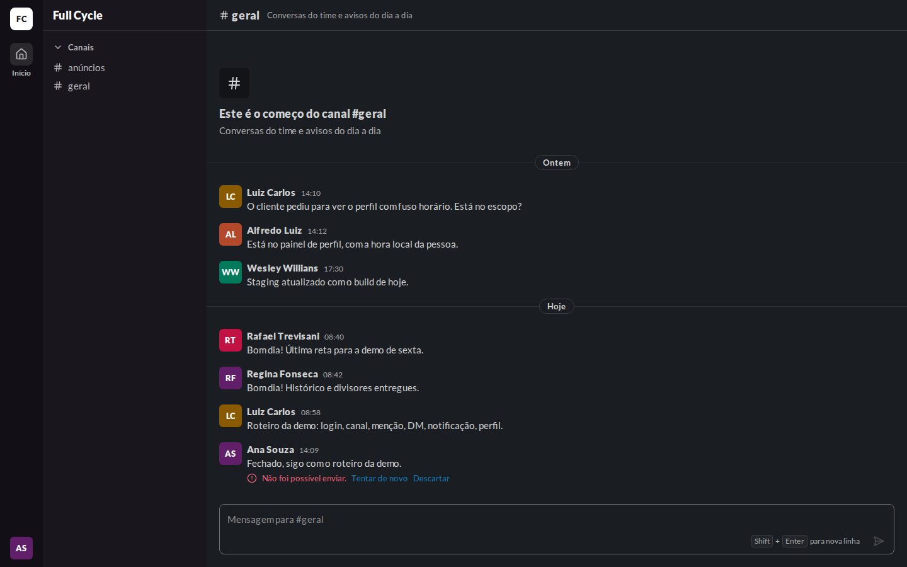 | 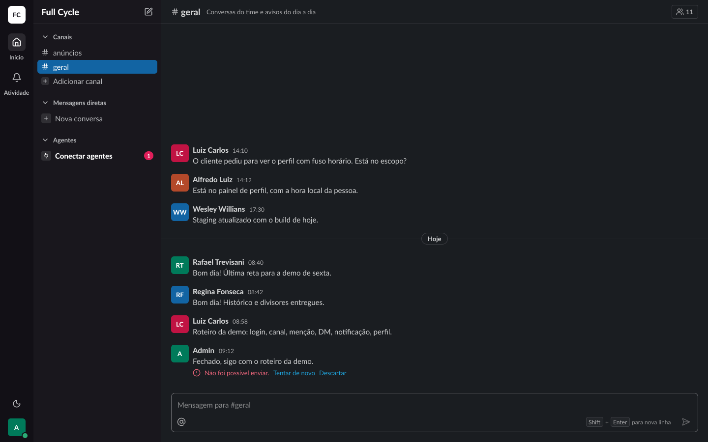 |
| Composer · Acima do limite | 23:13781 | 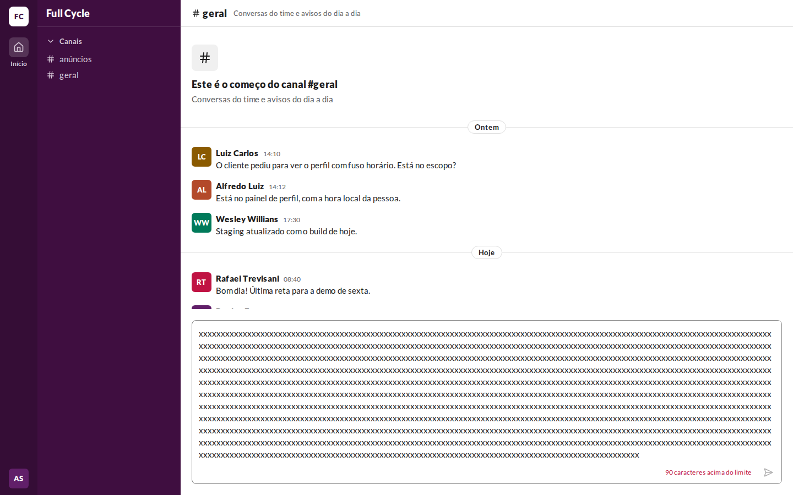 | 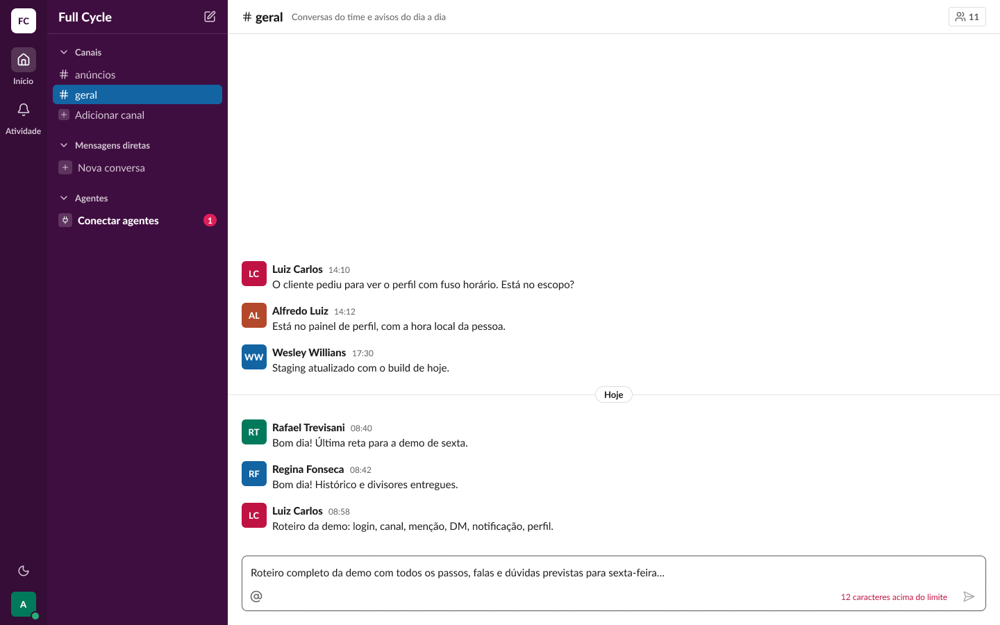 | 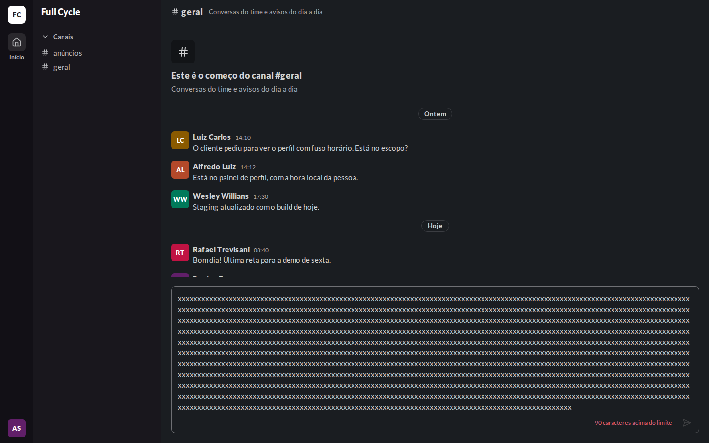 | 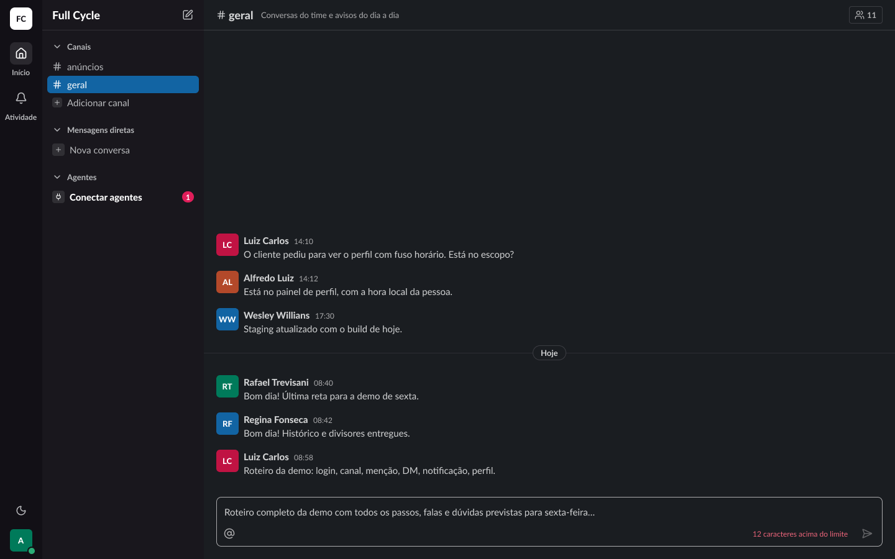 |

## Diferenças encontradas

- **"Tentar de novo" e "Descartar" afastados (corrigido).** Na primeira captura, os botões tinham
  a altura e o padding do tamanho padrão do Button, porque o `buttonVariants` usado fora do
  componente não passava pelo `tailwind-merge`. Agora o `buttonVariants` devolve as classes
  mescladas, e a variante `link` não tem altura nem padding, como diz a descrição do Button no
  Figma. Capturas refeitas.
- **Texto acima do limite.** Na web, a caixa cresce até o máximo de altura com o texto longo de
  verdade; o frame mostra o texto cortado numa linha. O contador "N caracteres acima do limite" em
  `danger-fg` no lugar da dica e o botão desabilitado batem com o frame.
- **Começo do Canal, divisor "Ontem", linha ativa e itens de outras funcionalidades:** os mesmos
  das validações da F02-T02 e da F02-T04.
