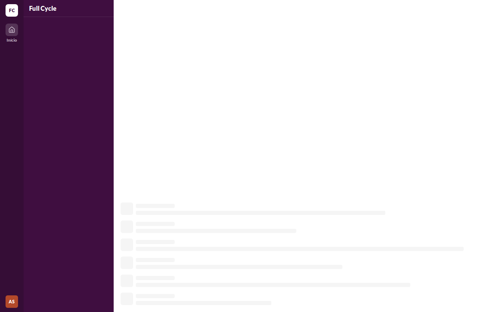
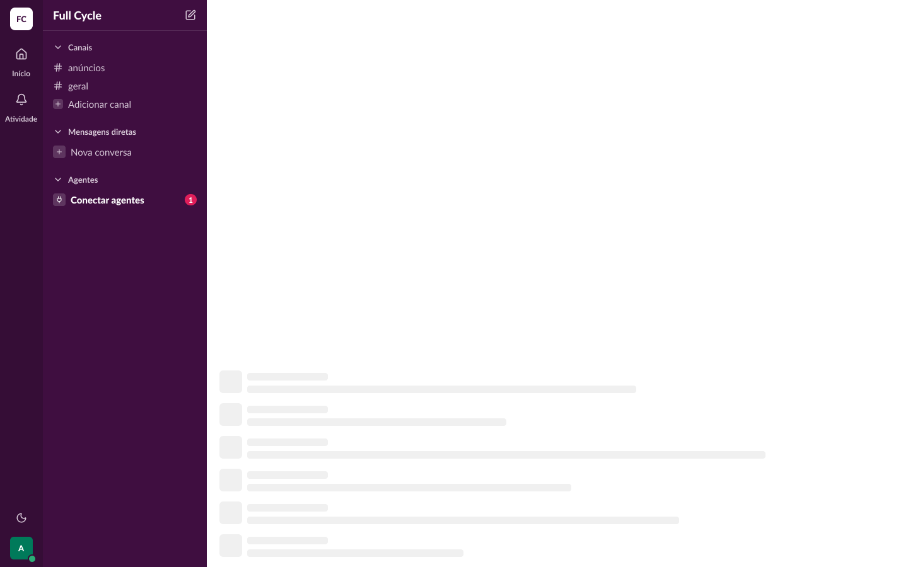
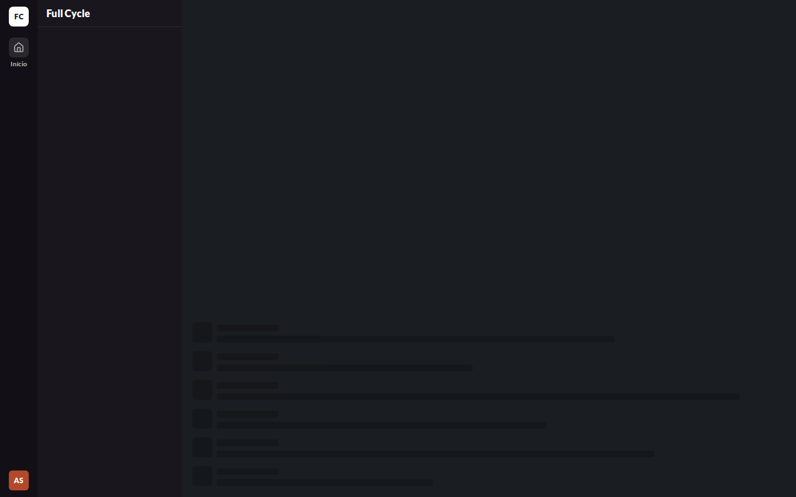
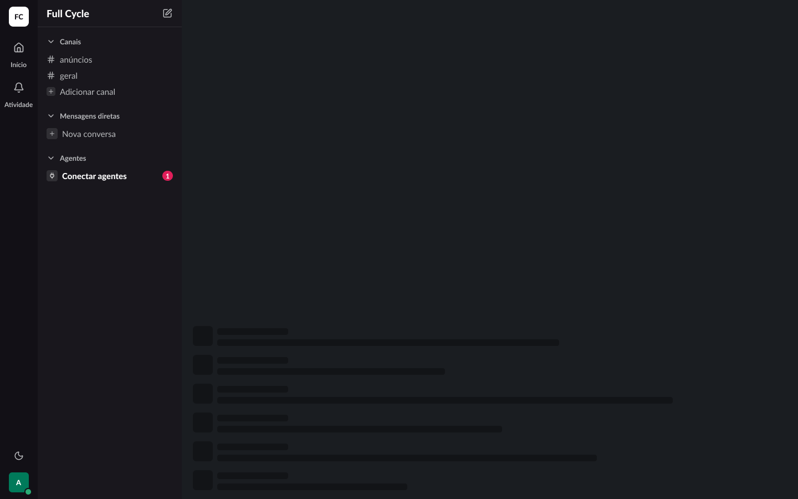
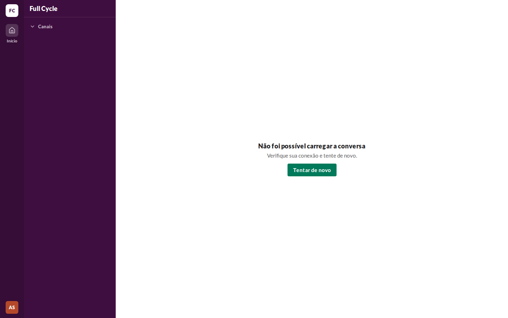
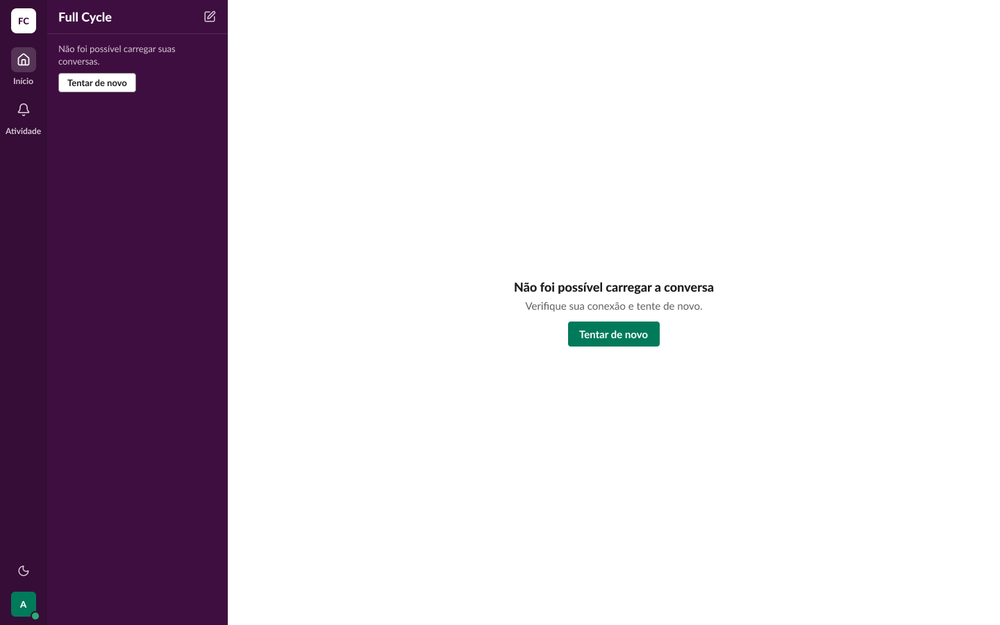
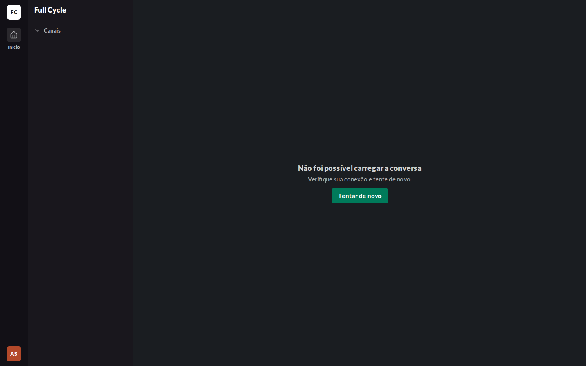
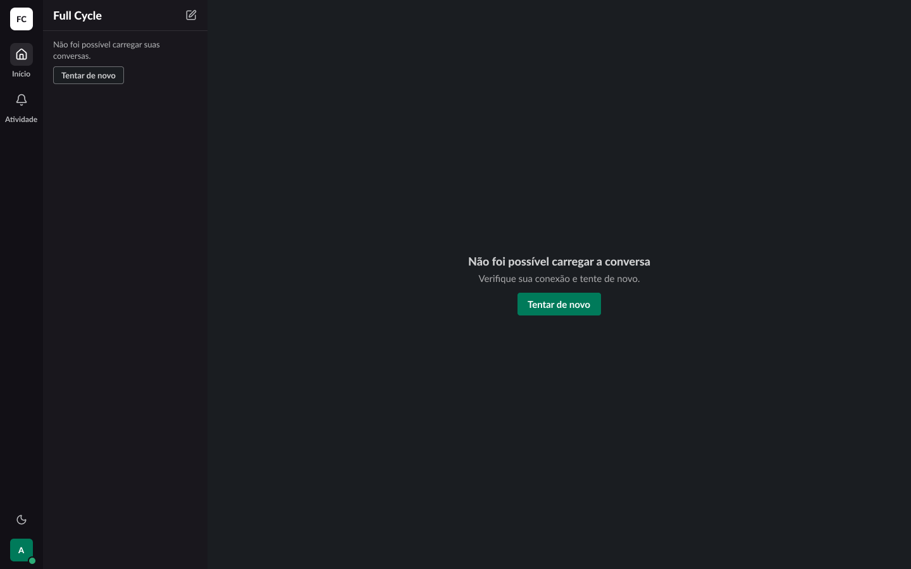

# Validação visual da F02-T06

Capturas da web em 1440 × 900, no Chromium do contêiner `e2e`, tiradas na verificação de
`erro-da-lista.md`, ao lado das capturas dos frames do Figma (arquivo `slack`, página Telas). O
tema escuro da web é o `data-theme="dark"` na raiz. No Figma, a página Telas está no modo Dark da
coleção Semantic; a captura clara aplicou o modo Light só a cada frame, removido depois.

| Estado | Frame | Web, claro | Figma, claro | Web, escuro | Figma, escuro |
| --- | --- | --- | --- | --- | --- |
| Home · Carregando | 19:1533 |  |  |  |  |
| Conversa · Erro ao carregar a lista | 26:46375 |  |  |  |  |

## Diferenças encontradas

- **Barra lateral.** No carregamento, ela fica vazia, porque a lista também está esperando. No
  erro, ela mostra a seção "Canais" vazia, e não "Não foi possível carregar suas conversas." com
  "Tentar de novo". O esqueleto e o erro da barra lateral são da F02-T07.
- **Esqueletos e erro na área principal.** Batem com os frames: seis Mensagens de esqueleto no fim
  da área, e o EmptyState com o título, a descrição e o Button primário.
- **Itens de outras funcionalidades:** os mesmos da validação da F02-T02.
