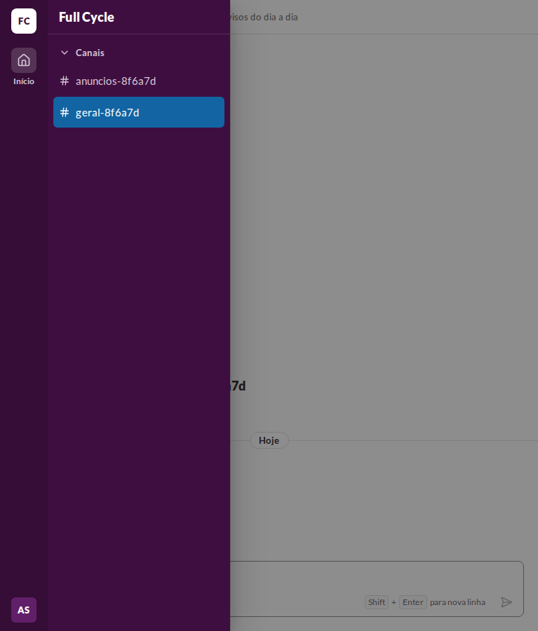
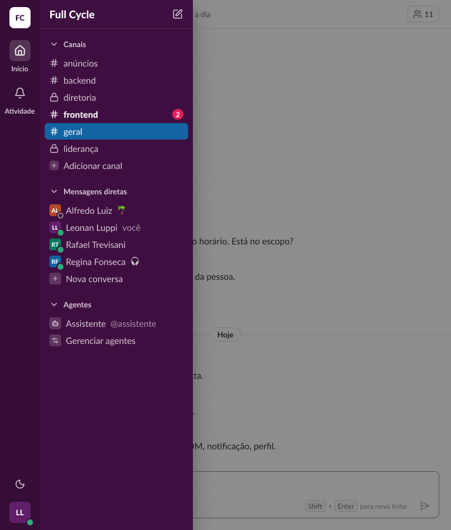
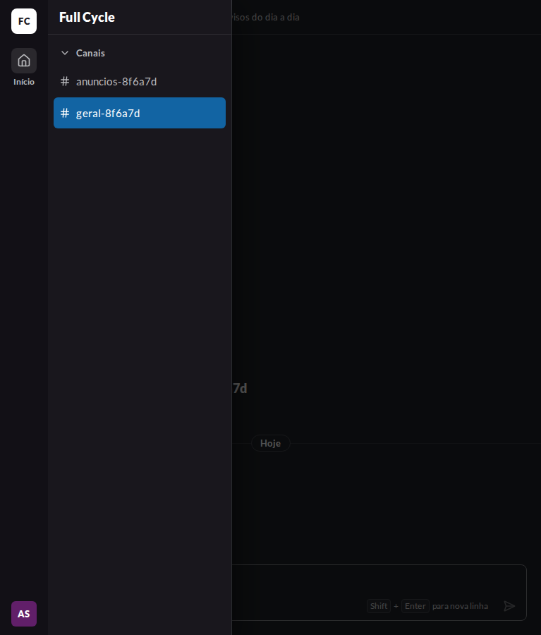
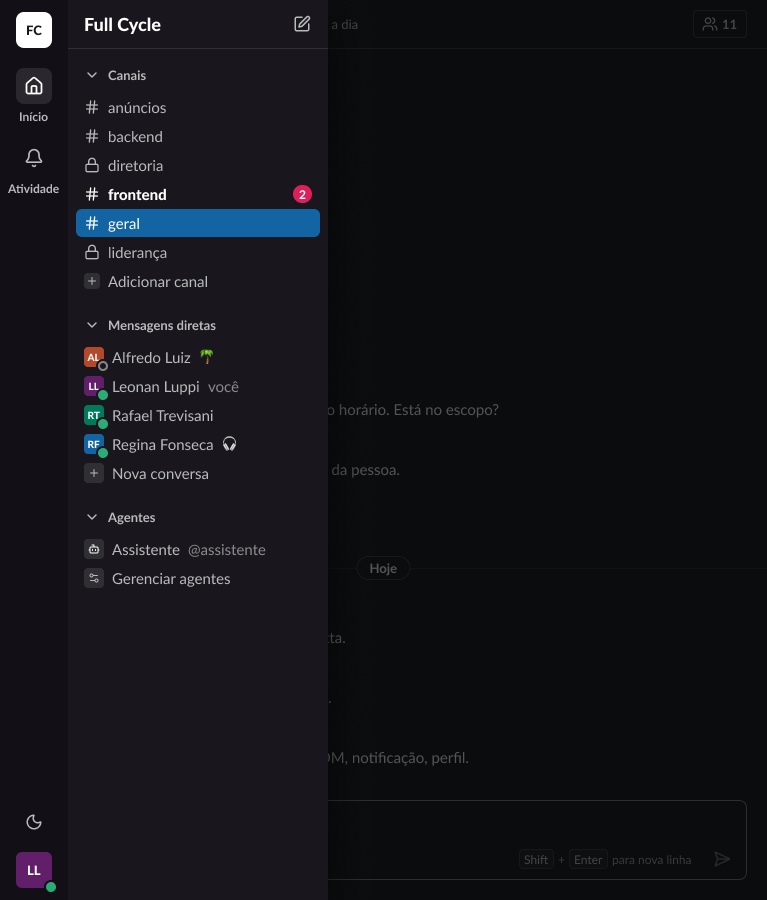
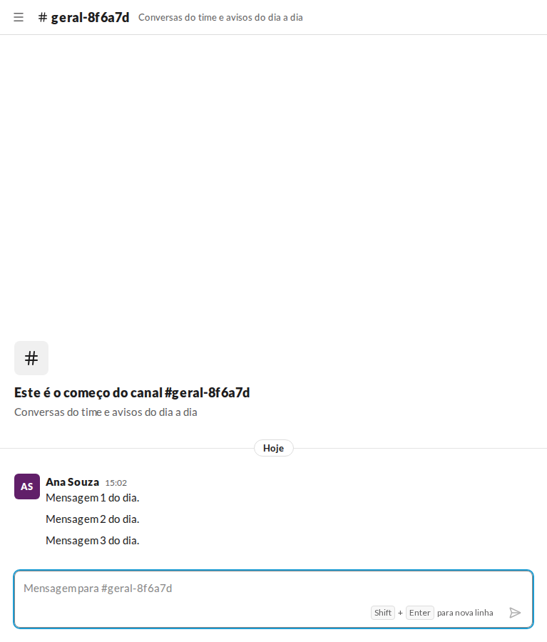
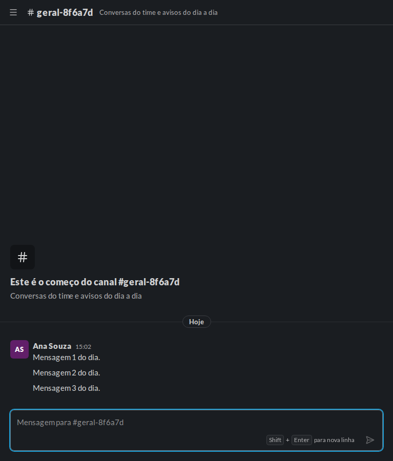

# Validação visual da F02-T08

Capturas da web em 767 × 900, no Chromium do contêiner `e2e`, ao lado das capturas do frame novo do
Figma, "Casca / Gaveta / Aberta" (104:32864, seção Casca da página Telas). O tema escuro da web é o
`data-theme="dark"` na raiz. No Figma, a página Telas está no modo Dark da coleção Semantic. A captura
clara aplicou o modo Light só ao frame, e ele foi removido depois.

## Mudanças no Figma

- **ConversationHeader:** ganhou a propriedade booleana `Menu`, desligada por padrão. Ela mostra, no
  começo do cabeçalho, uma instância do IconButton (`Tone=default`, `Size=md`) com `icon/menu`. A
  descrição do component set registra o comportamento.
- **"Casca / Gaveta / Aberta":** é um frame novo, em 767 × 900, feito a partir de "Casca / Sidebar /
  Com dados". Ele tem:
  - o cabeçalho com `Menu` ligado;
  - o overlay em `surface/surface-overlay`;
  - a gaveta com as instâncias do Rail e da Sidebar, em `elevation-3`.
- **`icon/menu`:** já existia na seção Ícones.

| Estado | Web, claro | Figma, claro | Web, escuro | Figma, escuro |
| --- | --- | --- | --- | --- |
| Gaveta aberta |  |  |  |  |
| Gaveta fechada (botão no cabeçalho) |  | — |  | — |

## Diferenças encontradas

- **Altura das linhas.** Na web, as linhas da barra lateral têm 44 px abaixo de `md`, como manda o
  design system ("Layout e responsividade"). As instâncias da Sidebar no frame mantêm as linhas de
  28 px do componente, que não tem variante de tamanho.
- **Itens de outras funcionalidades:** os mesmos da validação da F02-T02. São eles a Atividade no
  Rail, o botão de nova mensagem, as outras seções da Sidebar, o contador de Pessoas no cabeçalho e
  o botão de menções.
