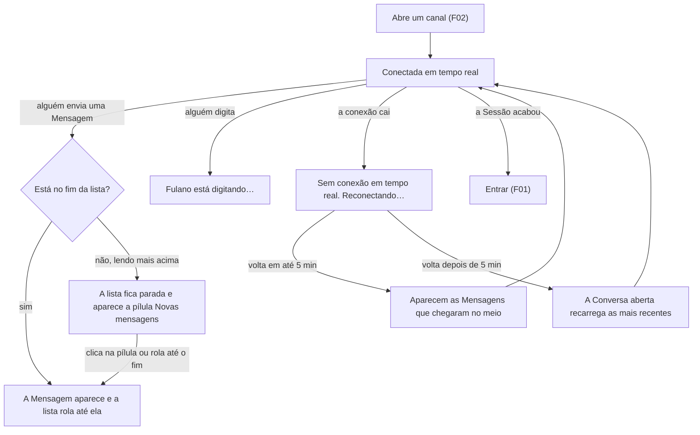

# PRD · F03 · Tempo real

2026-11-09 · Luiz Carlos · Status: aprovado

## 1. Resumo executivo

- **Problema:** depois da F02 a pessoa conversa nos canais públicos, mas só vê o que os outros
  escreveram ao reabrir o canal ou recarregar a página. A conversa parece parada, ninguém sabe se
  alguém está respondendo, e o chat não serve para o uso diário.
- **Solução proposta:** as Mensagens dos outros aparecem na Conversa aberta em até 1 s, sem
  recarregar; a pessoa vê quem está digitando; quando a conexão cai, um aviso mostra que o chat
  está reconectando, e ao voltar aparece tudo o que chegou no meio, sem recarregar a página.
- **Critérios de sucesso:** esta funcionalidade não move sozinha nenhuma métrica do product brief
  (seção "Objetivos e métricas de sucesso"). Ela cumpre, do requisito não funcional "Desempenho"
  do brief, as mensagens em tempo real e a recuperação do que se perdeu numa queda de conexão, e
  o requisito "Acessibilidade" nas telas que entrega. É pré-requisito das ações na mensagem (F06),
  cuja mudança aparece para todos na hora, e das respostas dos agentes (F11), que chegam na
  Conversa sem recarregar.

## 2. Experiência do usuário e funcionamento

### Personas

- **Pessoa do workspace:** conversa nos canais públicos (F02), no navegador do computador de
  trabalho, muitas vezes com o chat aberto numa aba enquanto faz outra coisa.

### Regras do tempo real nesta funcionalidade

- O tempo real vale para as Conversas de que a Pessoa é Membro. Na F03, são os canais públicos.
- A Pessoa recebe as Mensagens novas de todas as abas do navegador em que tem o chat aberto,
  inclusive as que ela mesma enviou por outra aba.
- O "digitando" só aparece na Conversa aberta. As outras Conversas não mostram nada até a F07
  (não lidas).

### Fluxo

### Histórias de usuário

1. Como pessoa do workspace, quero ver as Mensagens dos outros chegarem na Conversa aberta sem
   recarregar a página para acompanhar a conversa enquanto ela acontece.
2. Como pessoa do workspace, quero ser avisada de que chegaram Mensagens quando estou lendo
   Mensagens antigas para não perder o que chegou nem ser tirada do ponto em que estou lendo.
3. Como pessoa do workspace, quero ver quem está digitando na Conversa aberta para saber que vem
   resposta e esperar por ela.
4. Como pessoa do workspace, quero saber quando o chat perdeu a conexão em tempo real para não
   achar que a conversa parou.
5. Como pessoa do workspace, quero receber, ao reconectar, as Mensagens que chegaram enquanto eu
   estava sem conexão para não perder nada e não precisar recarregar a página.
6. Como pessoa do workspace, quero que o tempo real pare quando minha Sessão acabar para que
   ninguém continue lendo minhas conversas num navegador de que eu saí.

### Critérios de aceite

**Todas as histórias**

- As telas seguem o design system do projeto e os frames "Conversa / Lista / Digitando",
  "Conversa / Lista / Novas mensagens abaixo" e "Casca / Banner de reconexão" do Figma do projeto,
  nos temas claro e escuro, e atingem 100 na nota de Acessibilidade do Lighthouse.
- Tudo funciona só pelo teclado, e nada do que chega em tempo real tira o foco de onde ele está,
  nem o texto que a pessoa está escrevendo na caixa de mensagem.

**História 1, Mensagens chegando**

- Uma Mensagem enviada por outra Pessoa aparece na Conversa aberta de quem é Membro em até 1 s,
  no p95, contado da gravação da Mensagem. A carga em que a medida vale segue as hipóteses de
  dimensionamento do HLD: A definir.
- A Mensagem chega como as do histórico da F02: avatar, nome, hora, texto, forma compacta e
  divisor de dia seguem as mesmas regras.
- Todas as Pessoas veem as Mensagens da Conversa na mesma ordem, a ordem em que foram gravadas.
- Uma Mensagem nunca aparece duas vezes, inclusive a que a própria pessoa enviou e que volta pelo
  tempo real.
- Uma Mensagem enviada pela pessoa noutra aba do mesmo navegador aparece nesta aba, se a Conversa
  estiver aberta, como Mensagem já enviada.
- Ao abrir uma Conversa que não estava aberta, ela mostra também as Mensagens que chegaram desde a
  última vez em que foi aberta naquela aba.
- A aba em segundo plano continua recebendo as Mensagens: ao voltar para ela, estão todas lá.

**História 2, pílula de novas Mensagens**

- Se a pessoa está no fim da lista quando uma Mensagem chega, a lista rola até ela.
- Se a pessoa está lendo mais acima, a lista não se move e aparece a pílula "Novas mensagens",
  como em "Conversa / Lista / Novas mensagens abaixo".
- Clicar na pílula, ou ativá-la pelo teclado, leva ao fim da lista. A pílula some quando a pessoa
  chega ao fim, por ela ou rolando.
- A Mensagem que a própria pessoa envia sempre rola a lista até o fim, como na F02.

**História 3, "digitando"**

- Quando outra Pessoa escreve na caixa de mensagem da Conversa aberta, aparece acima da caixa,
  em até 1 s no p95, "Fulano está digitando…", como em "Conversa / Lista / Digitando".
- Com duas Pessoas, "Fulano e Beltrana estão digitando…". Com três ou mais, "Várias pessoas estão
  digitando…".
- A pessoa nunca vê a si mesma no "digitando", nem quando escreve em outra aba.
- O aviso some quando a Pessoa envia a Mensagem, apaga todo o texto, troca de Conversa, fecha a
  aba ou passa 5 s sem digitar.
- O aviso não desloca a lista de Mensagens nem a caixa de mensagem: ele ocupa uma linha reservada.

**História 4, aviso de conexão**

- Quando a conexão em tempo real cai, por falha da rede, do servidor ou depois de o computador
  sair da suspensão, a faixa "Sem conexão em tempo real. Reconectando…" aparece no topo da tela,
  como em "Casca / Banner de reconexão".
- A faixa só aparece depois de 3 s sem conexão, para que uma queda curta não pisque na tela, e
  some assim que a conexão volta.
- O chat tenta reconectar sozinho enquanto a aba estiver aberta, sem a pessoa fazer nada.
- Durante a queda, a pessoa continua lendo, rolando o histórico e enviando Mensagens. Um envio
  que falhar segue a F02 (história 6).
- Durante a queda, o "digitando" dos outros some.

**História 5, recuperar o que se perdeu**

- Numa queda de até 5 minutos, ao reconectar, as Mensagens que chegaram no meio aparecem na
  Conversa aberta, na ordem, sem duplicar e sem recarregar a página. As regras da história 2
  valem para elas: no fim da lista, a lista rola; lendo mais acima, aparece a pílula.
- Numa queda de mais de 5 minutos, ao reconectar, a Conversa aberta recarrega as Mensagens mais
  recentes, como ao abri-la (F02, história 3), sem recarregar a página e sem perder o texto que a
  pessoa está escrevendo.
- As Mensagens com falha no envio (F02, história 6) continuam na lista depois da reconexão.

**História 6, Sessão que acabou**

- Se a Sessão vencer, for revogada ou a pessoa sair em outra aba (F01, história 5), a aba para de
  receber Mensagens e "digitando" e vai para "Entrar", como na F01 (história 6).
- O tempo máximo entre a Sessão acabar e a aba parar de receber Mensagens: A definir.

### O que não é objetivo

- Presença (disponível, ausente) e a bolinha de presença no avatar: F09.
- Não lidas, menções e o divisor de novas Mensagens: F07.
- Edição e exclusão de Mensagens aparecendo para todos: F06, que usa o tempo real desta
  funcionalidade.
- Notificações na tela e do navegador: F08.
- Canais novos aparecendo na barra lateral sem recarregar: os canais públicos ainda são criados por
  script, e a criação pelo produto vem com a F04.
- "Digitando" na barra lateral ou em Conversas que não estão abertas.
- Recuperar, sem recarregar a Conversa, uma queda de mais de 5 minutos.
- Ver as Mensagens chegarem com a aba fechada: a notificação do navegador é da F08 e também
  depende de o chat estar aberto em alguma aba.
- Botão para reconectar à mão.

## 3. Requisitos do sistema de IA

Não se aplica: a F03 não envolve agentes.

## 4. Riscos de produto

| Risco | Mitigação |
| --- | --- |
| A pessoa perde Mensagens numa queda e não percebe, e responde fora de contexto | A faixa de reconexão mostra a queda; ao voltar, o que chegou no meio aparece, e uma queda mais longa recarrega a Conversa aberta |
| A Mensagem chega duplicada ou fora de ordem, e a conversa fica confusa | A ordem é a da gravação, igual para todos, e uma Mensagem nunca aparece duas vezes, nem a própria nem a recuperada depois da queda |
| A Mensagem que chega tira a pessoa do ponto em que estava lendo | A lista só rola sozinha quando a pessoa está no fim; lendo mais acima, aparece a pílula |
| A faixa de reconexão pisca a cada oscilação da rede e a pessoa passa a ignorá-la | A faixa só aparece depois de 3 s sem conexão |
| O "digitando" fica preso na tela depois que a pessoa parou, e os outros esperam uma resposta que não vem | O aviso some depois de 5 s sem digitar, ao trocar de Conversa, ao fechar a aba e na queda de conexão |
| Uma aba esquecida aberta continua mostrando conversas depois que a pessoa saiu | O fim da Sessão encerra o tempo real e leva a aba para "Entrar" |
