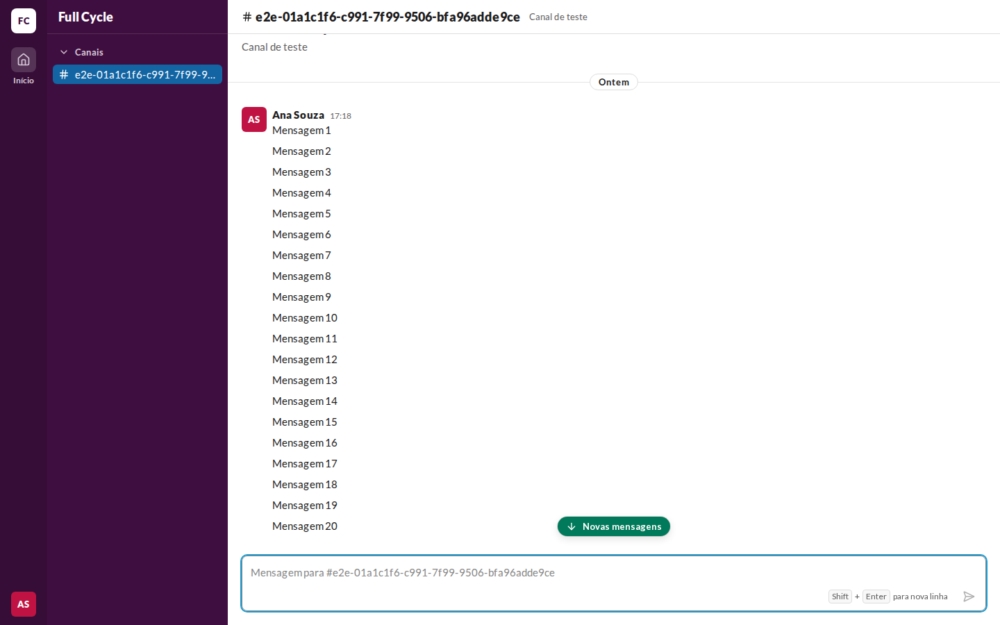
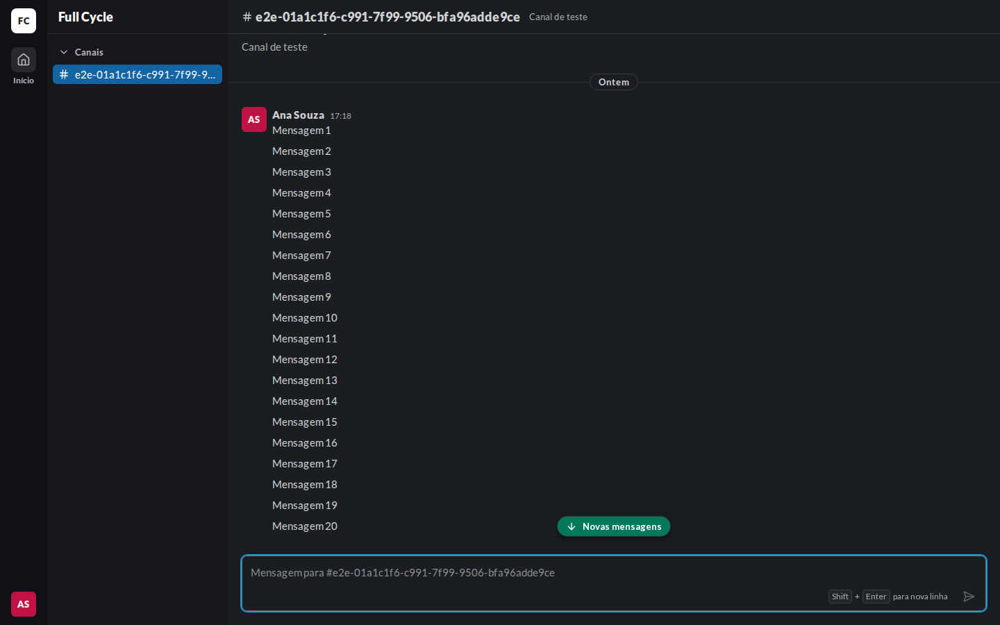
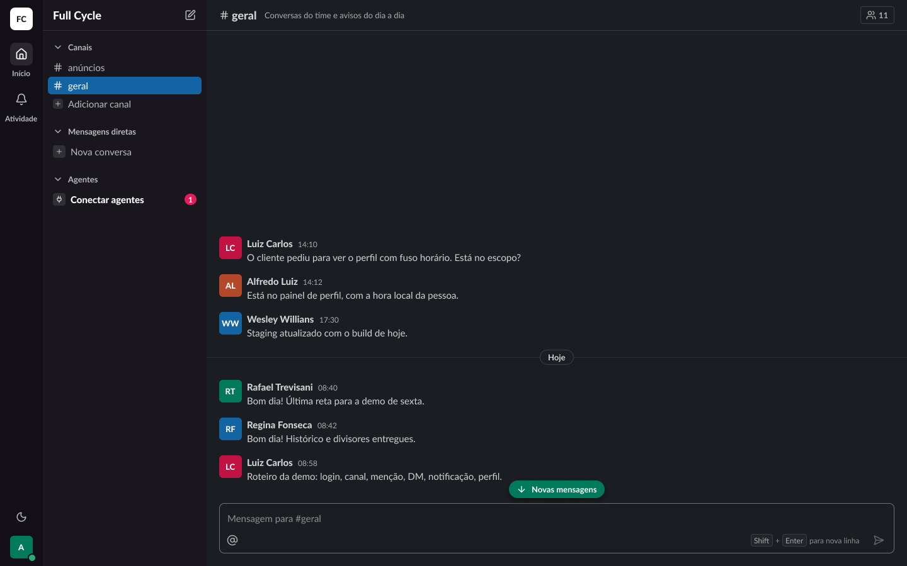

# Validação visual da F03-T03

Capturas da web em 1440 × 900, no Chromium do contêiner `e2e`, ao lado da captura do frame
"Conversa / Lista / Novas mensagens abaixo" (21:9308) do Figma (arquivo `slack`, página Telas, no
modo Dark da coleção Semantic). O tema escuro da web é o `data-theme="dark"` na raiz.

Os dados da web vêm de um teste: um Canal de teste com 40 Mensagens, a lista levada para longe do
fim e uma Mensagem enviada pela outra Pessoa, que faz a pílula aparecer.

| Estado | Web, claro | Web, escuro | Figma, escuro |
| --- | --- | --- | --- |
| Pílula "Novas mensagens" |  |  |  |

## O que bate

- A pílula: fundo `primary`, texto `on-primary` em `small/bold`, ícone de seta para baixo à
  esquerda, raio `pill`, sombra `elevation-2`, 28 px de altura e `px-3` com `gap-2`. Ela fica
  centralizada na largura da Conversa, logo acima da caixa de mensagem.
- Os mesmos tokens valem nos dois temas: a pílula não muda do claro para o escuro, como no Figma.

## Diferenças encontradas

- **Sem o Figma claro.** A página Telas está no modo Dark. A pílula usa só `primary` e
  `on-primary`, que são iguais nos dois temas (`docs/design-system.md`, "Tema escuro"), e por isso
  a captura clara do Figma não foi gerada.
- **O conteúdo da lista difere.** O frame mostra Mensagens de exemplo de várias Pessoas; a web,
  as Mensagens de teste. A posição da pílula é a mesma: sobre o fim da lista, acima da caixa.
- **O botão de Membros e os itens da barra lateral de outras funcionalidades** ficam de fora, como
  nas validações da F02.
