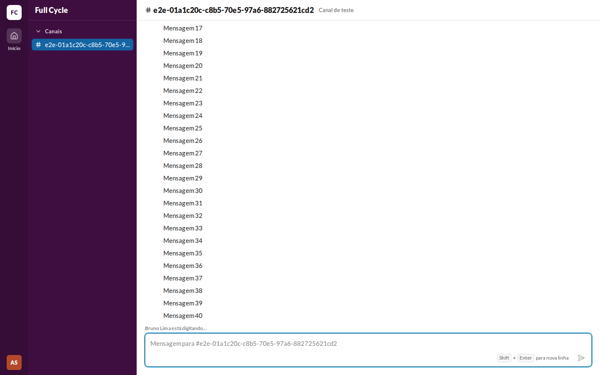
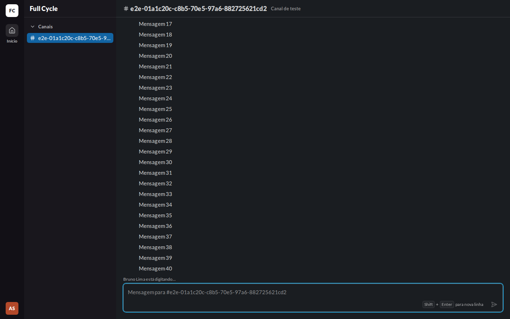
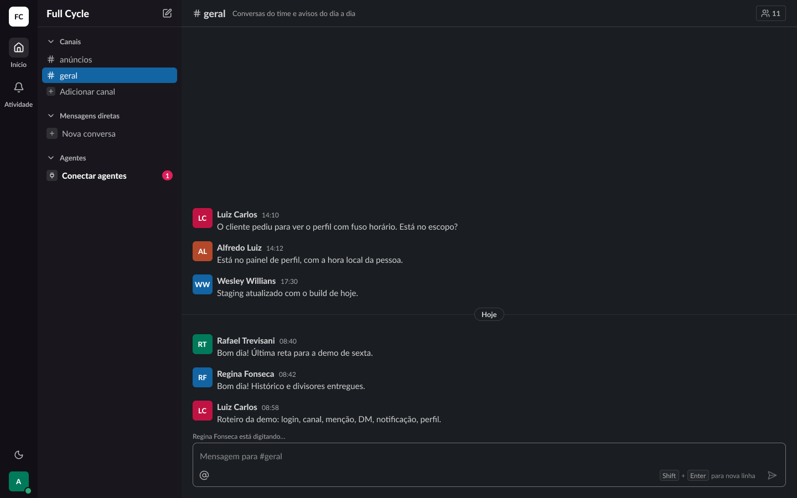

# Validação visual da F03-T04

Capturas da web em 1440 × 900, no Chromium do contêiner `e2e`, ao lado da captura do frame
"Conversa / Lista / Digitando" (21:8551) do Figma (arquivo `slack`, página Telas, no modo Dark da
coleção Semantic). O tema escuro da web é o `data-theme="dark"` na raiz.

Os dados da web vêm de um teste: um Canal de teste com 40 Mensagens, e a outra Pessoa, "Bruno
Lima", escrevendo na caixa dela sem enviar.

| Estado | Web, claro | Web, escuro | Figma, escuro |
| --- | --- | --- | --- |
| "Fulano está digitando…" |  |  |  |

## O que bate

- A linha de 20 px entre a lista e a caixa de mensagem, com o texto a 20 px da borda da Conversa,
  em `caption/regular` e `fg-muted`, como o frame Typing (21:8417).
- A linha ocupa o mesmo espaço com ou sem texto: a lista e a caixa não se movem quando o aviso
  aparece ou some.

## Diferenças encontradas

- **Sem o Figma claro.** A página Telas está no modo Dark; no claro, a web usa o `fg-muted` do
  tema claro, como o restante da Conversa.
- **O conteúdo da lista difere:** o frame mostra Mensagens de exemplo de várias Pessoas; a web, as
  Mensagens de teste.
- **O botão de Membros e os itens da barra lateral de outras funcionalidades** ficam de fora, como
  nas validações da F02.
