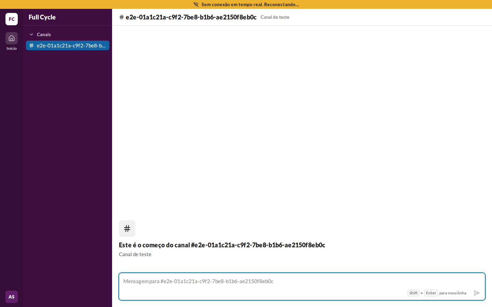
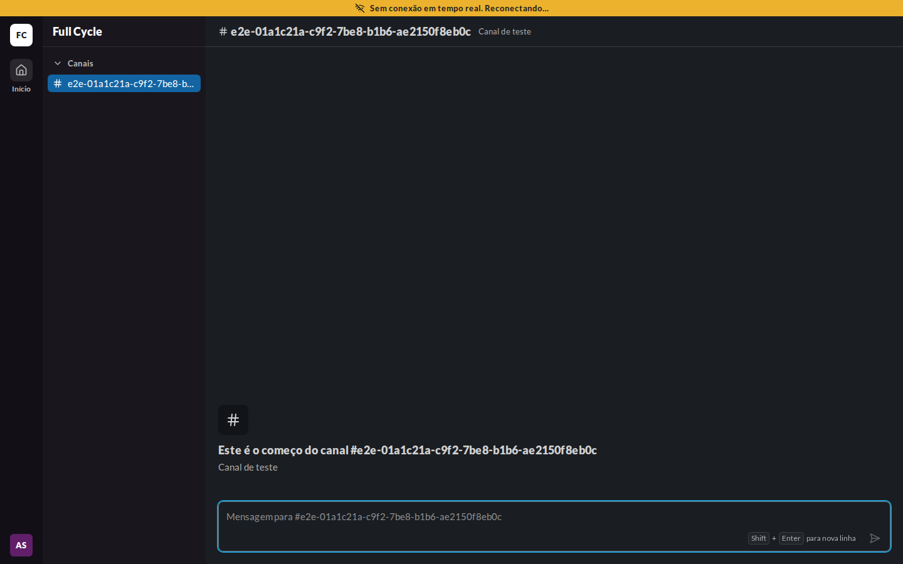
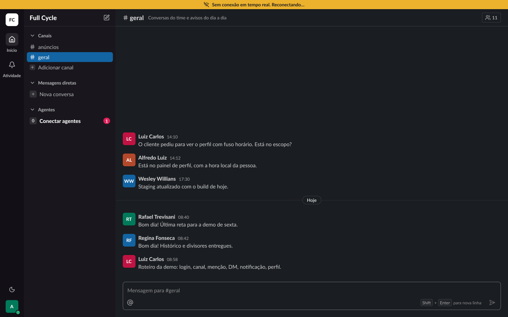

# Validação visual da F03-T05

Capturas da web em 1440 × 900, no Chromium do contêiner `e2e`, ao lado da captura do frame
"Casca / Banner de reconexão" (25:31291) do Figma (arquivo `slack`, página Telas, no modo Dark da
coleção Semantic). O tema escuro da web é o `data-theme="dark"` na raiz.

Os dados da web vêm de um teste: um Canal de teste vazio, com o navegador posto offline pelo
`context.setOffline` até a faixa aparecer.

| Estado | Web, claro | Web, escuro | Figma, escuro |
| --- | --- | --- | --- |
| Faixa de conexão |  |  |  |

## O que bate

- A faixa de 26 px no topo da tela inteira, acima do Rail, da barra lateral e da Conversa, que
  descem para dar lugar a ela.
- `bg-warning` com o texto `on-warning` em `small/bold`, centralizado, com o ícone de Wi-Fi cortado
  à esquerda e 8 px entre os dois.
- Os mesmos tokens nos dois temas: `warning` e `on-warning` não mudam com o tema, como no Figma.

## Diferenças encontradas

- **Sem o Figma claro.** A página Telas está no modo Dark, e a faixa usa só tokens iguais nos dois
  temas (`docs/design-system.md`, "Tema escuro").
- **O conteúdo da Conversa difere:** o frame mostra Mensagens de exemplo; a web, um Canal de teste
  vazio.
- **O botão de Membros e os itens da barra lateral de outras funcionalidades** ficam de fora, como
  nas validações da F02.
