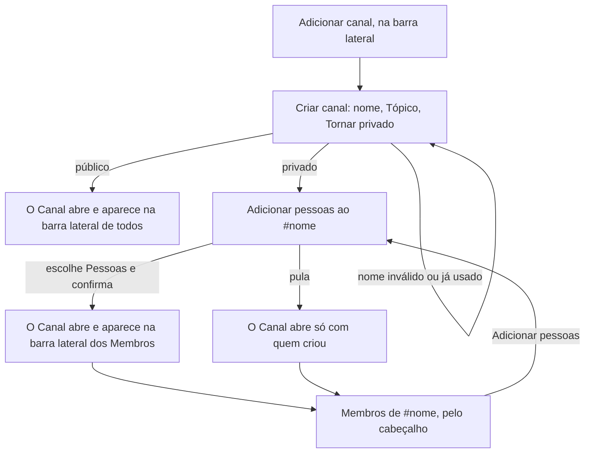

# PRD · F04 · Criação de canais e convite para canal privado

2026-11-09 · Luiz Carlos · Status: aprovado

## 1. Resumo executivo

- **Problema:** depois da F03 a pessoa conversa em tempo real, mas só nos canais públicos que quem
  opera a instalação criou por script. O time não consegue abrir o Canal de que precisa para um
  assunto, projeto ou time, e toda conversa inclui o workspace inteiro: não há onde falar só com
  algumas Pessoas, como a liderança ou quem acompanha os números do negócio.
- **Solução proposta:** qualquer Pessoa cria um Canal público ou privado pelo produto, com nome e
  Tópico. O Canal público inclui todo o workspace; o privado só quem o criou e quem foi convidado,
  e qualquer Membro dele convida outras Pessoas, na criação ou depois. Quem não é Membro de um
  Canal privado não o vê em lugar nenhum.
- **Critérios de sucesso:** esta funcionalidade não move sozinha nenhuma métrica do product brief
  (seção "Objetivos e métricas de sucesso"). Ela entrega o item 2 do "Escopo do MVP" do brief, na
  parte de criar canais e convidar para o privado, com a regra de que só quem foi convidado vê e
  participa do Canal privado, e cumpre o requisito "Acessibilidade" nas telas que entrega. É
  pré-requisito para que os pedidos a agentes (F11 a F14) aconteçam em Canais com só as Pessoas
  certas.

## 2. Experiência do usuário e funcionamento

### Personas

- **Pessoa do workspace:** conversa nos canais públicos (F02) em tempo real (F03) e quer abrir um
  Canal para um assunto novo ou uma conversa restrita a algumas Pessoas.
- **Quem opera a instalação:** deixa de criar Canais por script; os Canais criados antes continuam
  como estão.

### Regras de Canal nesta funcionalidade

- Qualquer Pessoa cria Canais, públicos ou privados.
- O Canal público inclui todas as Pessoas como Membros, como na F02, inclusive quem ganhar conta
  depois.
- O Canal privado começa só com quem o criou. Qualquer Membro dele convida outras Pessoas do
  workspace, e quem é convidada vira Membro na hora, sem precisar aceitar.
- Quem entra num Canal privado vê o histórico inteiro, desde a primeira Mensagem.
- O nome é único entre todos os Canais do workspace, públicos e privados.
- Um Canal não muda de público para privado, nem o contrário, e o nome e o Tópico não mudam depois
  de criados.
- Ninguém sai de um Canal nem é removido dele (F17 e F18, Fase 2).

### Fluxo

### Histórias de usuário

1. Como pessoa do workspace, quero criar um Canal público para organizar a conversa de um assunto,
   projeto ou time sem pedir a ninguém.
2. Como pessoa do workspace, quero criar um Canal privado para conversar só com as Pessoas que eu
   escolher.
3. Como Membro de um Canal privado, quero convidar outras Pessoas para ele para incluir quem
   passou a fazer parte do assunto.
4. Como pessoa do workspace, quero ver os Canais novos dos quais sou Membro aparecerem na barra
   lateral sem recarregar a página para saber que fui incluída e entrar na conversa.
5. Como pessoa do workspace, quero ver quem são os Membros de um Canal para saber quem lê o que
   escrevo ali.
6. Como Membro de um Canal privado, quero que quem não é Membro não veja o Canal nem as Mensagens
   dele para confiar que a conversa fica restrita.

### Critérios de aceite

**Todas as histórias**

- As telas seguem o design system do projeto e os frames "Diálogos / Criar canal" (Padrão, Erro
  no nome, Enviando), "Conversa / Estrutura / Canal privado" e "Conversa / Sobreposições / Membros
  do canal" do Figma do projeto, nos temas claro e escuro, e atingem 100 na nota de Acessibilidade
  do Lighthouse.
- As telas que ainda não estão no Figma são desenhadas lá antes da implementação: "Adicionar
  pessoas" (o passo da criação e o da lista de Membros), a falha ao criar e a falha ao convidar.
- Tudo funciona só pelo teclado. Os diálogos abrem com o foco no primeiro campo, Esc os fecha e,
  ao fechar, o foco volta para onde estava.

**História 1, criar um Canal público**

- "Adicionar canal", no fim da seção "Canais" da barra lateral, abre o diálogo "Criar canal".
- O diálogo tem o nome, o Tópico (opcional) e a chave "Tornar privado", desligada.
- O nome aceita letras minúsculas, inclusive acentuadas, números, `-` e `_`, de 1 a 80 caracteres.
  Ao digitar, as maiúsculas viram minúsculas e o espaço vira `-`. Os outros caracteres não entram.
- O Tópico aceita até 250 caracteres, numa linha só.
- Se o nome já existe, em qualquer Canal, público ou privado, o diálogo mostra "Já existe um canal
  chamado #nome." no campo, como em "Diálogos / Criar canal / Erro no nome", e não cria o Canal.
- Enquanto o Canal é criado, o botão "Criar canal" fica no estado "Enviando" e o diálogo não aceita
  um segundo envio. Um duplo clique cria um Canal só.
- Se a criação falhar, por rede ou servidor, o diálogo continua aberto, com o que a pessoa
  preencheu e uma mensagem de erro, e "Criar canal" tenta de novo sem duplicar o Canal.
- Criado o Canal, o diálogo fecha e o Canal abre, vazio, com "Este é o começo do canal #nome" e o
  Tópico (F02, história 4), e o foco vai para a caixa de mensagem.

**História 2, criar um Canal privado**

- Com "Tornar privado" ligado, "Criar canal" cria o Canal e leva ao passo "Adicionar pessoas ao
  #nome", no mesmo diálogo.
- O Canal privado aparece com o ícone de cadeado no lugar do `#`, na barra lateral e no cabeçalho,
  como em "Conversa / Estrutura / Canal privado".
- O passo "Adicionar pessoas" pode ser pulado: o Canal abre só com quem o criou, que convida
  depois pela lista de Membros (história 3).

**História 3, convidar para um Canal privado**

- O passo "Adicionar pessoas" busca as Pessoas do workspace pelo nome, sem diferenciar maiúsculas,
  minúsculas e acentos, e mostra avatar e nome de cada uma.
- Quem já é Membro não aparece na busca. A pessoa escolhe várias Pessoas antes de confirmar, e as
  escolhidas ficam visíveis e podem ser desmarcadas até a confirmação.
- Confirmar torna todas as escolhidas Membros, sem que elas precisem aceitar. Convidar quem já é
  Membro, por duas abas ao mesmo tempo, por exemplo, não dá erro nem duplica o Membro.
- Se o convite falhar, por rede ou servidor, o passo continua aberto com as escolhidas, mostra uma
  mensagem de erro e permite tentar de novo.
- Na lista de Membros de um Canal privado (história 5), o botão "Adicionar pessoas" abre o mesmo
  passo. Em Canal público ele não aparece.

**História 4, Canais novos na barra lateral**

- Um Canal público novo aparece na barra lateral de todas as Pessoas, e um Canal privado aparece na
  barra lateral de quem acabou de virar Membro, em até 1 s no p95, sem recarregar a página e em
  todas as abas abertas, como as Mensagens da F03.
- A seção "Canais" mostra os públicos e os privados juntos, em ordem alfabética.
- O Canal novo não abre sozinho para quem não o criou, nem tira o foco de onde ele está.
- As Mensagens de um Canal novo chegam em tempo real para os Membros, como na F03, inclusive para
  quem foi convidada com a página já aberta.

**História 5, ver os Membros**

- O cabeçalho do Canal mostra a quantidade de Membros. Clicar nela abre "Membros de #nome", com o
  avatar e o nome de cada Membro em ordem alfabética, e "(você)" ao lado da própria pessoa, como em
  "Conversa / Sobreposições / Membros do canal".
- No Canal privado, a lista e a quantidade mudam sem recarregar quando alguém é convidado.

**História 6, Canal privado restrito**

- Quem não é Membro de um Canal privado não o vê na barra lateral nem em nenhuma outra lista, não
  recebe as Mensagens nem o "digitando" dele e não consegue ler nem enviar Mensagens nele.
- O endereço de um Canal privado aberto por quem não é Membro mostra "Conversa não encontrada",
  igual ao de um Canal que não existe (F02, história 7), sem revelar que o Canal existe.
- Quem é convidada vê o histórico inteiro, desde a primeira Mensagem do Canal.

### O que não é objetivo

- Remover Membros de um Canal privado: F17. Entrar e sair de Canais: F18. Até lá, quem foi
  convidada por engano continua Membro.
- Transformar um Canal público em privado, ou o contrário.
- Editar o nome ou o Tópico, arquivar e apagar Canais.
- Diretório de Canais para procurar e entrar nos Canais públicos: o Canal público já inclui todo o
  workspace.
- Pedir para entrar num Canal privado, aceitar ou recusar um convite.
- Avisos na conversa de quem criou o Canal ou de quem convidou quem.
- Notificar quem foi convidada: a notificação é da F08, e nesta funcionalidade o aviso é o Canal
  aparecer na barra lateral.
- Buscar Pessoas pelo `@usuário` no convite: o `@usuário` entra com a F05.
- Convidar quem ainda não tem conta no workspace: F15.
- Restringir a criação de Canais a administradores.

## 3. Requisitos do sistema de IA

Não se aplica: a F04 não envolve agentes. Quando os agentes chegarem, o que eles leem e onde
respondem num Canal privado segue a mesma regra de participação desta funcionalidade, definida nas
funcionalidades deles.

## 4. Riscos de produto

| Risco | Mitigação |
| --- | --- |
| Uma conversa restrita chega a quem não é Membro e o time deixa de confiar no Canal privado | Quem não é Membro não vê o Canal em lugar nenhum, nem pelo endereço, que responde como Canal inexistente |
| A pessoa convida alguém por engano e não consegue desfazer até a F17 | As escolhidas ficam visíveis e podem ser desmarcadas antes de confirmar. Até a F17, quem opera a instalação remove por script |
| Quem foi convidada não percebe que entrou num Canal, porque a notificação só vem com a F08 | O Canal aparece na barra lateral sem recarregar, em todas as abas abertas |
| O workspace se enche de Canais repetidos ou abandonados, porque qualquer Pessoa cria e ninguém arquiva | O nome é único, e o aviso de nome em uso mostra que o assunto já tem Canal. Arquivar fica fora do MVP |
| O aviso de nome em uso revela o nome de um Canal privado a quem não é Membro | Risco aceito: revela só o nome, nunca os Membros nem as Mensagens, e o nome único evita dois Canais com o mesmo nome |
| O histórico inteiro de um Canal privado fica visível para quem entra depois, inclusive o que foi dito antes do convite | Regra declarada no produto: entrar no Canal dá acesso à conversa inteira, como nos chats de equipe conhecidos |
