# Validação visual da F04-T01

Capturas da web em 1440 × 900, no Chromium do contêiner `e2e`, ao lado das capturas dos frames
"Diálogos / Criar canal" do Figma (arquivo `slack`, página Telas, seção "Diálogos da casca", no
modo Dark da coleção Semantic): Padrão (26:24488), Erro no nome (26:25296), Enviando (26:26110) e
Falha ao criar (116:32939, criado nesta tarefa). O tema escuro da web é o `data-theme="dark"` na
raiz.

Os dados da web vêm de um teste: uma Pessoa de teste com um Canal vazio aberto. O estado Enviando
foi capturado com a criação presa pelo `page.route`, e a Falha ao criar, com ela abortada.

| Estado | Web, claro | Web, escuro | Figma, escuro |
| --- | --- | --- | --- |
| Padrão | 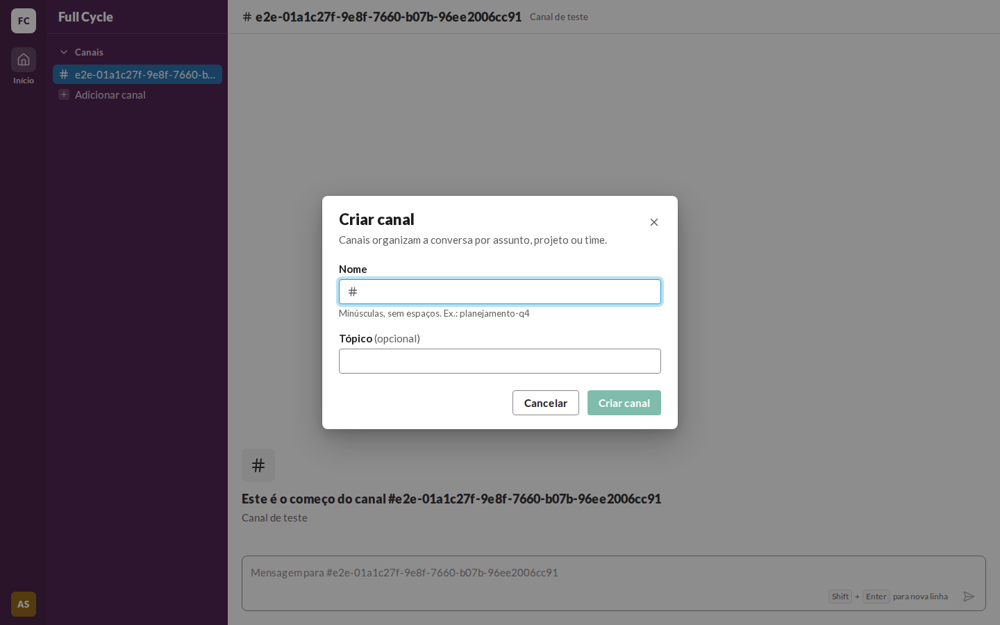 | 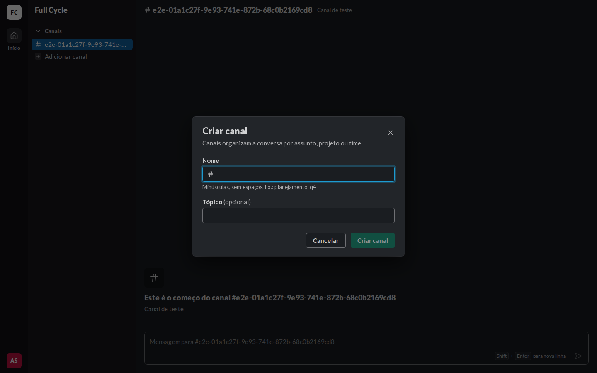 | 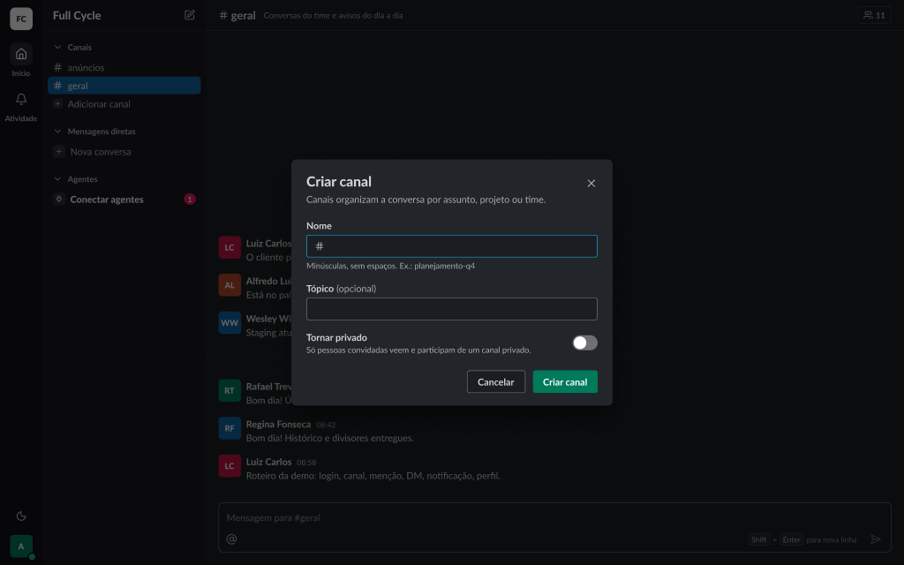 |
| Erro no nome | 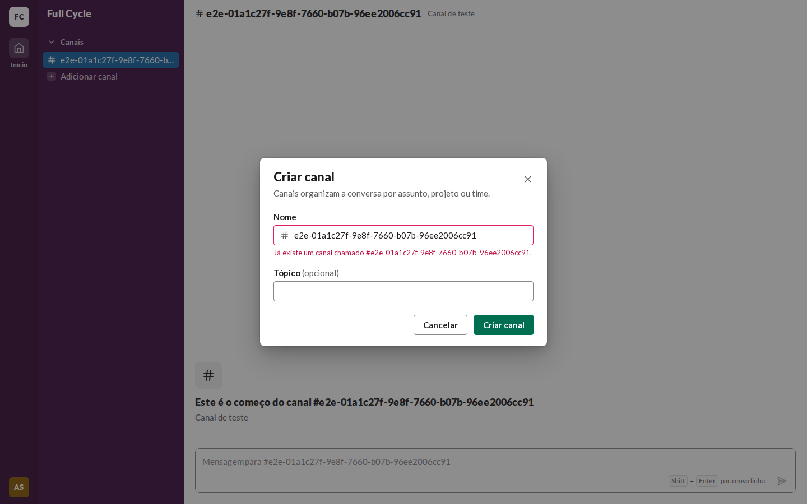 | 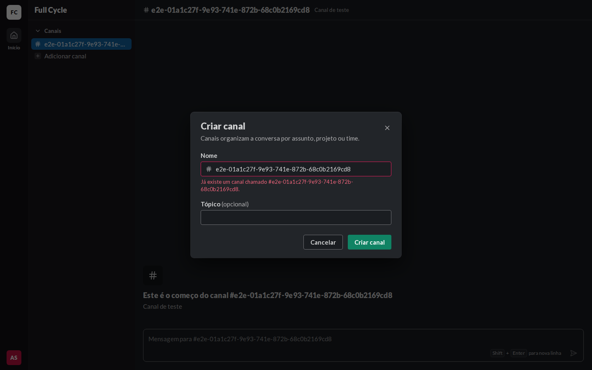 | 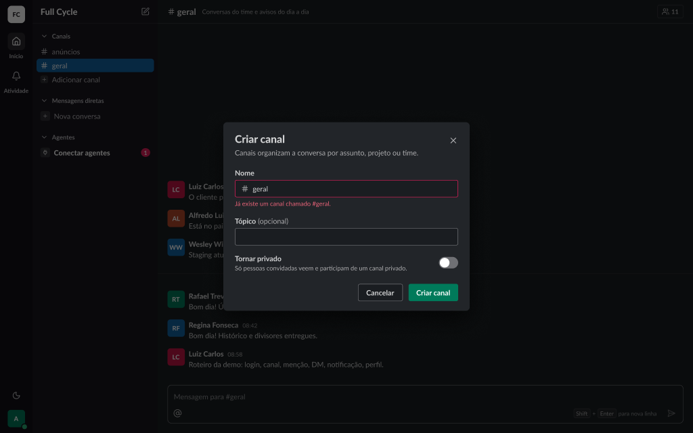 |
| Enviando | 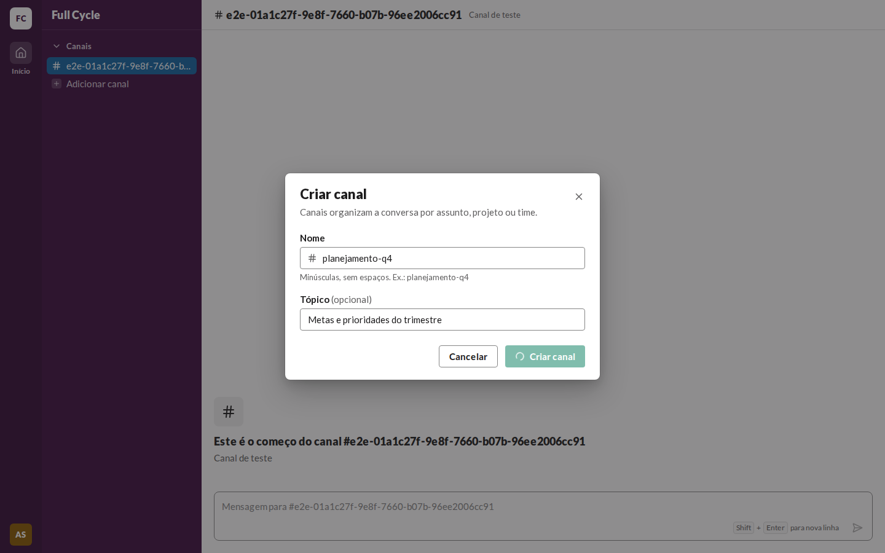 | 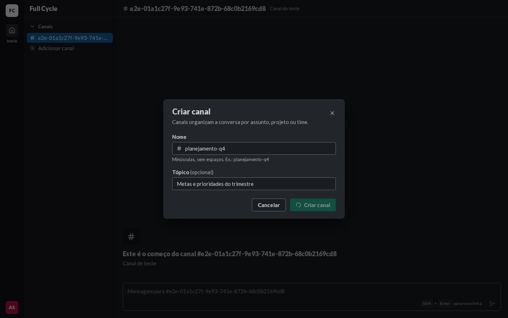 | 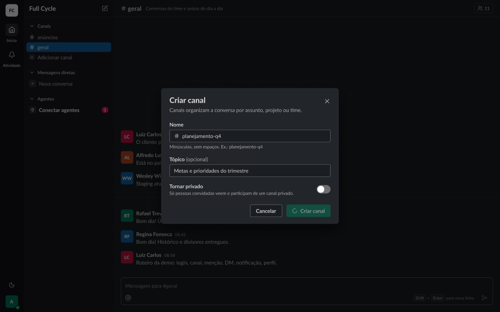 |
| Falha ao criar | 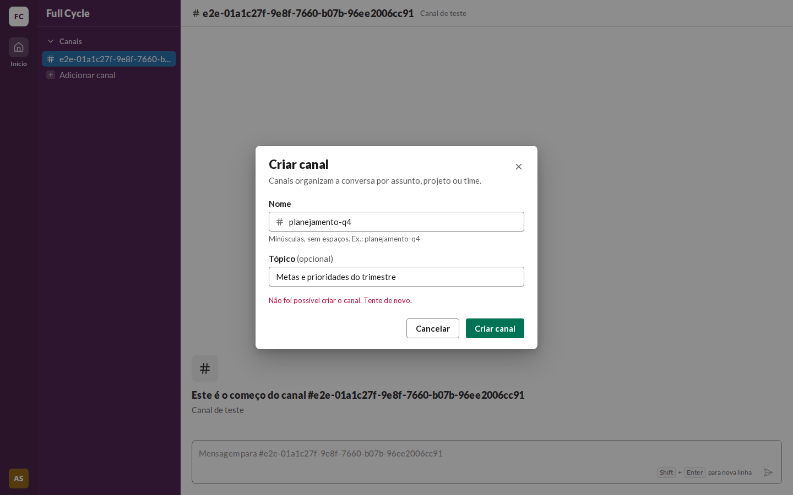 | 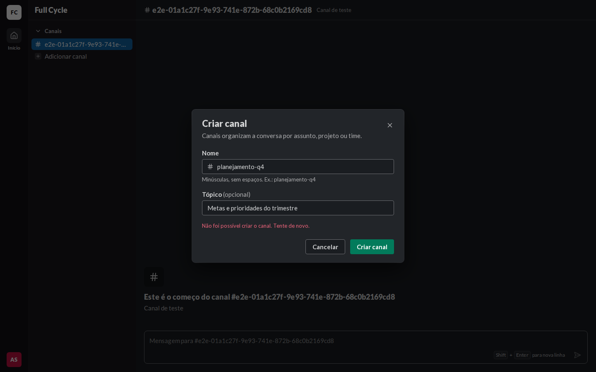 | 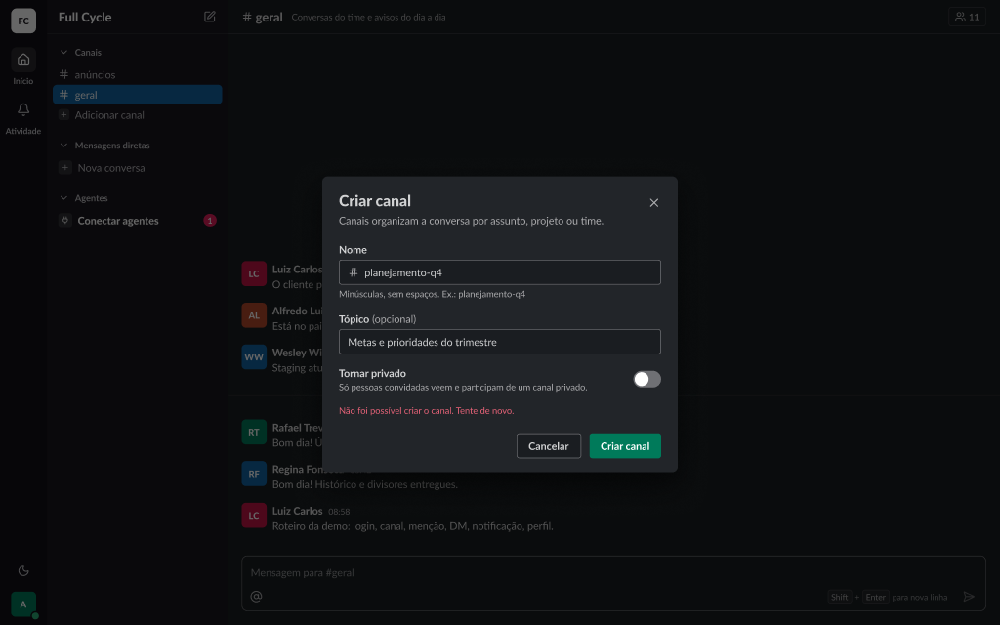 |

## O que bate

- O Dialog com 512 de largura, `rounded-card`, `shadow-3` e `surface-raised`; o DialogHeader com o
  título em `heading/black`, a descrição em `fg-muted` e o X de 36 px; o corpo com 24 px nas
  laterais e 16 px entre os campos; o rodapé com Cancelar (secondary) e Criar canal (primary).
- O campo do nome com o `#` em `fg-muted` à esquerda, a dica "Minúsculas, sem espaços. Ex.:
  planejamento-q4" em `small`, e o erro no lugar da dica, com a borda `danger`.
- "Tópico (opcional)", com "(opcional)" em `fg-muted`, como o frame depois da troca de rótulo.
- O Enviando com o Spinner no botão Criar canal; a Falha ao criar com o erro geral em
  `danger-fg`, como último item do corpo.
- A SidebarAction "Adicionar canal" no fim da seção Canais, com o quadro `sidebar-field` de 16 px e
  o `+` de 12 px.

## Diferenças encontradas

- **Sem o Switch "Tornar privado".** Ele entra com o Canal privado, na F04-T02.
- **Sem o Figma claro.** A página Telas está no modo Dark, e o diálogo usa só tokens semânticos
  (`docs/design-system.md`, "Tema escuro").
- **O botão desabilitado no Enviando** fica com a opacidade de 50% do Button do código; o frame
  mostra o tom mais escuro do mesmo botão. É o `disabled` do Button do design system, sem mudança
  aqui.
- **O conteúdo atrás do diálogo difere:** o frame mostra Mensagens de exemplo e outras seções da
  barra lateral, que entram com outras funcionalidades.
