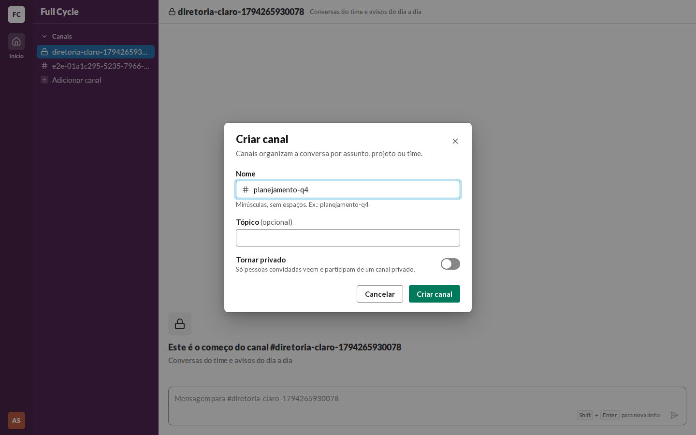
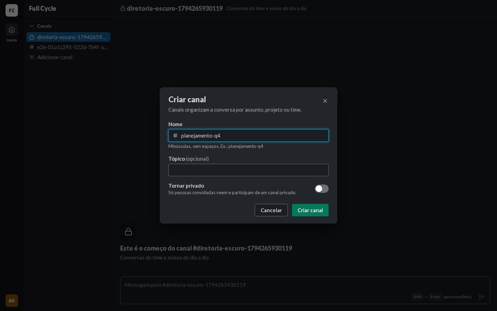
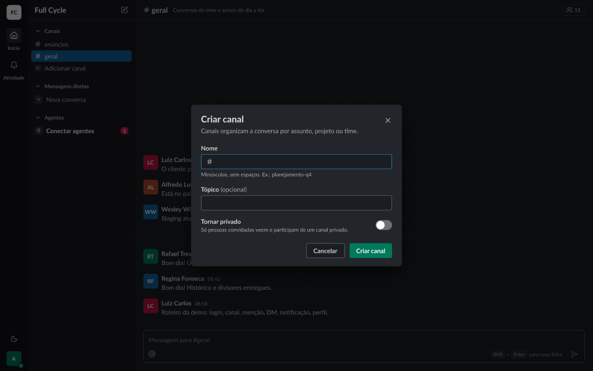
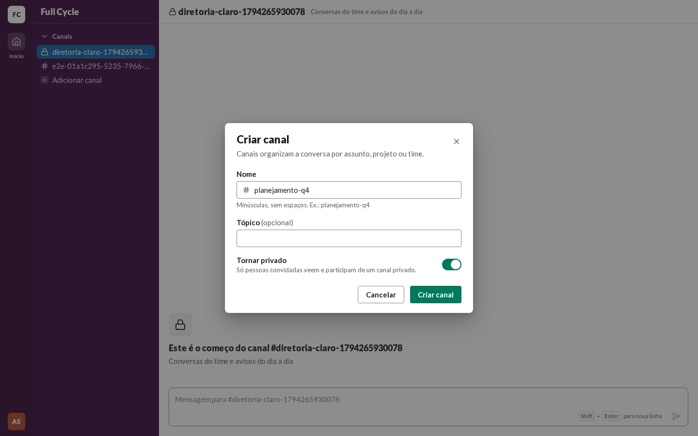
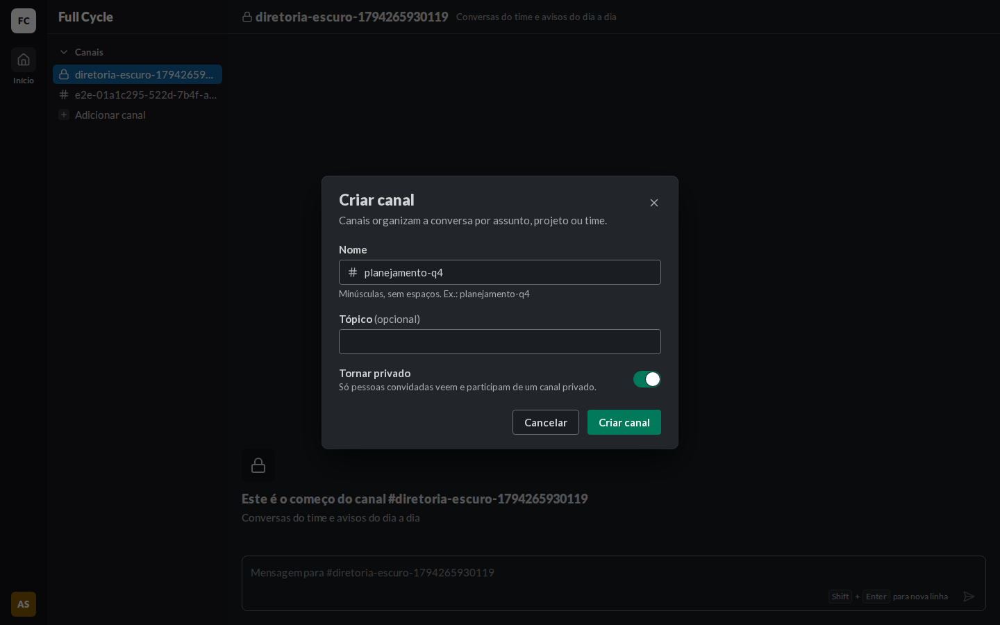
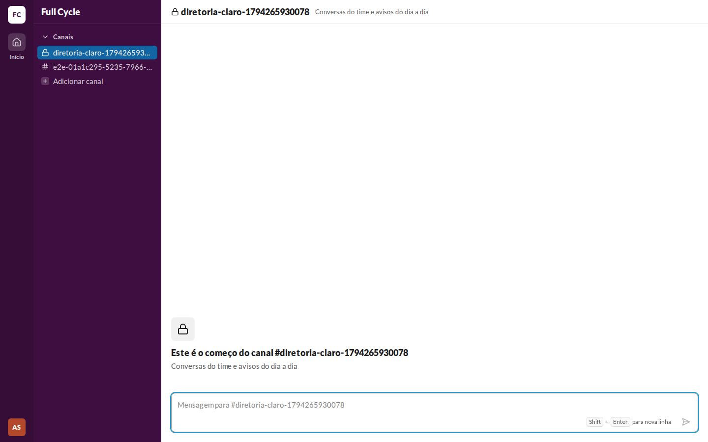
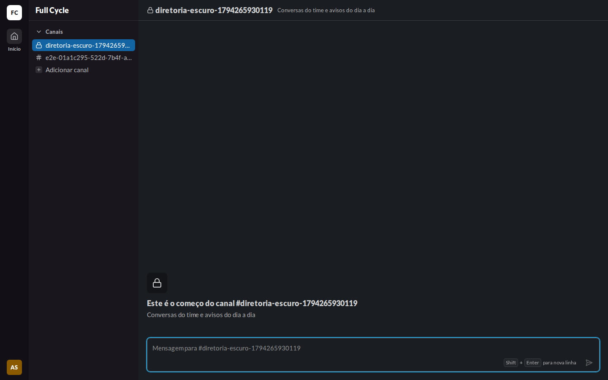
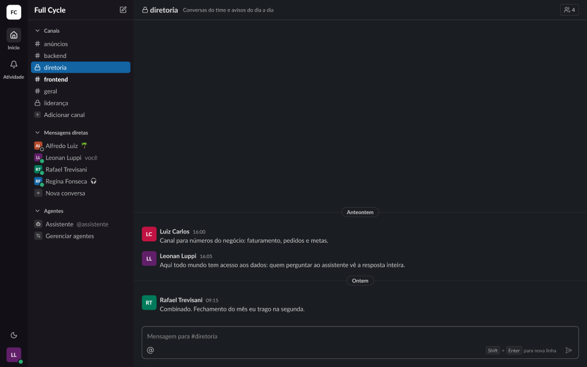

# Validação visual da F04-T02

Capturas da web em 1440 × 900, no Chromium do contêiner `e2e`, ao lado das capturas dos frames do
Figma (arquivo `slack`, página Telas, no modo Dark da coleção Semantic): "Diálogos / Criar canal /
Padrão" (26:24488) e "Conversa / Estrutura / Canal privado" (21:3570), este com o nome do cabeçalho
corrigido nesta tarefa. O tema escuro da web é o `data-theme="dark"` na raiz.

Os dados da web vêm de um teste: uma Pessoa de teste com um Canal privado e um público, ambos sem
Mensagens.

| Estado | Web, claro | Web, escuro | Figma, escuro |
| --- | --- | --- | --- |
| Diálogo, "Tornar privado" desligado |  |  |  |
| Diálogo, "Tornar privado" ligado |  |  | — |
| Conversa de um Canal privado |  |  |  |

## O que bate

- "Tornar privado" em `body/bold`, a descrição em `small` e `fg-muted`, e o Switch de 40 × 24 à
  direita: desligado em `border-strong`, ligado em `primary`, com o polegar `on-primary`.
- O cadeado no lugar do `#` na SidebarRow do Canal privado e no ConversationHeader, com o
  público e o privado juntos, em ordem alfabética, na seção Canais.

## Diferenças encontradas

- **O Switch ligado não tem frame.** A cor segue o Switch do design system (`primary` quando
  ligado).
- **O cadeado também no começo do Canal** (ConversationIntro): o frame do Canal privado tem
  Mensagens e não mostra o começo; a web usa o mesmo ChannelIcon do cabeçalho.
- **O botão de Membros e a quantidade no cabeçalho** ficam de fora: entram com a F04-T05.
- **O conteúdo e as outras seções da barra lateral** diferem, como nas validações anteriores.
