# Validação visual da F04-T04

Capturas da web em 1440 × 900, no Chromium do contêiner `e2e`, ao lado das capturas dos frames
"Diálogos / Adicionar pessoas" do Figma, criados nesta tarefa (arquivo `slack`, página Telas, seção
"Diálogos da casca", no modo Dark da coleção Semantic): Escolhidas (121:33458), Ninguém encontrado
(121:33837), Enviando (121:34200) e Falha ao adicionar (121:34581). O tema escuro da web é o
`data-theme="dark"` na raiz.

Os dados da web vêm de um teste: um Canal privado recém-criado, duas Pessoas de teste escolhidas e
a busca "Ana" no banco de desenvolvimento. O Enviando foi capturado com a adição presa pelo
`page.route`, e a Falha ao adicionar, com ela abortada.

| Estado | Web, claro | Web, escuro | Figma, escuro |
| --- | --- | --- | --- |
| Escolhidas | 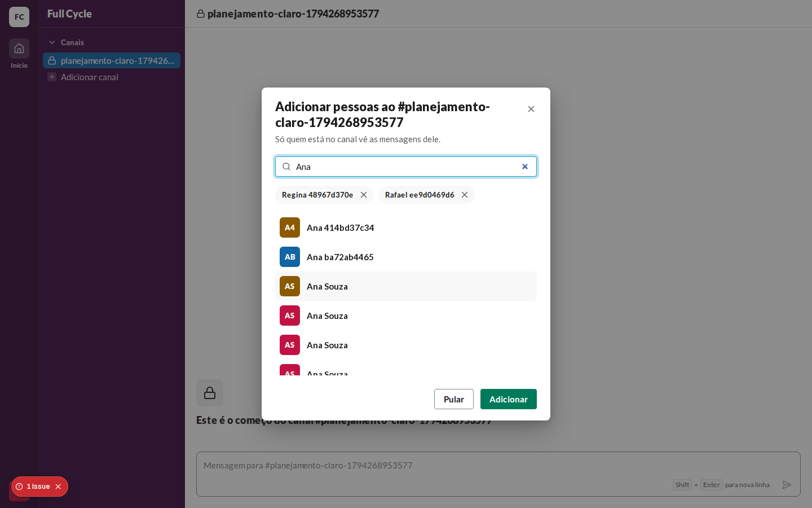 | 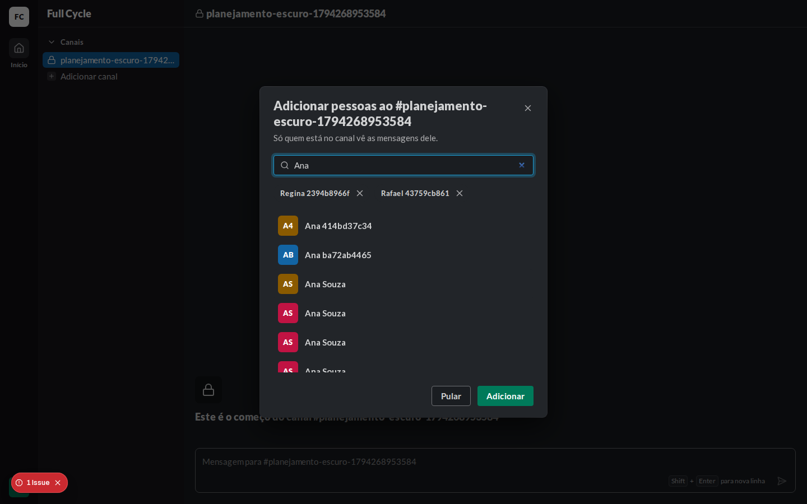 | 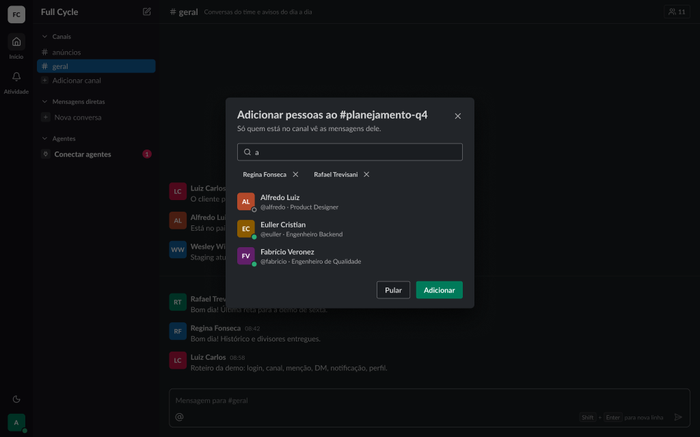 |
| Ninguém encontrado | 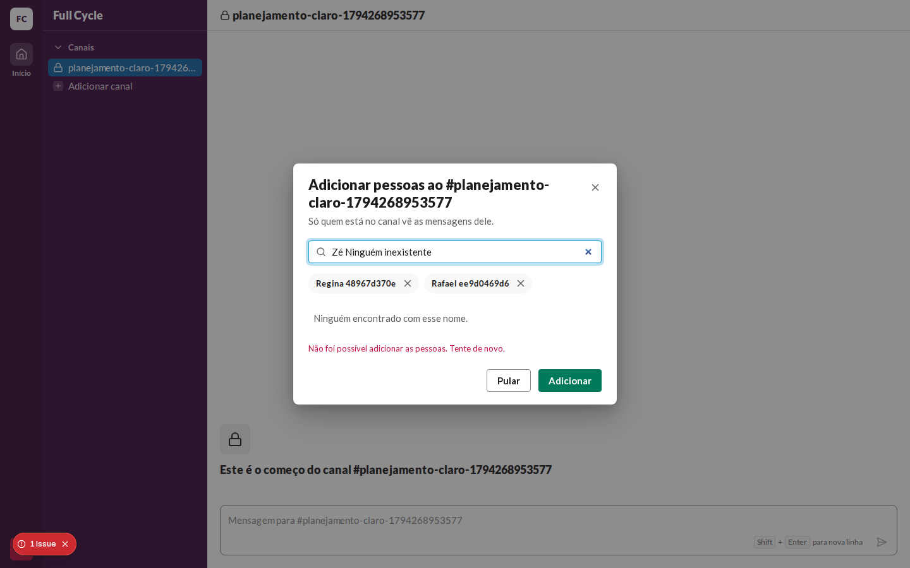 | 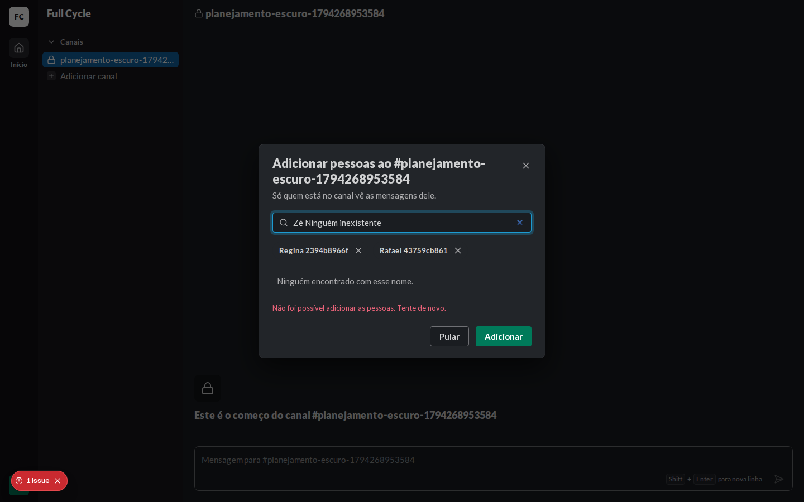 | 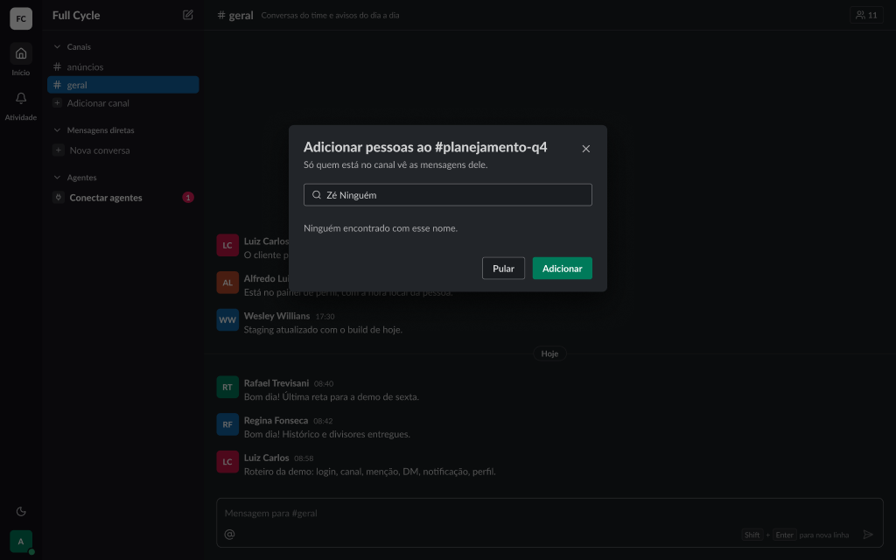 |
| Enviando | 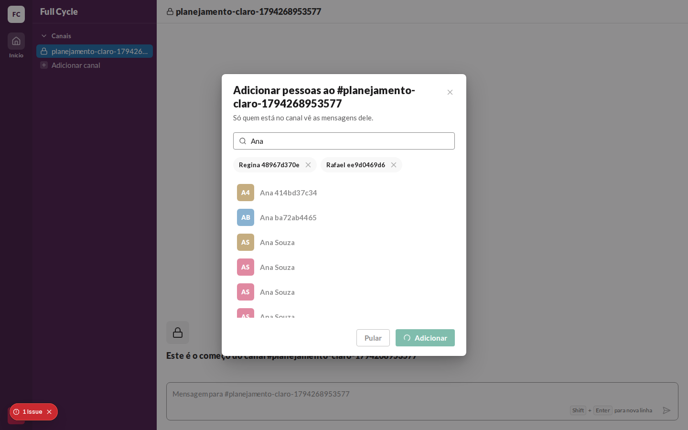 | 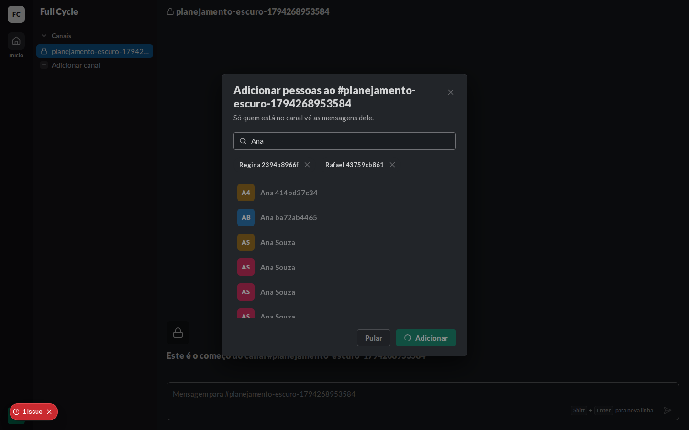 | 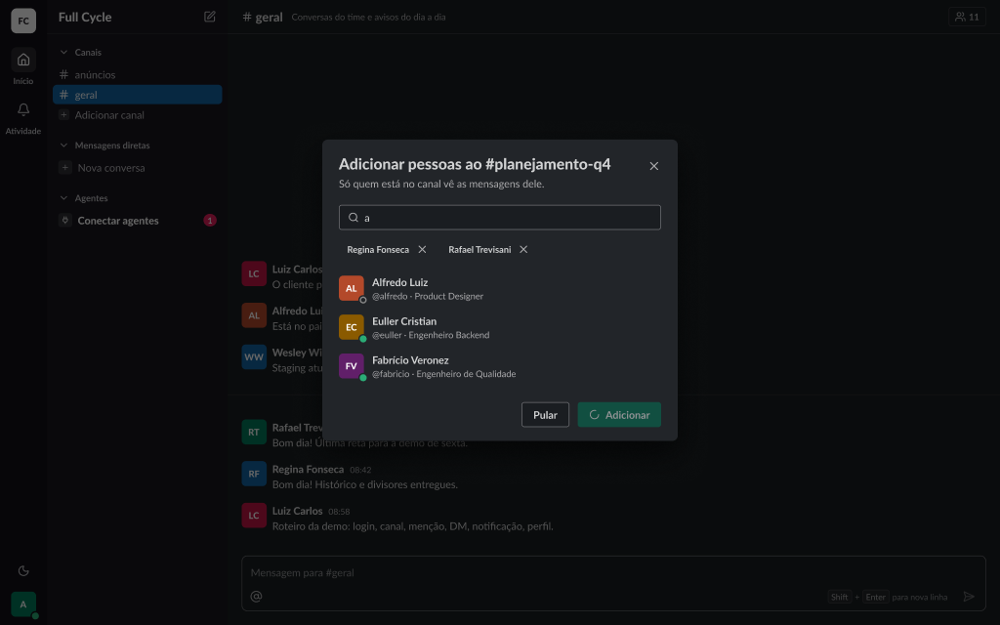 |
| Falha ao adicionar | 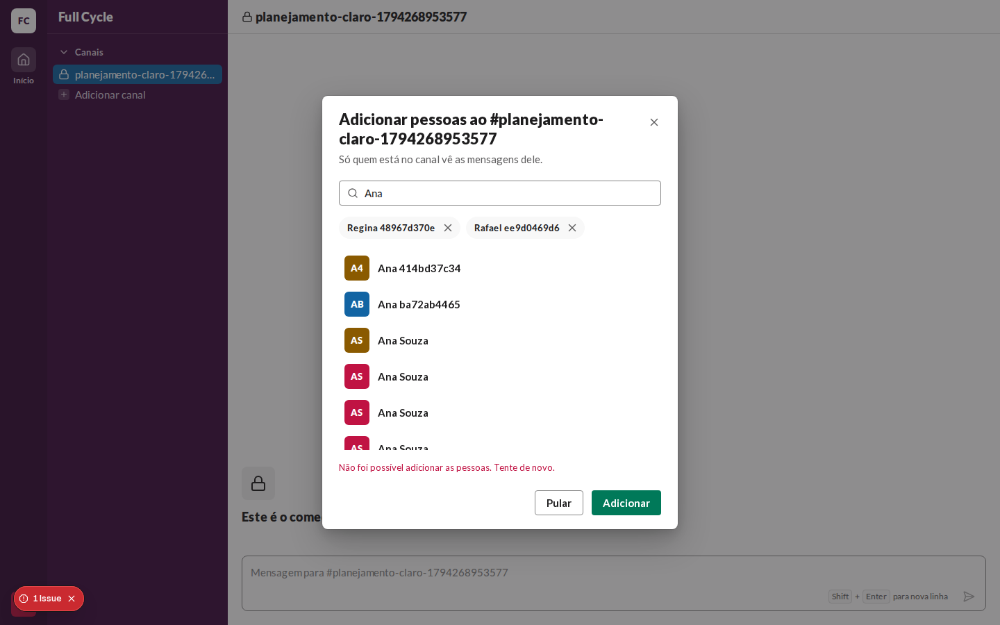 | 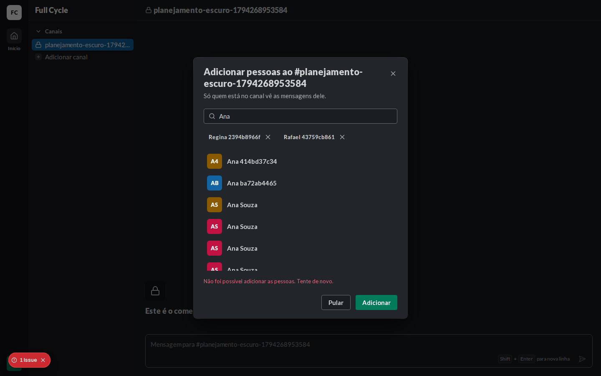 | 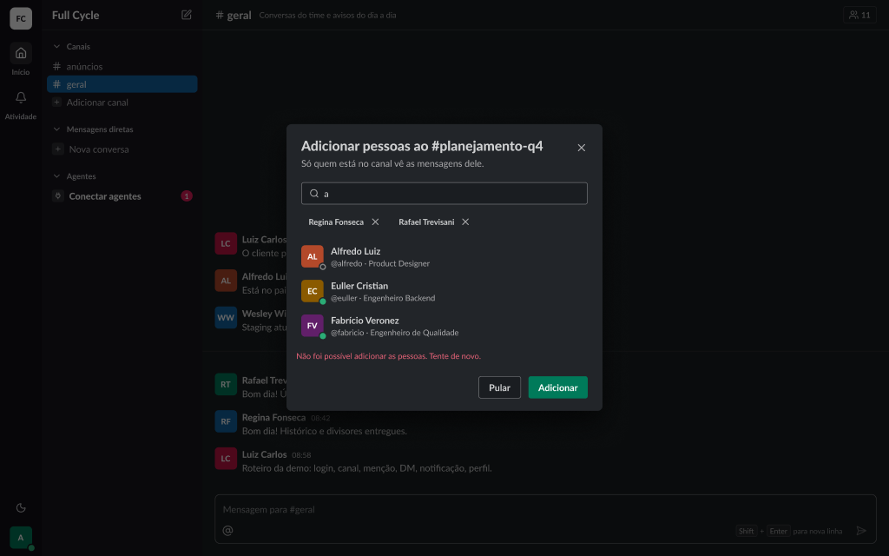 |

## O que bate

- O Dialog do design system, com o título "Adicionar pessoas ao #nome" e a descrição em
  `fg-muted`.
- A busca com o ícone de lupa e o foco ao abrir.
- As escolhidas em pílulas `surface-subtle`, cada uma com o X de tirar, acima dos resultados.
- As linhas de Pessoa com o avatar de 36 px e o nome em `body/bold`.
- O vazio "Ninguém encontrado com esse nome." em `fg-muted`.
- O rodapé com Pular (secondary) e Adicionar (primary), este com o Spinner no Enviando.
- A falha em `danger-fg`, como último item do corpo.

## Diferenças encontradas

- **A segunda linha do PersonRow** (`@usuário · cargo`) não aparece na web: o `@usuário` entra com
  a F05 e o cargo com a F09.
- **O título longo quebra em duas linhas** na web quando o nome do Canal de teste é comprido; o
  frame usa um nome curto.
- **Sem o Figma claro.** A página Telas está no modo Dark, e o passo usa só tokens semânticos.
- **O aviso "1 Issue" do `next dev`** nas capturas é um erro do modo de desenvolvimento do React ao
  medir a navegação a partir da Home ("cannot have a negative time stamp"), e não deste passo.
