# Validação visual da F04-T05

Capturas da web em 1440 × 900, no Chromium do contêiner `e2e`, ao lado das capturas dos frames do
Figma (arquivo `slack`, página Telas, no modo Dark da coleção Semantic):
- "Conversa / Sobreposições / Membros do canal" (23:17033);
- "Conversa / Sobreposições / Membros do canal privado" (122:34362), criado nesta tarefa;
- "Diálogos / Adicionar pessoas / Pela lista de Membros" (122:34746), criado nesta tarefa.

O tema escuro da web é o `data-theme="dark"` na raiz. Os dados vêm de um teste: quatro Pessoas de
teste num Canal privado e num público, sem Mensagens.

| Estado | Web, claro | Web, escuro | Figma, escuro |
| --- | --- | --- | --- |
| Cabeçalho do Canal privado | 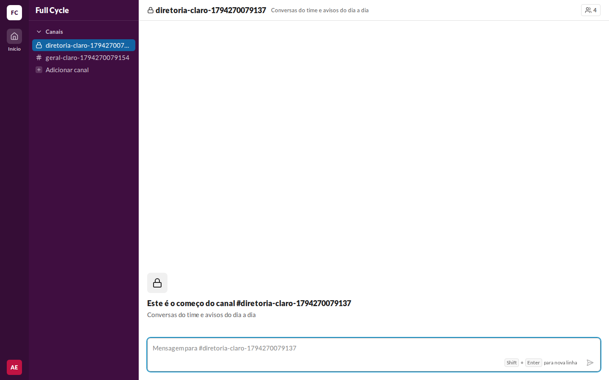 | 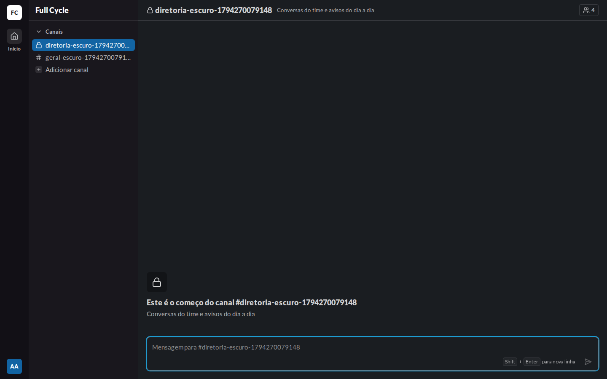 | — |
| Cabeçalho do Canal público | 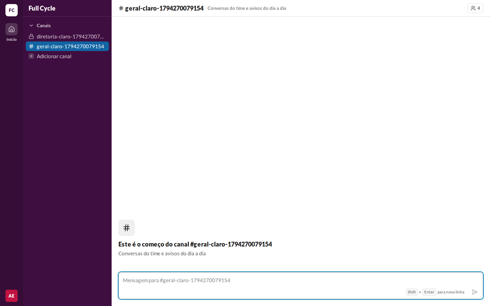 | 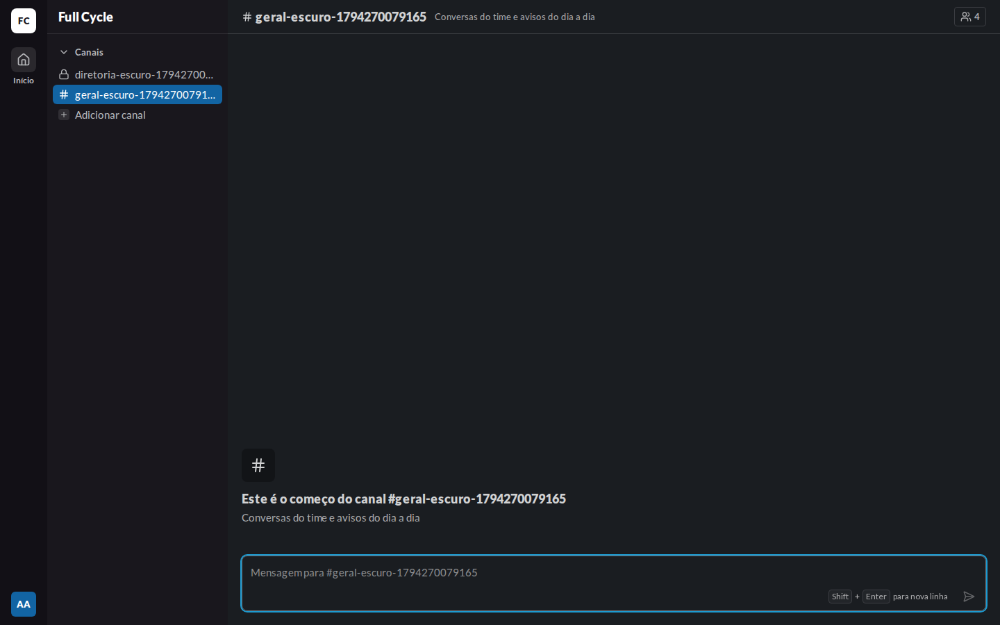 | — |
| Membros do Canal privado | 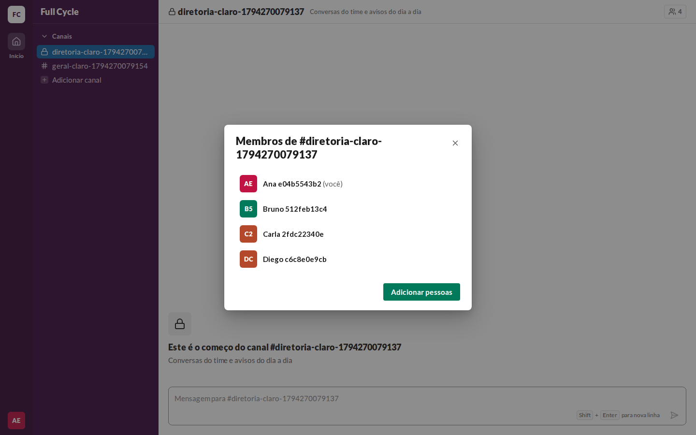 | 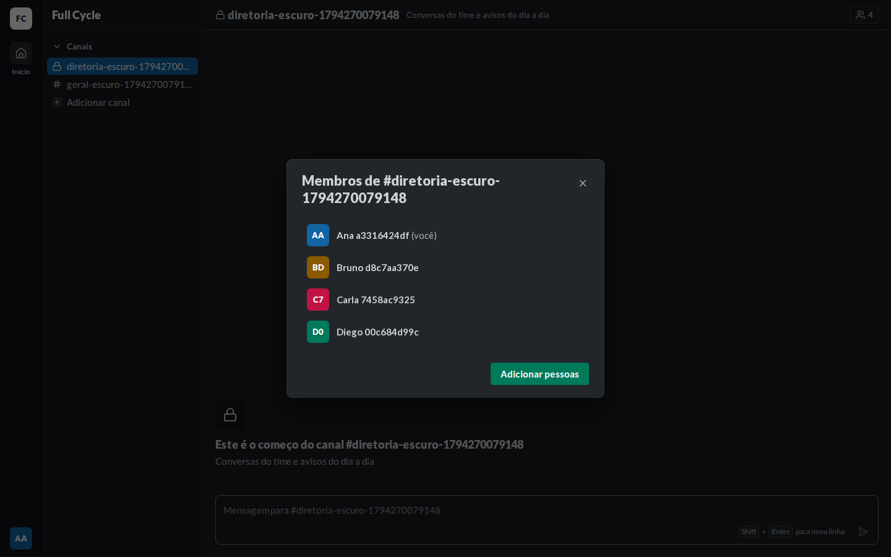 | 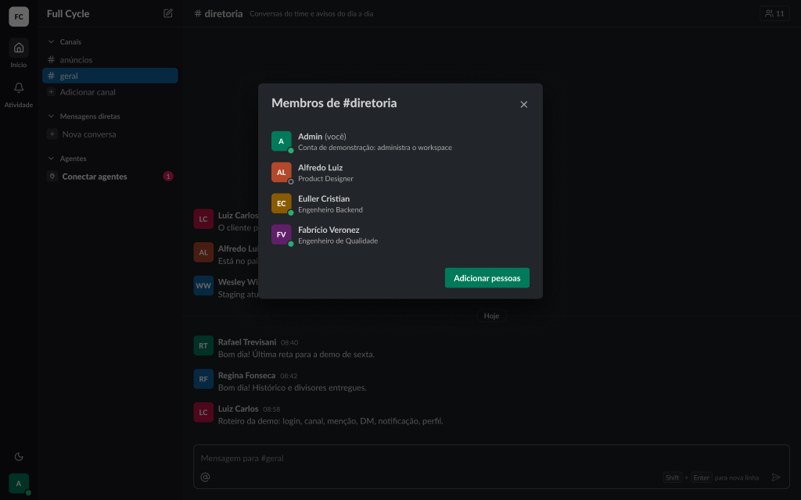 |
| Membros do Canal público | 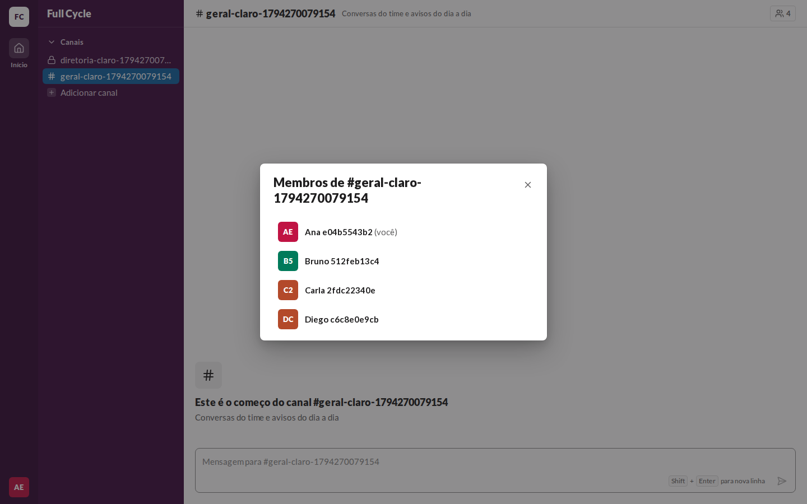 | 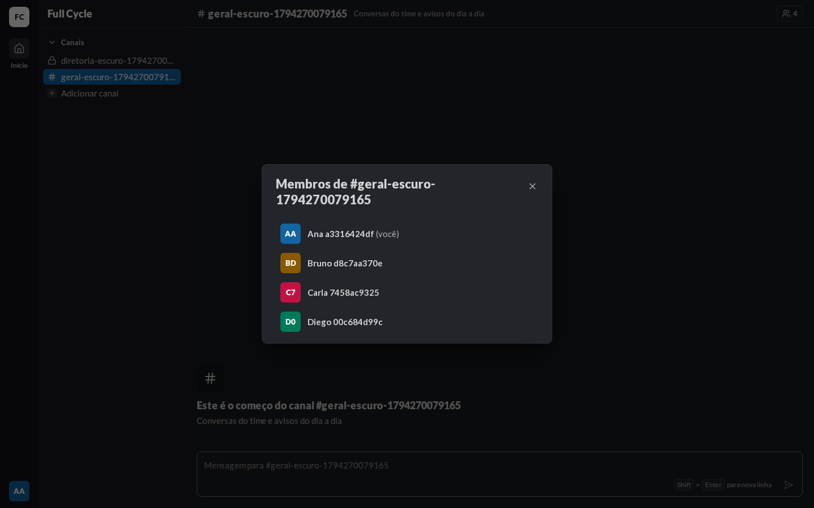 | 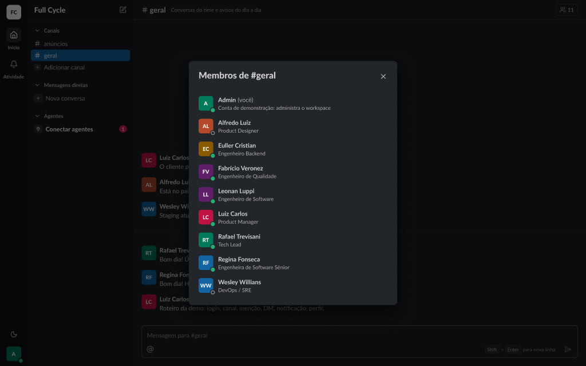 |
| Adicionar pela lista de Membros | — | — | 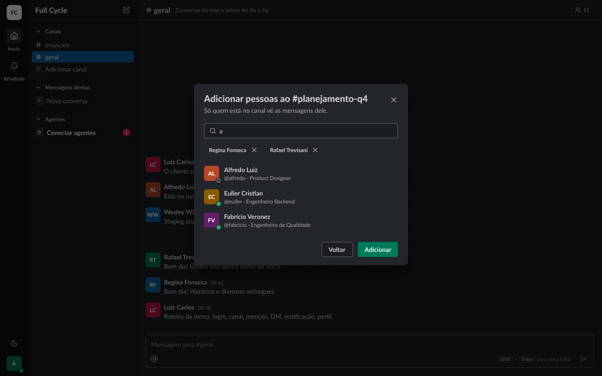 |

## O que bate

- O botão do cabeçalho com o ícone de Pessoas e a quantidade, à direita, como no frame do Canal.
- "Membros de #nome" com o PersonRow de 36 px, "(você)" em `fg-muted` ao lado da Pessoa da Sessão,
  e o botão primary "Adicionar pessoas" no rodapé, só no Canal privado.
- O passo aberto pela lista é o mesmo da criação (validação da F04-T04), com "Voltar" no lugar de
  "Pular".

## Diferenças encontradas

- **A segunda linha do PersonRow** (`@usuário · cargo`) não aparece na web: o `@usuário` entra com
  a F05 e o cargo com a F09.
- **O cabeçalho ao fundo do frame do Canal privado** ainda mostra o `#` do frame de origem; o
  cadeado do cabeçalho está validado na F04-T02.
- **O título longo quebra em duas linhas** com o nome comprido do Canal de teste.
- **Sem o Figma claro**, como nas validações anteriores.
