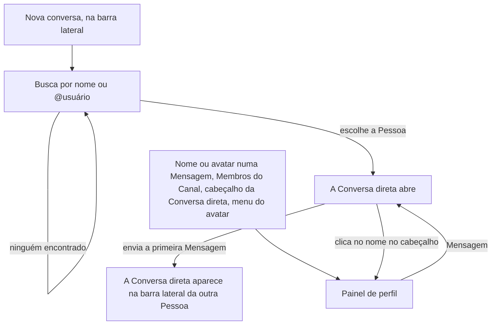

# PRD · F05 · Busca de pessoas, perfil e conversa direta

2026-11-09 · Luiz Carlos · Status: aprovado

## 1. Resumo executivo

- **Problema:** depois da F04 a pessoa conversa em Canais públicos e privados, mas não tem como
  falar só com uma Pessoa nem saber quem é quem: a Pessoa do chat tem só nome e e-mail, e clicar no
  autor de uma Mensagem não leva a lugar nenhum. A notificação de mensagem direta e a aba DMs de
  Atividade (F08) e a edição do perfil (F09) dependem de existirem a Conversa direta e o perfil.
- **Solução proposta:** cada Pessoa ganha um `@usuário` e um perfil com cargo, contato e hora
  local. A pessoa busca qualquer Pessoa do workspace por nome ou `@usuário`, vê o perfil dela e
  abre uma Conversa direta, que funciona como um Canal de duas Pessoas, com o mesmo histórico e o
  mesmo tempo real.
- **Critérios de sucesso:** esta funcionalidade não move sozinha nenhuma métrica do product brief
  (seção "Objetivos e métricas de sucesso"). Ela entrega o item 3 do "Escopo do MVP" do brief e a
  parte de conversas diretas do item 2, cumpre o requisito "Acessibilidade" nas telas que entrega e
  guarda o fuso de cada Pessoa, que o requisito "Idioma e fuso" usa no "hoje" de um resumo. É
  pré-requisito da F08 e da F09.

## 2. Experiência do usuário e funcionamento

### Personas

- **Pessoa do workspace:** conversa em Canais (F02 a F04) e quer falar em particular com um colega
  ou saber quem é quem escreveu uma Mensagem.
- **Quem opera a instalação:** continua criando as contas por script e passa a informar nele o
  `@usuário`, o cargo e o telefone de cada Pessoa.

### Regras desta funcionalidade

- Toda Pessoa tem um `@usuário` único no workspace, em minúsculas, que não muda no MVP. As contas
  que já existem ganham o `@usuário` da parte do e-mail antes do `@`, com um número no fim quando
  ele já estiver em uso. As contas novas recebem o `@usuário` informado no comando de contas ou,
  sem ele, o da parte do e-mail.
- O cargo e o telefone são opcionais e só quem opera a instalação os preenche, pelo comando de
  contas, até a F09.
- O fuso de cada Pessoa vem do navegador dela e é atualizado sempre que ela abre o chat num fuso
  diferente do gravado. Quem nunca abriu o chat não tem fuso, e o perfil dela não mostra a hora
  local.
- A Conversa direta é entre duas Pessoas, ou de uma Pessoa consigo mesma, como bloco de notas. Só
  os Membros dela a veem. Existe no máximo uma Conversa direta por par de Pessoas.
- Quem abre a Conversa direta vira Membro dela na hora. A outra Pessoa vira Membro quando chega a
  primeira Mensagem, ou antes, se ela mesma abrir a Conversa direta pela busca ou pelo perfil. Só
  então a Conversa direta aparece na barra lateral dela.
- Nada na Conversa direta é diferente das Mensagens de um Canal: histórico, envio, falha,
  "digitando" e recuperação depois de uma queda de conexão seguem a F02 e a F03.

### Fluxo

### Histórias de usuário

1. Como pessoa do workspace, quero buscar uma Pessoa por nome ou `@usuário` para encontrá-la sem
   saber em que Canal ela escreve.
2. Como pessoa do workspace, quero ver o perfil de quem escreveu uma Mensagem ou é Membro de um
   Canal para saber o cargo, o contato e que horas são para ela.
3. Como pessoa do workspace, quero ver o meu próprio perfil para conferir como as outras Pessoas me
   veem.
4. Como pessoa do workspace, quero abrir uma Conversa direta com uma Pessoa para falar em
   particular sem criar um Canal.
5. Como pessoa do workspace, quero ver as minhas Conversas diretas na barra lateral, inclusive as
   que outra Pessoa começou comigo, para voltar a elas e saber que alguém me escreveu.
6. Como pessoa do workspace, quero uma Conversa direta comigo mesma para guardar lembretes e
   rascunhos.
7. Como Membro de uma Conversa direta, quero que só a outra Pessoa veja a conversa para confiar
   que ela é particular.

### Critérios de aceite

**Todas as histórias**

- As telas seguem o design system do projeto e os frames "Diálogos / Nova conversa" (Carregando,
  Lista, Ninguém encontrado, Abrindo), "Painel de perfil" (Carregando, Outra pessoa, Próprio
  perfil, Abrindo conversa direta), "Painel de perfil / Erro ao carregar", na seção "Erros
  corretos", "Conversa / Estrutura / Conversa direta" e "Conversa / Lista / Início da conversa
  direta" do Figma do projeto, nos temas claro e escuro, e atingem 100 na nota de Acessibilidade do
  Lighthouse.
- A presença, o status, o selo de administrador e o botão "Editar perfil", que aparecem nesses
  frames, ficam fora desta funcionalidade (ver "O que não é objetivo").
- Antes da implementação, o Figma é corrigido e completado: "Início da conversa direta" mostra o
  começo da conversa com a Pessoa, e não "Este é o começo do canal #geral"; ganham frames o início
  da Conversa direta consigo mesma, a falha ao abrir a Conversa direta e o perfil sem cargo,
  telefone ou hora local.
- Tudo funciona só pelo teclado. Os diálogos e o painel de perfil abrem com o foco no primeiro
  controle, Esc os fecha e, ao fechar, o foco volta para onde estava. Na lista de resultados, as
  setas mudam a Pessoa destacada e Enter a escolhe.

**História 1, buscar uma Pessoa**

- "Nova conversa", no fim da seção "Mensagens diretas" da barra lateral, abre o diálogo "Nova
  conversa", com o foco no campo "Buscar por nome ou @usuário".
- Sem nada digitado, o diálogo lista as primeiras Pessoas do workspace em ordem alfabética, até o
  limite da busca, inclusive a própria pessoa, com "(você)" ao lado do nome. As outras aparecem ao
  digitar.
- Ao digitar, a lista mostra as Pessoas cujo nome ou `@usuário` contém o texto, sem diferenciar
  maiúsculas, minúsculas e acentos. O `@` no começo do texto é opcional.
- Cada resultado mostra o avatar, o nome, o `@usuário` e, quando houver, o cargo.
- Sem resultado, o diálogo mostra "Ninguém encontrado", com o texto buscado, como em "Diálogos /
  Nova conversa / Ninguém encontrado".
- O passo "Adicionar pessoas" da F04 usa a mesma busca: encontra por nome ou `@usuário` e mostra o
  `@usuário` e o cargo de cada Pessoa.

**Histórias 2 e 3, ver um perfil**

- Clicar no nome ou no avatar do autor de uma Mensagem, numa Pessoa da lista "Membros de #nome" ou
  no nome da outra Pessoa no cabeçalho de uma Conversa direta abre o painel de perfil dela. O
  item "Perfil", no menu do avatar do Rail, abre o próprio perfil.
- O painel mostra o avatar grande, o nome, o cargo, o `@usuário`, a hora local ("14:32 no horário
  local"), o botão "Mensagem" e, em "Informações de contato", o e-mail e o telefone. Cargo,
  telefone e hora local que não existam não aparecem, sem linha vazia.
- A hora local é a hora atual no fuso da Pessoa e avança enquanto o painel está aberto.
- O e-mail abre o programa de e-mail, e o telefone é texto que pode ser selecionado e copiado.
- Enquanto o perfil carrega, o painel fica no estado "Carregando". Se falhar, por rede ou servidor,
  mostra "Não foi possível carregar o perfil" e "Tentar de novo".
- Abrir outro perfil com o painel aberto troca o conteúdo do painel.

**História 4, abrir uma Conversa direta**

- Escolher uma Pessoa em "Nova conversa", ou clicar em "Mensagem" no perfil dela, abre a Conversa
  direta com ela e põe o foco na caixa de mensagem.
- Se a Conversa direta já existir, abre a que existe, com o histórico. Abrir a mesma Conversa
  direta por duas abas, ou pelas duas Pessoas ao mesmo tempo, nunca cria duas.
- Enquanto a Conversa direta abre, o diálogo e o botão "Mensagem" ficam no estado "Abrindo" e não
  aceitam um segundo clique.
- Se a abertura falhar, por rede ou servidor, a pessoa continua onde estava, com uma mensagem de
  erro e a opção de tentar de novo.
- O cabeçalho mostra o avatar e o nome da outra Pessoa, e a caixa de mensagem diz "Mensagem para
  <primeiro nome>".
- Uma Conversa direta sem Mensagens mostra o começo da conversa com a Pessoa, com o avatar e o nome
  dela, como em "Conversa / Lista / Início da conversa direta", depois de corrigido.
- A Conversa direta tem endereço próprio: abrir o endereço abre a conversa, e ela conta como a
  última Conversa visitada naquele navegador (F02, história 2).

**História 5, Conversas diretas na barra lateral**

- A seção "Mensagens diretas" fica abaixo de "Canais" e lista as Conversas diretas da pessoa em
  ordem alfabética do nome da outra Pessoa, cada uma com o avatar e o nome, e "você" ao lado da
  Conversa direta consigo mesma.
- Quem abre uma Conversa direta a vê na barra lateral na hora, mesmo sem Mensagens.
- A outra Pessoa a vê na barra lateral quando chega a primeira Mensagem, em até 1 s no p95, sem
  recarregar a página e em todas as abas abertas, como os Canais novos da F04. A Conversa direta
  não abre sozinha para ela nem tira o foco de onde ela está.
- Uma Conversa direta aberta e deixada sem Mensagens continua na barra lateral de quem a abriu, e
  não aparece na da outra Pessoa, nem pelo endereço, que mostra "Conversa não encontrada". Se a
  outra Pessoa abrir a Conversa direta pela busca ou pelo perfil, cai nessa mesma Conversa.

**História 6, Conversa direta consigo mesma**

- A própria pessoa aparece na busca de "Nova conversa", com "(você)", e o próprio perfil tem o botão
  "Mensagem".
- A Conversa direta consigo mesma funciona como as outras, e só a própria pessoa a vê.

**História 7, Conversa direta particular**

- Quem não é Membro de uma Conversa direta não a vê em lista nenhuma, não recebe as Mensagens nem
  o "digitando" dela e não consegue ler nem enviar Mensagens nela.
- O endereço de uma Conversa direta aberto por quem não é Membro mostra "Conversa não
  encontrada", igual ao de uma Conversa que não existe (F02, história 7), sem revelar que ela
  existe.

**Comando de contas**

- Criar uma conta aceita o `@usuário`, o cargo e o telefone, opcionais. Um `@usuário` em uso ou
  fora do formato recusa a criação com uma mensagem que diz o motivo.
- O comando troca o cargo e o telefone de uma conta existente, e o perfil mostra a mudança na
  próxima vez que for aberto.

### O que não é objetivo

- Presença (disponível, ausente) e status: entram com a F09, que os edita. Até lá, nenhuma tela
  mostra a bolinha de presença nem o status.
- Editar o próprio perfil, inclusive o `@usuário`, e o botão "Editar perfil": F09. O `@usuário` não
  muda nem na F09.
- Selo de administrador no perfil: entra com a funcionalidade que cria o papel de administrador no
  produto.
- Foto de perfil: o avatar é sempre de iniciais (design system, "Assets").
- Conversa direta com três Pessoas ou mais.
- Esconder, fechar, silenciar ou apagar uma Conversa direta, e bloquear uma Pessoa.
- Contagem de não lidas e de menções nas Conversas diretas: F07. Mencionar Pessoas pelo
  `@usuário`: F06.
- Notificação de mensagem direta e a aba DMs de Atividade: F08.
- Mencionar um agente numa Conversa direta: F11 a F14.
- Buscar Mensagens: F19. Buscar Canais.
- Ordenar a barra lateral pela Conversa mais recente.

## 3. Requisitos do sistema de IA

Não se aplica: a F05 não envolve agentes. Quando os agentes chegarem, o que eles leem e onde
respondem numa Conversa direta segue a regra de participação desta funcionalidade, definida nas
funcionalidades deles.

## 4. Riscos de produto

| Risco | Mitigação |
| --- | --- |
| Uma Conversa direta chega a quem não é Membro e o time deixa de confiar nela | Só os Membros a veem, em qualquer lista, e o endereço responde como Conversa inexistente para as outras |
| A pessoa recebe a primeira Mensagem e não percebe, porque a notificação só vem com a F08 e a contagem de não lidas com a F07 | A Conversa direta aparece na barra lateral sem recarregar, em todas as abas abertas |
| A barra lateral de quem não pediu se enche de Conversas diretas vazias | A Conversa direta só aparece para a outra Pessoa quando chega a primeira Mensagem |
| O perfil mostra cargo ou telefone desatualizados, porque só quem opera a instalação os troca até a F09 | O comando de contas troca os dois sem recriar a conta, e a F09 passa a edição para a própria Pessoa |
| A hora local fica errada quando o navegador da Pessoa está num fuso diferente do dela, ou some para quem ainda não entrou | O fuso é atualizado a cada entrada; quem nunca entrou fica sem a linha de hora local, em vez de uma hora inventada |
| O `@usuário` herdado do e-mail fica estranho ou com número no fim, e não muda no MVP | O comando de contas aceita o `@usuário` na criação; para as contas existentes, o risco é aceito, e o `@usuário` só aparece no perfil e na busca |
| Uma Pessoa recebe Mensagens diretas que não quer e não consegue bloquear | Risco aceito: o workspace é de uma empresa só, com contas criadas por ela (brief, "Público-alvo") |
