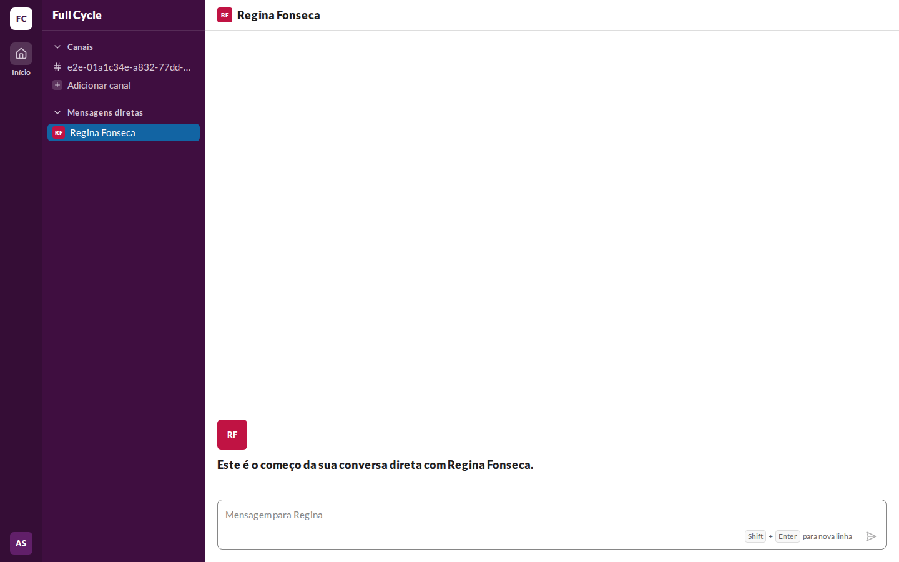
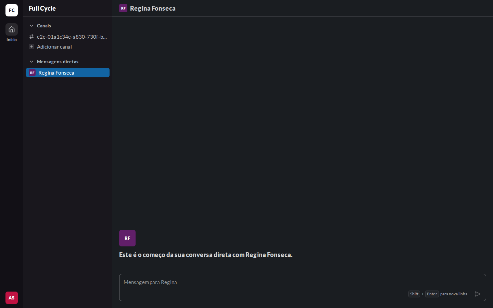
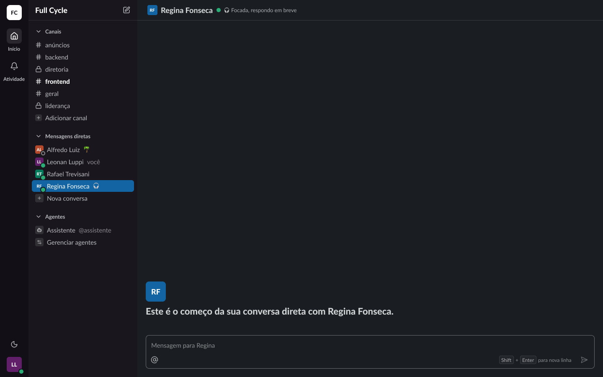
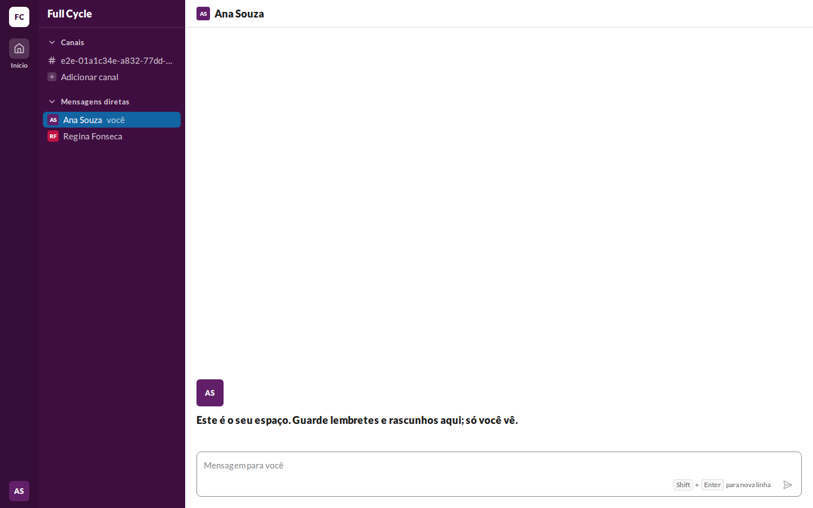
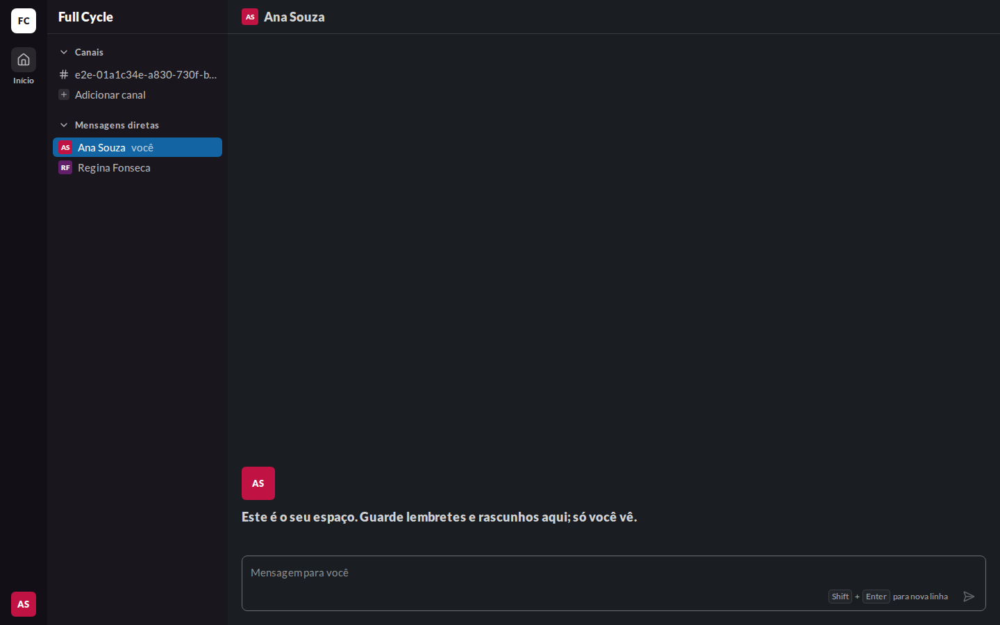
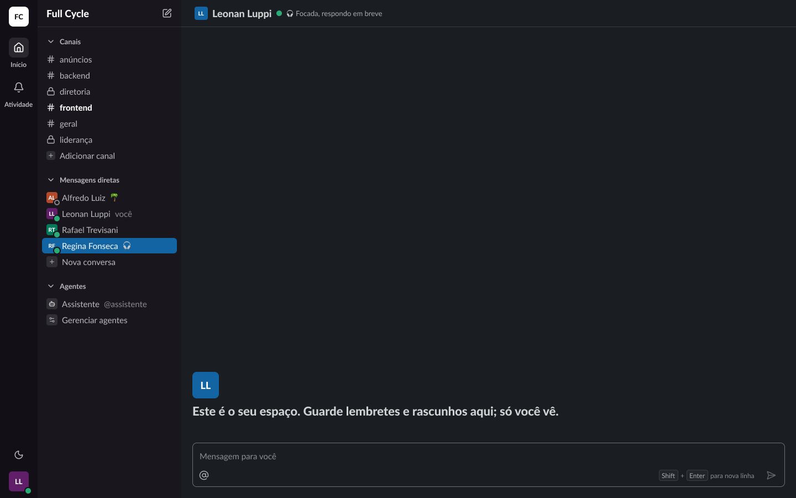
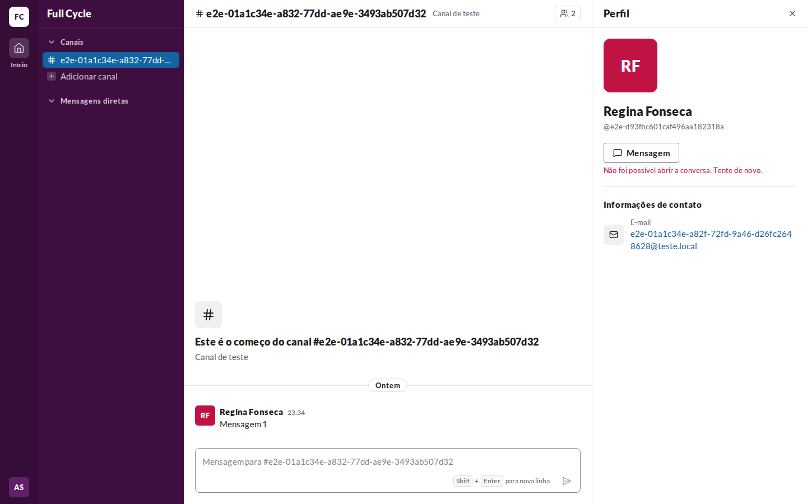
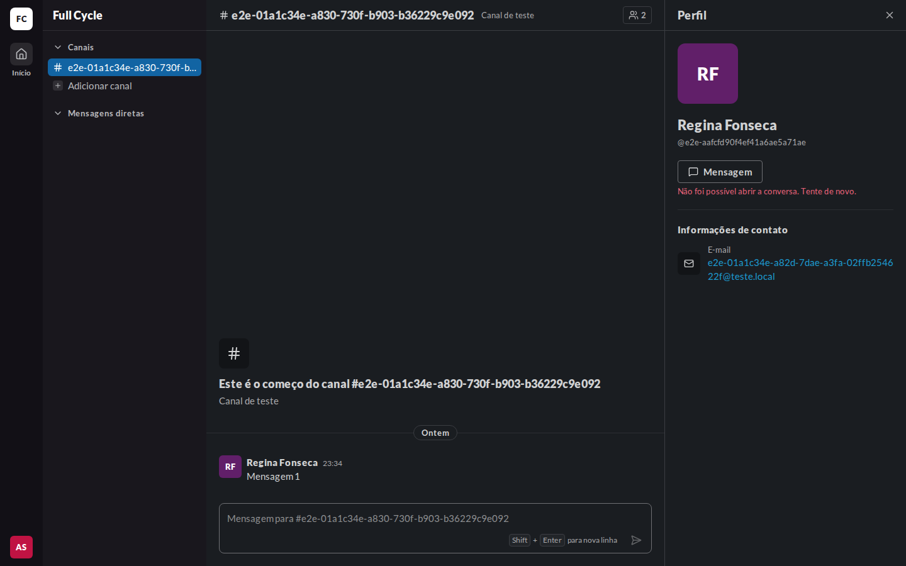
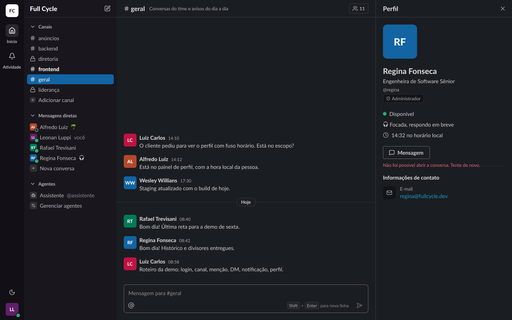

# Validação visual da F05-T04

Capturas da web em 1440 × 900, no Chromium do contêiner `e2e`, ao lado das capturas dos frames do
Figma (arquivo `slack`, página Telas, no modo Dark da coleção Semantic): "Conversa / Lista / Início
da conversa direta" (21:5056, corrigido nesta tarefa), "Conversa / Lista / Início da conversa
consigo mesma" (124:35330, criado nesta tarefa) e "Painel de perfil / Falha ao abrir conversa
direta" (124:35340, criado nesta tarefa). O tema escuro da web é o `data-theme="dark"` na raiz.

Os dados da web vêm de um teste: Regina Fonseca, com uma Mensagem num Canal de teste. A falha ao
abrir foi capturada com a Server Action respondida com 500 pelo `page.route`.

| Estado | Web, claro | Web, escuro | Figma, escuro |
| --- | --- | --- | --- |
| Conversa direta, começo |  |  |  |
| Conversa consigo mesma |  |  |  |
| Falha ao abrir |  |  |  |

## O que bate

- O cabeçalho da Conversa direta com o avatar `sm` e o nome em `title/black`, sem Tópico nem o
  botão de Membros.
- O começo da conversa com o avatar de 48 px e o título em `title/black`, nos textos dos frames.
- "Mensagem para Regina" e "Mensagem para você" na caixa de mensagem.
- A seção "Mensagens diretas" abaixo de "Canais", com o avatar `xs` e o nome, e "você" ao lado da
  Conversa consigo mesma.
- A falha ao abrir em `small` e `danger-fg`, logo abaixo de "Mensagem".

## Diferenças esperadas

- Presença, status, o botão "Nova conversa" (F05-T06) e a seção de Agentes não aparecem na web.
- Na web, a barra lateral só tem as Conversas da Pessoa de teste; o Figma mostra um workspace
  cheio.
- As cores dos avatares vêm do id de cada Pessoa.
