# Validação visual da F05-T06

Capturas da web em 1440 × 900, no Chromium do contêiner `e2e`, ao lado das capturas dos frames
"Diálogos / Nova conversa" do Figma (arquivo `slack`, página Telas, seção "Diálogos da casca", no
modo Dark da coleção Semantic): Lista (26:27752), Ninguém encontrado (26:28551), Abrindo
(26:29410) e Falha ao abrir (126:35945, criado nesta tarefa). O tema escuro da web é o
`data-theme="dark"` na raiz.

Os dados da web vêm de um teste: três Pessoas de teste com um sufixo em comum, buscado no campo,
duas com cargo. O Abrindo foi capturado com a abertura presa pelo `page.route`, e a Falha ao abrir
com ela respondida com 500.

| Estado | Web, claro | Web, escuro | Figma, escuro |
| --- | --- | --- | --- |
| Lista | 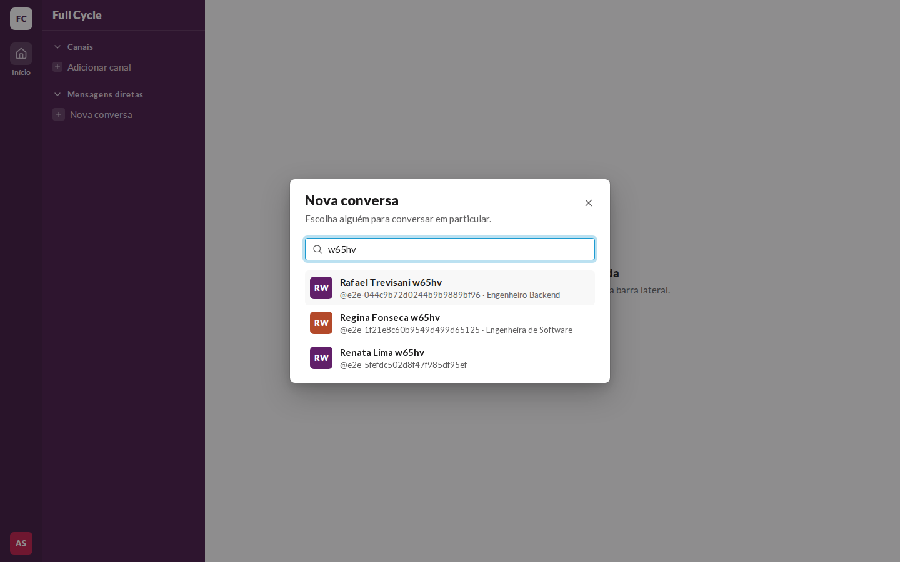 | 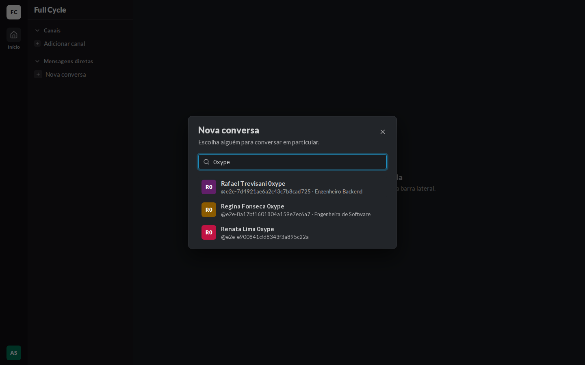 | 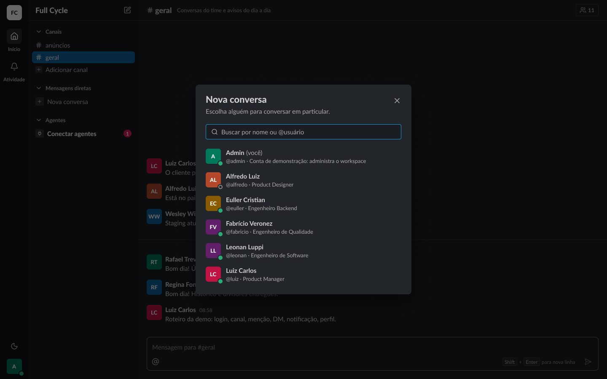 |
| Ninguém encontrado | 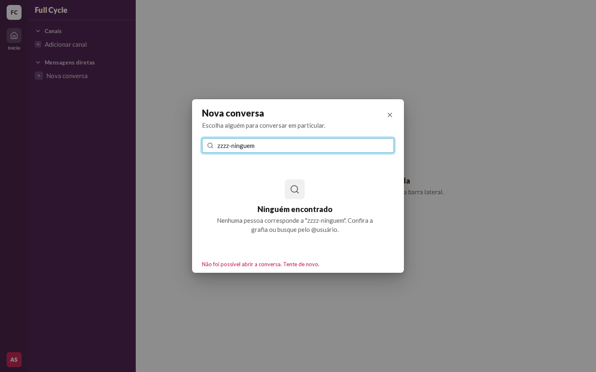 | 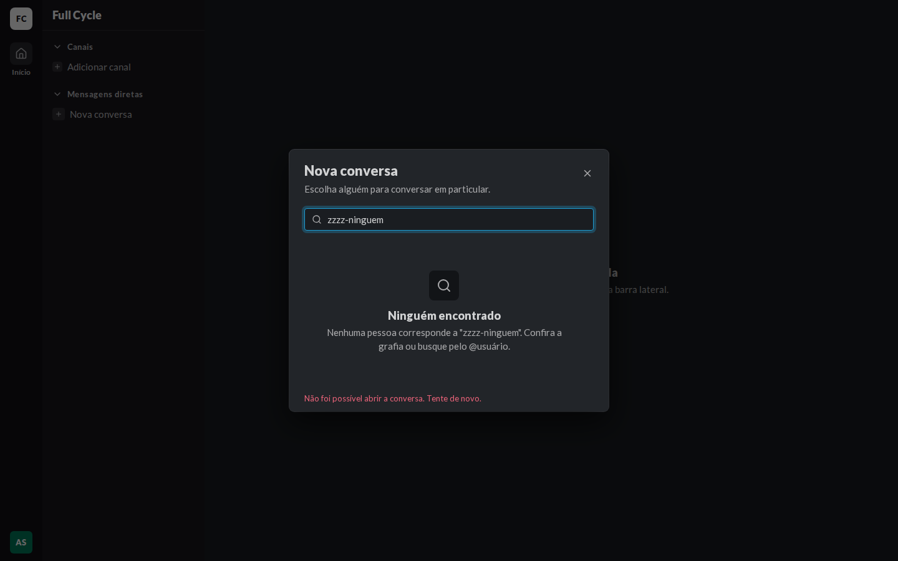 | 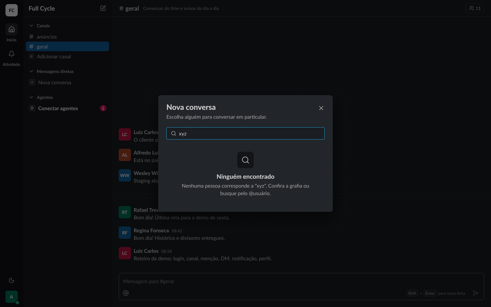 |
| Abrindo | 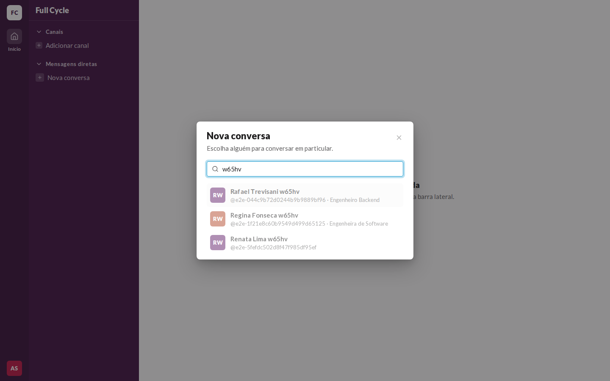 | 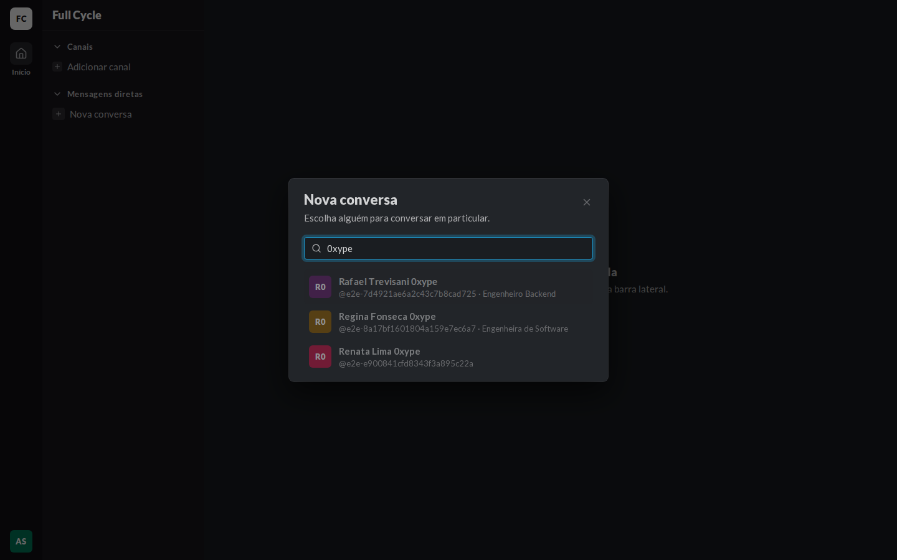 | 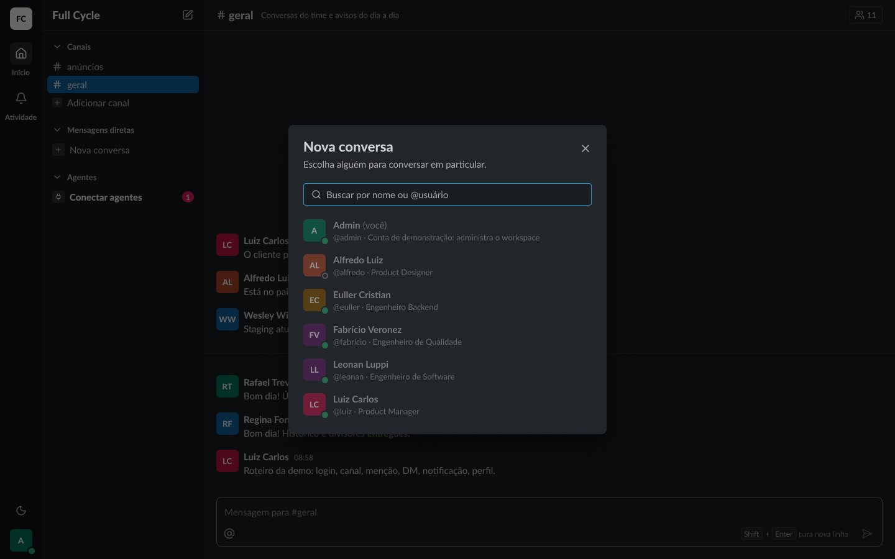 |
| Falha ao abrir | 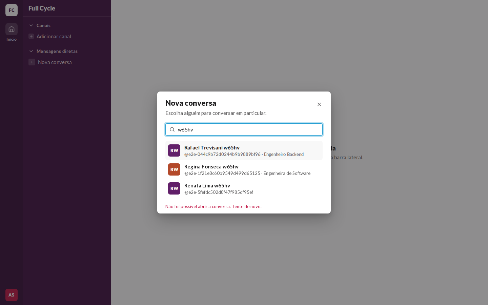 | 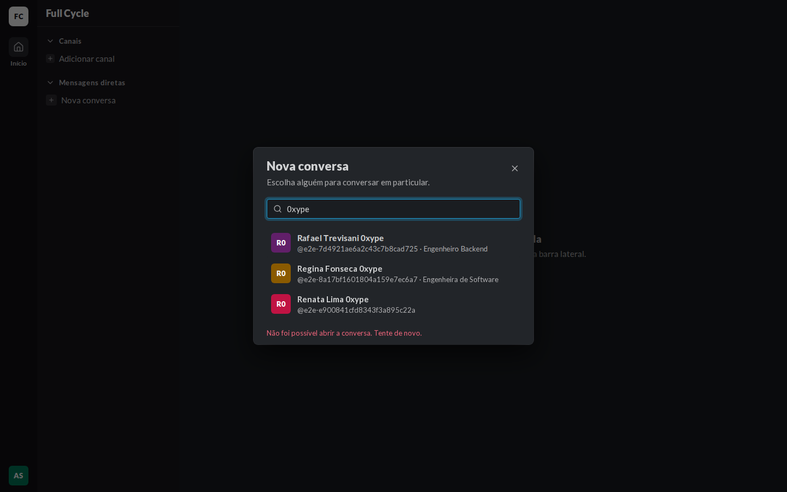 | 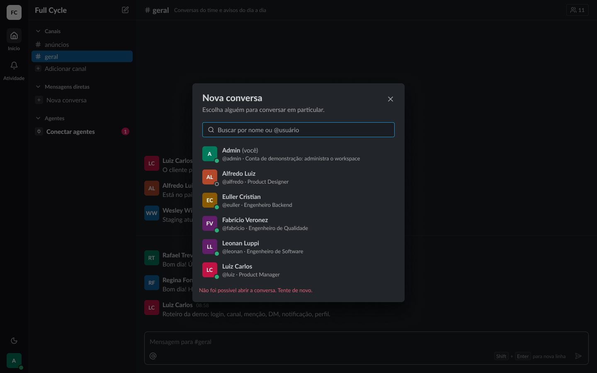 |

## O que bate

- O Dialog com o título "Nova conversa" em `heading/black`, a descrição em `fg-muted` e o X de
  36 px; a busca com o ícone `search` e o placeholder "Buscar por nome ou @usuário".
- A PersonRow com o avatar de 36 px, o nome em `body/bold` e "@usuário · cargo" em `small` e
  `fg-muted`, sem o cargo quando ele não existe.
- O Ninguém encontrado com o EmptyState, o ícone `search` num quadro de 48 e o texto do frame.
- O Abrindo com a lista em `opacity-50`; a Falha ao abrir com o erro em `small` e `danger-fg`
  abaixo da lista.
- A SidebarAction "Nova conversa" no fim de "Mensagens diretas", com o quadro `sidebar-field` e o
  `+`.

## Diferenças esperadas

- Presença e a seção de Agentes não aparecem na web; o Figma mostra um workspace cheio.
- Os `@usuário` das Pessoas de teste são longos, gerados para não colidir.
- A Pessoa destacada pelas setas ganha o fundo `surface-subtle`, que o Figma não desenha.
