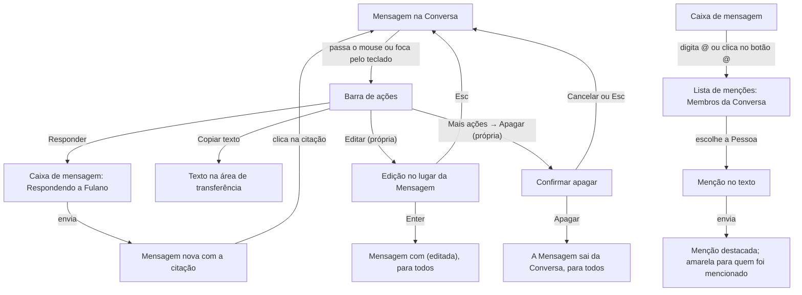

# PRD · F06 · Ações na mensagem

2026-11-10 · Luiz Carlos · Status: aprovado

## 1. Resumo executivo

- **Problema:** depois da F05 a pessoa conversa em Canais e Conversas diretas, mas uma Mensagem
  enviada não muda mais: um erro de digitação fica para sempre, uma Mensagem enviada na Conversa
  errada não sai, não há como chamar a atenção de uma Pessoa nem deixar claro a que Mensagem se
  responde numa conversa movimentada. A contagem de menções (F07), a notificação de menção (F08) e
  o pedido a um agente por menção (F11 e F12) dependem de a menção existir.
- **Solução proposta:** cada Mensagem ganha uma barra de ações e um menu. Qualquer Membro responde
  citando a Mensagem e copia o texto dela, e o autor a edita ou apaga. Ao digitar `@` na caixa de
  mensagem, a pessoa escolhe um Membro da Conversa para mencionar, e a menção aparece destacada,
  em amarelo para quem foi mencionado. Edições e Mensagens apagadas chegam a todos os Membros na
  hora, pelo mesmo tempo real da F03.
- **Critérios de sucesso:** esta funcionalidade não move sozinha nenhuma métrica do product brief
  (seção "Objetivos e métricas de sucesso"). Ela entrega o item 5 do "Escopo do MVP" do brief e
  cumpre o requisito "Acessibilidade" nas telas que entrega. É pré-requisito da F07, da F08 e, pela
  menção, do pedido a um agente na F11 e da delegação a uma Pessoa mencionada na F12.

## 2. Experiência do usuário e funcionamento

### Personas

- **Pessoa do workspace:** conversa em Canais e Conversas diretas (F02 a F05), erra, se arrepende
  do que enviou, quer chamar alguém para a conversa e responder a uma Mensagem específica.

### Regras desta funcionalidade

- Só o autor edita ou apaga uma Mensagem, a qualquer momento, sem limite de tempo. Ninguém mais,
  nem um administrador, edita ou apaga a Mensagem de outra Pessoa.
- Uma Mensagem editada mostra "(editada)" ao lado do texto. Não há histórico das versões
  anteriores.
- Uma Mensagem apagada sai da Conversa para todos os Membros, e o texto dela não pode ser
  recuperado. As Mensagens que a citavam continuam, com "Em resposta a uma mensagem apagada" no
  lugar da citação.
- Uma citação aponta para uma Mensagem da mesma Conversa e mostra o autor e o texto atual dela:
  se a original for editada, a citação mostra o texto novo.
- Só se menciona Pessoas, pelo `@usuário`, e só quem é Membro da Conversa. Num Canal público,
  todo o workspace é Membro; num Canal privado, só os Membros dele; numa Conversa direta, as duas
  Pessoas. Um `@usuário` digitado à mão de quem não é Membro, ou que não existe, fica como texto
  comum, sem destaque, e não dá acesso à Conversa.
- A menção vale pelo texto atual da Mensagem: uma menção acrescentada numa edição passa a
  destacar a Pessoa, e uma menção tirada numa edição deixa de destacar.
- As ações valem para Mensagens enviadas. Uma Mensagem "Enviando" ou com "Falha no envio" (F02)
  não tem barra de ações nem menu.

### Fluxo

### Histórias de usuário

1. Como pessoa do workspace, quero mencionar um Membro da Conversa para chamar a atenção dele
   para a Mensagem.
2. Como pessoa do workspace, quero ver destacadas as Mensagens que me mencionam para não deixar
   passar o que é comigo.
3. Como pessoa do workspace, quero responder citando uma Mensagem para deixar claro a que estou
   respondendo numa conversa movimentada.
4. Como pessoa do workspace, quero copiar o texto de uma Mensagem para usá-lo em outro lugar sem
   selecionar à mão.
5. Como autor de uma Mensagem, quero editá-la para corrigir um erro sem enviar outra.
6. Como autor de uma Mensagem, quero apagá-la para tirar da Conversa o que enviei por engano.
7. Como Membro de uma Conversa, quero ver as edições e as Mensagens apagadas na hora, sem
   recarregar, para não responder a um texto que já mudou ou saiu.

### Critérios de aceite

**Todas as histórias**

- As telas seguem o design system do projeto e os frames "Conversa / Mensagem / Hover com barra de
  ações", "Menciona você", "Destaque por link", "Com citação", "Citação apagada", "Editada",
  "Edição", "Edição salvando", "Edição com erro", "Conversa / Composer / Lista de menções",
  "Citando", "Conversa / Lista / Indo até a mensagem" e "Conversa / Sobreposições / Menu da
  própria mensagem", "Menu de mensagem de terceiros", "Confirmar apagar", "Apagando" e "Erro ao
  apagar" do Figma do projeto, nos temas claro e escuro, e atingem 100 na nota de Acessibilidade do
  Lighthouse.
- O que esses frames mostram e fica fora desta funcionalidade não aparece: `@canal`, `@aqui` e o
  agente na lista de menções, e a citação restrita (ver "O que não é objetivo").
- Antes da implementação, o Figma é corrigido e completado: a lista de menções mostra só Pessoas;
  ganham frames a falha ao copiar o texto, a citação de uma Mensagem que não está mais carregada e
  a edição acima do limite de caracteres.
- Tudo funciona só pelo teclado. Com o foco numa Mensagem, a barra de ações fica visível e
  alcançável por Tab; os menus abrem com Enter ou Espaço, as setas mudam o item e Esc fecha,
  devolvendo o foco para onde estava.

**Barra de ações e menu**

- Passar o mouse sobre uma Mensagem, ou pôr o foco nela, mostra a barra de ações: "Responder",
  "Copiar texto", "Editar", só nas próprias, e "Mais ações".
- "Mais ações" abre o menu da Mensagem: "Responder", "Copiar texto", "Editar" e, separado e em
  vermelho, "Apagar", nas próprias; só "Responder" e "Copiar texto", nas dos outros.

**Histórias 1 e 2, mencionar e ver a menção**

- Digitar `@` na caixa de mensagem, no começo do texto ou depois de um espaço, ou clicar no botão
  `@` da caixa, abre a lista de menções com os Membros da Conversa, cada um com o avatar, o nome, o
  `@usuário` e, quando houver, o cargo.
- O texto digitado depois do `@` filtra a lista por nome ou `@usuário`, sem diferenciar
  maiúsculas, minúsculas e acentos, como a busca da F05. Sem resultado, a lista fecha.
- As setas mudam a Pessoa destacada, Enter ou Tab a escolhe e Esc fecha a lista sem mudar o texto.
  Escolher põe `@usuário` e um espaço no texto, no lugar do que foi digitado.
- A mesma lista funciona na edição de uma Mensagem.
- Na Conversa, a menção a um Membro aparece destacada em azul. A menção à própria pessoa aparece
  em amarelo, e a Mensagem inteira ganha o fundo de "Menciona você", só para ela.
- Clicar numa menção abre o painel de perfil da Pessoa mencionada (F05).

**História 3, responder citando**

- "Responder" põe a caixa de mensagem em "Respondendo a <nome>", com o começo do texto da
  Mensagem citada e um botão para desistir, e leva o foco para a caixa. Esc ou o botão desistem
  da citação sem apagar o que foi digitado.
- Responder a outra Mensagem antes de enviar troca a citação. Trocar de Conversa desiste dela.
- A Mensagem enviada mostra, acima do texto, a citação com o nome do autor e o começo do texto da
  original, como em "Conversa / Mensagem / Com citação".
- Clicar na citação, ou ativá-la pelo teclado, rola a Conversa até a original e a destaca, como em
  "Destaque por link". Se a original não estiver carregada, a Conversa carrega o histórico até ela,
  no estado "Indo até a mensagem".
- Se a original for apagada, a citação vira "Em resposta a uma mensagem apagada", sem nome nem
  texto, e não leva a lugar nenhum.

**História 4, copiar o texto**

- "Copiar texto" copia o texto da Mensagem, sem o nome do autor nem a hora, com as menções como
  `@usuário`, e mostra o aviso "Texto copiado".
- Se o navegador recusar o acesso à área de transferência, a pessoa vê um aviso de erro, e nada
  mais muda.

**História 5, editar**

- "Editar" troca o texto da Mensagem por uma caixa de edição no mesmo lugar, com o texto atual e o
  foco no fim dele, como em "Conversa / Mensagem / Edição".
- Enter salva, Shift+Enter quebra a linha e Esc cancela, voltando ao texto de antes.
- O limite é o mesmo do envio, 4000 caracteres, com o mesmo aviso de "N caracteres acima do
  limite" (F02). Com o texto vazio ou acima do limite, salvar não é aceito; para tirar a Mensagem,
  a pessoa a apaga.
- Salvar sem mudar nada fecha a edição sem marcar "(editada)".
- Enquanto salva, a edição fica no estado "Salvando" e não aceita outro Enter. Se falhar, por rede
  ou servidor, a caixa continua aberta com o texto digitado, uma mensagem de erro e a opção de
  tentar de novo, como em "Edição com erro".
- Salva, a Mensagem mostra o texto novo e "(editada)", na mesma posição da Conversa.

**História 6, apagar**

- "Apagar" abre o diálogo "Apagar mensagem?", que diz que ela some da Conversa para todo mundo e
  que não dá para desfazer, mostra o texto dela e tem o foco em "Cancelar". Clicar fora não fecha o
  diálogo; Esc o fecha.
- Enquanto apaga, o diálogo fica no estado "Apagando" e não aceita outro clique. Se falhar, por
  rede ou servidor, o diálogo mostra o erro e a opção de tentar de novo, e a Mensagem continua na
  Conversa.
- Apagada, a Mensagem sai da Conversa. Se ela abria um grupo de Mensagens do mesmo autor (F02), a
  seguinte passa a mostrar o nome e o avatar dele.

**História 7, mudanças na hora para todos**

- Uma Mensagem editada ou apagada muda na Conversa aberta de todos os Membros, em todas as abas,
  em até 1 s no p95, contado da gravação da mudança, sem recarregar e sem mudar a posição da
  rolagem de quem está lendo.
- As citações a essa Mensagem mudam junto.
- Uma menção acrescentada numa edição destaca a Pessoa mencionada na hora, do mesmo jeito.
- Se a pessoa estiver editando ou citando uma Mensagem que outra aba ou dispositivo apagou, a
  edição fecha ou a citação some, com um aviso de que a Mensagem foi apagada, e o texto digitado na
  caixa de mensagem continua lá.
- Edições e Mensagens apagadas durante uma queda de conexão aparecem ao reconectar, como as
  Mensagens novas na F03.

### O que não é objetivo

- `@canal` e `@aqui`: ficam para quando houver notificação (F08) e presença (F09).
- Mencionar um agente: F11.
- Notificação de menção e a aba Menções de Atividade: F08. Contagem de menções: F07.
- Mencionar quem não é Membro da Conversa, ou adicioná-lo a ela pela menção.
- Histórico das versões de uma Mensagem editada e desfazer uma Mensagem apagada.
- Editar ou apagar a Mensagem de outra Pessoa, inclusive como administrador.
- Limite de tempo para editar ou apagar.
- Citar uma Mensagem de outra Conversa, encaminhar, fixar, salvar e copiar o link de uma Mensagem.
- Citação restrita de dados de negócio: F13.
- Atalho de teclado para editar a última Mensagem enviada.
- Formatação de texto (negrito, código, listas) e prévia de links.
- Threads (F20) e reações (F21).

## 3. Requisitos do sistema de IA

Não se aplica: a F06 não envolve agentes. A menção a um agente e a citação restrita entram com as
funcionalidades dos agentes (F11 a F14).

## 4. Riscos de produto

| Risco | Mitigação |
| --- | --- |
| Alguém edita uma Mensagem depois de respondida, e as respostas passam a parecer fora de contexto | A Mensagem editada mostra "(editada)"; a citação mostra o texto atual, e quem leu antes vê a mudança na hora |
| A pessoa apaga uma Mensagem por engano e não consegue recuperá-la | O diálogo de confirmação diz que não dá para desfazer, mostra o texto e começa com o foco em "Cancelar" |
| Uma menção dá a entender que a Pessoa foi avisada, mas a notificação só vem com a F08 | Risco aceito até a F08: a menção aparece destacada em amarelo para quem foi mencionado, e a contagem de menções vem com a F07 |
| Mencionar quem não é Membro de um Canal privado revelaria a Conversa ou criaria a expectativa de que a Pessoa vai ler | A lista de menções só mostra Membros, e um `@usuário` de quem não é Membro fica como texto comum |
| O texto de uma Mensagem apagada continua acessível e o time deixa de confiar que apagar apaga | O texto não pode ser recuperado, e a Mensagem some de todas as abas; as Citações a ela ficam, só com "Em resposta a uma mensagem apagada" no lugar do texto |
| Uma Mensagem editada ou apagada continua aparecendo com o texto antigo em outra aba ou depois de uma queda | A mudança chega em até 1 s pelo tempo real e é recuperada ao reconectar, como as Mensagens novas |
