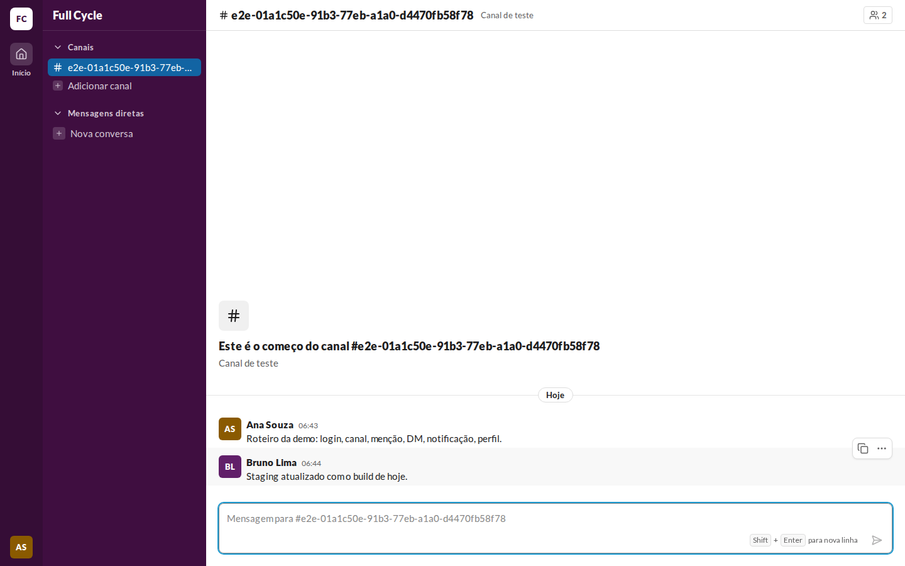
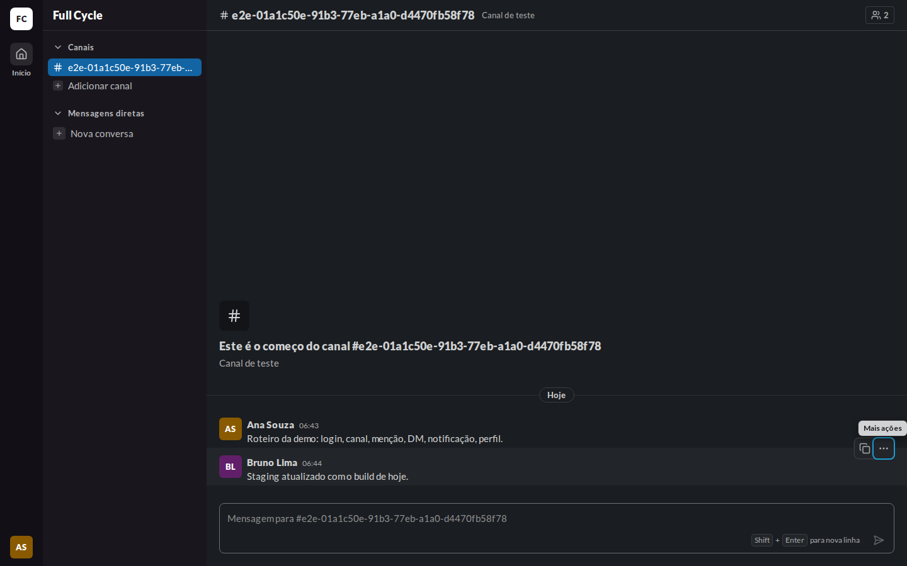
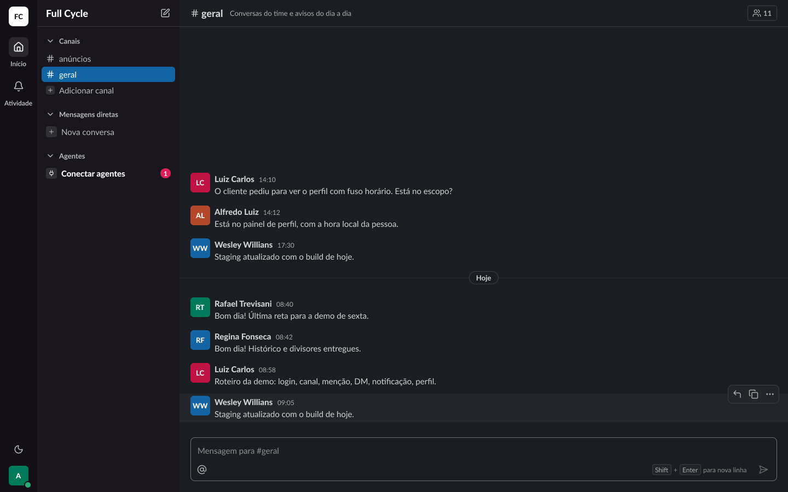
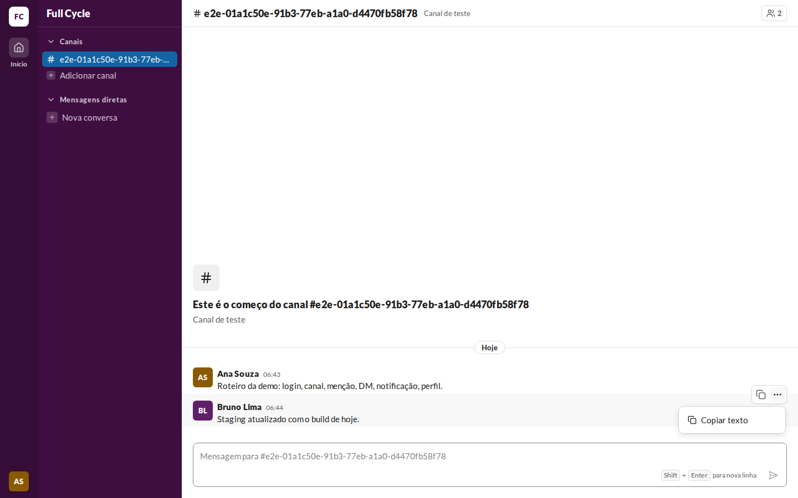
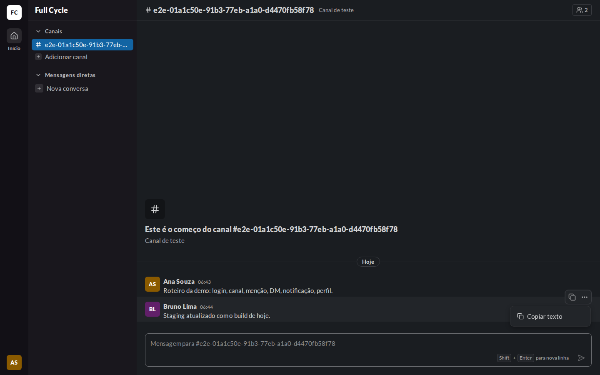
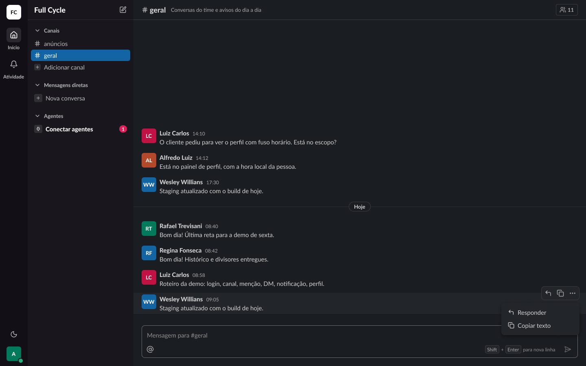
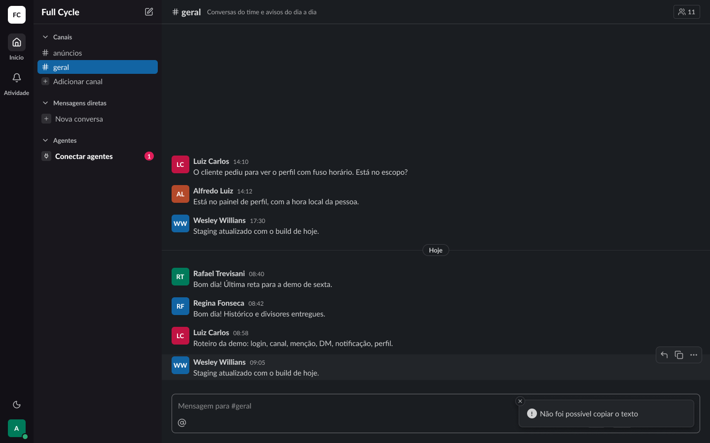

# Validação visual da F06-T02

Capturas da web em 1440 × 900, no Chromium do contêiner `e2e`, ao lado das capturas dos frames do
Figma (arquivo `slack`, página Telas, modo Dark da coleção Semantic): "Conversa / Mensagem / Hover
com barra de ações" (22:10143), "Conversa / Sobreposições / Menu de mensagem de terceiros"
(23:19029) e "Conversa / Sobreposições / Erro ao copiar" (127:36261, criado nesta tarefa). O tema
escuro da web é o `data-theme="dark"` na raiz.

Os dados vêm de um teste: Ana Souza logada, com uma Mensagem dela e uma de Bruno Lima num Canal de
teste; o mouse fica sobre a Mensagem de Bruno, e o menu é o de uma Mensagem de outra Pessoa.

| Estado | Web, claro | Web, escuro | Figma, escuro |
| --- | --- | --- | --- |
| Barra no hover |  |  |  |
| Menu de outra Pessoa |  |  |  |
| Erro ao copiar | — | — |  |

## O que bate

- A linha em hover com `surface-subtle` e a barra no canto superior direito, sobre a borda de cima
  da linha: `surface-raised`, borda `border`, `rounded-card`, `shadow-1`, `p-0.5` e `gap-0.5`, com
  IconButtons `sm` (28 px) e ícones de 18 px em `fg-muted` (`copy`, `ellipsis`).
- O menu abaixo da barra, alinhado à direita: `surface-raised`, `rounded-card`, `shadow-2`, `py-2`,
  largura mínima de 192, itens de `h-8` com `px-4`, `gap-2` e ícone de 16 px.

## Diferenças esperadas

- "Responder" e "Editar" ainda não aparecem na barra nem no menu: entram com a F06-T06 e a F06-T03.
- O toast é o do Sonner, com o ícone dele (design system, "Toast"); o "Erro ao copiar" foi conferido
  pelo teste "mostra o erro quando o navegador recusa a cópia", e não por captura.
- O nome do Canal de teste é o id gerado pelo teste, e as cores dos avatares vêm do id de cada
  Pessoa.
