# Validação visual da F06-T03

Capturas da web em 1440 × 900, no Chromium do contêiner `e2e`, ao lado das capturas dos frames do
Figma (arquivo `slack`, página Telas, modo Dark da coleção Semantic): "Conversa / Mensagem /
Editada" (22:12887), "Edição" (22:16333), "Edição salvando" (22:18117), "Edição com erro"
(22:17221), "Edição acima do limite" (130:36546, criado nesta tarefa) e "Conversa / Sobreposições /
Menu da própria mensagem" (23:18093). O tema escuro da web é o `data-theme="dark"` na raiz.

Os dados vêm de um teste: Ana Souza logada, com uma Mensagem dela depois de uma de Bruno Lima num
Canal de teste. O "Salvando" e o "Edição com erro" foram capturados com a Server Action presa e
depois abortada pelo `page.route`.

| Estado | Web, claro | Web, escuro | Figma, escuro |
| --- | --- | --- | --- |
| Menu da própria Mensagem | 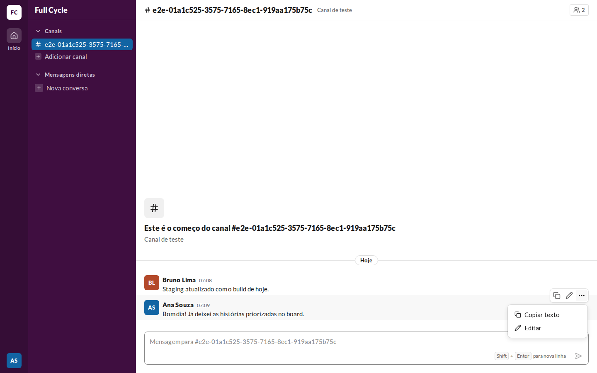 | 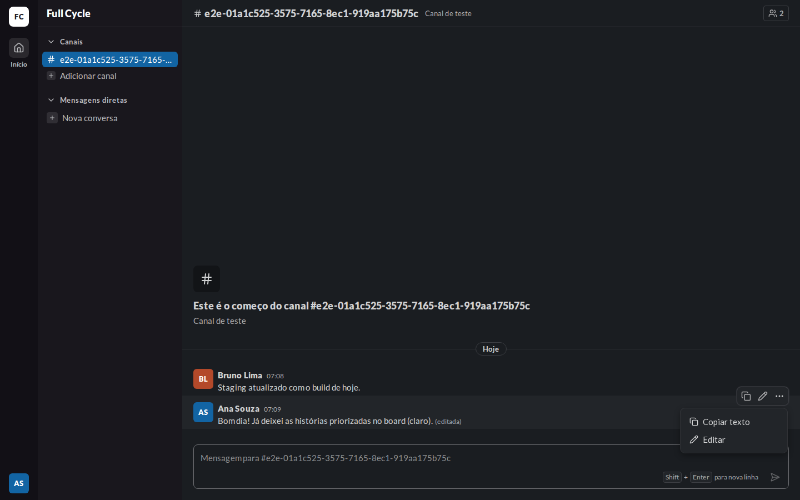 | 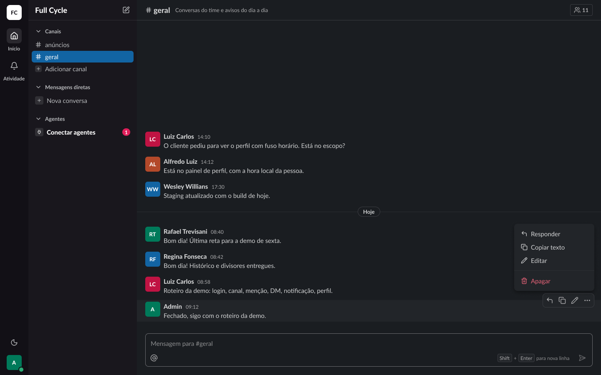 |
| Edição | 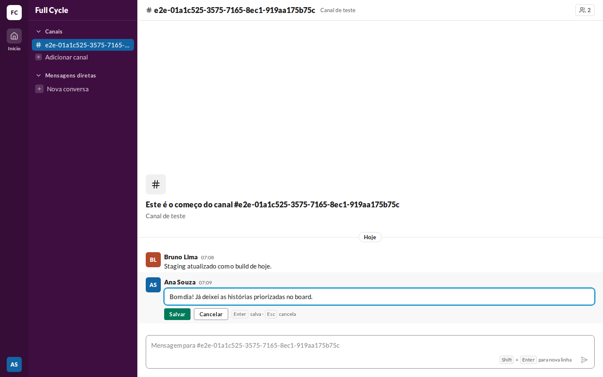 | 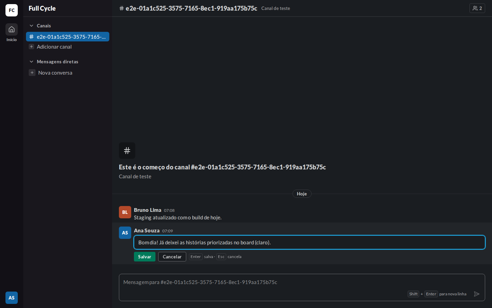 | 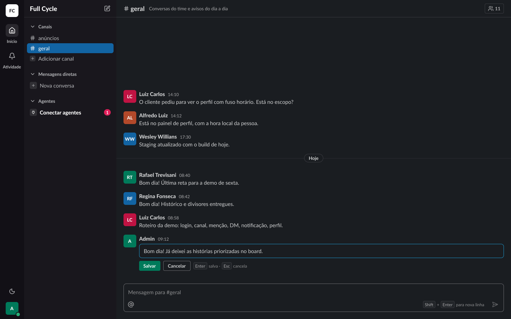 |
| Edição salvando | 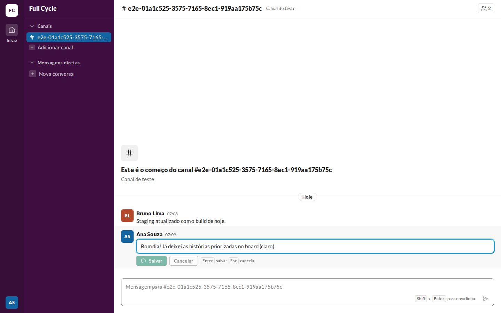 |  | 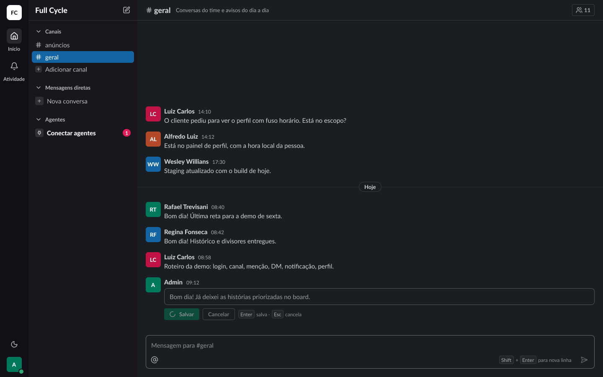 |
| Edição com erro | 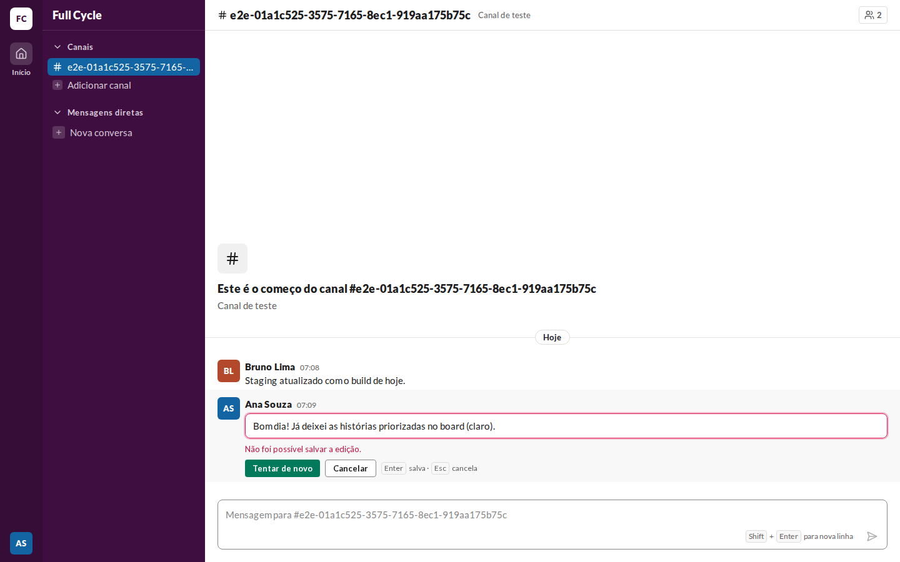 | 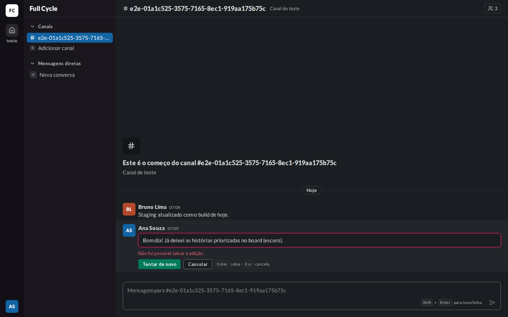 | 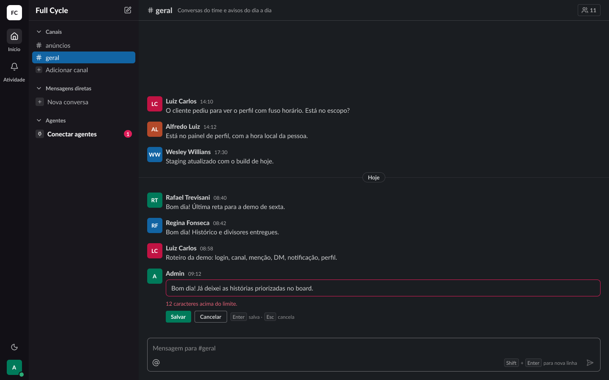 |
| Editada | 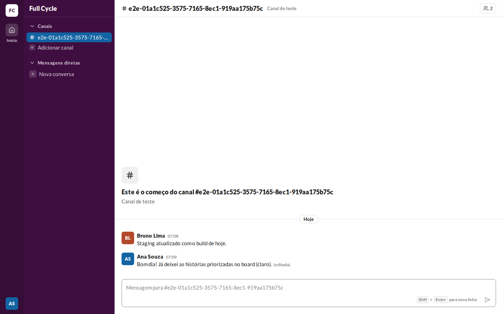 | 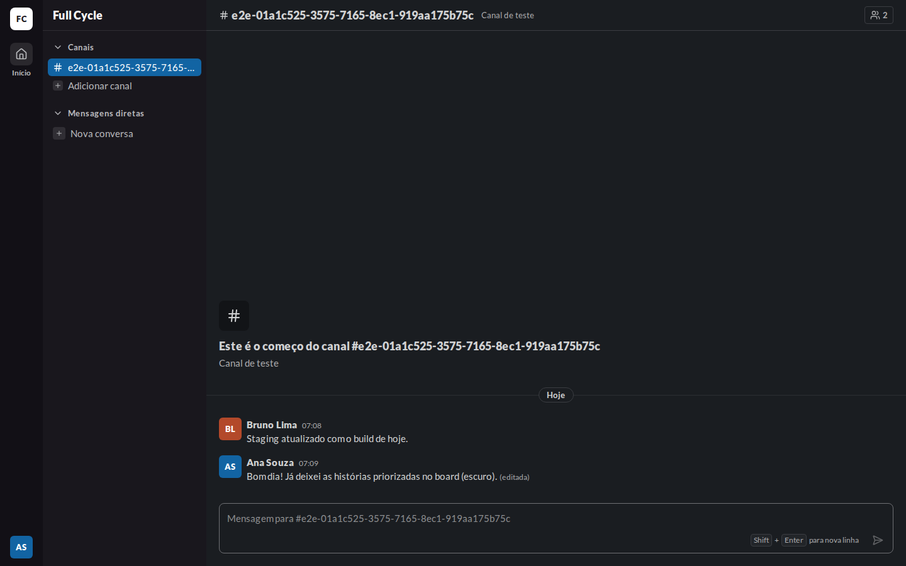 | 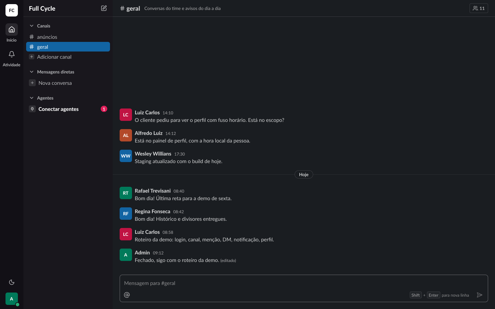 |
| Edição acima do limite | — | — | 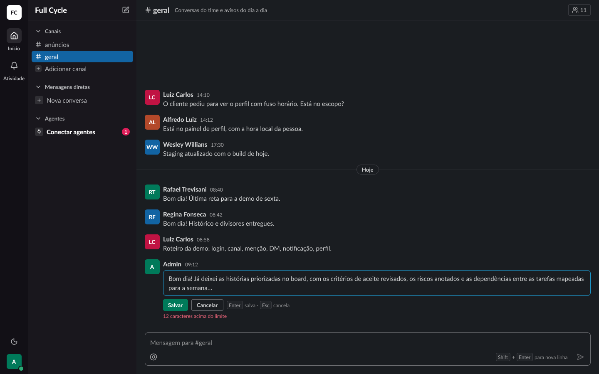 |

## O que bate

- A caixa de edição no lugar do texto: `surface`, `rounded-card`, `px-3 py-2`, com a borda e o anel
  de foco; Salvar (primary sm), Cancelar (secondary sm) e a dica "Enter salva · Esc cancela" com
  Kbd, em `gap-2`.
- "Salvando" com o Spinner no Salvar e o Cancelar desabilitado; "Edição com erro" com a borda e o
  anel `danger` e a mensagem em `danger-fg` entre a caixa e os botões.
- "(editada)" em `caption` e `fg-muted` logo depois do texto.
- O menu da própria Mensagem com "Copiar texto" e "Editar"; "Responder" e "Apagar" entram com a
  F06-T06 e a F06-T04.

## Diferenças esperadas

- A dica da edição usa `fg-muted`, e não o `fg-subtle` do frame: sobre a linha em hover
  (`surface-subtle`), o `fg-subtle` não passa no contraste de 4,5:1 do axe.
- Na falha, o Salvar vira "Tentar de novo", como pede o critério da tarefa; o frame mantém
  "Salvar", e a mensagem é "Não foi possível salvar a edição." em vez do texto de exemplo do frame.
- O contador "acima do limite" foi conferido pelo teste "não salva vazio nem acima do limite", e
  não por captura.
