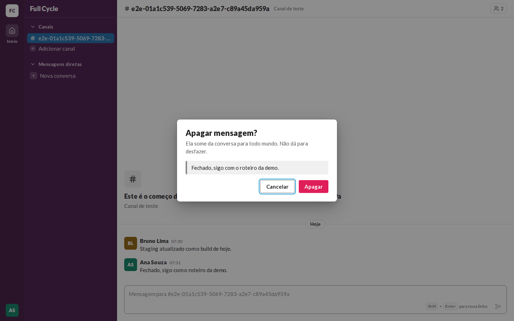
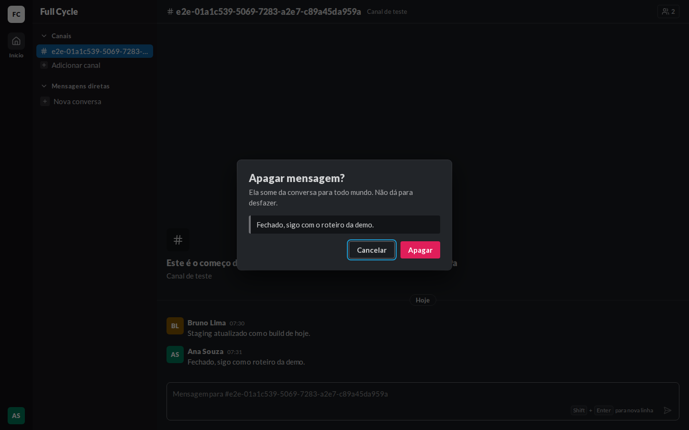
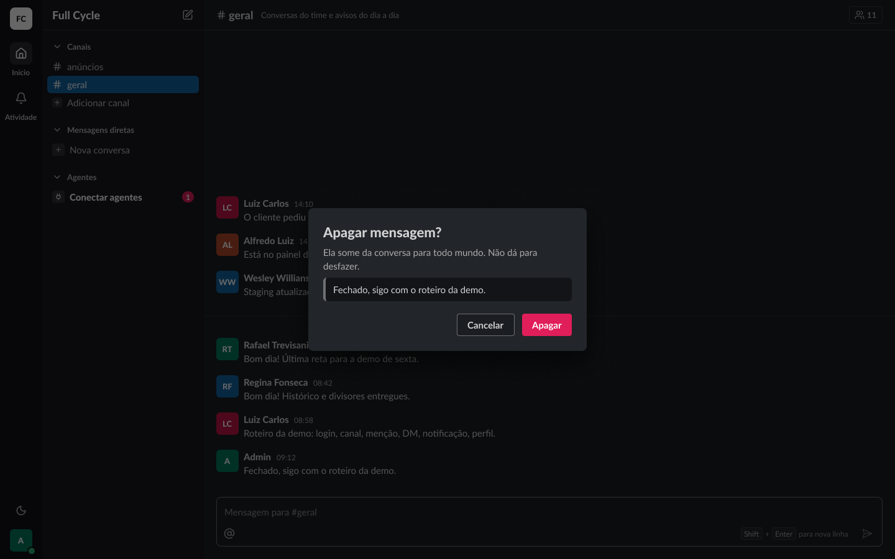
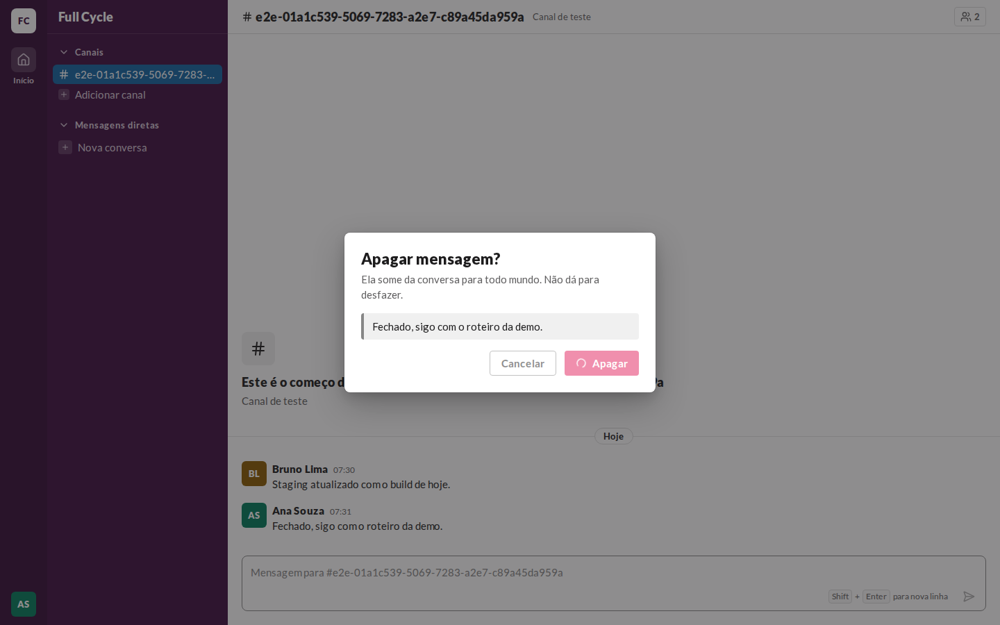
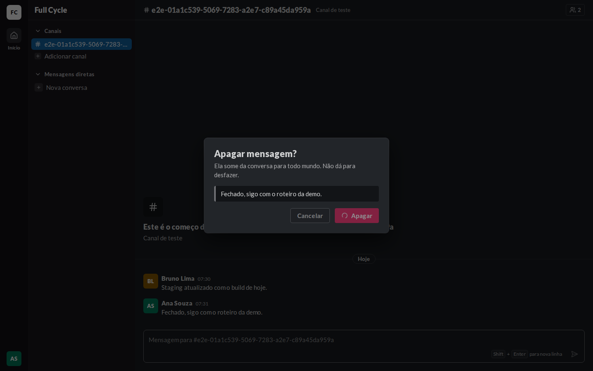
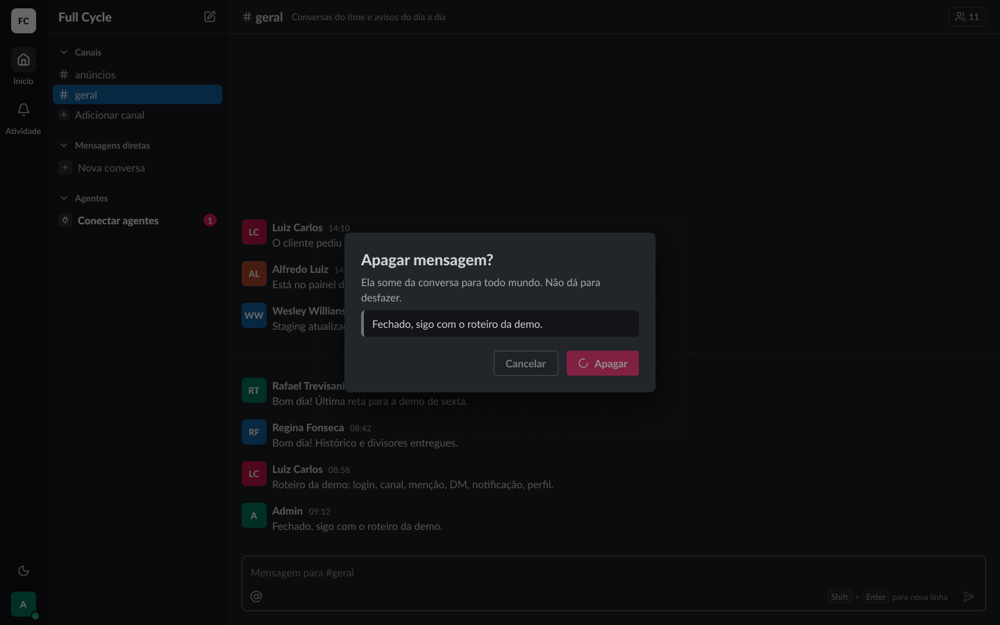
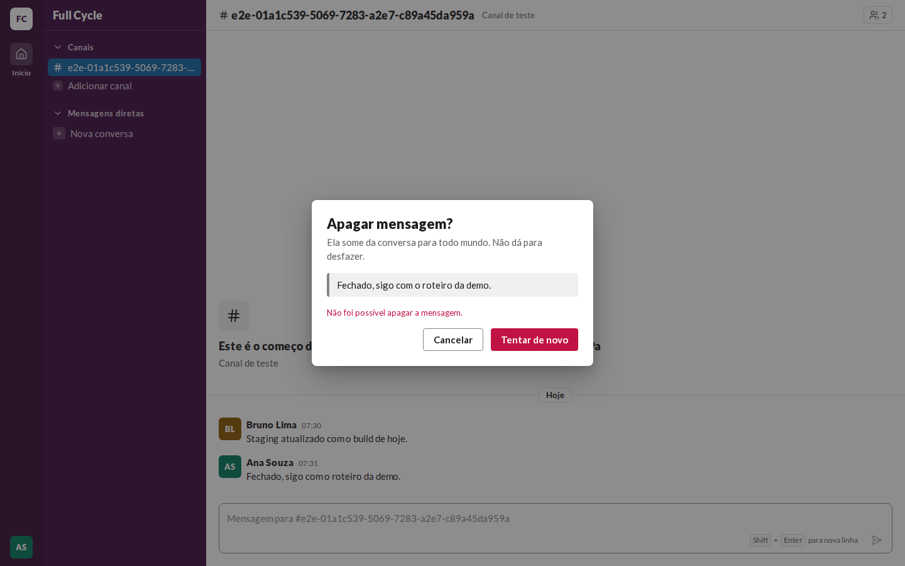
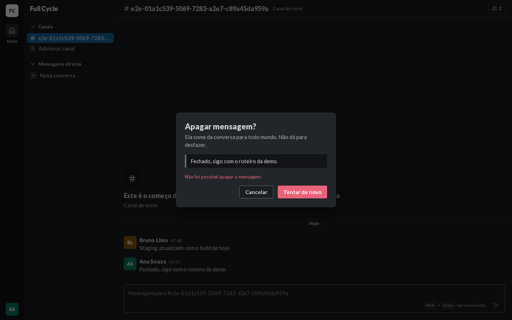
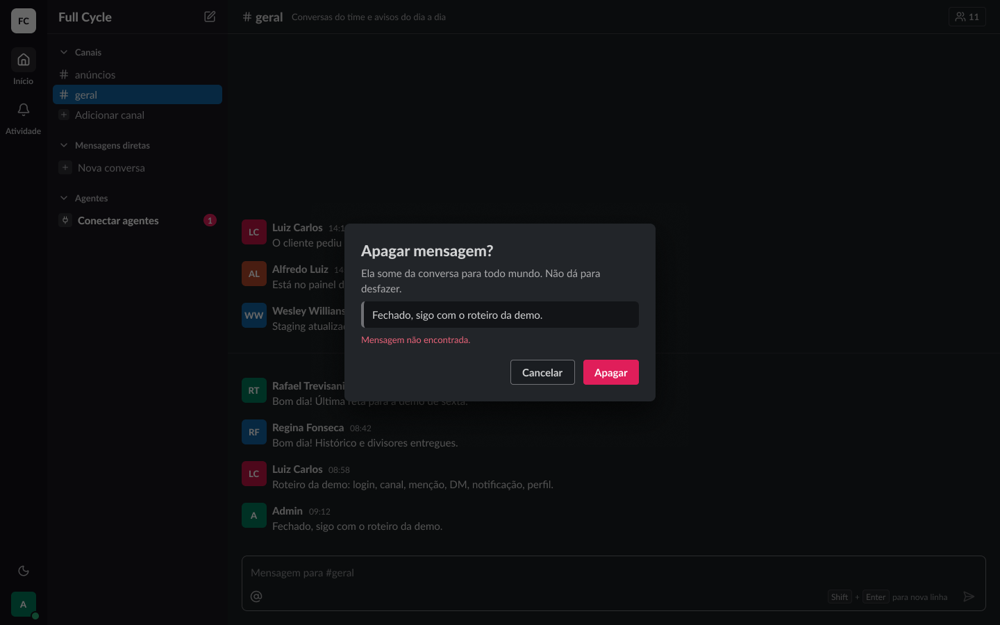

# Validação visual da F06-T04

Capturas da web em 1440 × 900, no Chromium do contêiner `e2e`, ao lado das capturas dos frames do
Figma (arquivo `slack`, página Telas, modo Dark da coleção Semantic): "Conversa / Sobreposições /
Confirmar apagar" (23:19941), "Apagando" (23:20832) e "Erro ao apagar" (23:21715). O tema escuro da
web é o `data-theme="dark"` na raiz.

Os dados vêm de um teste: Ana Souza logada, com uma Mensagem dela depois de uma de Bruno Lima num
Canal de teste. O "Apagando" e o "Erro ao apagar" foram capturados com a Server Action presa e
depois abortada pelo `page.route`.

| Estado | Web, claro | Web, escuro | Figma, escuro |
| --- | --- | --- | --- |
| Confirmar apagar |  |  |  |
| Apagando |  |  |  |
| Erro ao apagar |  |  |  |

## O que bate

- O ConfirmDialog de largura máxima 448, `rounded-card`, `shadow-3`, sobre o `surface-overlay`, com
  o título em `heading/black`, a descrição em `fg-muted` e o texto da Mensagem num bloco
  `surface-inset` com a borda à esquerda.
- Cancelar (secondary) e Apagar (danger), alinhados à direita; "Apagando" com o Spinner no Apagar e
  o Cancelar desabilitado; o erro em `danger-fg` acima dos botões.

## Diferenças esperadas

- Na falha, o Apagar vira "Tentar de novo", como pede o critério da tarefa.
- O nome do Canal de teste é o id gerado pelo teste, e as cores dos avatares vêm do id de cada
  Pessoa.
