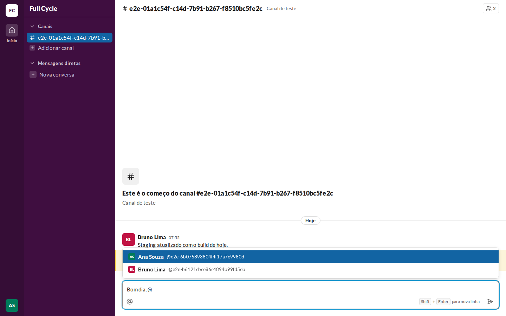
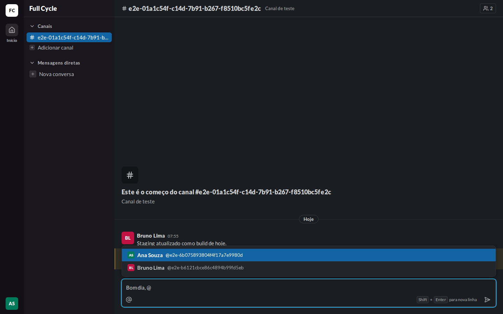
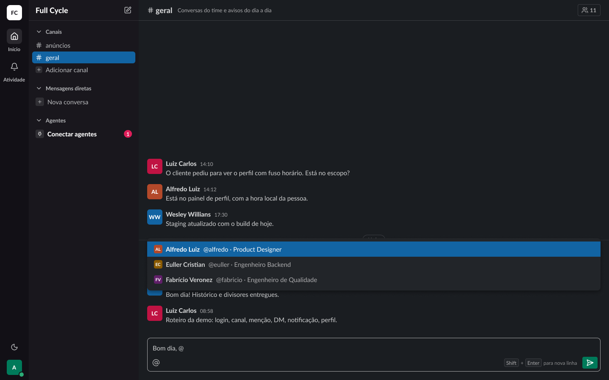
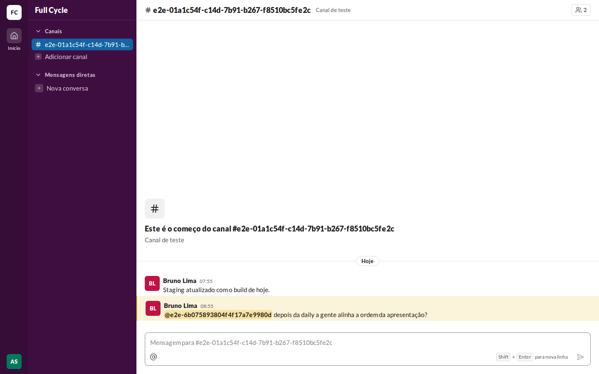
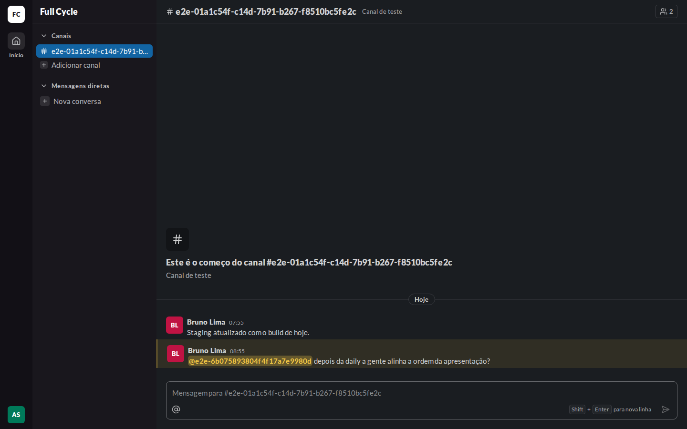
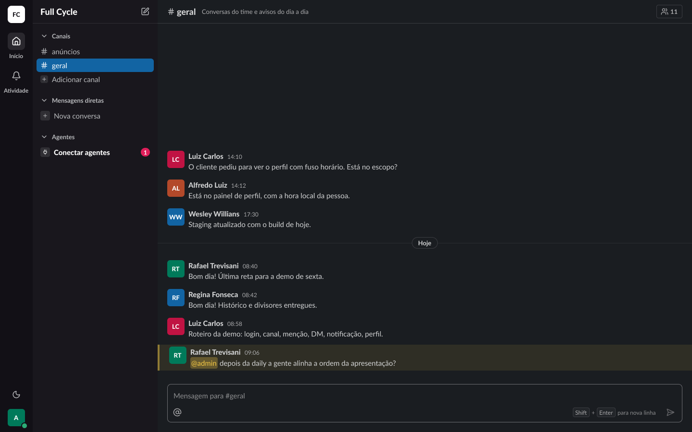

# Validação visual da F06-T05

Capturas da web em 1440 × 900, no Chromium do contêiner `e2e`, ao lado das capturas dos frames do
Figma (arquivo `slack`, página Telas, modo Dark da coleção Semantic): "Conversa / Composer / Lista de
menções" (23:14538) e "Conversa / Mensagem / Menciona você" (22:8334), os dois ajustados nesta
tarefa (só Pessoas na lista; "@admin" na Menção). O tema escuro da web é o `data-theme="dark"` na
raiz.

Os dados vêm de um teste: Ana Souza logada e Bruno Lima num Canal de teste. A Mensagem que menciona
Ana foi enviada por Bruno pela caixa de mensagem, para as Menções virem da API.

| Estado | Web, claro | Web, escuro | Figma, escuro |
| --- | --- | --- | --- |
| Lista de menções |  |  |  |
| Menciona você |  |  |  |

## O que bate

- A lista acima da caixa de mensagem, na largura dela: `surface-raised`, `rounded-card`, `shadow-2`,
  `py-2`, cada Pessoa com o avatar `xs`, o nome em `bold` e "@usuário · cargo" em `small`, e a
  destacada em `sidebar-active`.
- O botão `@` (`at-sign`) à esquerda da caixa.
- A Mensagem que menciona a pessoa logada com `highlight-bg` e a borda `highlight-border` à esquerda,
  e a Menção a ela em `mention-self-bg`/`mention-self-fg`, em negrito.

## Diferenças esperadas

- Os @usuário das Pessoas de teste são longos (gerados pelo teste); o cargo não aparece porque elas
  não têm cargo.
- A lista do frame mostra três Pessoas; o Canal de teste tem duas.
