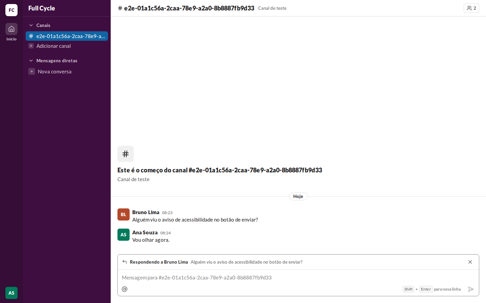
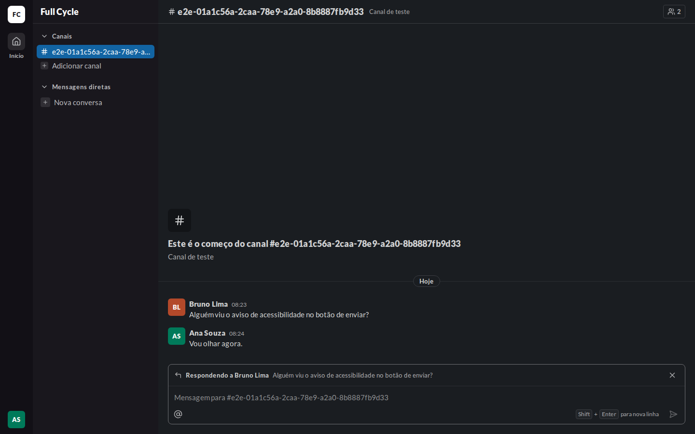
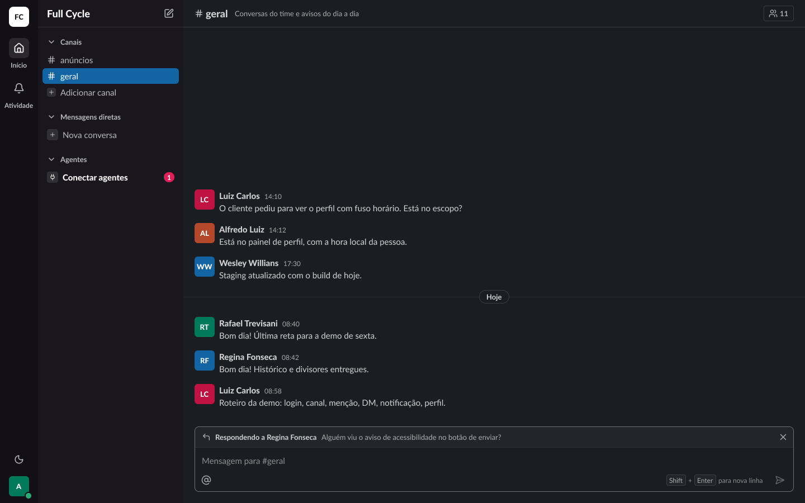
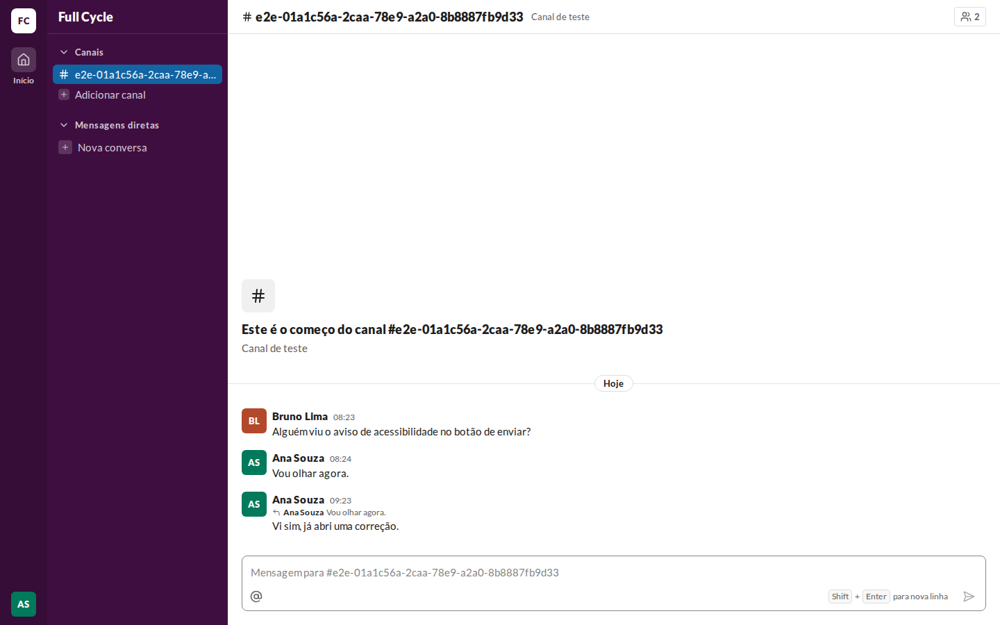
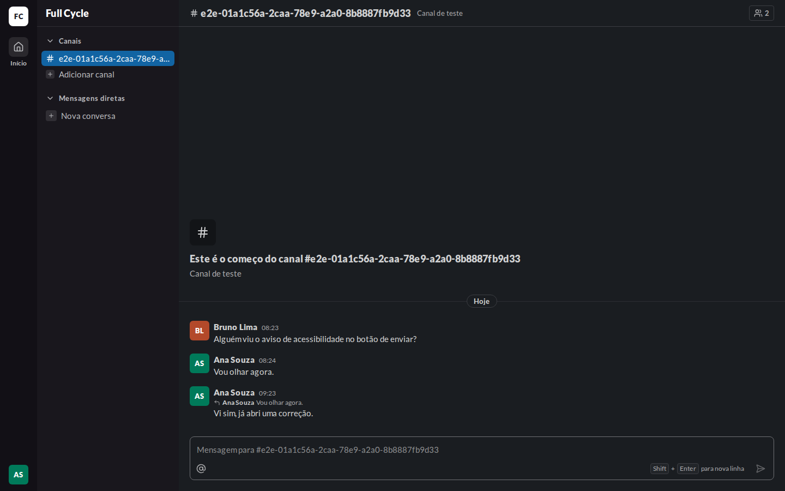
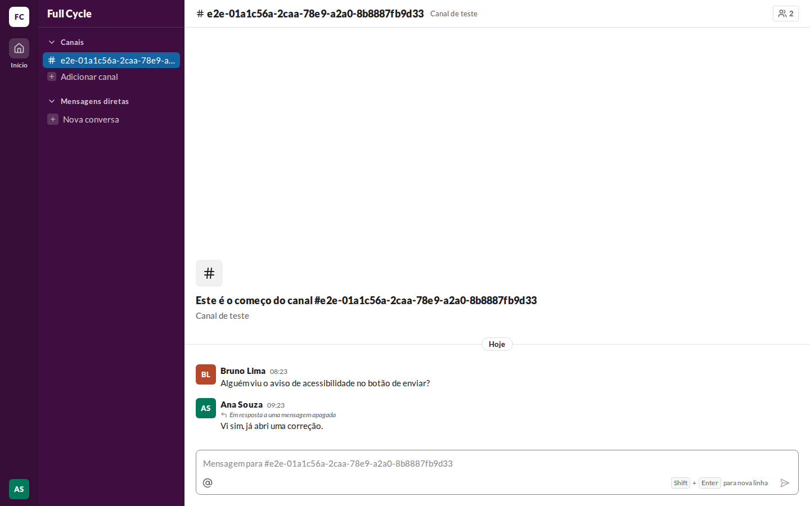
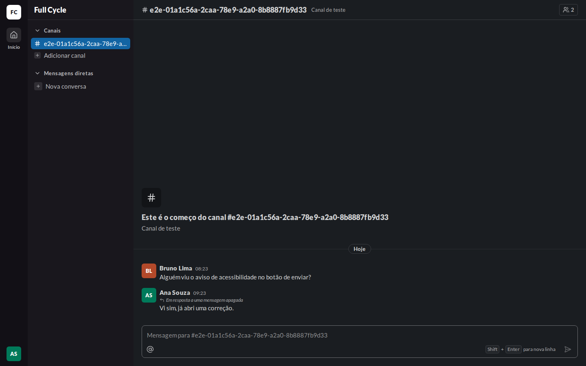
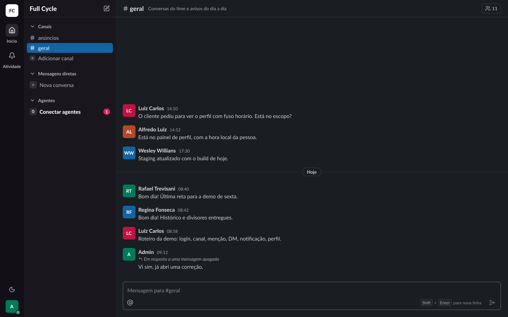

# Validação visual da F06-T06

Capturas da web em 1440 × 900, no Chromium do contêiner `e2e`, ao lado das capturas dos frames do
Figma (arquivo `slack`, página Telas, modo Dark da coleção Semantic): "Conversa / Composer /
Citando" (23:15389), "Conversa / Mensagem / Com citação" (22:13744) e "Citação apagada" (22:14607).
O tema escuro da web é o `data-theme="dark"` na raiz.

Os dados vêm de um teste: Ana Souza logada e Bruno Lima num Canal de teste. "Com citação" e
"Citação apagada" usam uma resposta de Ana à própria Mensagem, que depois ela apaga.

| Estado | Web, claro | Web, escuro | Figma, escuro |
| --- | --- | --- | --- |
| Citando |  |  |  |
| Com citação |  |  |  |
| Citação apagada |  |  |  |

## O que bate

- A faixa "Respondendo a <nome>" no topo da caixa de mensagem, com o ícone `corner-up-left`, o nome
  em `bold`, o começo do texto em `fg-muted` numa linha e o X "Cancelar resposta" à direita,
  separada do campo por `border-subtle`.
- A Citação acima do texto da Mensagem, em `caption`: o ícone, o nome em `bold` e o começo do texto
  em `fg-muted`, numa linha; apagada, "Em resposta a uma mensagem apagada" em itálico.

## Diferenças esperadas

- Os nomes e o Canal são os do teste, e as cores dos avatares vêm do id de cada Pessoa.
- A ida até a original pelo clique na Citação entra com a F06-T07.
