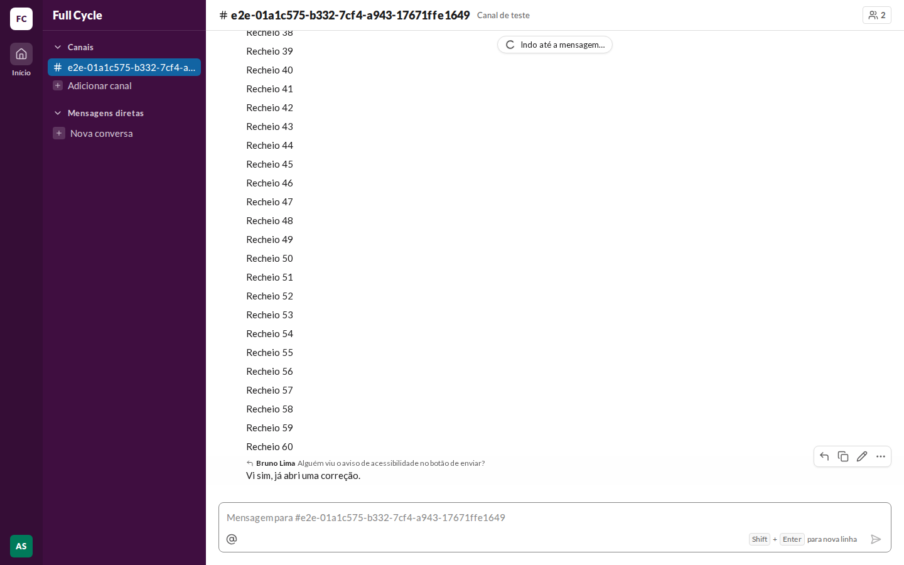
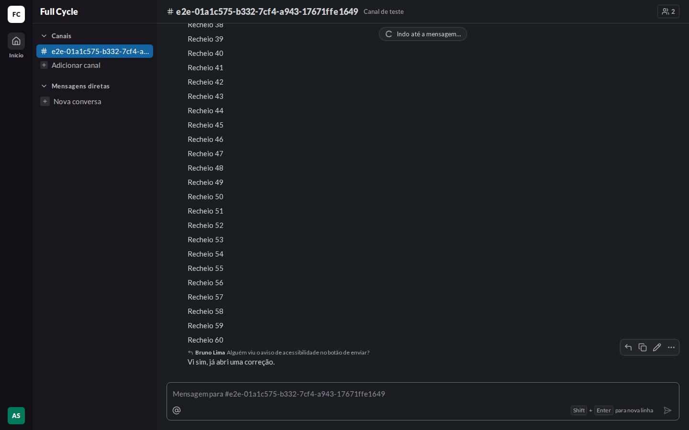
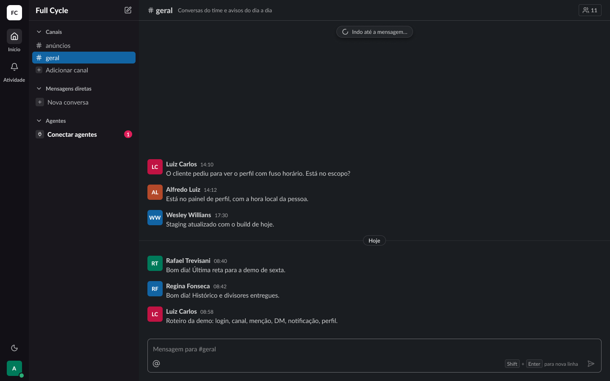
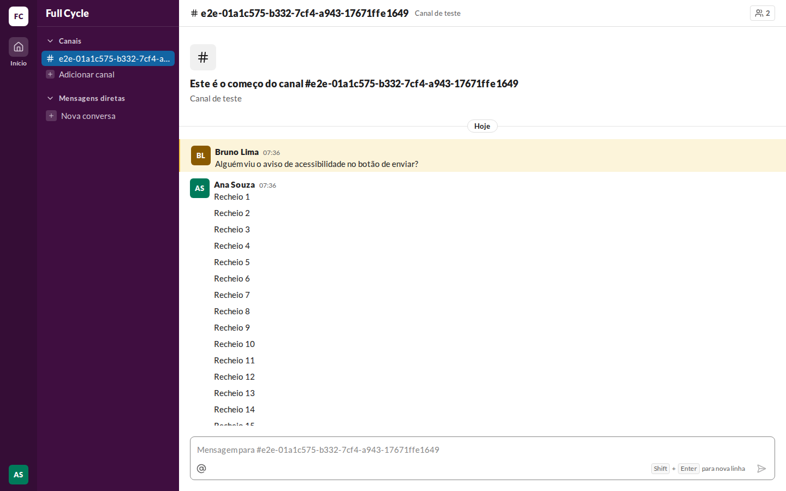
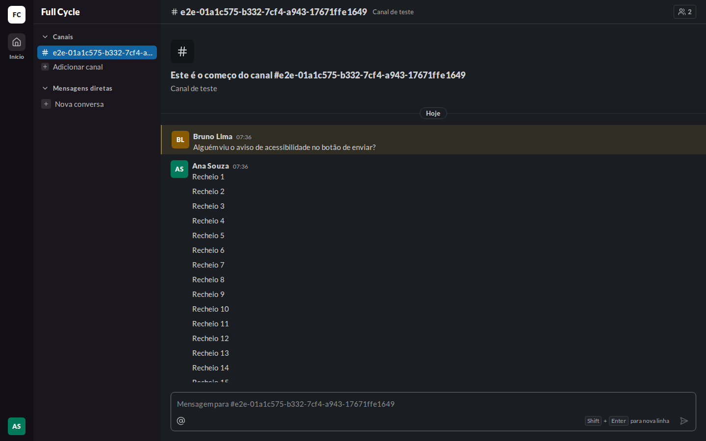
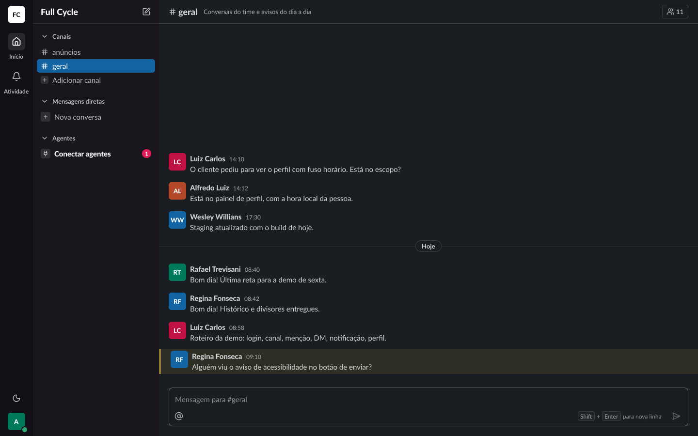
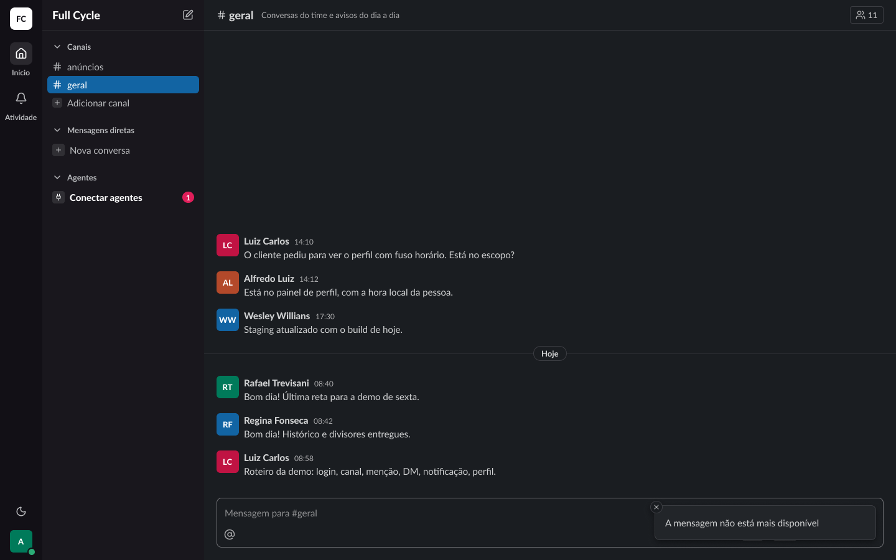

# Validação visual da F06-T07

Capturas da web em 1440 × 900, no Chromium do contêiner `e2e`, ao lado das capturas dos frames do
Figma (arquivo `slack`, página Telas, modo Dark da coleção Semantic): "Conversa / Lista / Indo até a
mensagem" (21:10072), "Conversa / Mensagem / Destaque por link" (22:9191) e "Conversa / Lista /
Mensagem citada indisponível" (133:36772, criado nesta tarefa). O tema escuro da web é o
`data-theme="dark"` na raiz.

Os dados vêm de um teste: uma Mensagem de Bruno Lima, 60 de Ana Souza (logada) e a resposta de Ana
que cita a de Bruno, que fica fora da primeira página. O "Indo até a mensagem" foi capturado com a
leitura das anteriores presa pelo `page.route`.

| Estado | Web, claro | Web, escuro | Figma, escuro |
| --- | --- | --- | --- |
| Indo até a mensagem |  |  |  |
| Destaque |  |  |  |
| Mensagem citada indisponível | — | — |  |

## O que bate

- A pílula no topo da lista, ao centro: `surface-raised`, `rounded-full`, borda `border`, `shadow-1`,
  com o Spinner e "Indo até a mensagem…".
- A original com `highlight-bg` e a borda `highlight-border` à esquerda, como a Mensagem que
  menciona a pessoa logada.

## Diferenças esperadas

- A original da captura fica perto do começo do Canal, então a rolagem não consegue pô-la no centro.
- O aviso de indisponível é um toast do Sonner, conferido pelo teste "avisa quando a original não
  está mais disponível", e não por captura.
