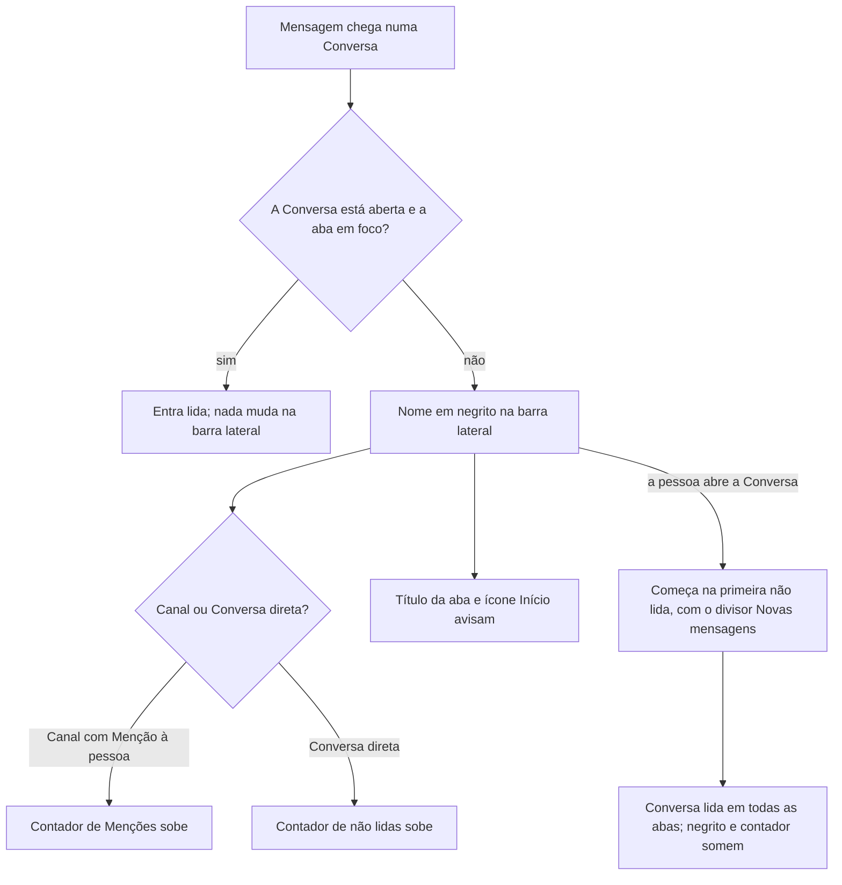

# PRD · F07 · Não lidas e menções

2026-11-10 · Luiz Carlos · Status: aprovado

## 1. Resumo executivo

- **Problema:** depois da F06 a pessoa conversa em vários Canais e Conversas diretas e já é
  mencionada, mas a barra lateral não diz onde há Mensagens que ela ainda não leu nem onde a
  chamaram. Para não perder nada, ela abre Conversa por Conversa e rola procurando onde parou, e
  uma Menção passa despercebida se ela não estiver com aquela Conversa aberta.
- **Solução proposta:** a barra lateral marca em negrito as Conversas com Mensagens não lidas e
  mostra um contador com o número de Menções em cada Canal e de não lidas em cada Conversa direta.
  Ao abrir uma Conversa com não lidas, ela começa na primeira não lida, com o divisor "Novas
  mensagens". O título da aba do navegador e o ícone Início do rail avisam que há algo novo mesmo
  com a pessoa em outra tela. Tudo muda na hora, pelo tempo real da F03.
- **Critérios de sucesso:** esta funcionalidade não move sozinha nenhuma métrica do product brief
  (seção "Objetivos e métricas de sucesso"). Ela entrega a "contagem de não lidas e de menções" do
  item 4 do "Escopo do MVP" do brief e cumpre o requisito "Acessibilidade" nas telas que entrega.

## 2. Experiência do usuário e funcionamento

### Personas

- **Pessoa do workspace:** participa de vários Canais e Conversas diretas (F02 a F06), alterna
  entre eles e entre outras ferramentas, e precisa saber onde há Mensagens novas e onde foi
  mencionada sem abrir cada Conversa.

### Regras desta funcionalidade

- **Não lida:** uma Mensagem de outra Pessoa ou de um agente, numa Conversa de que a pessoa é
  Membro, que chegou depois da última vez que ela leu aquela Conversa. As Mensagens da própria
  pessoa nunca contam, nem a Menção a si mesma, nem as da Conversa direta consigo mesma.
- **Menção que conta:** uma Mensagem não lida que menciona a pessoa pelo `@usuário` (F06). Uma
  Mensagem com a Menção repetida conta uma vez.
- **Ler:** a Conversa fica lida quando a pessoa a abre com a aba do navegador em foco. Enquanto
  ela continua aberta e em foco, as Mensagens que chegam já entram lidas. Com a aba em segundo
  plano, ou com outra Conversa aberta, as Mensagens que chegam contam como não lidas. Não há
  "marcar como não lida" nem leitura parcial pela rolagem.
- **O que a barra lateral mostra:**
  - Canal: nome em negrito quando há não lidas; contador com o número de Menções não lidas,
    quando há ao menos uma.
  - Conversa direta: nome em negrito e contador com o número de não lidas, já que toda Mensagem
    de uma Conversa direta é para a pessoa.
  - O contador mostra `99+` acima de 99 e some em zero.
- **A leitura vale para a Sessão inteira:** ler uma Conversa numa aba a marca como lida em todas
  as abas daquele navegador e nos outros navegadores em que a pessoa está logada.
- **Edição e exclusão corrigem os números:** uma Mensagem não lida apagada sai das não lidas e,
  se mencionava a pessoa, das Menções. Uma Menção acrescentada na edição de uma Mensagem ainda
  não lida passa a contar, e uma Menção tirada deixa de contar. A edição de uma Mensagem já lida
  não a torna não lida de novo.
- **Ao entrar numa Conversa:** quem é adicionado a um Canal privado, ou recebe a primeira
  Mensagem de uma Conversa direta nova, só tem como não lidas as Mensagens que chegarem a partir
  dali, além da Mensagem que abriu a Conversa direta. O histórico anterior à entrada não conta.

### Fluxo

### Histórias de usuário

1. Como pessoa do workspace, quero ver na barra lateral quais Conversas têm Mensagens não lidas
   para saber onde há algo novo sem abrir cada uma.
2. Como pessoa do workspace, quero ver quantas vezes fui mencionada em cada Canal e quantas
   Mensagens não lidas há em cada Conversa direta para decidir o que ler primeiro.
3. Como pessoa do workspace, quero que uma Conversa com não lidas abra na primeira delas, com uma
   marca de onde começam, para continuar de onde parei sem procurar.
4. Como pessoa do workspace, quero ver pelo título da aba e pelo rail que há algo novo para
   perceber mesmo quando estou em outra aba ou na tela Atividade.
5. Como pessoa do workspace, quero que os números mudem na hora e valham para todas as minhas
   abas para confiar neles sem recarregar a página.

### Critérios de aceite

**Todas as histórias**

- As telas seguem o design system do projeto e os frames "Casca / Sidebar / Com dados", "Casca /
  Sidebar / Seção recolhida", "Casca / Rail / Início ativo", "Casca / Rail / Atividade ativa",
  "Conversa / Lista / Divisor de novas mensagens" e "Conversa / Lista / Indo até a mensagem" do
  Figma do projeto, nos temas claro e escuro, e atingem 100 na nota de Acessibilidade do
  Lighthouse.
- Antes da implementação, o Figma é completado: ganham frames a Conversa direta com contador de
  não lidas na barra lateral, o marcador de não lidas no ícone Início do rail e a seção recolhida
  com Conversas não lidas.
- Tudo funciona só pelo teclado, e os sinais visuais têm equivalente para leitor de tela: cada
  linha da barra lateral anuncia o nome e o que há de novo, como "geral, não lidas, 2 menções" ou
  "Alfredo Luiz, 3 mensagens não lidas".

**Histórias 1 e 2, barra lateral**

- Um Canal com não lidas aparece com o nome em negrito; com Menções não lidas à pessoa, mostra
  também o contador com o número delas, como "frontend" em "Casca / Sidebar / Com dados".
- Uma Conversa direta com não lidas aparece com o nome em negrito e o contador com o número de
  não lidas.
- A Conversa aberta com a aba em foco não fica em negrito nem mostra contador.
- O contador mostra `99+` acima de 99 e some em zero, como o CountBadge do design system.
- Com uma seção da barra lateral recolhida, as Conversas dela com não lidas continuam visíveis,
  em negrito e com o contador; as lidas ficam escondidas.
- Ao entrar no chat, ao recarregar a página ou ao abrir uma aba nova, a barra lateral já chega com
  os números certos, sem piscar sem eles.

**História 3, abrir na primeira não lida**

- Abrir uma Conversa com não lidas rola até a primeira delas e mostra, logo acima, o divisor
  "Novas mensagens", como em "Conversa / Lista / Divisor de novas mensagens".
- Se a primeira não lida não estiver no primeiro bloco de histórico carregado, a Conversa carrega
  o histórico até ela, no estado "Indo até a mensagem" da F06.
- Se a primeira não lida já cabe na tela junto com as últimas Mensagens, a Conversa abre no fim,
  como antes, com o divisor no lugar.
- O divisor fica no mesmo lugar enquanto a pessoa continua na Conversa, mesmo com Mensagens novas
  chegando, e some quando ela troca de Conversa e volta.
- Se a pessoa estava com a Conversa aberta e a aba em segundo plano, ao voltar o foco o divisor
  aparece acima da primeira Mensagem que chegou sem foco, e a Conversa fica lida.
- Abrir uma Conversa sem não lidas não mostra o divisor e abre no fim, como antes.
- Se a primeira não lida for apagada antes de a pessoa abrir a Conversa, o divisor fica acima da
  seguinte; se todas forem apagadas, não há divisor.

**História 4, título da aba e rail**

- O título da aba do navegador começa com a soma dos contadores da barra lateral entre
  parênteses, como "(3) Full Cycle Chat"; sem nenhum contador, fica sem número.
- O ícone Início do rail mostra um marcador quando há ao menos uma Conversa não lida, também na
  tela Atividade, e o marcador some quando não há mais nenhuma.

**História 5, na hora e em todas as abas**

- Uma Mensagem nova, editada ou apagada atualiza o negrito, os contadores, o título e o marcador
  do rail de todos os Membros afetados, em todas as abas, em até 1 s no p95, contado da gravação,
  sem recarregar a página.
- Ler uma Conversa numa aba tira o negrito e o contador dela em todas as abas e navegadores da
  pessoa em até 1 s no p95.
- Uma aba atrasada, que ainda mostra a Conversa como aberta depois de a pessoa ter lido mais
  adiante em outra, não volta os números para trás.
- As Mensagens que chegaram durante uma queda de conexão contam ao reconectar, e os números
  ficam iguais aos de uma página recarregada.

### O que não é objetivo

- Marcar uma Conversa como não lida, ou marcar todas como lidas de uma vez.
- Leitura parcial pela rolagem: abrir a Conversa a lê inteira.
- Recibo de leitura, ou mostrar a outras Pessoas quem leu uma Mensagem.
- Silenciar uma Conversa ou escolher o que conta como não lido.
- Contador das Menções de `@canal` e `@aqui`, que não existem (F06).
- Notificação na tela e do navegador, e a tela Atividade com Menções e DMs: F08.
- Contador ou sinal no favicon da aba; só o título muda.
- Ordenar a barra lateral pelas não lidas ou criar uma seção "Não lidas".
- Não lidas de threads (F20).

## 3. Requisitos do sistema de IA

Não se aplica: a F07 não envolve agentes. As Mensagens de um agente contam como não lidas como as
de qualquer Pessoa, quando os agentes existirem (F11 a F14).

## 4. Riscos de produto

| Risco | Mitigação |
| --- | --- |
| A pessoa abre a Conversa, não lê tudo, e as Mensagens que não viu somem das não lidas | O divisor "Novas mensagens" fica no lugar enquanto ela continua na Conversa e a Conversa abre na primeira não lida; a leitura parcial pela rolagem fica fora, como risco aceito |
| Os números divergem entre abas, ou depois de uma queda de conexão, e a pessoa deixa de confiar no contador | A leitura vale para a Sessão inteira, uma aba atrasada não volta os números para trás e, ao reconectar, os números ficam iguais aos de uma página recarregada |
| Um contador continua contando uma Mensagem apagada ou uma Menção tirada na edição | A exclusão e a edição de uma Mensagem não lida corrigem os contadores na hora, para todos os Membros afetados |
| O negrito em muitos Canais públicos movimentados vira ruído e esconde o que importa | Nos Canais o contador mostra só as Menções; o número de não lidas aparece só nas Conversas diretas; silenciar uma Conversa fica fora, como risco aceito |
| Uma Menção passa despercebida porque a notificação só vem com a F08 | O contador de Menções na barra lateral, o título da aba e o marcador do rail avisam mesmo com a pessoa em outra Conversa ou em outra aba |
| Uma Conversa aberta numa aba em segundo plano marcaria como lido o que a pessoa não viu | Só conta como lida a Conversa aberta com a aba em foco; ao voltar o foco, o divisor marca onde começam as que chegaram sem foco |
