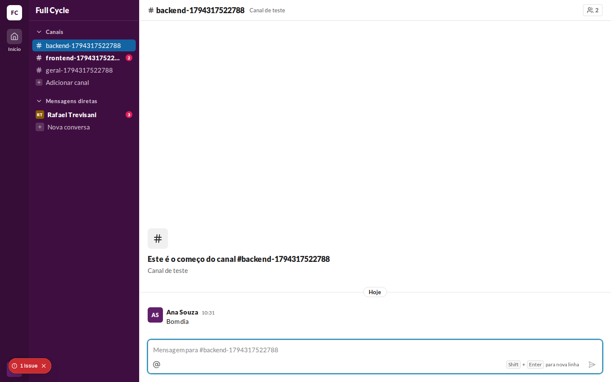
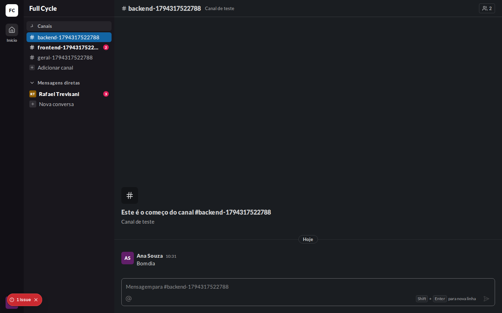
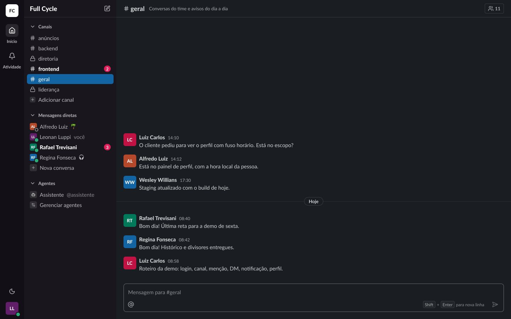
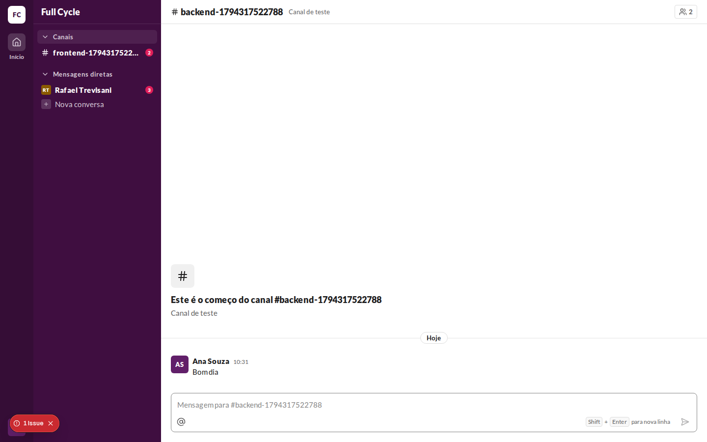
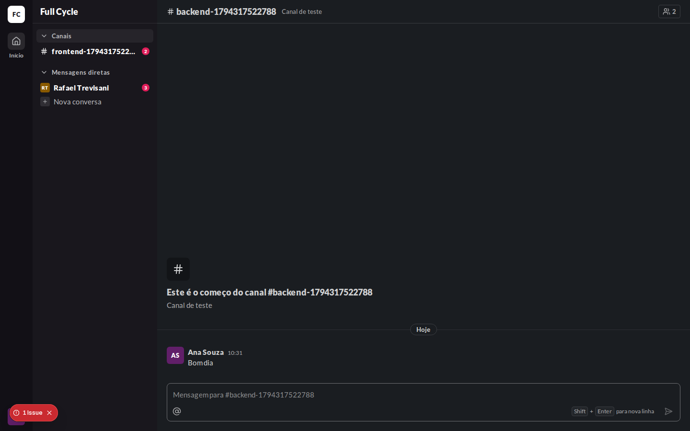
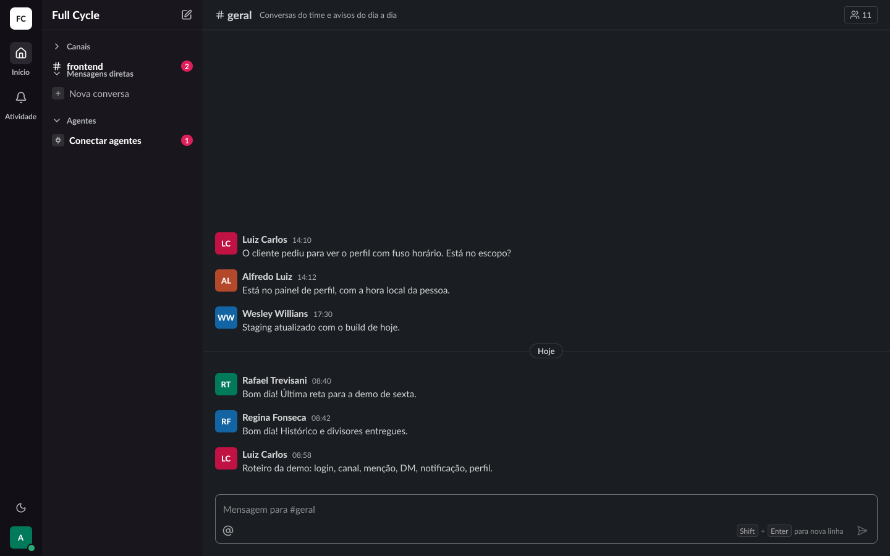

# Validação visual da F07-T01

Capturas da web em 1440 × 900, no Chromium do contêiner `e2e`, ao lado das capturas dos frames do
Figma (arquivo `slack`, página Telas, modo Dark da coleção Semantic): "Casca / Sidebar / Com dados"
(25:20064), com a Conversa direta "Rafael Trevisani" passada a Não lida com o contador 3 nesta
tarefa, e "Casca / Sidebar / Seção recolhida" (25:20813), que nesta tarefa passou a mostrar o Canal
Não lido "frontend" com a seção "Canais" recolhida. O tema escuro da web é o `data-theme="dark"` na
raiz.

Os dados vêm de um teste: Ana Souza logada, três Canais de teste, duas Menções a ela num deles e
três Mensagens de Rafael Trevisani na Conversa direta, direto no banco.

| Estado | Web, claro | Web, escuro | Figma, escuro |
| --- | --- | --- | --- |
| Barra lateral com Não lidas |  |  |  |
| Seção recolhida |  |  |  |

## O que bate

- A linha Não lida em `font-black`, na cor `sidebar-fg-strong`, e o CountBadge à direita:
  `bg-badge`, `text-on-badge`, `rounded-pill`, `text-micro` em `black`.
- No Canal, o contador é o número de Menções (2); na Conversa direta, o de Não lidas (3).
- Com "Canais" recolhida, só o Canal Não lido continua visível, logo abaixo do título.

## Diferenças esperadas

- Os nomes dos Canais de teste levam um sufixo numérico e o mais longo é truncado.
- Os frames mostram mais Canais, Conversas diretas e a seção "Agentes", que não existe ainda.
- Na captura da seção recolhida, o chevron está no meio da transição de 100 ms.
