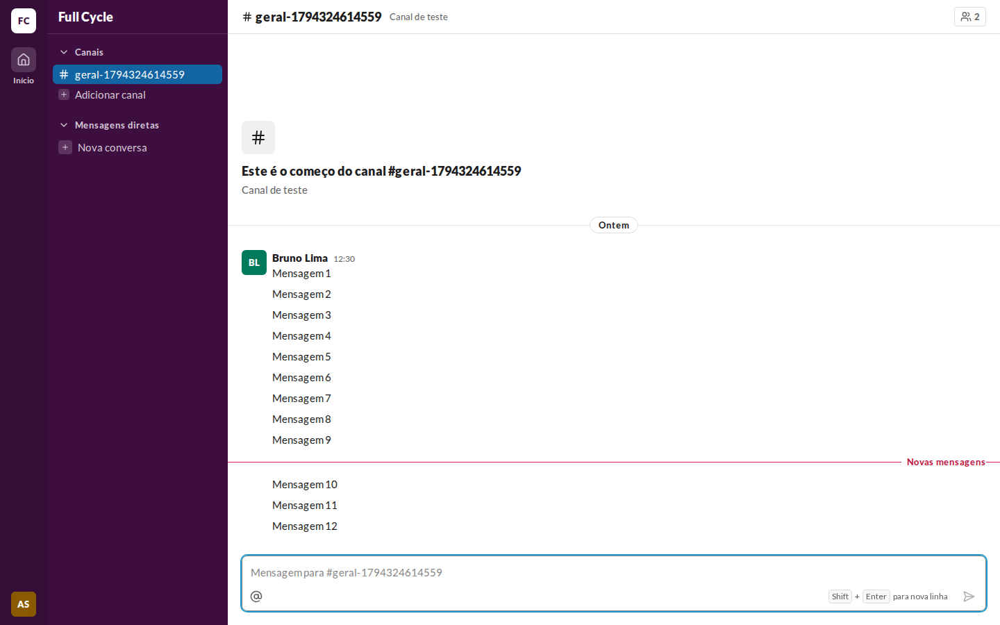
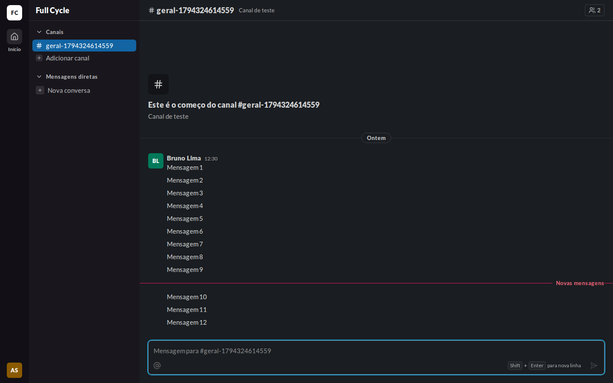
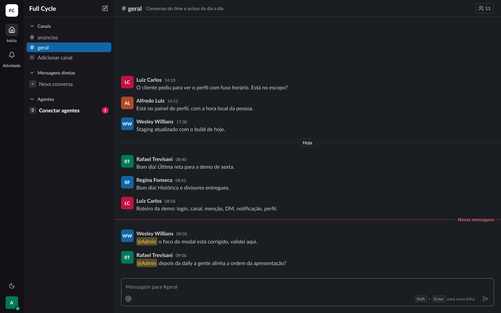
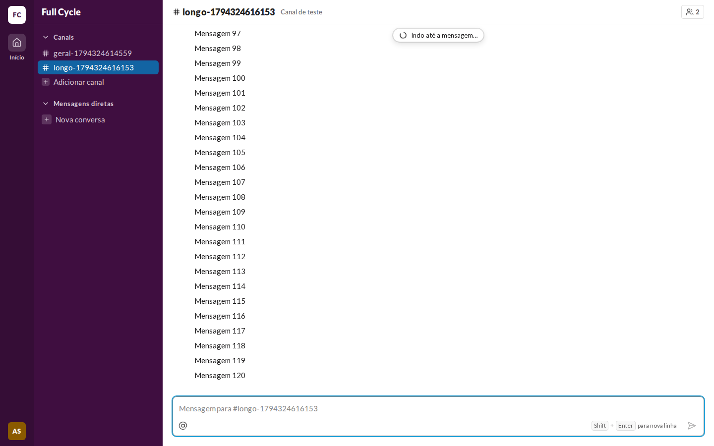
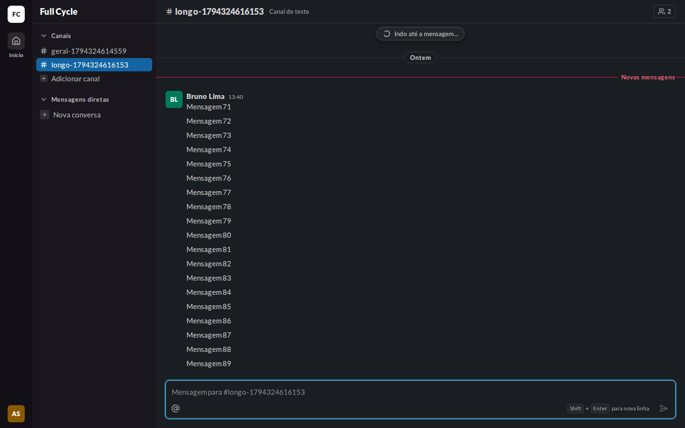
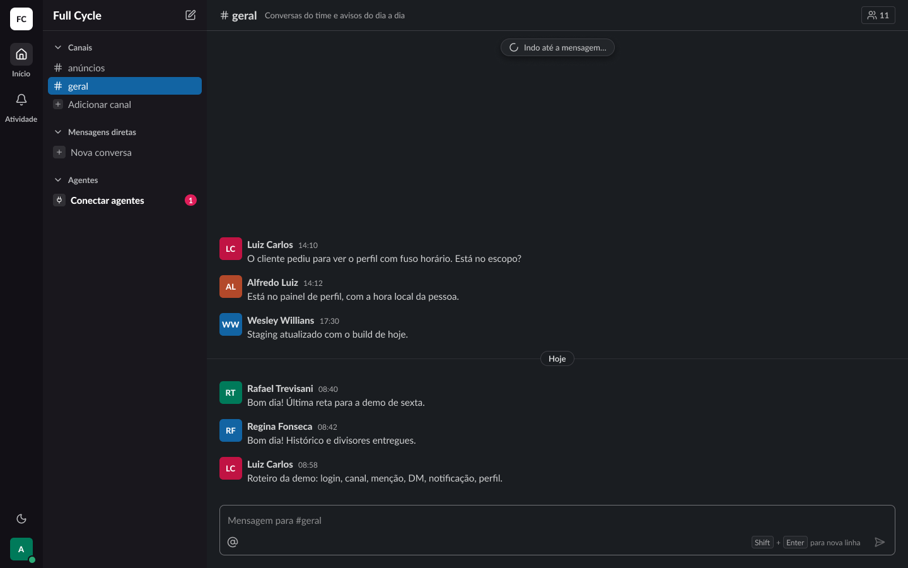

# Validação visual da F07-T04

Capturas da web em 1440 × 900, no Chromium do contêiner `e2e`, ao lado das capturas dos frames do
Figma (arquivo `slack`, página Telas, modo Dark da coleção Semantic): "Conversa / Lista / Divisor de
novas mensagens" (21:7793) e "Conversa / Lista / Indo até a mensagem" (21:10072). O tema escuro da
web é o `data-theme="dark"` na raiz.

Os dados vêm de um teste: Ana Souza logada, Mensagens de Bruno Lima num Canal de teste e a Última
leitura de Ana gravada direto no banco. "Indo até a mensagem" foi capturado com a página anterior
presa (`page.route`), num Canal com 120 Mensagens e a Última leitura na sexta.

| Estado | Web, claro | Web, escuro | Figma, escuro |
| --- | --- | --- | --- |
| Divisor de novas mensagens |  |  |  |
| Indo até a mensagem |  |  |  |

## O que bate

- O UnreadDivider: a linha de 1 px em `danger` de ponta a ponta, o rótulo "Novas mensagens" à
  direita em `small/bold` e `danger-fg`, sobre `surface`, com `pl-2`, e `py-2` e `pr-5` no divisor.
- O divisor fica acima da primeira Não lida, abaixo da última lida, dentro do item da Mensagem.
- "Indo até a mensagem…" no topo da lista, com o Spinner, como na F06.

## Diferenças esperadas

- As Mensagens de teste são "Mensagem N" de uma Pessoa só; o frame mostra uma conversa com várias
  Pessoas e Menções.
- O frame do divisor tem a barra lateral de outro estado (Agentes, Conectar agentes), que não existe
  ainda.
