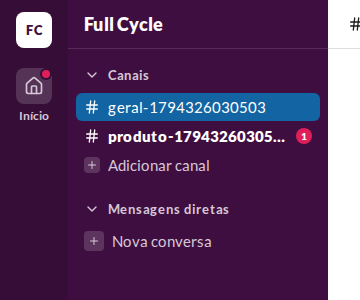
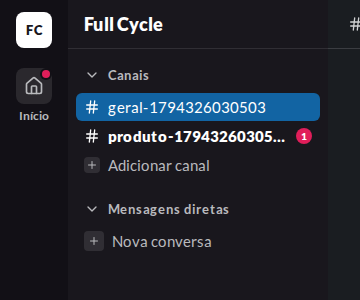
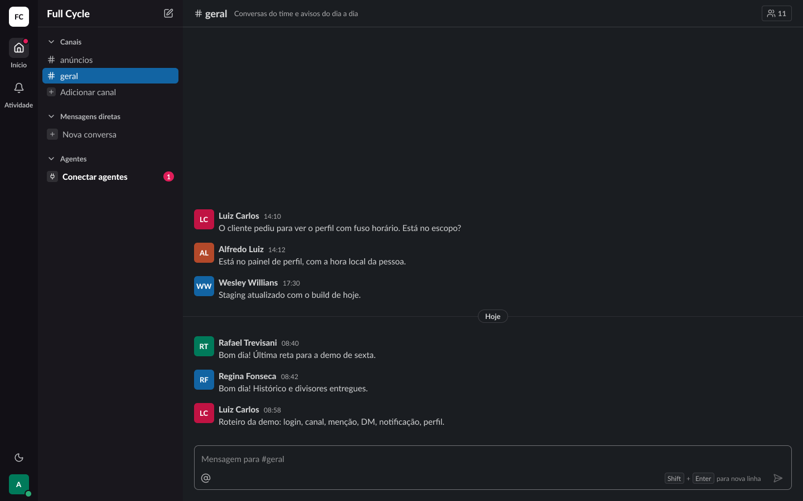
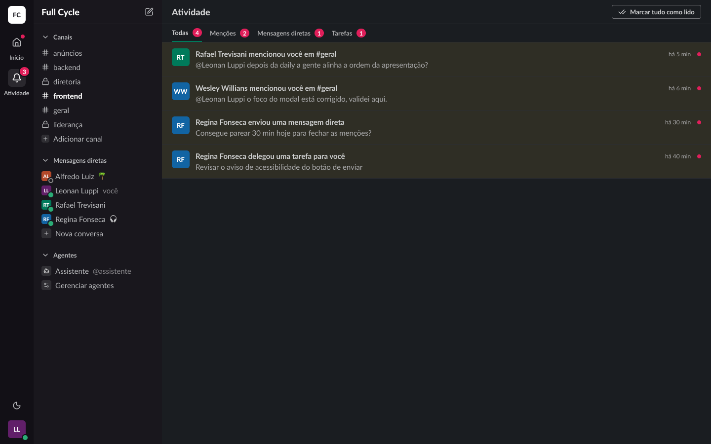

# Validação visual da F07-T05

Capturas da web no Chromium do contêiner `e2e` (o canto da tela em 1440 × 900 com o rail e a barra
lateral), ao lado das capturas dos frames do Figma (arquivo `slack`, página Telas, modo Dark da
coleção Semantic): "Casca / Rail / Início ativo" (25:24628) e "Casca / Rail / Atividade ativa"
(25:24898). Nesta tarefa, o component set do Rail ganhou a propriedade "Show home dot", ligada nos
dois frames. O tema escuro da web é o `data-theme="dark"` na raiz.

Os dados vêm de um teste: Ana Souza logada num Canal vazio, com uma Menção de Bruno Lima Não lida
em outro Canal.

| Estado | Web, claro | Web, escuro | Figma, escuro |
| --- | --- | --- | --- |
| Início com Não lidas |  |  |  |
| Atividade ativa, com Não lidas no Início | — | — |  |

## O que bate

- O ponto de 8 px em `badge` no canto superior direito do quadrado do Início, a 2 px das bordas,
  com o anel de 2 px na cor do fundo do rail (`chrome`).
- O resto do Início não muda: o ícone `house`, o fundo `sidebar-field` e o rótulo "Início".

## Diferenças esperadas

- A tela Atividade ainda não existe (F08): a web não tem o item Atividade no rail, e o marcador vale
  no rail de todas as telas logadas.
