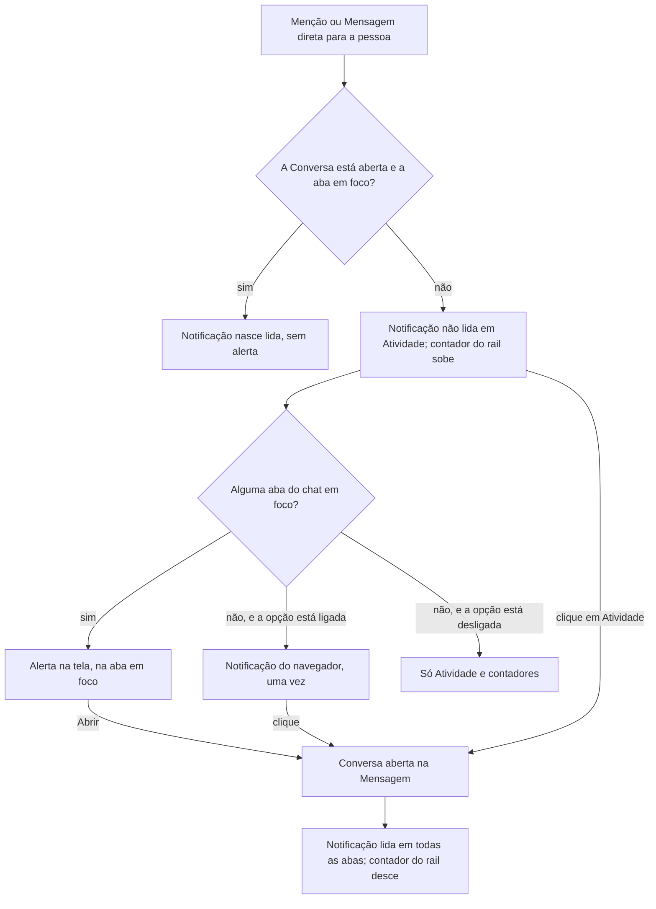

# PRD · F08 · Notificações e Atividade

2026-11-10 · Luiz Carlos · Status: aprovado

## 1. Resumo executivo

- **Problema:** depois da F07 a barra lateral mostra onde há não lidas e Menções, mas só para
  quem olha para ela. Com o chat em outra aba, em outra janela ou noutra Conversa, a pessoa não
  fica sabendo na hora que foi mencionada ou recebeu uma Mensagem numa Conversa direta, e não tem
  um lugar que junte tudo o que foi para ela.
- **Solução proposta:** cada Menção e cada Mensagem de Conversa direta vira uma notificação. Com
  uma aba do chat em foco, ela aparece como um alerta na tela; sem aba em foco e com a opção
  ligada naquele navegador, como uma notificação do navegador. Clicar em qualquer uma leva à
  Mensagem. A tela Atividade reúne as notificações nas abas Todas, Menções e Mensagens diretas, e
  o ícone Atividade do rail mostra quantas ainda não foram lidas.
- **Critérios de sucesso:** esta funcionalidade não move sozinha nenhuma métrica do product brief
  (seção "Objetivos e métricas de sucesso"). Ela entrega o item 6 do "Escopo do MVP" do brief,
  menos a notificação de Tarefa e a aba Tarefas, que ficam para a F12, e é a base de que a F12
  precisa para mover a métrica "Tarefas delegadas concluídas". Cumpre o requisito "Acessibilidade"
  do brief nas telas que entrega.

## 2. Experiência do usuário e funcionamento

### Personas

- **Pessoa do workspace:** participa de vários Canais e Conversas diretas (F02 a F07), passa boa
  parte do dia em outras abas e ferramentas e precisa saber na hora quando alguém a chama, sem
  ficar de olho na barra lateral.

### Regras desta funcionalidade

- **O que gera notificação:**
  - Uma Mensagem que menciona a pessoa pelo `@usuário` (F06), num Canal de que ela é Membro. A
    Menção repetida na mesma Mensagem gera uma notificação só.
  - Uma Mensagem de outra Pessoa ou de um agente numa Conversa direta com ela. Uma Menção dentro
    da Conversa direta não gera uma segunda notificação: é uma notificação de Mensagem direta.
  - Nunca geram notificação as Mensagens da própria pessoa, a Menção a si mesma, a Conversa
    direta consigo mesma nem o histórico anterior à entrada numa Conversa.
- **Notificação lida:** fica lida quando a pessoa clica nela (no alerta, na notificação do
  navegador ou em Atividade) ou quando a Conversa é lida até a Mensagem dela (F07, regra "Ler").
  Uma notificação de uma Mensagem que chega com a Conversa aberta e a aba em foco já nasce lida.
  "Marcar tudo como lido" marca todas as notificações como lidas, sem mexer nas não lidas e nas
  Menções das Conversas na barra lateral.
- **Onde e quando alerta:**
  - Com uma aba do chat em foco e outra Conversa aberta, ou a tela Atividade, a notificação
    aparece como alerta na tela, só naquela aba.
  - Com a Conversa da Mensagem aberta e a aba em foco, não há alerta.
  - Sem nenhuma aba do chat em foco e com a opção ligada naquele navegador, a notificação sai uma
    vez como notificação do navegador, mesmo com várias abas abertas.
  - Com o chat fechado em todas as abas não há alerta; a notificação espera em Atividade.
- **A opção de notificação do navegador vale por navegador:** a pessoa liga e desliga pelo menu da
  própria conta, e a permissão é pedida ao navegador só quando ela liga. Com a permissão negada, a
  opção mostra que está bloqueada naquele navegador.
- **Edição e exclusão corrigem as notificações em silêncio:** apagar a Mensagem tira a notificação
  dela de Atividade e do contador; tirar a Menção numa edição também. Acrescentar uma Menção numa
  edição cria a notificação em Atividade, sem alerta na tela nem do navegador.
- **Queda de conexão:** as notificações que chegaram durante a queda aparecem em Atividade e no
  contador ao reconectar, sem alerta.

### Fluxo

### Histórias de usuário

1. Como pessoa do workspace, quero ver um alerta na tela quando sou mencionada ou recebo uma
   Mensagem direta para responder na hora, mesmo estando em outra Conversa.
2. Como pessoa do workspace, quero ligar a notificação do navegador para ser avisada quando o
   chat está em segundo plano, e desligá-la quando ela atrapalha.
3. Como pessoa do workspace, quero clicar no alerta, na notificação do navegador ou num item de
   Atividade e cair direto na Mensagem para ver o contexto sem procurar.
4. Como pessoa do workspace, quero rever em Atividade as Menções e as Mensagens diretas que
   recebi, separadas por tipo, para não perder nada do que foi para mim.
5. Como pessoa do workspace, quero ver no rail quantas notificações ainda não li e marcar todas
   como lidas de uma vez para saber quando estou em dia.

### Critérios de aceite

**Todas as histórias**

- As telas seguem o design system do projeto e os frames "Portas / Toast de atividade",
  "Atividade / Marcar tudo habilitado", "Atividade / Marcar tudo desabilitado", "Atividade /
  Marcando tudo", "Atividade / Notificações carregando", "Atividade / Erro", "Atividade / Vazio em
  Todas", "Atividade / Vazio em Menções", "Atividade / Vazio em Mensagens diretas", "Atividade /
  Item não lido", "Atividade / Item lido", "Casca / Rail / Atividade ativa" e "Casca / Menu do
  usuário / Ativar notificações", "Notificações bloqueadas" e "Notificações ligadas" do Figma do
  projeto, nos temas claro e escuro, sem a aba Tarefas e sem itens de Tarefa, e atingem 100 na
  nota de Acessibilidade do Lighthouse.
- Tudo funciona só pelo teclado. O alerta na tela é anunciado pelo leitor de tela sem tirar o
  foco de onde a pessoa está, e o botão "Abrir" e o de fechar são alcançáveis pelo teclado.

**História 1, alerta na tela**

- Uma Menção num Canal, ou uma Mensagem numa Conversa direta, que chega com outra Conversa ou a
  tela Atividade aberta mostra o alerta na aba em foco em até 1 s no p95, contado da gravação, com
  o autor, onde foi ("mencionou você em #geral" ou "enviou uma mensagem direta"), o começo do
  texto e o botão "Abrir", como em "Portas / Toast de atividade".
- O alerta some sozinho depois de 8 s ou pelo botão de fechar; vários alertas seguidos se
  empilham, sem cobrir o campo de envio.
- Com a Conversa da Mensagem aberta e a aba em foco, não há alerta.
- As abas que não estão em foco não mostram alerta.
- As Mensagens da própria pessoa, a Menção a si mesma e a Conversa direta consigo mesma não
  alertam.

**História 2, notificação do navegador**

- O menu da conta mostra "Ativar notificações do navegador"; ao escolher, o navegador pede a
  permissão, e só então. Com a permissão dada, a opção passa a "Desativar notificações do
  navegador".
- Com a permissão negada, a opção mostra "Bloqueadas neste navegador", como em "Casca / Menu do
  usuário / Notificações bloqueadas", e não pede de novo.
- Com a opção ligada e nenhuma aba do chat em foco, cada notificação nova sai uma vez como
  notificação do navegador, com o autor, onde foi e o começo do texto, mesmo com várias abas
  abertas, em até 1 s no p95.
- Com uma aba do chat em foco, ou com a opção desligada, não sai notificação do navegador.
- A escolha vale só para aquele navegador e continua valendo depois de recarregar a página, sair
  e entrar de novo.

**História 3, clicar e cair na Mensagem**

- "Abrir" no alerta, o clique na notificação do navegador e o clique num item de Atividade abrem
  a Conversa posicionada na Mensagem, com o destaque e o estado "Indo até a mensagem" da F06
  quando ela não está no primeiro bloco do histórico carregado.
- O clique na notificação do navegador traz para a frente uma aba do chat já aberta, em vez de
  abrir outra.
- Ao abrir a Mensagem, a notificação fica lida, e a Conversa segue a regra de leitura da F07.
- Um item de Atividade é um botão: Enter o abre.

**História 4, tela Atividade**

- O ícone Atividade do rail abre a tela Atividade, com as abas Todas, Menções e Mensagens
  diretas, cada uma com o contador das suas notificações não lidas.
- Cada aba lista as notificações da mais nova para a mais antiga, com o autor, onde foi, o começo
  do texto e o tempo relativo ("há 5 min"); as não lidas com fundo de destaque, título em negrito
  e ponto, como em "Atividade / Item não lido".
- Rolar até o fim da lista carrega as notificações mais antigas, até a primeira.
- Uma notificação nova entra no topo da lista aberta, em até 1 s no p95, sem recarregar a
  página.
- Uma Mensagem apagada sai da lista; uma Menção tirada na edição tira a notificação; uma Menção
  acrescentada na edição cria a notificação, sem alerta. O começo do texto mostra a versão editada.
- Os estados de carregando, erro (com "Tentar de novo") e vazio de cada aba seguem os frames da
  seção Atividade.

**História 5, contador do rail e marcar tudo**

- O ícone Atividade do rail mostra o número de notificações não lidas, `99+` acima de 99, e o
  número some em zero.
- O leitor de tela anuncia o ícone com o número, como "Atividade, 3 não lidas".
- "Marcar tudo como lido" fica desabilitado sem notificações não lidas. Ao usá-lo, todas ficam
  lidas, o contador do rail e os das abas zeram, e as não lidas e Menções da barra lateral não
  mudam.
- Ler uma notificação ou a Conversa dela, ou marcar tudo, atualiza o contador do rail, os das
  abas e o destaque dos itens em todas as abas e navegadores da pessoa em até 1 s no p95.
- Ao entrar no chat, recarregar a página ou reconectar depois de uma queda, o contador e a lista
  ficam iguais aos de uma página recarregada, e as notificações que chegaram durante a queda não
  alertam.

### O que não é objetivo

- Notificação de Tarefa, a aba Tarefas e os avisos a quem delegou: F12.
- Notificação com o chat fechado em todas as abas, por push, e-mail ou celular (HLD, seção 4).
- Som no alerta.
- Silenciar uma Conversa, escolher por tipo o que notifica ou horário de não perturbar.
- Notificação de `@canal` e `@aqui`, que não existem (F06), e de Mensagens comuns de Canal sem
  Menção.
- Apagar uma notificação, marcar uma como não lida ou filtrar Atividade por Conversa ou pessoa.
- Agrupar várias Mensagens da mesma Conversa direta numa notificação só.
- Tirar a notificação do navegador da central do sistema quando ela é lida em outro lugar.
- Mudar o título da aba do navegador além do que a F07 já faz.
- Notificações de threads (F20) e de reações (F21).

## 3. Requisitos do sistema de IA

Não se aplica: a F08 não envolve agentes. A Mensagem de um agente numa Conversa direta ou com
uma Menção notifica como a de qualquer Pessoa, quando os agentes existirem (F11 a F14). O alerta,
a notificação do navegador e o item de Atividade de uma Mensagem com dados de negócio só mostram
o conteúdo a quem tem permissão de dados (brief, requisito "Permissão"); os outros veem a versão
bloqueada.

## 4. Riscos de produto

| Risco | Mitigação |
| --- | --- |
| Alertas demais numa Conversa direta movimentada viram ruído, e a pessoa desliga tudo | Com a Conversa aberta e em foco não há alerta, só a aba em foco alerta e a notificação do navegador sai uma vez por navegador; silenciar uma Conversa fica fora, como risco aceito |
| A pessoa nega a permissão do navegador sem querer e não sabe como voltar atrás | A opção mostra "Bloqueadas neste navegador" em vez de sumir, e a permissão só é pedida quando ela liga |
| A pessoa conta com a notificação do navegador e perde Menções com o chat fechado | O MVP só alerta com o chat aberto em alguma aba; Atividade e o contador do rail guardam tudo para quando ela voltar; push fica fora, como risco aceito |
| O contador de Atividade e as não lidas da barra lateral divergem e a pessoa deixa de confiar nos dois | Ler a Conversa lê também as notificações dela; "Marcar tudo como lido" só limpa as notificações, e a barra lateral continua mostrando o que falta ler nas Conversas |
| Um alerta ou um item de Atividade mostra uma Mensagem que já foi apagada ou editada | A exclusão tira a notificação e a edição atualiza o texto e as Menções, em todas as abas, sem alerta novo |
| Um conteúdo de dados de negócio vaza pelo alerta ou pela notificação do navegador, que aparece fora do chat | O alerta, a notificação do navegador e Atividade mostram a versão bloqueada a quem não tem permissão de dados |
