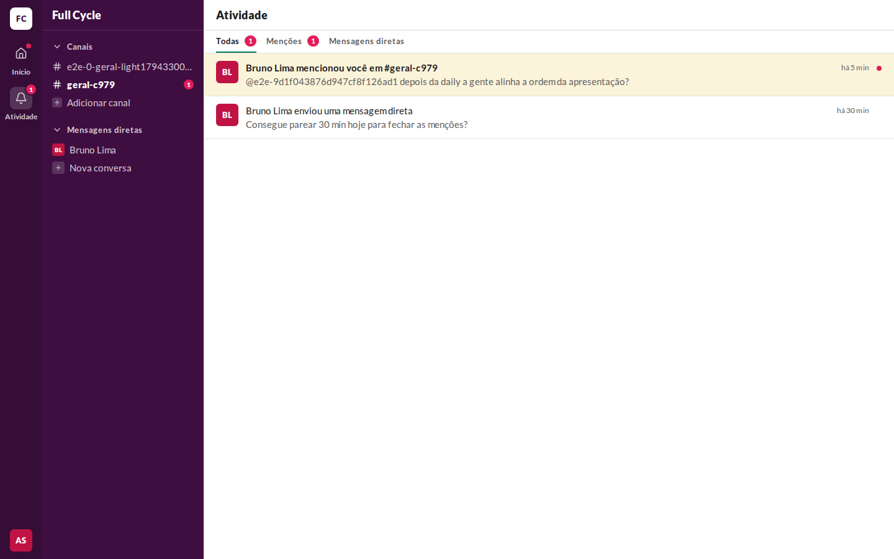
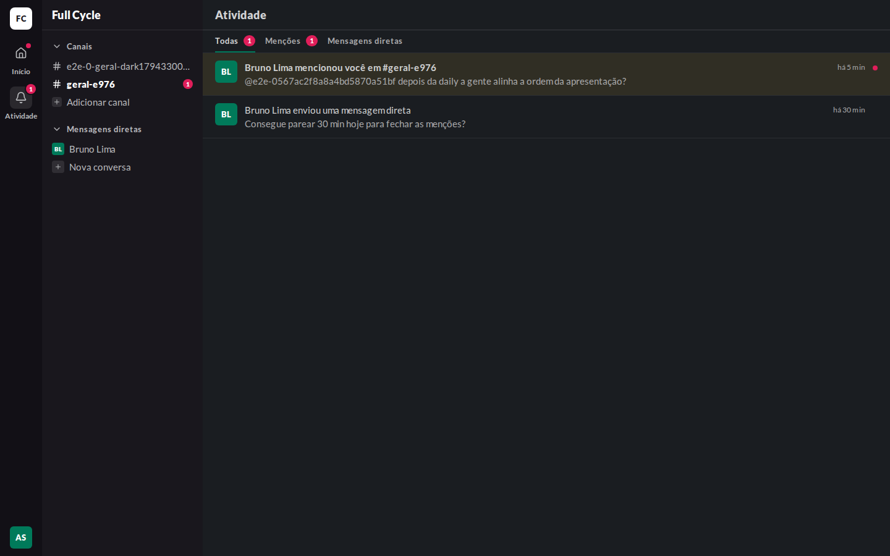
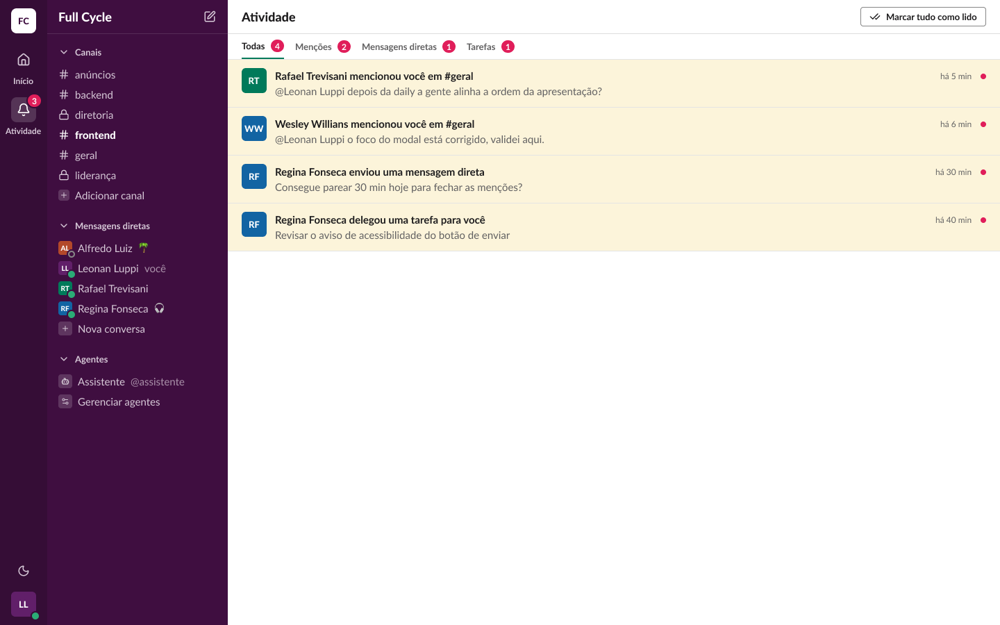
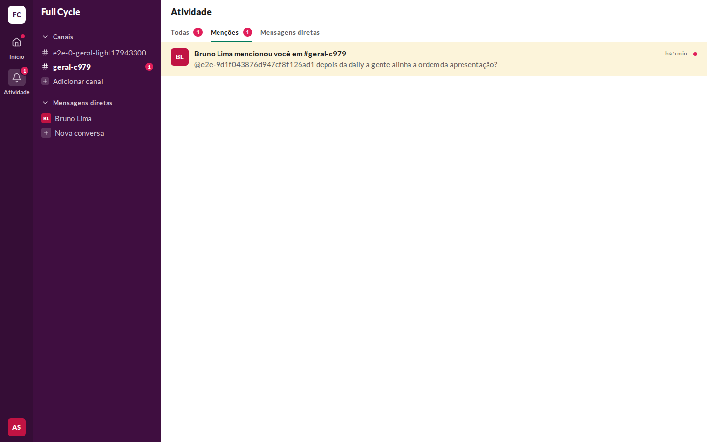
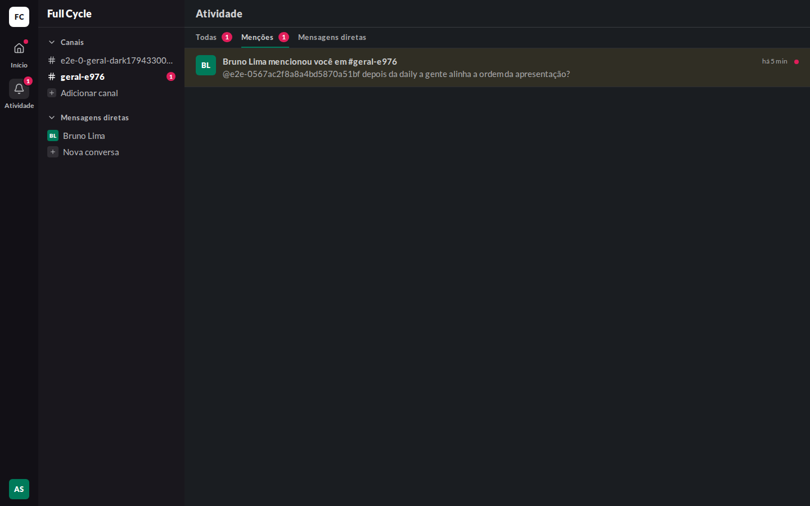
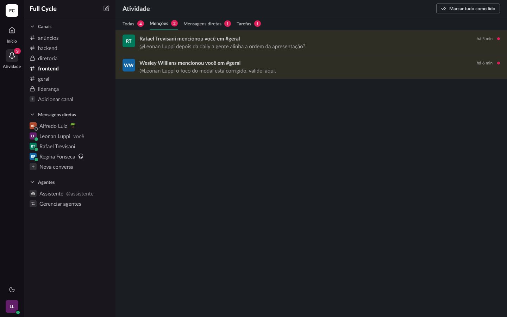
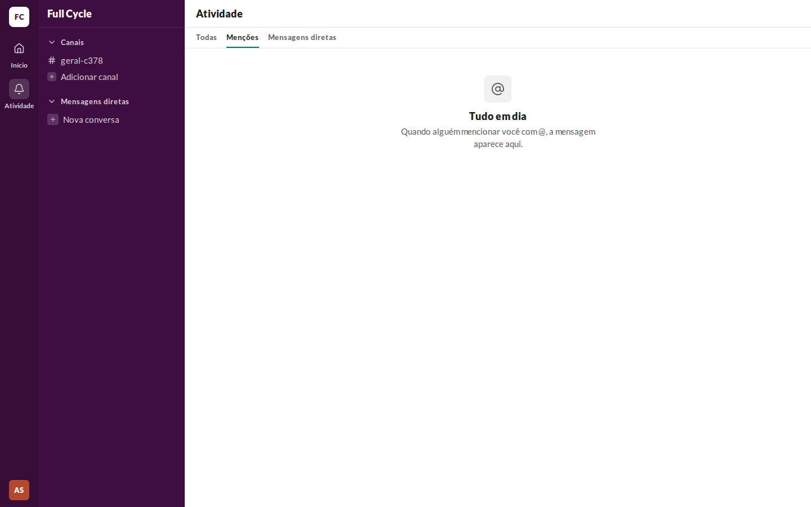
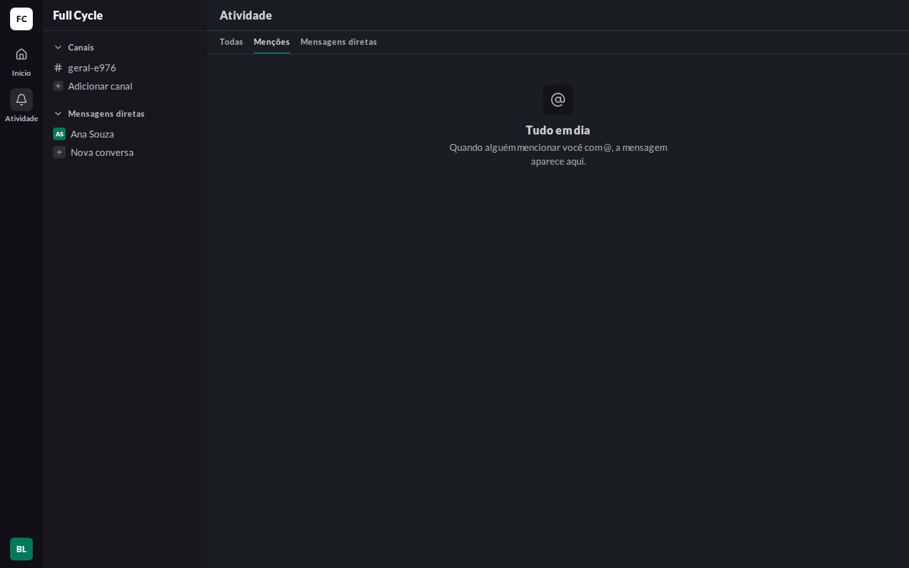
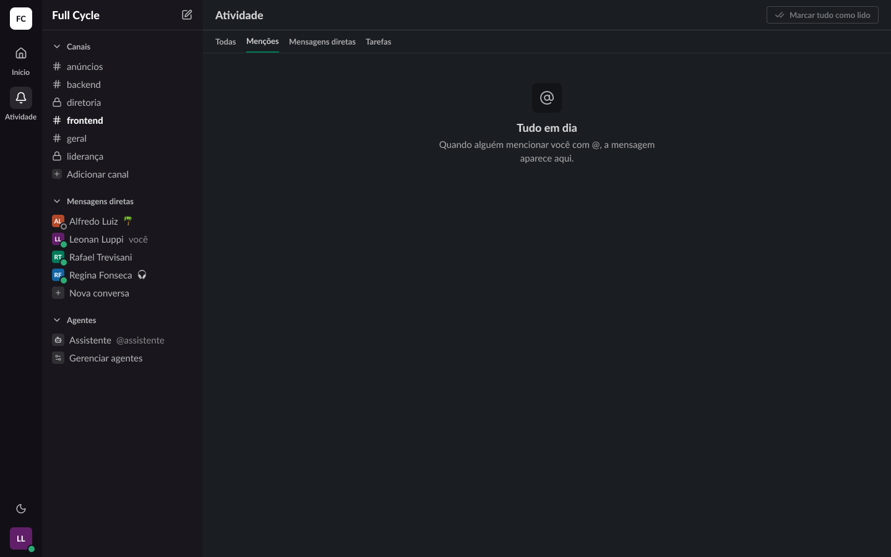

# Validação visual da F08-T01

Capturas da web em 1440 × 900, no Chromium do contêiner `e2e`, ao lado das capturas dos frames do
Figma (arquivo `slack`, página Telas, modo Dark da coleção Semantic): "Atividade / Marcar tudo
habilitado" (25:15219), "Atividade / Item não lido" (25:17233) e "Atividade / Vazio em Menções"
(25:16729). O tema escuro da web é o `data-theme="dark"` na raiz.

Os dados vêm de um teste: Ana Souza logada, um Canal com uma Menção a ela, de Bruno Lima, há 5
min, e uma Conversa direta com uma Mensagem de Bruno Lima há 30 min, já lida.

| Estado | Web, claro | Web, escuro | Figma, escuro |
| --- | --- | --- | --- |
| Todas, com um item não lido e um lido |  |  |  |
| Menções, com o item não lido |  |  |  |
| Menções, vazia |  |  |  |

## O que bate

- O cabeçalho "Atividade" em `title/black`, com a borda de baixo, e as abas em `small/bold`, com o
  CountBadge de 18 px e o sublinhado `primary` de 2 px na ativa.
- O item não lido com o fundo `highlight-bg`, o título em `body/bold`, o tempo em `caption` e o ponto
  `badge` de 8 px; o lido sem fundo, sem negrito e sem ponto.
- O avatar de 36 px com as iniciais, o começo do texto em `fg-muted` e a borda `border-subtle` entre
  os itens.
- O rail com Atividade ativa (o quadro `sidebar-field` no sino) e o contador sobre o ícone; o Início
  sem o quadro e com o marcador da F07.
- O vazio com o ícone `at-sign` no quadro de 48, "Tudo em dia" e o texto do frame.

## Diferenças esperadas

- Sem a aba Tarefas e sem o botão "Marcar tudo como lido": a aba entra na F12, e o botão na
  F08-T04.
- O vazio de Todas não fala de "avisos de tarefas", que só existem na F12: "Menções e mensagens
  diretas aparecem aqui assim que chegam."
- Os nomes dos Canais de teste levam um sufixo, e o texto da Menção mostra o `@usuário` de teste.
- Os frames mostram mais Canais, Conversas diretas e a seção "Agentes", que não existe ainda.

## Estados vistos só no código

"Atividade / Erro" (25:16253) e "Atividade / Notificações carregando" (25:16011) dependem de a
API falhar ou demorar no servidor. O erro usa o EmptyState com o título, o texto e o "Tentar de
novo" do frame, e o carregando, as quatro linhas em pulso do frame; a falha da página seguinte, que
o cliente busca, é provada no Playwright.
