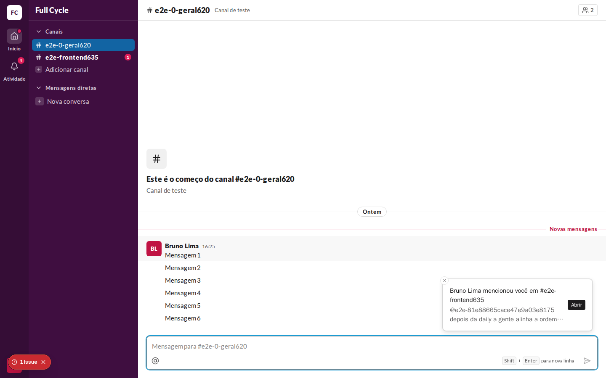
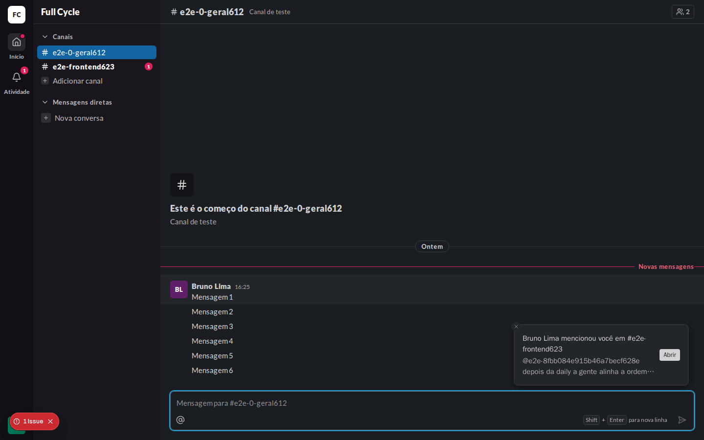
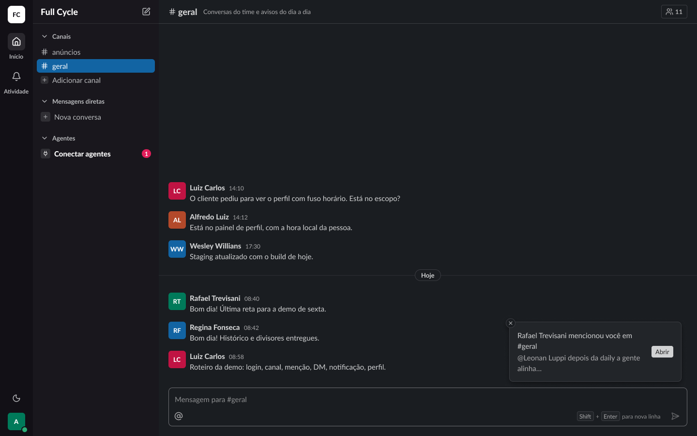

# Validação visual da F08-T05

Capturas da web em 1440 × 900, no Chromium do contêiner `e2e`, ao lado da captura do frame
"Portas / Toast de atividade" (19:3399) do Figma (arquivo `slack`, página Telas, modo Dark da coleção
Semantic), já com o Alerta movido para cima do campo de envio nesta tarefa (CA1: o toast fica 12 px
acima do MessageComposer). O tema escuro da web é o `data-theme="dark"` na raiz.

Os dados vêm de um teste: Ana Souza num Canal com seis Mensagens, e Bruno Lima mencionando-a em
outro Canal, pela API.

| Web, claro | Web, escuro | Figma, escuro |
| --- | --- | --- |
|  |  |  |

## O que bate

- O toast no canto inferior direito, acima do campo de envio, com `surface-raised`, borda, raio
  `card` e a sombra `elevation-2`.
- O título em `body/regular` na cor `fg`, o começo do texto em `fg-muted`, em até duas linhas, e o
  botão "Abrir" em `small`, com fundo `fg` e texto `fg-inverse`.
- O botão de fechar redondo no canto superior esquerdo.

## Diferenças esperadas

- Os nomes dos Canais e o `@usuário` da Menção são os de teste, mais longos que os do frame.
- O selo "1 Issue" no canto inferior esquerdo é do `next dev` (o aviso do WebSocket fechado antes de
  conectar, do efeito duplo do React em desenvolvimento) e não existe no build.
