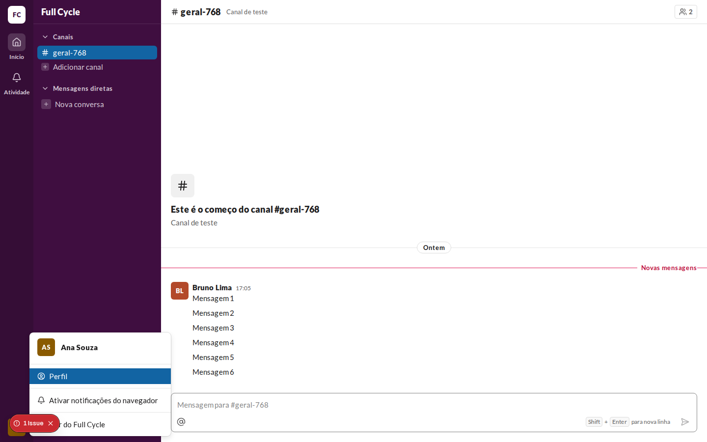
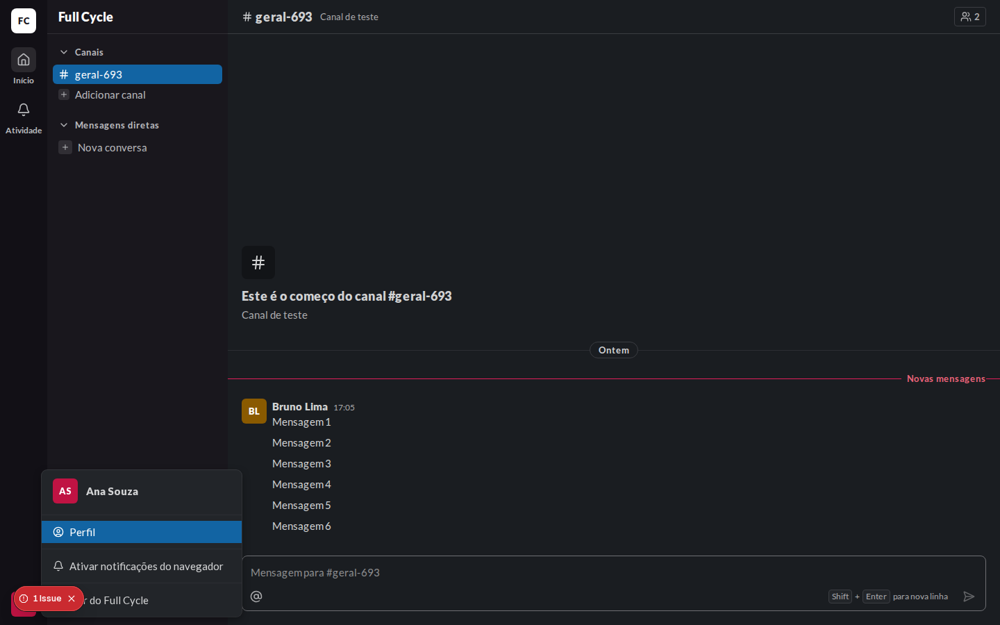
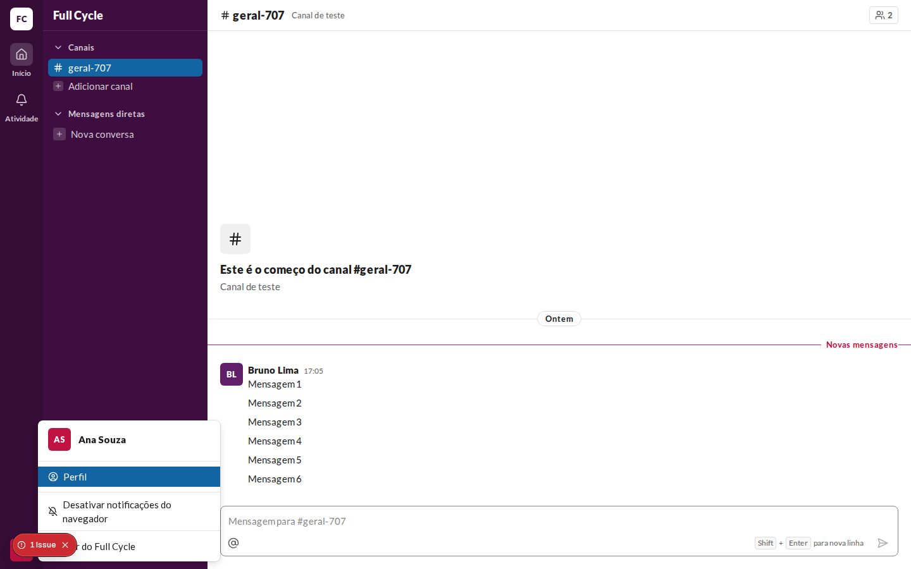
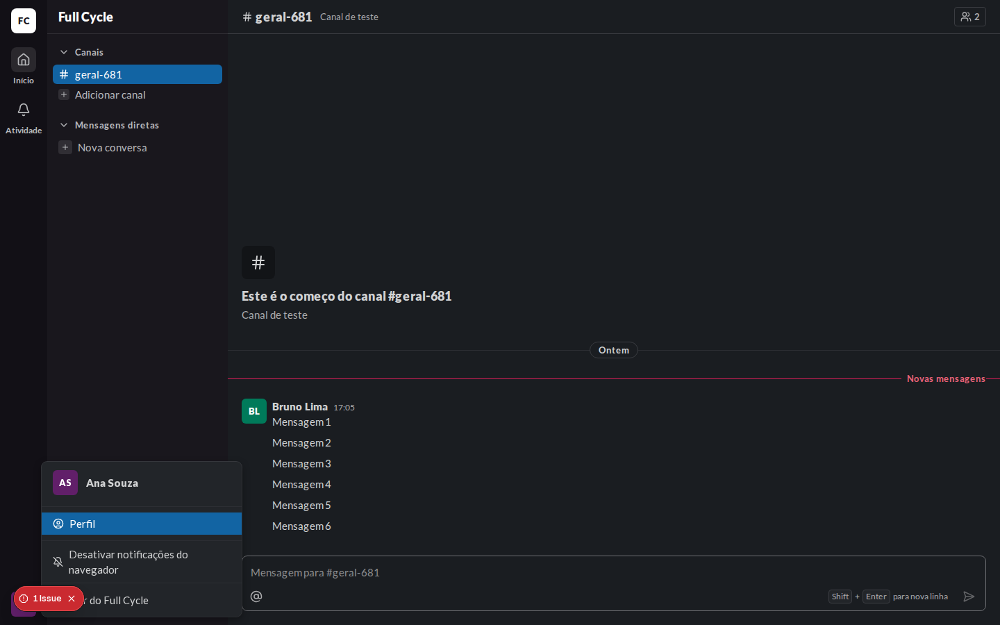
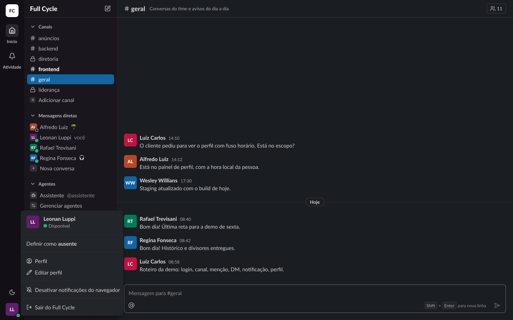
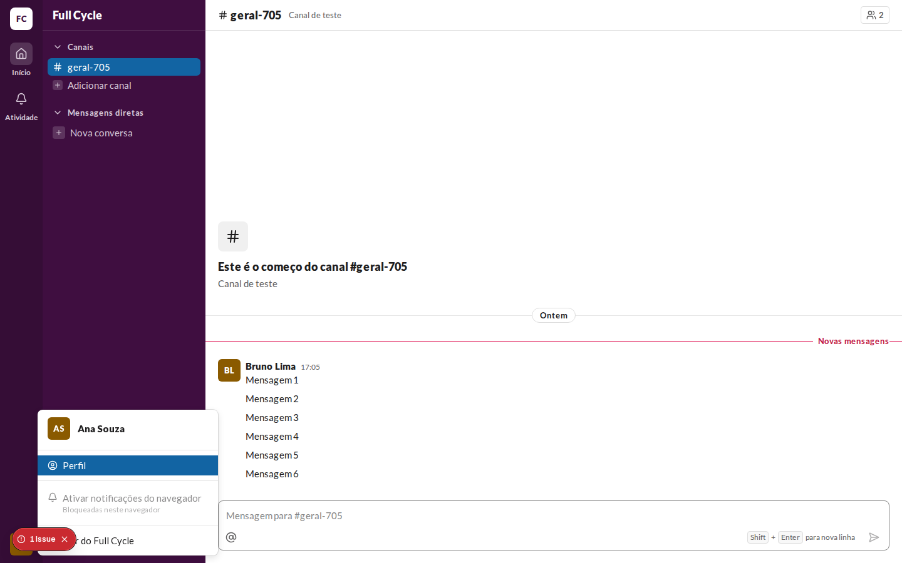
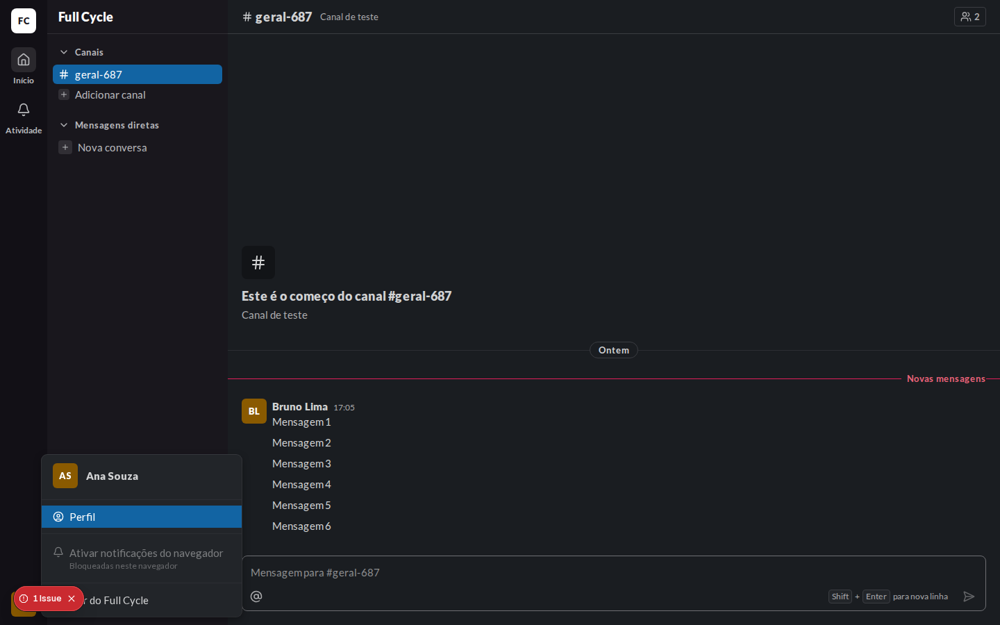

# Validação visual da F08-T06

Capturas da web em 1440 × 900, no Chromium do contêiner `e2e`, ao lado das capturas dos frames do
Figma (arquivo `slack`, página Telas, modo Dark da coleção Semantic): "Casca / Menu do usuário /
Ativar notificações" (25:27634), "Notificações bloqueadas" (25:28538) e "Notificações ligadas"
(25:29478). O tema escuro da web é o `data-theme="dark"` na raiz; a permissão do navegador vem da
Notification instrumentada dos testes.

| Estado | Web, claro | Web, escuro | Figma, escuro |
| --- | --- | --- | --- |
| Ativar (permissão ainda não pedida) |  |  |  |
| Ligadas (permissão dada e opção ligada) |  |  |  |
| Bloqueadas (permissão negada) |  |  |  |

## O que bate

- O item fica entre "Perfil" e "Sair do Full Cycle", com separadores, como nos frames.
- "Ativar notificações do navegador" com o sino; "Desativar notificações do navegador" com o sino
  cortado.
- Bloqueadas: a segunda linha "Bloqueadas neste navegador" em `caption`, na cor `fg-muted`.

## Diferenças esperadas

- O item bloqueado fica com a opacidade de 50% do estado desabilitado do design system ("Estados",
  Desabilitado), que o frame não aplica.
- Os frames mostram "Definir como ausente" e "Editar perfil", que entram com a F09.
- O selo "1 Issue" no canto inferior esquerdo é do `next dev`, e não existe no build.
