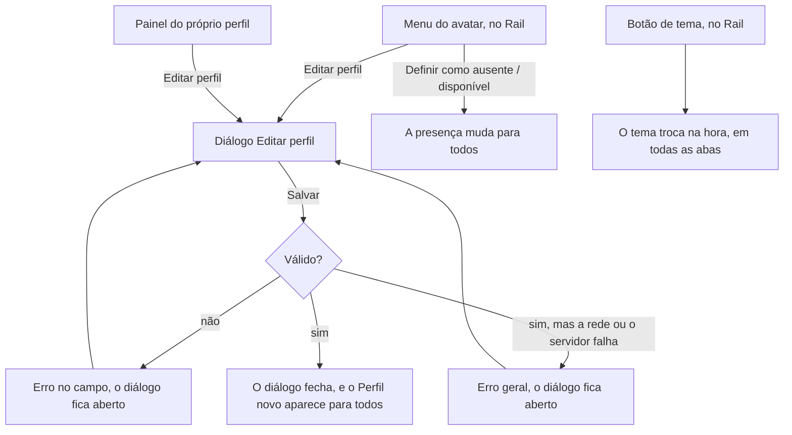

# PRD · F09 · Perfil e tema

2026-11-10 · Luiz Carlos · Status: aprovado

## 1. Resumo executivo

- **Problema:** desde a F05 o Perfil de cada Pessoa aparece para todo o workspace, mas só quem opera
  a instalação troca o cargo e o telefone, pelo comando de contas, e ninguém troca o próprio nome.
  Também não há como saber se um colega está por perto antes de escrever para ele, nem avisar que
  se está em reunião ou de férias. E o tema escuro, que o design system já define, não tem como ser
  escolhido.
- **Solução proposta:** a Pessoa edita o próprio Perfil (nome, cargo, telefone e status, com emoji
  e mensagem) e escolhe se está disponível ou ausente. A presença e o status aparecem para os
  outros, em tempo real, onde o nome dela aparece. Um botão no Rail troca entre o tema claro e o
  escuro, e a escolha vale em qualquer navegador em que ela entrar.
- **Critérios de sucesso:** esta funcionalidade não move sozinha nenhuma métrica do product brief
  (seção "Objetivos e métricas de sucesso"). Ela entrega o item 7 do "Escopo do MVP" do brief, a
  presença das Pessoas citada no HLD, e cumpre o requisito "Acessibilidade" nas telas que entrega,
  nos dois temas. Fecha as funcionalidades de chat da Fase 1.

## 2. Experiência do usuário e funcionamento

### Personas

- **Pessoa do workspace:** conversa em Canais e Conversas diretas, quer que o Perfil dela esteja
  certo, quer saber se um colega está por perto e avisar quando não está, e prefere trabalhar no
  tema escuro.
- **Quem opera a instalação:** continua criando as contas por script e deixa de ser a única a
  manter o cargo e o telefone.

### Regras desta funcionalidade

- Cada Pessoa edita só o próprio Perfil. O nome é obrigatório. O cargo, o telefone, o emoji e a
  mensagem de status são opcionais. O `@usuário` e o e-mail não mudam.
- O status é um emoji, escolhido entre os sete do diálogo "Editar perfil" (💬 🎧 📅 🍽️ 🏠 🌴 🤒),
  e uma mensagem curta. Os dois são opcionais. Uma mensagem sem emoji mostra o 💬. O status não
  expira: fica até a Pessoa trocá-lo ou limpá-lo.
- A presença é disponível ou ausente. A Pessoa escolhe uma das duas, e a escolha fica guardada até
  ela mudar, inclusive entre Sessões. Para os outros, ela aparece disponível só quando escolheu
  disponível **e** tem o chat aberto em pelo menos uma aba. Sem nenhuma aba conectada, aparece
  ausente, seja qual for a escolha.
- Uma queda de conexão de até 30 s não muda a presença. Quem fecha a última aba, ou fica sem
  conexão por mais tempo, aparece ausente para os outros em até 1 minuto.
- O tema é claro ou escuro e fica guardado na Pessoa: vale em todas as abas e em qualquer
  navegador em que ela entrar. Quem nunca escolheu fica no claro. As telas sem Sessão, como a de
  login, ficam sempre no claro.
- Uma mudança no Perfil, na presença ou no status aparece para as outras Pessoas sem recarregar a
  página, em todas as abas delas. O nome novo aparece em todo lugar onde o nome da Pessoa aparece,
  inclusive nas Mensagens antigas, e as iniciais do avatar seguem o nome.
- O comando de contas continua trocando o cargo e o telefone, como na F05.

### Fluxo

### Histórias de usuário

1. Como pessoa do workspace, quero editar o meu nome, cargo e telefone para que o Perfil que os
   outros veem esteja certo sem depender de quem opera a instalação.
2. Como pessoa do workspace, quero definir um status com emoji e mensagem para avisar os colegas
   do que estou fazendo, como reunião, almoço ou férias.
3. Como pessoa do workspace, quero me definir como ausente ou disponível para que os colegas
   saibam se devem esperar uma resposta minha agora.
4. Como pessoa do workspace, quero ver a presença e o status de um colega onde o nome dele aparece
   para saber, antes de escrever, se ele está por perto.
5. Como pessoa do workspace, quero trocar entre o tema claro e o escuro para trabalhar no que é
   mais confortável para mim, em qualquer navegador em que eu entrar.

### Critérios de aceite

**Todas as histórias**

- As telas seguem o design system do projeto e os frames "Diálogos / Editar perfil" (Padrão,
  Salvando, Erro de campo, Erro geral), "Casca / Menu do usuário" (Disponível, Ausente),
  "Painel de perfil" (Outra pessoa, Próprio perfil) e a barra lateral com presença e status do
  Figma do projeto, nos temas claro e escuro, e atingem 100 na nota de Acessibilidade do
  Lighthouse nos dois temas.
- Antes da implementação, o Figma é conferido e completado onde faltar: a presença e o emoji de
  status ao lado do autor de uma Mensagem, em "Membros de #nome" e nos resultados de "Nova
  conversa"; o status com mensagem no painel de perfil; e o diálogo com o status limpo.
- Tudo funciona só pelo teclado. O diálogo "Editar perfil" abre com o foco no campo "Nome
  completo", Esc o fecha sem salvar e, ao fechar, o foco volta para onde estava. Os emojis de
  status são escolhidos pelas setas e por Enter ou espaço, e anunciam o nome de cada um.
- A presença nunca é passada só pela cor: a bolinha cheia é disponível e o anel vazado é ausente,
  e os dois têm texto para leitores de tela.

**História 1, editar o Perfil**

- "Editar perfil", no menu do avatar do Rail e no painel do próprio perfil, abre o diálogo
  "Editar perfil", preenchido com o Perfil atual.
- "Salvar" grava as mudanças e fecha o diálogo. "Cancelar", Esc ou o X fecham sem gravar.
- O nome vazio, ou o cargo e o telefone fora dos limites que a F05 definiu, mostram o erro embaixo
  do campo, como em "Erro de campo", e o diálogo continua aberto, com o que foi digitado.
- Apagar o cargo ou o telefone os remove do Perfil, sem linha vazia no painel.
- Enquanto salva, o diálogo fica no estado "Salvando" e não aceita um segundo clique. Se a rede ou
  o servidor falharem, mostra o erro geral, como em "Erro geral", com o que foi digitado mantido.
- Depois de salvo, o Perfil novo aparece para as outras Pessoas em até 1 s no p95, sem recarregar
  a página, em todas as abas abertas, e para a própria Pessoa nas outras abas dela.

**História 2, definir o status**

- No diálogo "Editar perfil", a Pessoa escolhe um dos sete emojis e escreve a mensagem de status.
  Escolher de novo o emoji marcado o desmarca.
- Desmarcar o emoji e apagar a mensagem limpa o status, que deixa de aparecer em todo lugar.
- A mensagem de status tem um limite de tamanho, numa linha só, e o diálogo avisa quando ele é
  passado. O limite fica a definir na spec.
- O status aparece e some para os outros no mesmo prazo da história 1.

**História 3, definir a presença**

- O menu do avatar mostra, no cabeçalho, a presença atual ("Disponível" ou "Ausente") e oferece
  "Definir como ausente" ou "Definir como disponível", como nos frames "Casca / Menu do usuário".
- A escolha muda a presença na hora para a própria Pessoa e, para os outros, em até 1 s no p95,
  sem recarregar a página.
- A escolha continua valendo depois de sair e entrar de novo, em qualquer navegador.
- Quem escolheu disponível e fecha todas as abas aparece ausente para os outros em até 1 minuto, e
  volta a disponível ao abrir o chat de novo. Uma queda de até 30 s não muda o que os outros veem.

**História 4, ver a presença e o status dos outros**

- A bolinha de presença aparece no avatar das Pessoas na barra lateral (Mensagens diretas), no
  painel de perfil, no avatar do Rail e no cabeçalho do menu do avatar, ao lado do autor de cada
  Mensagem, em "Membros de #nome" e nos resultados de "Nova conversa".
- Nos mesmos lugares, o emoji de status aparece ao lado do nome. Passar o mouse sobre o emoji, ou
  focar nele pelo teclado, mostra a mensagem de status.
- O painel de perfil mostra a presença, o emoji e a mensagem de status por inteiro.
- O próprio painel, a barra lateral e as Mensagens já abertas se atualizam quando a presença ou o
  status de alguém muda, sem recarregar a página.
- A Conversa direta consigo mesma mostra a própria presença e o próprio status, como as outras.

**História 5, trocar o tema**

- O botão de tema, no Rail, mostra a lua no tema claro e o sol no escuro, e tem um nome acessível
  que diz para qual tema ele troca.
- Clicar no botão troca o tema na hora, sem recarregar a página, em todas as abas abertas daquele
  navegador.
- A escolha fica guardada na Pessoa: ao entrar em outro navegador, ou ao recarregar a página, o
  chat já abre no tema escolhido, sem mostrar o outro tema por um instante.
- Se a gravação falhar, o tema volta ao anterior e a Pessoa vê uma mensagem de erro.
- A tela de login e as outras telas sem Sessão ficam no tema claro.

### O que não é objetivo

- Mudar o `@usuário` ou o e-mail.
- Foto de perfil: o avatar continua de iniciais (design system, "Assets").
- Status com prazo de expiração, emoji livre fora dos sete do diálogo, ou status definido pelo
  menu do avatar sem abrir o diálogo.
- Presença automática por inatividade ("ausente depois de N minutos sem usar"), "não perturbe" e
  silenciar Notificações conforme a presença ou o status.
- Mostrar "visto por último" ou o horário em que a Pessoa ficou ausente.
- Seguir o tema do sistema operacional, ou outros temas além do claro e do escuro.
- Tema nas telas sem Sessão.
- Editar o Perfil de outra Pessoa, inclusive como administrador.
- Selo de administrador no perfil: entra com a funcionalidade que cria o papel de administrador no
  produto.
- Presença e status de agentes: ficam para as funcionalidades de agentes (F10 em diante).

## 3. Requisitos do sistema de IA

Não se aplica: a F09 não envolve agentes. O fuso que o agente usa no "hoje" de um resumo continua
vindo do navegador, como na F05, e não é editado aqui.

## 4. Riscos de produto

| Risco | Mitigação |
| --- | --- |
| A presença diz "disponível" para quem já foi embora, e os colegas deixam de confiar nela | Sem nenhuma aba conectada, a Pessoa aparece ausente, seja qual for a escolha, em até 1 minuto |
| A presença pisca entre disponível e ausente a cada oscilação da rede | Uma queda de até 30 s não muda o que os outros veem |
| A Pessoa se define como ausente, esquece, e passa dias aparecendo ausente | Risco aceito: a escolha fica visível no avatar do Rail e no menu, de onde se desfaz com um clique |
| Um status antigo ("de férias") fica no Perfil depois que a situação mudou, porque não expira | Risco aceito no MVP; prazo de expiração fica como candidato a funcionalidade futura |
| A troca de nome confunde quem lê Mensagens antigas | O `@usuário` não muda e aparece no perfil, e o nome novo aparece em todo lugar ao mesmo tempo |
| A tela pisca no tema errado ao carregar, ou um dos temas fica com contraste ruim | O tema vem aplicado na primeira carga, e a nota 100 de Acessibilidade do Lighthouse é exigida nos dois temas |
| A presença em tempo real de todo o workspace pesa no servidor de 2 GB (brief, "Requisitos não funcionais") | A spec define como a presença é distribuída, e só as mudanças trafegam |
