# Validação visual da F09-T01

Capturas da web em 1440 × 900, no Chromium do contêiner `e2e`, ao lado das capturas dos frames do
Figma (arquivo `slack`, página Telas, modo Dark da coleção Semantic): "Diálogos / Editar perfil"
Padrão (26:38120), Erro de campo (26:38947), Erro geral (26:39774) e Salvando (26:40602), e "Casca /
Menu do usuário / Disponível" (25:25749). O tema escuro da web é o `data-theme="dark"` na raiz.

| Estado | Web, claro | Web, escuro | Figma, escuro |
| --- | --- | --- | --- |
| Padrão | 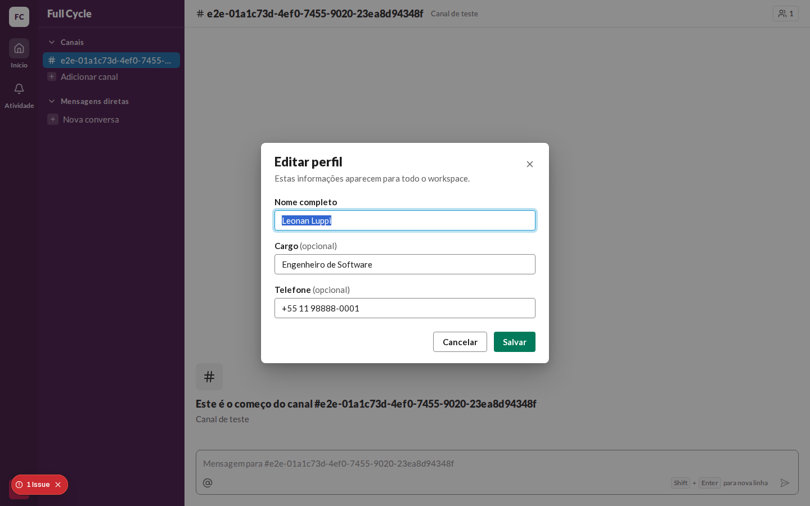 | 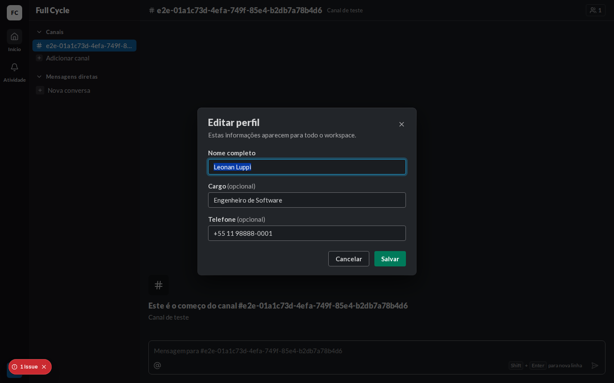 | 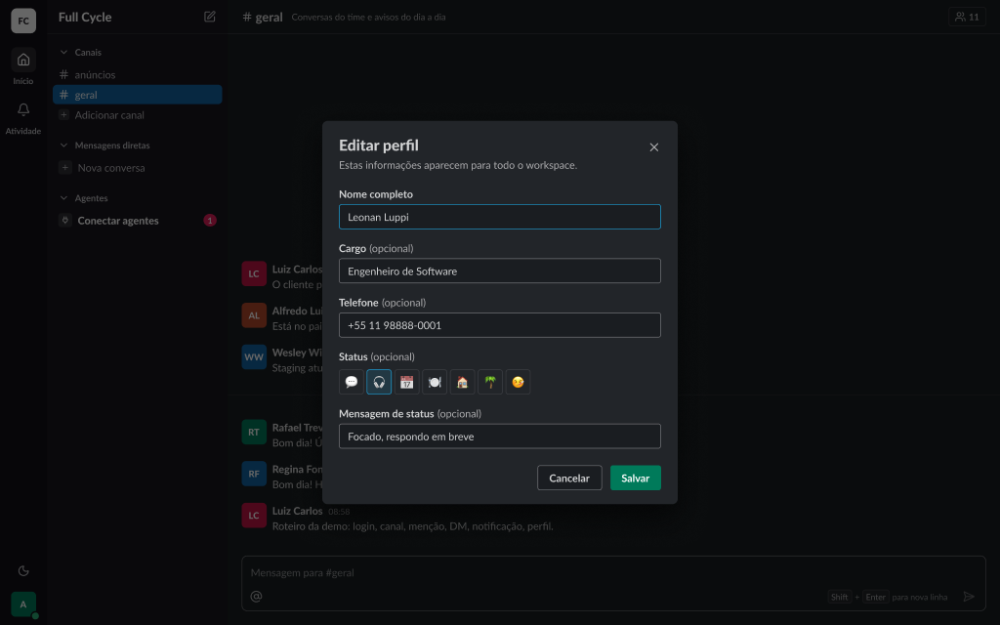 |
| Erro de campo (nome vazio) | 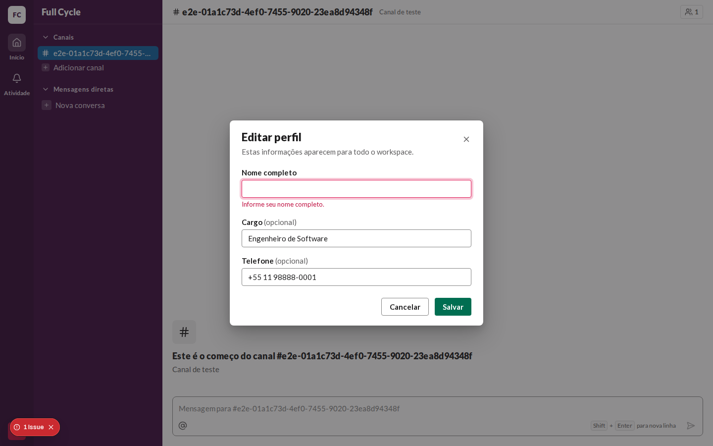 | 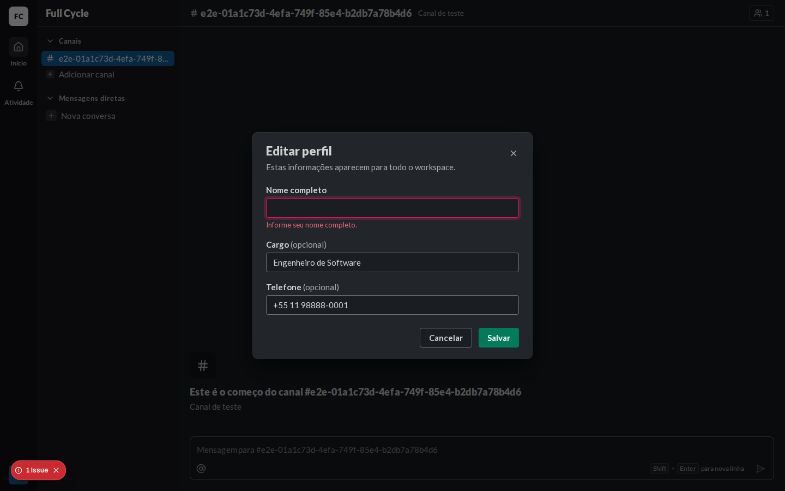 | 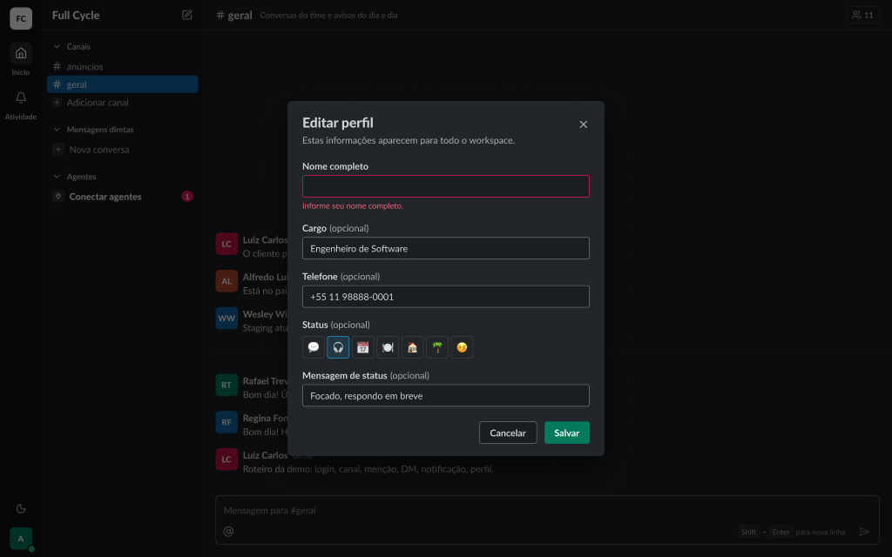 |
| Salvando | 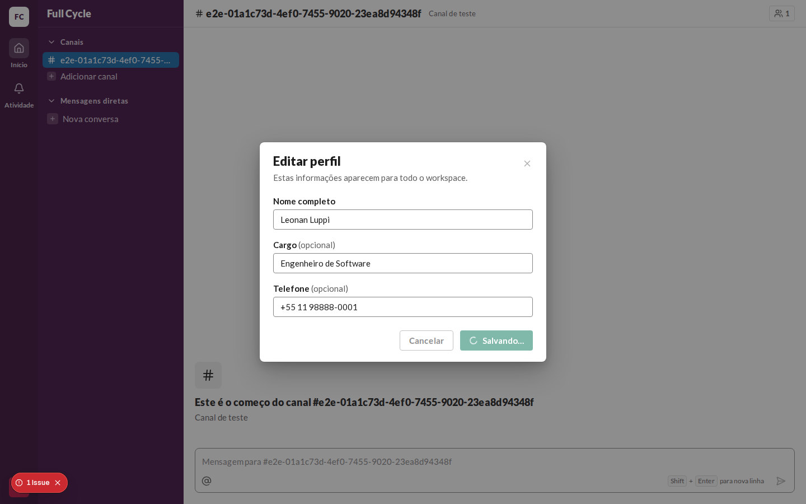 | 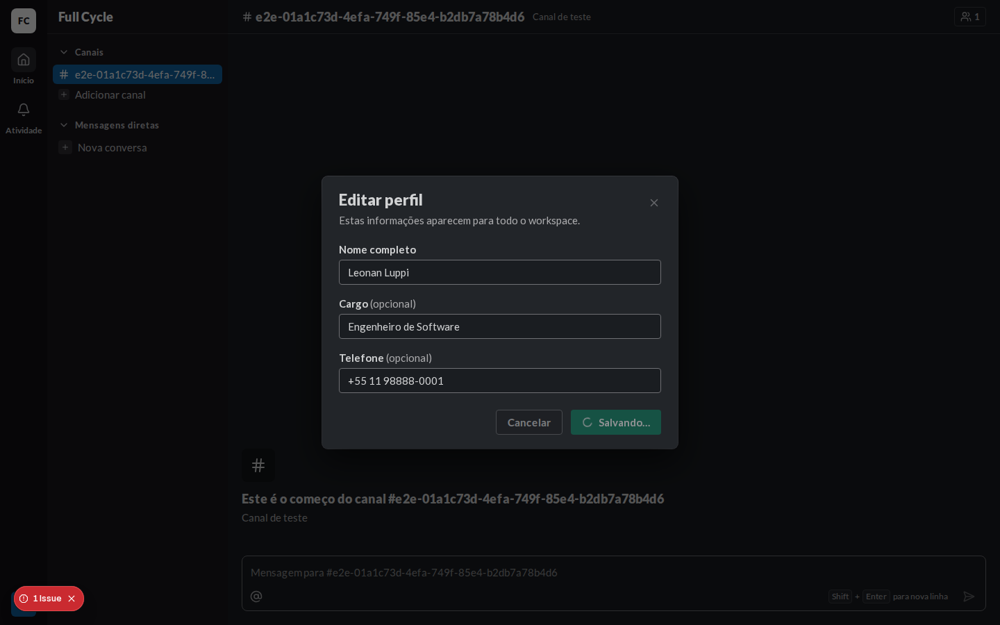 |  |
| Erro geral (falha da rede) |  | 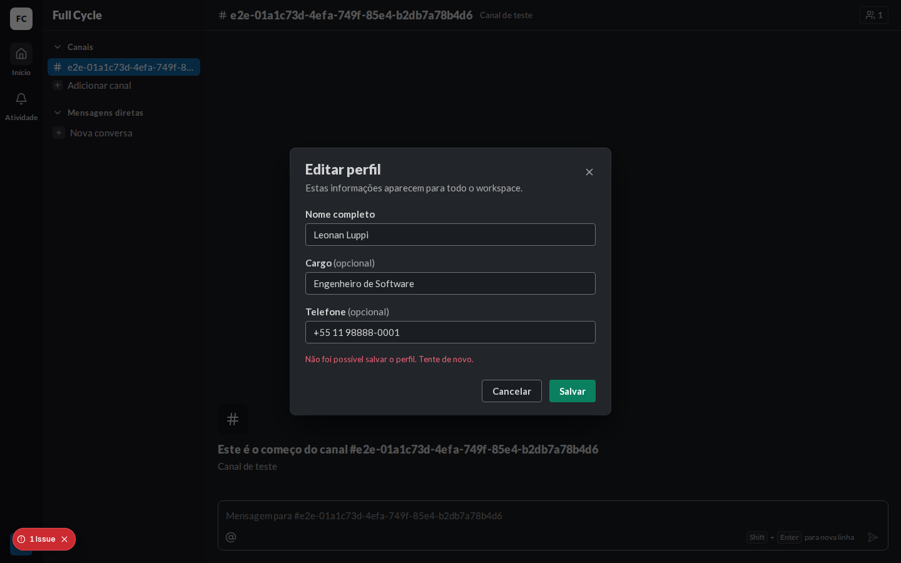 | 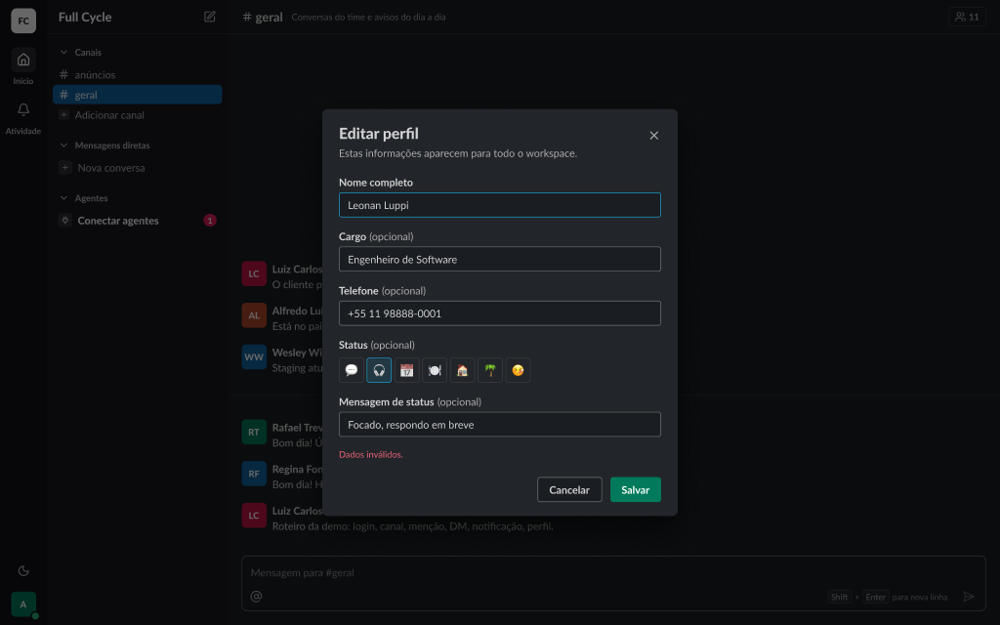 |
| Menu do avatar com "Editar perfil" | 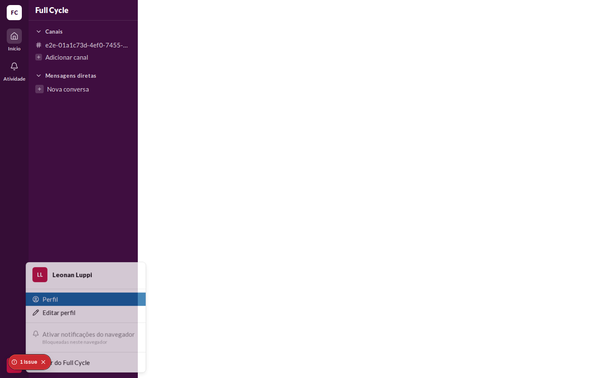 | 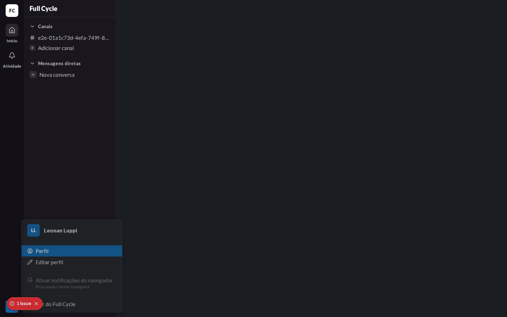 | 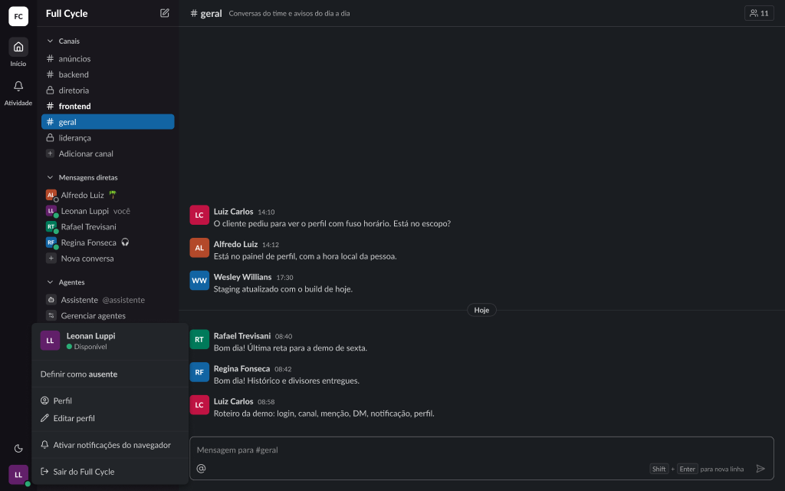 |

## O que bate

- Título "Editar perfil", a descrição "Estas informações aparecem para todo o workspace." e o X.
- "Nome completo", "Cargo (opcional)" e "Telefone (opcional)", com o "(opcional)" em `fg-muted`.
- O erro de campo embaixo do nome, em `danger-fg`, com a borda `danger` no campo.
- "Cancelar" secundário e "Salvar" primário, alinhados à direita; no envio, o spinner no botão.
- "Editar perfil", com o lápis, logo abaixo de "Perfil" no menu do avatar.

## Diferenças esperadas

- O Status e a mensagem de status do frame entram na F09-T03; a linha de presença e "Definir como
  ausente" do menu, na F09-T04.
- O erro geral diz "Não foi possível salvar o perfil. Tente de novo.", acima dos botões, e não o
  "Dados inválidos." do frame, que não descreve uma falha de rede (plano, "Erro geral"). O frame
  passa a ter o texto do código.
- O botão no envio diz "Salvando…", com o spinner.
- O selo "1 Issue" no canto inferior esquerdo é do `next dev`, e não existe no build.
