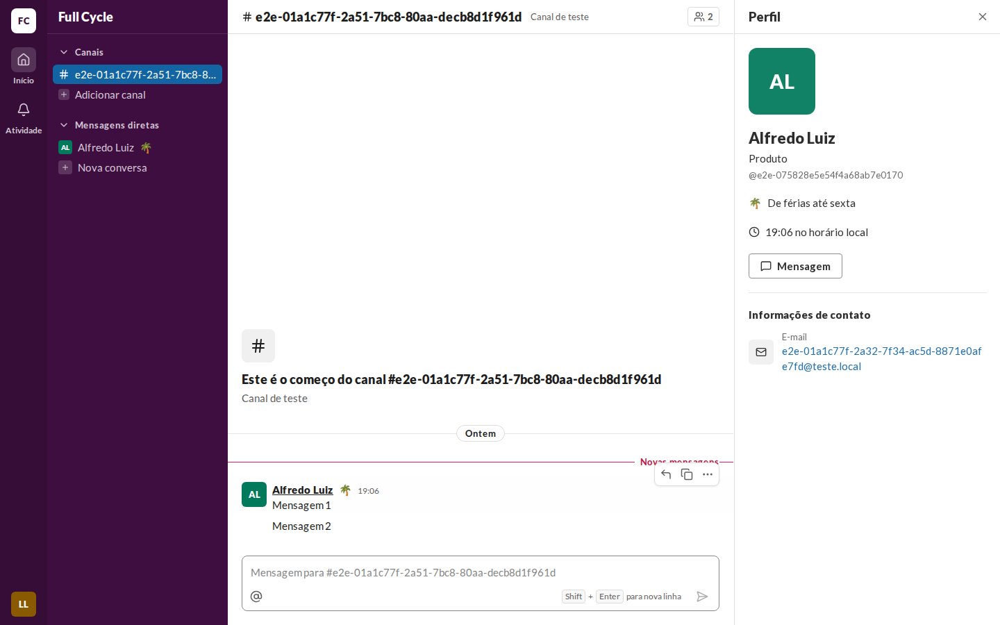
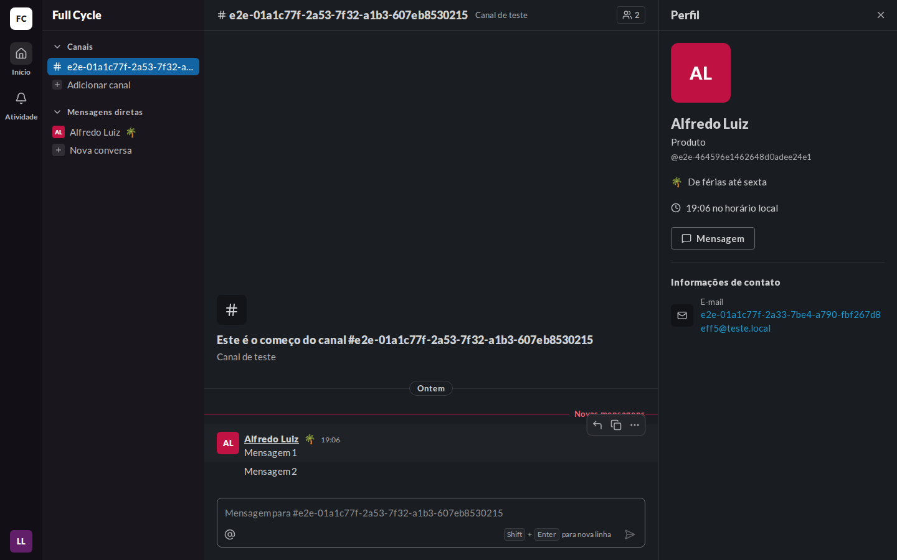
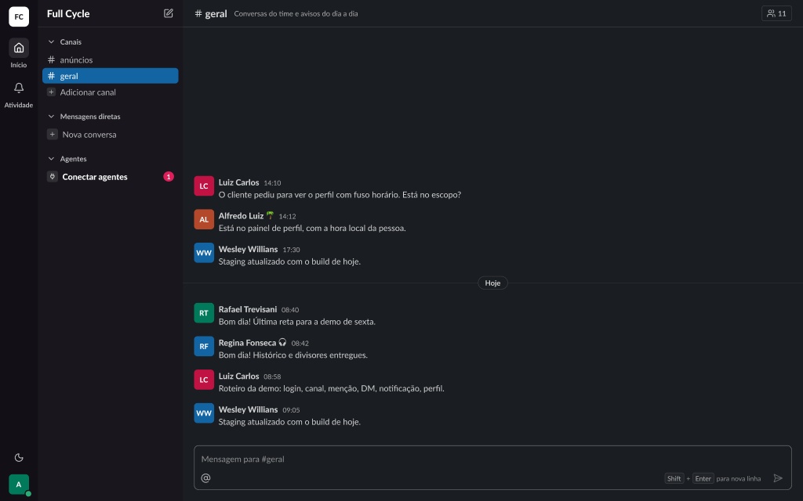
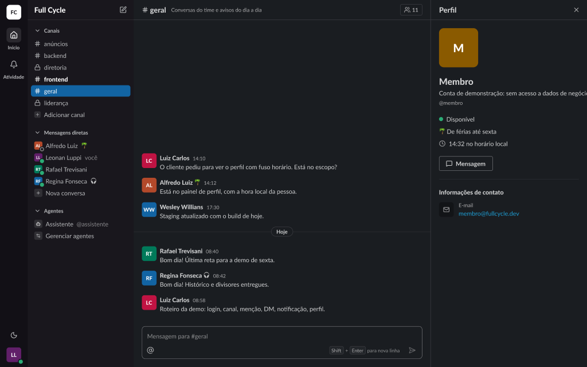
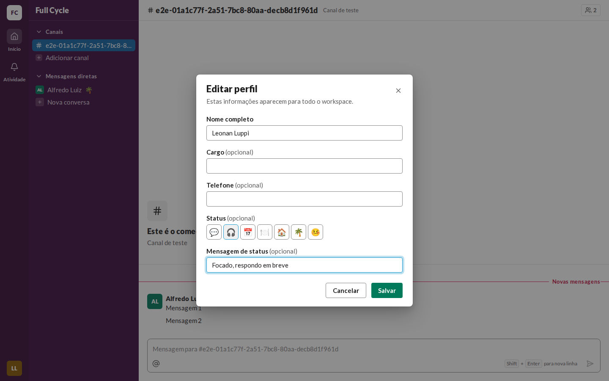
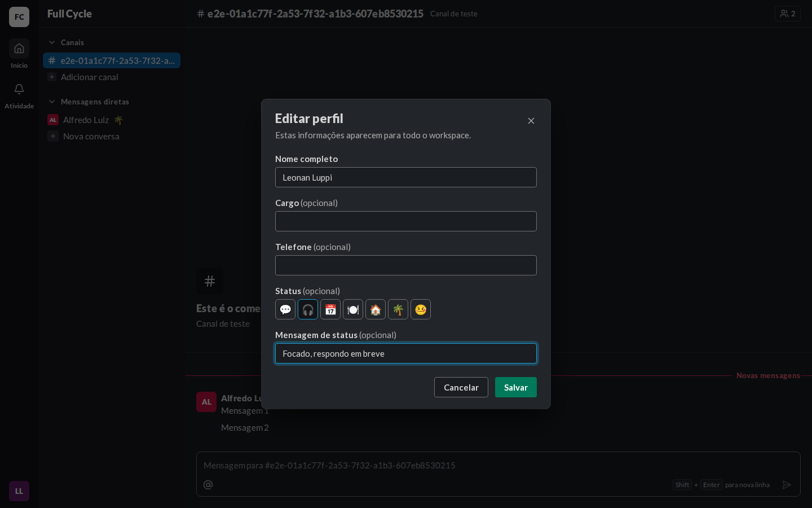
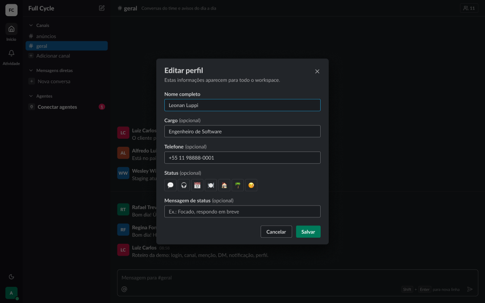

# Validação visual da F09-T03

Capturas da web em 1440 × 900, no Chromium do contêiner `e2e`, ao lado das capturas dos frames do
Figma (arquivo `slack`, página Telas): "Diálogos / Editar perfil / Padrão" (26:38120) e, na seção
"Status (F09)", "Status / Painel de perfil com mensagem (escuro)" (144:39284), "Status / Editar
perfil sem Status (escuro)" (144:39873) e "Status / Autor da Mensagem (escuro)" (144:37190). A
seção tem também os frames de "Membros", "Nova conversa" e "Cabeçalho da Conversa direta", e uma
cópia clara de cada um.

| Estado | Web, claro | Web, escuro | Figma, escuro |
| --- | --- | --- | --- |
| Autor da Mensagem, barra lateral e painel de perfil com o Status |  |  |   |
| "Editar perfil" com o Status |  |  |  |
| "Editar perfil" sem Status |  |  |  |

## O que bate

- Os sete emojis do diálogo, na ordem do frame, em quadros de 36 px; o marcado com a borda `focus`.
- "Mensagem de status (opcional)" embaixo, com o exemplo "Ex.: Focado, respondo em breve".
- O emoji logo depois do nome do autor, na barra lateral (Conversa direta) e nos Membros.
- No painel de perfil, a linha do Status com o emoji e a mensagem, entre o bloco do nome e a hora
  local.

## Diferenças esperadas

- A bolinha de Presença do painel e do Rail entra na F09-T04.
- No cabeçalho da Conversa direta, o frame põe a bolinha de Presença entre o nome e o emoji; sem a
  Presença (F09-T04), a web mostra o emoji logo depois do nome.
- O selo "1 Issue" no canto inferior esquerdo é do `next dev`, e não existe no build.
