# Validação visual da F09-T04

Capturas da web em 1440 × 900, no Chromium do contêiner `e2e`, ao lado dos frames do Figma
(arquivo `slack`, página Telas): "Casca / Menu do usuário / Disponível" (25:25749) e "Ausente"
(25:26689), "Painel de perfil / Outra pessoa" (26:43588) e a seção "Presença (F09)" (145:41207),
com a bolinha no autor da Mensagem (145:41208 e 145:41496), nos Membros (145:41784 e 145:42162),
em "Nova conversa" (145:42540 e 145:42892) e no cabeçalho da Conversa direta (145:43244 e
145:43544).

| Estado | Web, claro | Web, escuro | Figma, escuro |
| --- | --- | --- | --- |
| Menu do avatar, Disponível |  | 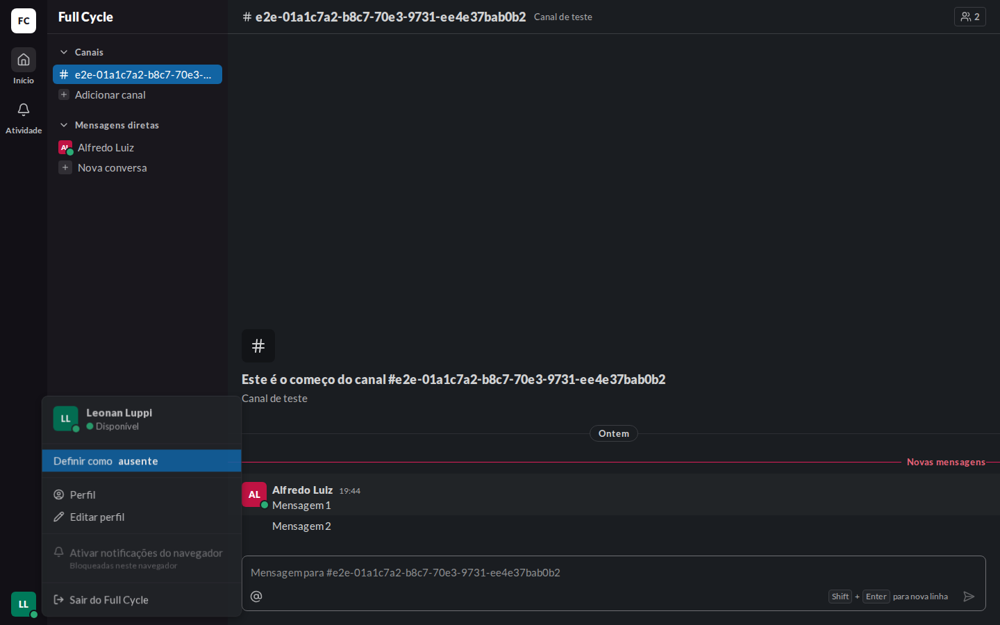 | 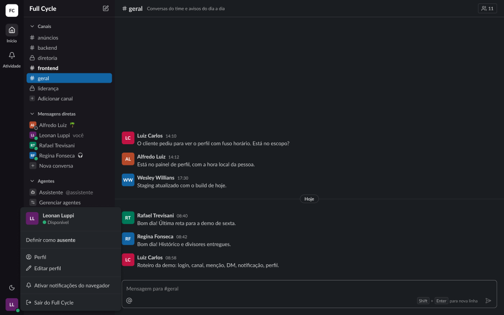 |
| Menu do avatar, Ausente | 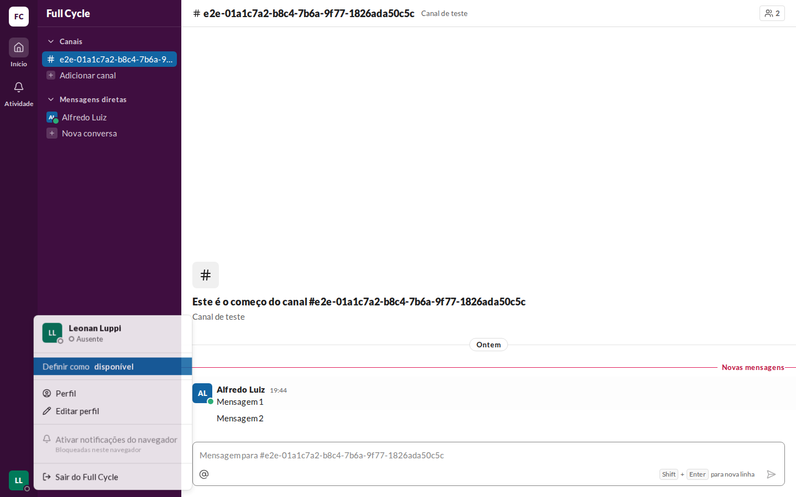 | 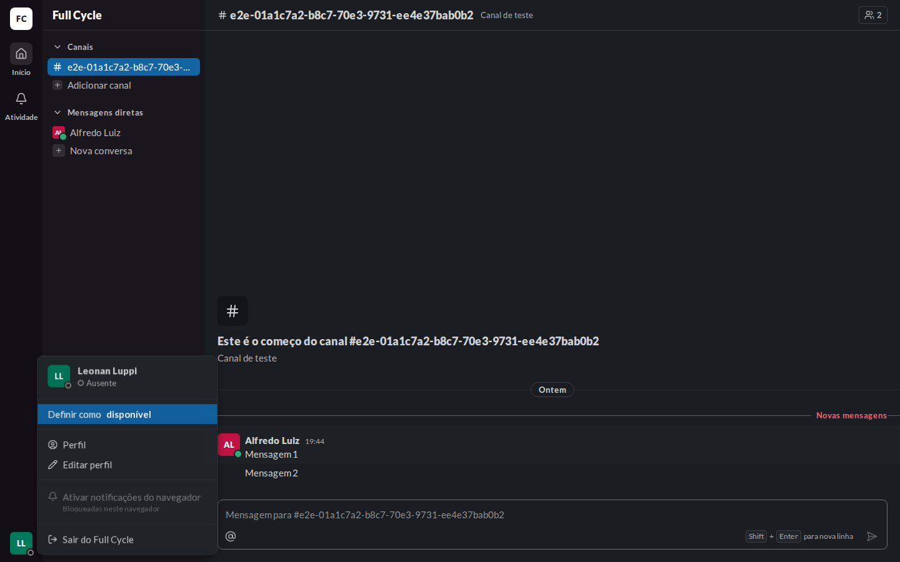 | frame 25:26689 |
| Autor da Mensagem, barra lateral e painel de perfil | 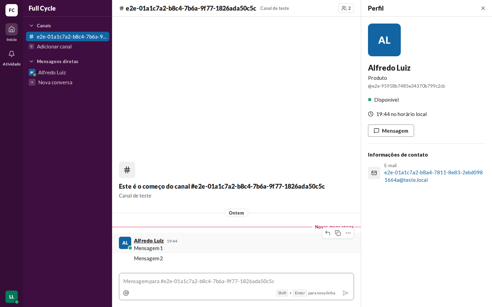 | 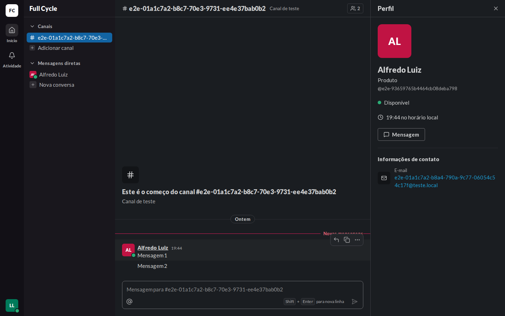 | frames 145:41208 e 26:43588 |
| "Membros de #nome" (disponível e ausente) | 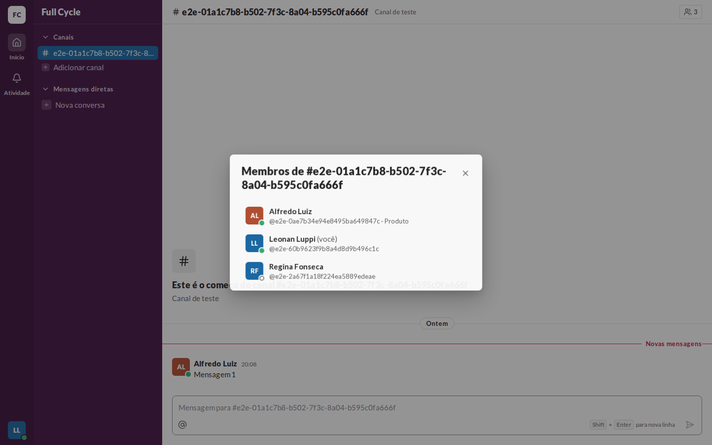 | 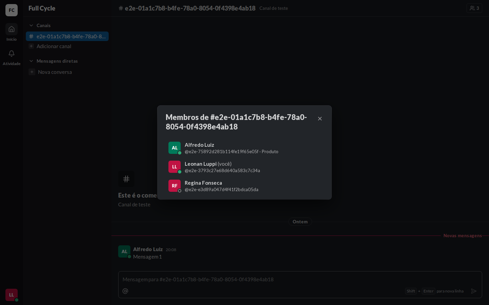 | frame 145:41784 |
| Resultados de "Nova conversa" | 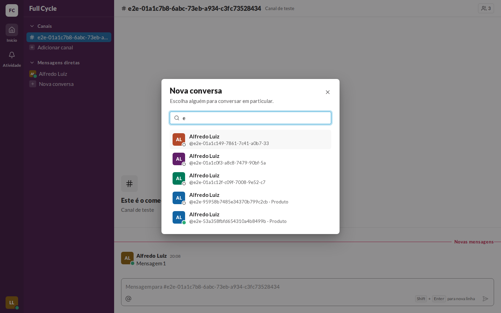 | 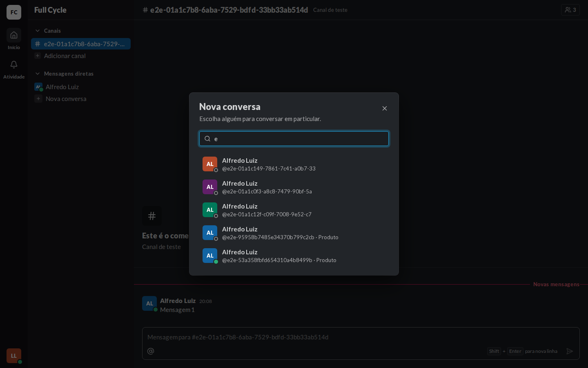 | frame 145:42540 |
| Cabeçalho da Conversa direta | 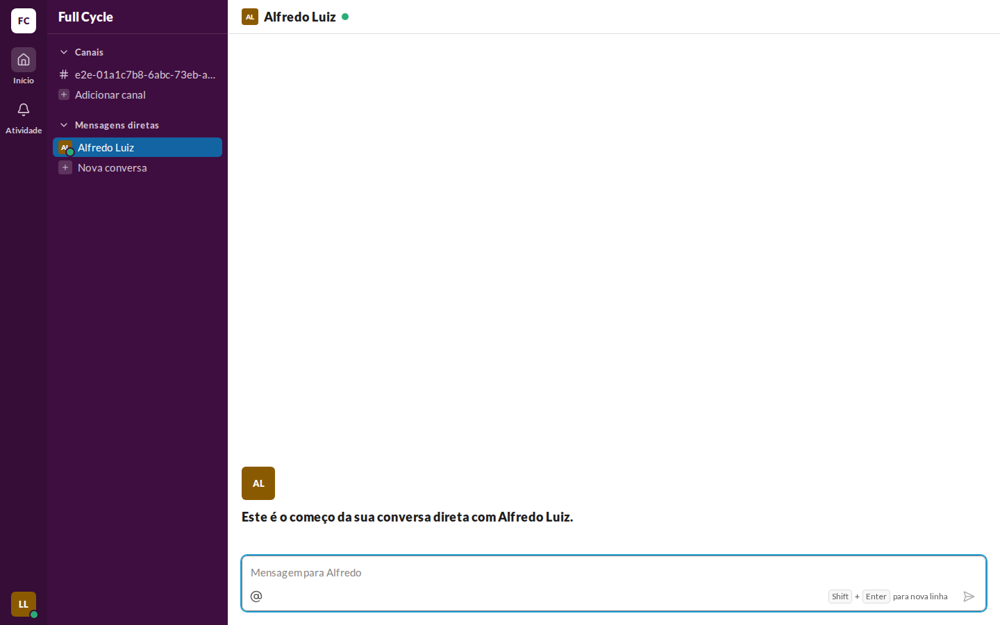 | 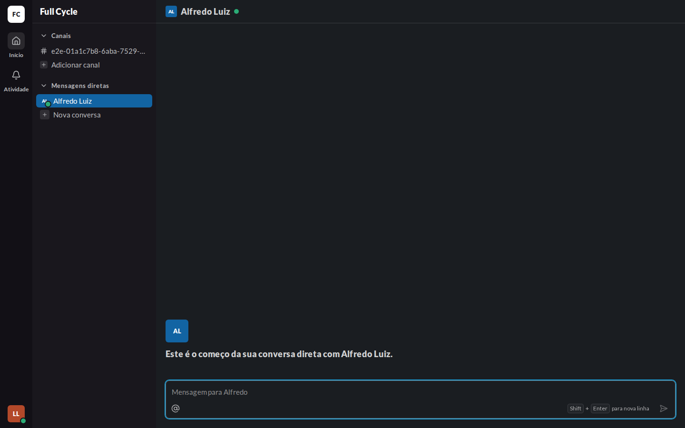 | frame 145:43244 |

## O que bate

- O cabeçalho do menu com o avatar, o nome e a linha "● Disponível" ou "○ Ausente"; logo abaixo,
  "Definir como **ausente**" ou "Definir como **disponível**", entre separadores.
- A bolinha cheia (`presence-online`) para disponível e o anel vazado (`presence-away`) para
  ausente, no canto do avatar, recortando o fundo do lugar: `chrome` no Rail, `raised` no menu e nos
  diálogos, `sidebar` na barra lateral e `surface` no autor da Mensagem (a variante nova do
  UserAvatar no Figma).
- No painel de perfil, a linha da Presença acima do Status e da hora local.
- No cabeçalho da Conversa direta, a bolinha ao lado do nome, como o ConversationHeader do Figma.

## Diferenças esperadas

- O selo "1 Issue" no canto inferior esquerdo é do `next dev`, e não existe no build.
