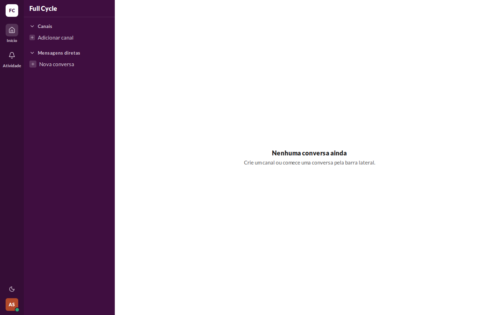
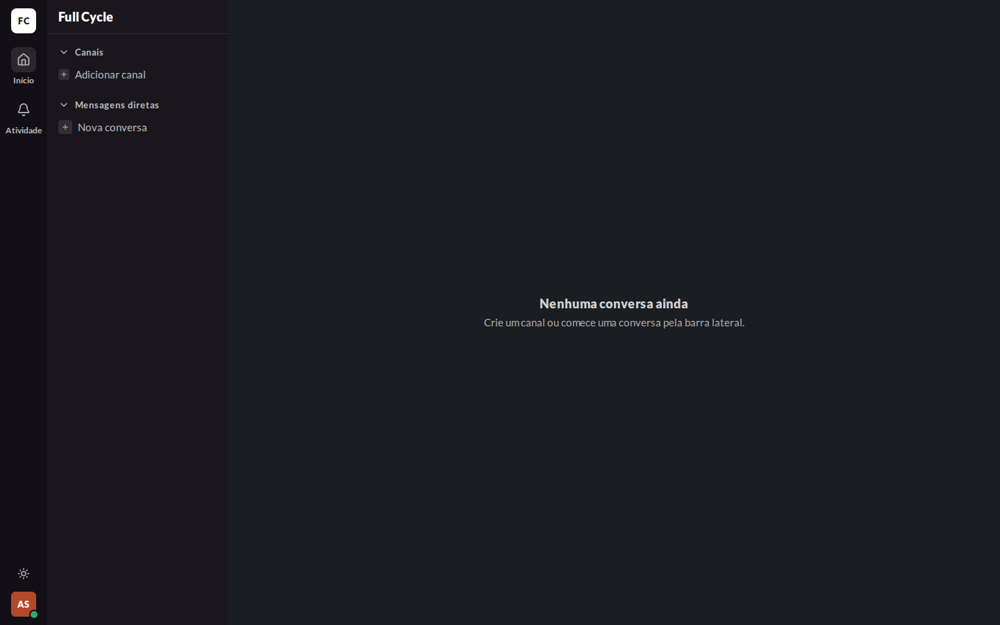
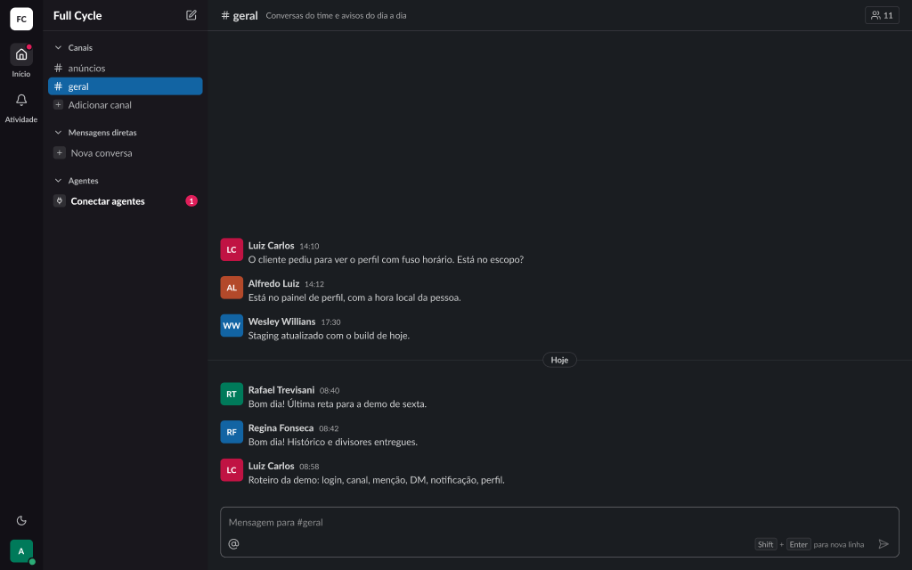

# Validação visual da F09-T05

Capturas da web em 1440 × 900, no Chromium do contêiner `e2e`, ao lado do frame "Casca / Rail /
Início ativo" (25:24628) do Figma (arquivo `slack`, página Telas, modo Dark).

| Estado | Web, claro | Web, escuro | Figma, escuro |
| --- | --- | --- | --- |
| Rail com o botão de tema acima do avatar |  |  |  |

## O que bate

- O ThemeToggle no pé do Rail, acima do avatar: a lua no tema claro e o sol no escuro, no tom
  `sidebar` do IconButton.
- O tema escuro troca os tokens semânticos da página inteira (`data-theme="dark"` na raiz), sem
  `dark:` por componente.

## Diferenças esperadas

- Nenhuma.
